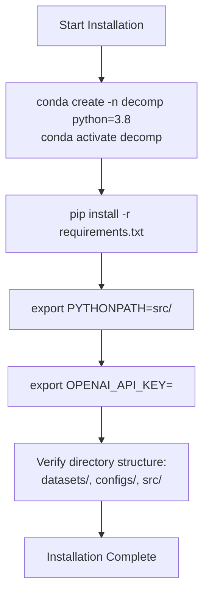
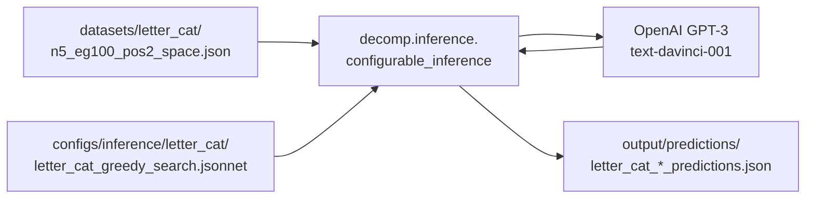
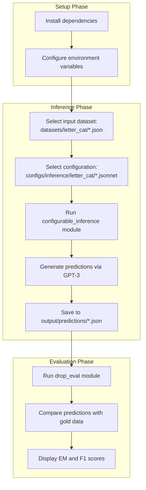

<!-- source: DeepWiki mcp.deepwiki.com · repo allenai/DecomP · page 2 Getting Started · fetched 2026-10-26 -->

# Getting Started

<details>
<summary>Relevant source files</summary>

The following files were used as context for generating this wiki page:

- [LICENSE](LICENSE)
- [README.md](README.md)

</details>


This page guides you through installing DecomP, configuring your environment, and running your first inference experiment. By the end of this guide, you will have executed a decomposed prompting experiment and evaluated its predictions.

For detailed information about the prompting strategies available, see [Core Concepts](#3). For in-depth exploration of specific experiments, see [Experiments](#4). For system architecture and development guidance, see [System Architecture](#5) and [Development Guide](#8).

## Prerequisites

Before installing DecomP, ensure you have:

- **Python 3.8** or later
- **Conda** package manager
- **OpenAI API key** with access to GPT-3 models (specifically `text-davinci-001`)
- **Unix-like environment** (Linux, macOS, or WSL on Windows)

## Installation

### Step 1: Create Conda Environment

Create a new conda environment with Python 3.8:

```bash
conda create -n decomp python=3.8
conda activate decomp
```

### Step 2: Install Dependencies

Clone the repository and install required packages:

```bash
git clone https://github.com/allenai/DecomP
cd DecomP
pip install -r requirements.txt
```

The `requirements.txt` file contains all necessary Python packages for running inference experiments.

**Sources**: [README.md:1-11]()

## Environment Configuration

DecomP requires two critical environment variables to function correctly:

### PYTHONPATH Configuration

Set the `PYTHONPATH` to include the source directory:

```bash
export PYTHONPATH=src/
```

This allows Python to locate the `decomp` module and its submodules (`decomp.inference`, `decomp.datasets_utils`, etc.).

### OpenAI API Key Configuration

Set your OpenAI API key as an environment variable:

```bash
export OPENAI_API_KEY=<YOUR_API_KEY>
```

Replace `<YOUR_API_KEY>` with your actual OpenAI API key. This key is used by the inference system to make GPT-3 API calls during model execution.

**Note**: These environment variables must be set in each terminal session. Consider adding them to your shell configuration file (`~/.bashrc`, `~/.zshrc`, etc.) for persistence.

**Sources**: [README.md:12-16]()

## Installation Verification Workflow

The following diagram illustrates the complete installation and verification process:



**Sources**: [README.md:5-16]()

## Directory Structure After Installation

After successful installation, your DecomP directory should contain:

| Directory/File | Description |
|----------------|-------------|
| `src/decomp/` | Core source code including inference engine and utilities |
| `configs/inference/` | Jsonnet configuration files for different experiments |
| `datasets/` | Input datasets for letter concatenation, list reversal, and CommAQA |
| `output/predictions/` | Directory for storing prediction outputs (created automatically) |
| `requirements.txt` | Python package dependencies |
| `README.md` | Quick reference documentation |

## Running Your First Experiment

We recommend starting with the **Letter Concatenation** experiment as it is the simplest to execute and does not require dataset generation.

### Letter Concatenation Example

This example runs inference on a letter concatenation task using the decomposed prompting strategy:

```bash
promptid=p1 python -m decomp.inference.configurable_inference \
  --input datasets/letter_cat/n5_eg100_pos2_space.json \
  --config configs/inference/letter_cat/letter_cat_greedy_search.jsonnet \
  --output output/predictions/letter_cat_n5_eg100_pos2_space_decomp_predictions.json
```

#### Command Breakdown

| Component | Description |
|-----------|-------------|
| `promptid=p1` | Environment variable selecting prompt variant (p1, p2, or p3 available) |
| `decomp.inference.configurable_inference` | Main inference module entry point |
| `--input` | Path to input dataset in JSON format |
| `--config` | Jsonnet configuration file defining the inference pipeline |
| `--output` | Path where predictions will be saved |

#### What Happens During Execution



The inference module:
1. Loads the input dataset and configuration
2. Initializes the model pipeline based on the config
3. Processes each example by calling GPT-3 with formatted prompts
4. Saves predictions to the output file

**Sources**: [README.md:18-31]()

## Evaluating Predictions

After inference completes, evaluate the predictions against ground truth:

```bash
python -m decomp.datasets_utils.drop_eval \
  --gold_path datasets/letter_cat/n5_eg100_pos2_space.json \
  --prediction_path output/predictions/letter_cat_n5_eg100_pos2_space_decomp_predictions.json
```

### Evaluation Module

The `drop_eval` module compares predicted answers with ground truth answers and computes accuracy metrics. It outputs:

- **Exact Match (EM)**: Percentage of predictions that exactly match the ground truth
- **F1 Score**: Token-level F1 score between prediction and ground truth

### Expected Output Format

The evaluation will print metrics to stdout:

```
Exact Match: 85.0
F1: 87.3
```

These metrics indicate how well the decomposed prompting strategy performed on the letter concatenation task.

**Sources**: [README.md:28-31]()

## Trying Different Configurations

Once you've successfully run the basic example, experiment with different configurations:

### Different Prompt Variants

Change the `promptid` environment variable to try alternative prompts:

```bash
promptid=p2 python -m decomp.inference.configurable_inference ...
promptid=p3 python -m decomp.inference.configurable_inference ...
```

Each prompt variant implements the same strategy with different phrasing or structure. See [Prompt Templates](#7) for details.

### Different Prompting Strategies

Modify the `--config` parameter to test alternative strategies:

| Strategy | Configuration File | Description |
|----------|-------------------|-------------|
| Decomposed | `letter_cat_greedy_search.jsonnet` | Breaks task into explicit sub-operations |
| CoT | `cot_letter_cat_greedy_search.jsonnet` | Chain of Thought baseline |
| CoT w/ Rollout | `cot_rollout_letter_cat_greedy_search.jsonnet` | CoT with execution rollout |

For detailed explanations of each strategy, see [Core Concepts](#3).

**Sources**: [README.md:33-35]()

## Quick Start Workflow Summary

The following diagram shows the complete workflow from installation to evaluation:



**Sources**: [README.md:1-31]()

## Common Issues and Troubleshooting

### Module Not Found Error

If you encounter `ModuleNotFoundError: No module named 'decomp'`, verify that:
- `PYTHONPATH=src/` is set in your current terminal session
- You're running commands from the DecomP repository root directory

### OpenAI API Errors

If inference fails with API-related errors:
- Verify your `OPENAI_API_KEY` is correctly set and valid
- Check that your API key has access to the `text-davinci-001` model
- Ensure you have sufficient API credits/quota

### Missing Output Directory

The system automatically creates the `output/predictions/` directory if it doesn't exist. If you encounter permission errors, manually create it:

```bash
mkdir -p output/predictions
```

## Next Steps

Now that you've successfully run your first experiment, you can:

1. **Explore Other Experiments**: Try [List Reversal](#4.2) or [CommAQA](#4.3) experiments
2. **Understand the Strategies**: Learn about [Decomposed Prompting](#3.1), [Chain of Thought](#3.2), and [Unrolled Strategies](#3.3)
3. **Examine the Architecture**: Dive into the [Inference Pipeline](#5.1) and [Configuration System](#5.2)
4. **Create Custom Experiments**: See [Adding New Experiments](#8.2) to extend the framework

### Recommended Learning Path


**Sources**: [README.md:1-83]()

---

