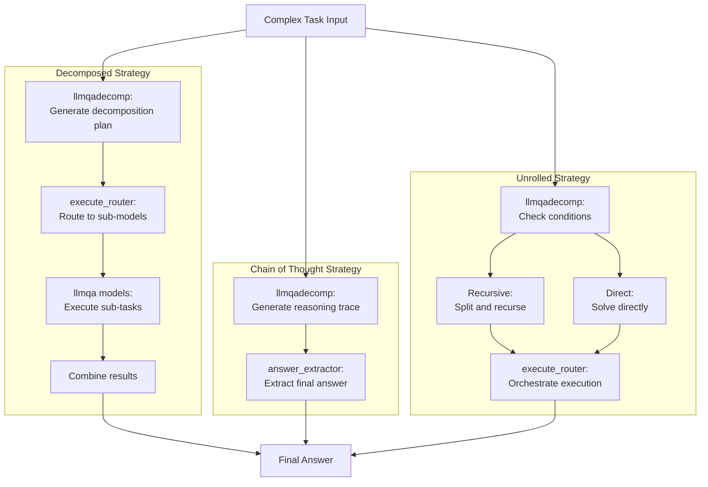
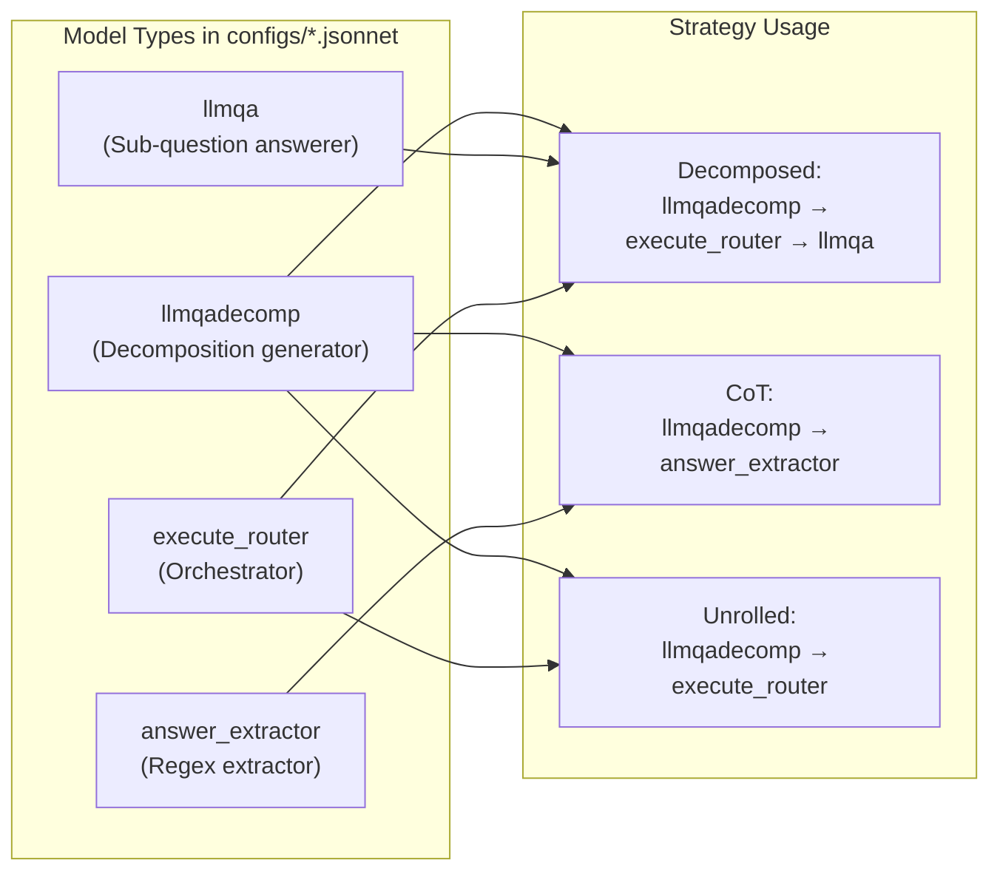
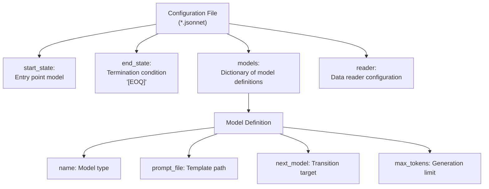
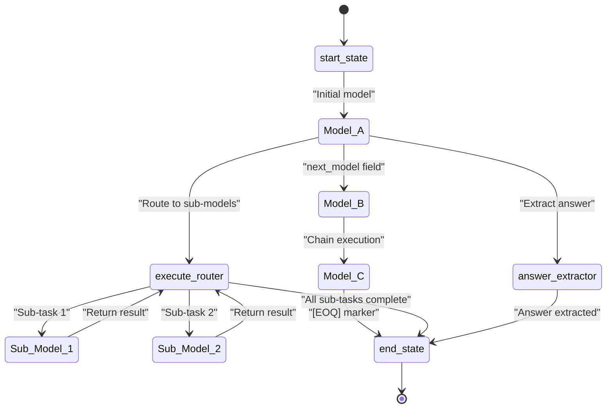

<!-- source: DeepWiki mcp.deepwiki.com · repo allenai/DecomP · page 3 Core Concepts · fetched 2026-10-26 -->

# Core Concepts

<details>
<summary>Relevant source files</summary>

The following files were used as context for generating this wiki page:

- [LICENSE](LICENSE)
- [README.md](README.md)
- [configs/inference/reverse/decomp.jsonnet](configs/inference/reverse/decomp.jsonnet)

</details>


## Purpose and Scope

This document explains the three fundamental prompting strategies implemented in DecomP and how they differ in their approach to solving complex tasks. Each strategy represents a distinct method for guiding large language models (LLMs) to break down and solve problems through different decomposition patterns.

For detailed explanations of each strategy, see:
- [Decomposed Prompting Strategy](#3.1)
- [Chain of Thought (CoT) Strategy](#3.2)
- [Unrolled Strategy](#3.3)

For practical application of these strategies in experiments, see [Experiments](#4).

## Overview of Prompting Strategies

DecomP implements three core prompting strategies that differ in how they decompose complex tasks:

| Strategy | Approach | Key Characteristic | Primary Use Case |
|----------|----------|-------------------|------------------|
| **Decomposed** | Explicit sub-operation breakdown | Structured, step-by-step execution with intermediate model calls | Multi-hop QA, complex reasoning tasks |
| **Chain of Thought (CoT)** | Natural language reasoning | Single-pass generation with explicit reasoning steps | Tasks requiring step-by-step explanation |
| **Unrolled** | Conditional recursive logic | Applies different strategies based on input characteristics | Length-dependent tasks (e.g., list reversal) |

Each strategy is implemented through:
1. A configuration file (`.jsonnet`) that defines the model execution pipeline
2. Prompt template files (`.txt`) that provide task-specific instructions
3. Model components that execute the strategy's logic

**Sources:** [README.md:1-83](), [configs/inference/reverse/decomp.jsonnet:1-43]()

## Strategy Comparison

### Conceptual Differences



**Diagram: Strategy Execution Patterns**

**Sources:** [configs/inference/reverse/decomp.jsonnet:1-43](), Diagram 4 from high-level architecture

### Execution Characteristics

| Characteristic | Decomposed | CoT | Unrolled |
|----------------|------------|-----|----------|
| **LLM Calls** | Multiple (per sub-task) | Single (or minimal) | Conditional (based on recursion depth) |
| **Intermediate Results** | Explicitly stored and reused | Implicit in reasoning trace | Recursively combined |
| **Model Transitions** | `next_model` field routes between models | Linear flow to `answer_extractor` | Conditional routing via `execute_router` |
| **Configuration Complexity** | High (multiple model definitions) | Low (2-3 models) | Medium (conditional logic) |
| **Prompt Structure** | Task-specific sub-prompts | Single reasoning prompt | Conditional prompt selection |

**Sources:** [configs/inference/reverse/decomp.jsonnet:1-43](), [README.md:33-60]()

## Configuration to Code Mapping

### Model Component Types

DecomP uses specific model types to implement different strategy behaviors:



**Diagram: Model Component Usage Across Strategies**

**Sources:** [configs/inference/reverse/decomp.jsonnet:3-36]()

### Configuration Structure

Each strategy is defined by a configuration file that specifies:



**Diagram: Configuration File Structure**

**Sources:** [configs/inference/reverse/decomp.jsonnet:1-43]()

### Example Configuration: Decomposed Strategy

The decomposed strategy for list reversal is configured as:

| Field | Value | Purpose |
|-------|-------|---------|
| `start_state` | `"reverse"` | Entry point to the `reverse` model |
| `end_state` | `"[EOQ]"` | Termination marker |
| `models.reverse.name` | `"llmqadecomp"` | Generates decomposition steps |
| `models.reverse.next_model` | `"execute"` | Routes to `execute_router` |
| `models.execute.name` | `"execute_router"` | Orchestrates sub-model execution |
| `models.join.name` | `"llmqa"` | Executes join sub-operation |
| `models.remove_numbers.name` | `"llmqa"` | Executes number removal sub-operation |

**Sources:** [configs/inference/reverse/decomp.jsonnet:3-36]()

## Strategy Selection in Practice

### Command-Line Usage

Strategies are selected by specifying different configuration files:

```bash
# Decomposed strategy
--config configs/inference/reverse/decomp.jsonnet

# Chain of Thought strategy
--config configs/inference/reverse/cot.jsonnet

# Unrolled strategy
--config configs/inference/reverse/unrolled.jsonnet
```

**Sources:** [README.md:38-60]()

### Prompt Variation

Some strategies support multiple prompt variations via the `promptid` environment variable:

```bash
# Different prompt templates (p1, p2, p3)
promptid=p1 python -m decomp.inference.configurable_inference ...
promptid=p2 python -m decomp.inference.configurable_inference ...
```

This allows experimentation with different phrasings while maintaining the same strategy structure.

**Sources:** [README.md:23-35](), [README.md:65-76]()

## Strategy-Experiment Matrix

Different experiments support different strategies:

| Experiment | Decomposed | CoT | Unrolled | Configuration Files |
|------------|------------|-----|----------|-------------------|
| **Letter Concatenation** | ✓ | ✓ | ✓ (as rollout) | `letter_cat_greedy_search.jsonnet`, `cot_letter_cat.jsonnet`, `cot_rollout_letter_cat.jsonnet` |
| **List Reversal** | ✓ | ✓ | ✓ | `decomp.jsonnet`, `cot.jsonnet`, `unrolled.jsonnet` |
| **CommAQA** | ✓ (fine/coarse) | ✓ | ✗ | `commaqae_fine.jsonnet`, `commaqae_coarse.jsonnet`, `cot_commaqae.jsonnet` |

**Sources:** [README.md:20-78]()

## State Machine Execution Model

All strategies execute as state machines where models transition between states:



**Diagram: Generic State Machine Execution Flow**

The specific state transitions differ by strategy:
- **Decomposed**: Uses `execute_router` for multi-stage sub-task execution
- **CoT**: Linear progression from generation to extraction
- **Unrolled**: Conditional transitions based on input properties

**Sources:** [configs/inference/reverse/decomp.jsonnet:3-36](), Diagram 3 from high-level architecture

## Model Parameter Configuration

Each model in a strategy configuration supports parameters for controlling GPT-3 generation:

| Parameter | Type | Purpose | Example Value |
|-----------|------|---------|---------------|
| `gen_model` | string | Model backend identifier | `"gpt3"` |
| `engine` | string | Specific GPT-3 engine | `"text-davinci-001"` |
| `max_tokens` | integer | Maximum tokens to generate | `400` |
| `max_steps` | integer | Maximum execution iterations | `1` |
| `prompt_file` | string | Path to prompt template | `"configs/prompts/reverse/decomp.txt"` |
| `next_model` | string | Target model for transition | `"execute"` |
| `end_state` | string | Termination marker | `"[EOQ]"` |

These parameters are typically defined once as `gen_params` and reused across models:

```jsonnet
local gen_params = { "gen_model": "gpt3", "engine": "text-davinci-001"};
```

**Sources:** [configs/inference/reverse/decomp.jsonnet:1-12]()

## Key Distinctions Summary

The three strategies differ primarily in:

1. **Decomposition Approach**
   - Decomposed: Explicit sub-operations with separate model calls
   - CoT: Implicit reasoning within a single generation
   - Unrolled: Conditional decomposition based on input characteristics

2. **Model Orchestration**
   - Decomposed: Uses `execute_router` to manage sub-models
   - CoT: Simple linear flow with regex extraction
   - Unrolled: Dynamic routing with recursive logic

3. **Computational Cost**
   - Decomposed: Highest (multiple LLM calls per sub-task)
   - CoT: Lowest (typically single LLM call)
   - Unrolled: Variable (depends on recursion depth)

For implementation details of each strategy, refer to:
- [Decomposed Prompting Strategy](#3.1)
- [Chain of Thought (CoT) Strategy](#3.2)
- [Unrolled Strategy](#3.3)

**Sources:** [README.md:1-83](), [configs/inference/reverse/decomp.jsonnet:1-43](), Diagram 4 from high-level architecture

---

