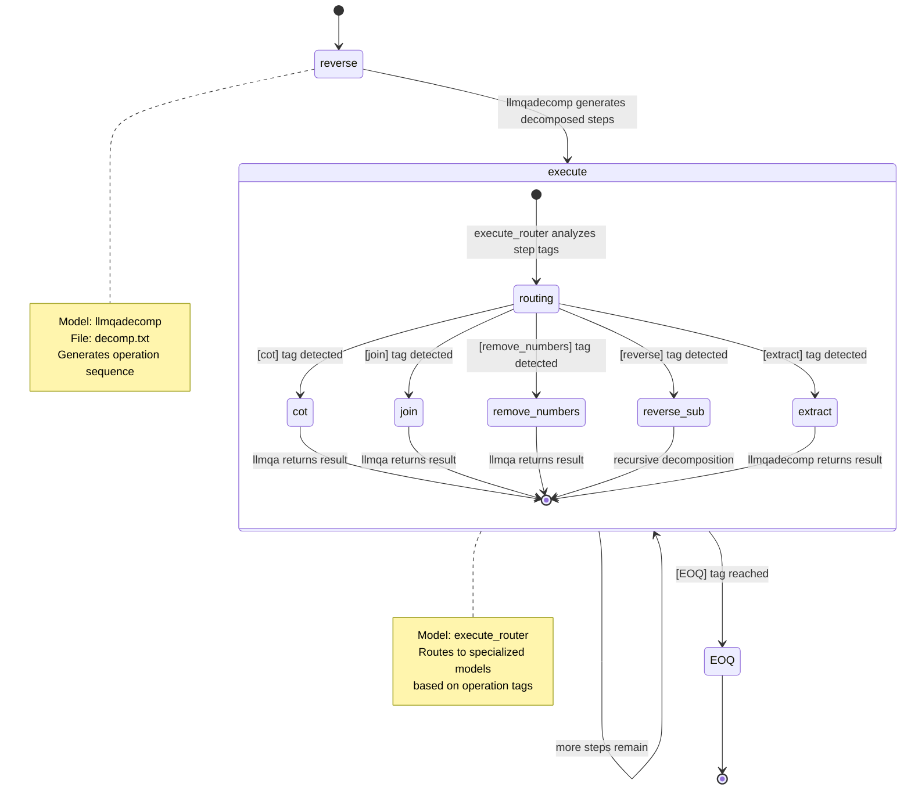
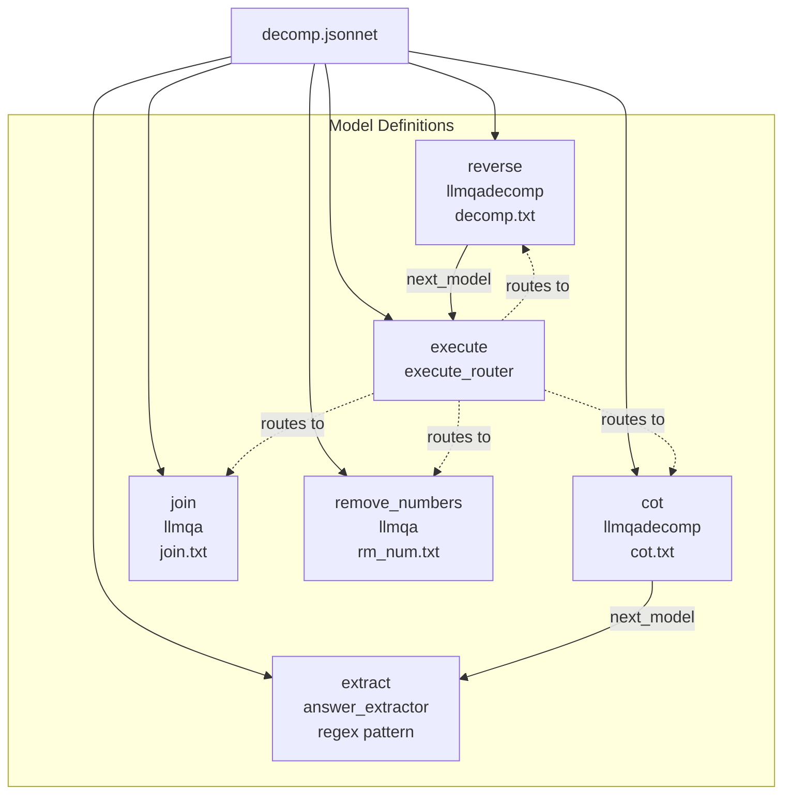
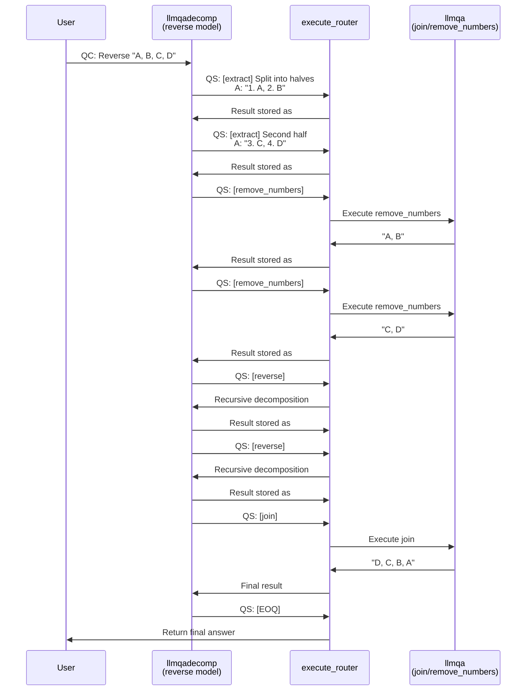
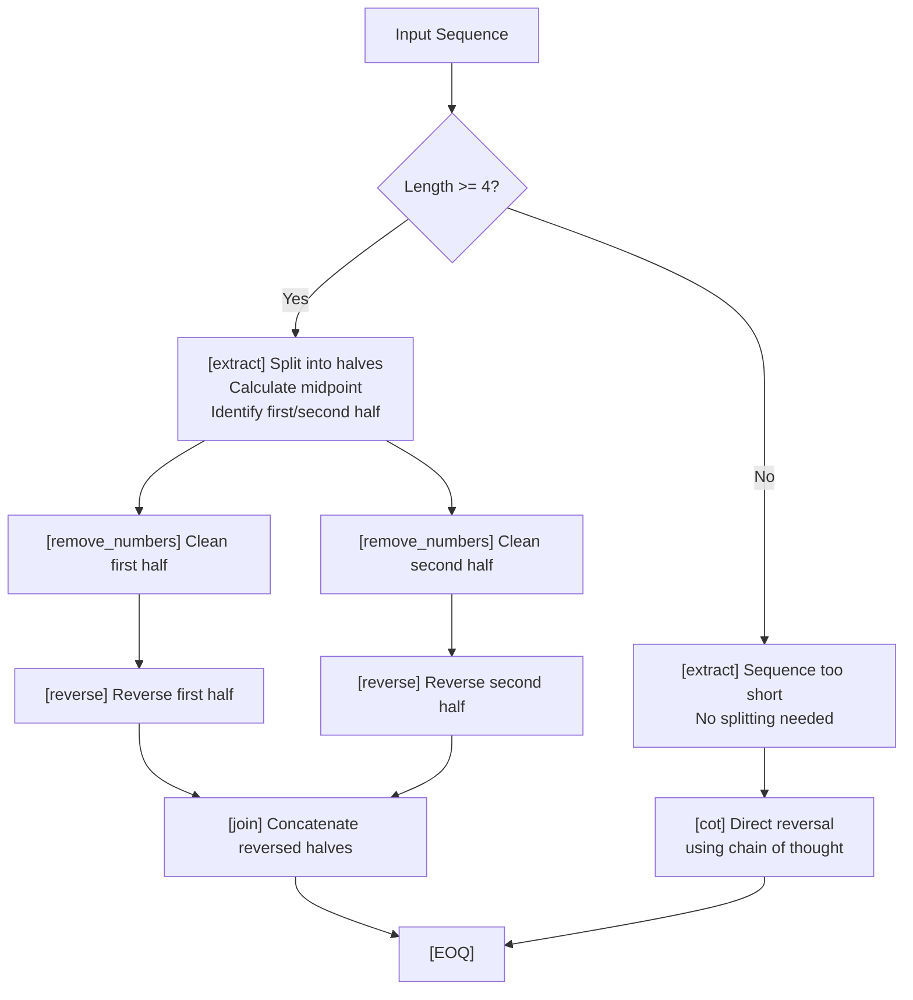

<!-- source: DeepWiki mcp.deepwiki.com · repo allenai/DecomP · page 3.1 Decomposed Prompting Strategy · fetched 2026-10-26 -->

# Decomposed Prompting Strategy

<details>
<summary>Relevant source files</summary>

The following files were used as context for generating this wiki page:

- [configs/inference/reverse/decomp.jsonnet](configs/inference/reverse/decomp.jsonnet)
- [configs/prompts/reverse/decomp.txt](configs/prompts/reverse/decomp.txt)

</details>


## Purpose and Scope

This document details the **Decomposed Prompting Strategy**, the primary prompting methodology implemented in the DecomP repository. This strategy explicitly breaks down complex tasks into a sequence of simpler sub-operations, each handled by specialized models or execution steps.

For information about alternative prompting strategies, see:
- [Chain of Thought (CoT) Strategy](#3.2) - Uses natural language reasoning steps
- [Unrolled Strategy](#3.3) - Applies conditional logic with recursive decomposition

For implementation details of the model components used in this strategy, see [Model Components](#5.3).

## Core Principles

The Decomposed Prompting Strategy operates on the principle that complex tasks can be systematically reduced to sequences of simpler operations. Unlike strategies that rely on implicit reasoning (CoT) or procedural logic (Unrolled), the decomposed approach uses **explicit operation tags** to direct execution flow.

### Key Characteristics

| Characteristic | Description |
|---|---|
| **Explicit Decomposition** | Tasks are broken into labeled sub-operations like `[extract]`, `[remove_numbers]`, `[reverse]`, `[join]` |
| **Multi-Model Orchestration** | Different models handle different operation types through an `execute_router` |
| **State-Based Execution** | Pipeline progresses through defined states until reaching `[EOQ]` (End Of Question) |
| **Result Chaining** | Intermediate results (referenced as `#1`, `#2`, etc.) feed into subsequent operations |

**Sources:** [configs/prompts/reverse/decomp.txt:1-41]()

## Model Pipeline Architecture

The decomposed strategy uses a multi-stage pipeline where different model types collaborate to execute the decomposed operations.

### Pipeline State Machine



**Diagram: Decomposed Strategy State Machine**

This diagram shows the progression from the initial `reverse` state through the `execute_router` orchestration, which dispatches to specialized models based on operation tags, until the `[EOQ]` termination state is reached.

**Sources:** [configs/inference/reverse/decomp.jsonnet:3-27]()

### Configuration Structure

The decomposed strategy configuration defines the complete model pipeline:



**Diagram: Model Configuration Graph**

| Configuration Field | Value | Purpose |
|---|---|---|
| `start_state` | `"reverse"` | Initial model to execute |
| `end_state` | `"[EOQ]"` | Termination marker |
| `models.reverse.name` | `"llmqadecomp"` | Primary decomposition generator |
| `models.execute.name` | `"execute_router"` | Operation dispatcher |
| `models.join.name` | `"llmqa"` | Specialized sub-operation handler |
| `models.remove_numbers.name` | `"llmqa"` | Specialized sub-operation handler |

**Sources:** [configs/inference/reverse/decomp.jsonnet:1-43]()

## Prompt Template Structure

The decomposed prompt template encodes the decomposition logic through few-shot examples. Each example demonstrates how to break a task into tagged operations.

### Operation Tag System

The prompt template uses a structured format where each step is tagged with an operation type:

| Tag | Purpose | Model Handler |
|---|---|---|
| `[extract]` | Extract and analyze input components | `llmqadecomp` |
| `[remove_numbers]` | Remove numbering from sequences | `llmqa` |
| `[reverse]` | Recursively reverse a sequence | `llmqadecomp` or `llmqa` |
| `[join]` | Concatenate two sequences | `llmqa` |
| `[cot]` | Apply chain-of-thought reasoning | `llmqadecomp` |
| `[EOQ]` | Mark end of decomposition | N/A (termination) |

### Example Decomposition Trace

The prompt template demonstrates the complete decomposition pattern through examples:



**Diagram: Execution Trace for List Reversal**

This sequence diagram illustrates how a decomposed query progresses through the model pipeline, with intermediate results chained together via numbered references.

**Sources:** [configs/prompts/reverse/decomp.txt:25-40]()

### Few-Shot Example Structure

Each example in the prompt follows this pattern:

1. **Query Context (QC)**: The original task
   ```
   QC: Reverse the sequence "newspaper, glasses, laptop, bottle".
   ```

2. **Query Steps (QS)**: Tagged decomposition operations with answers (A)
   ```
   QS: [extract] The sequence is "1. newspaper, 2. glasses, 3. laptop, 4. bottle"...
   A: "1. newspaper, 2. glasses"
   ```

3. **Result References**: Intermediate results referenced by number
   ```
   QS: [remove_numbers] Remove the numbers from #1.
   A: "newspaper, glasses"
   ```

4. **Termination**: End marker
   ```
   QS: [EOQ]
   ```

**Sources:** [configs/prompts/reverse/decomp.txt:1-16]()

## Conditional Decomposition Logic

The decomposed strategy includes decision logic for when to apply different decomposition paths:



**Diagram: Conditional Decomposition Decision Tree**

The strategy adapts its decomposition based on input characteristics. Sequences of length 4 or greater are split into halves for recursive processing, while shorter sequences are handled directly using chain-of-thought reasoning.

**Sources:** [configs/prompts/reverse/decomp.txt:18-23](), [configs/prompts/reverse/decomp.txt:25-40]()

## Configuration Details

### Model Parameters

The `decomp.jsonnet` configuration specifies parameters for each model in the pipeline:

| Model | Parameter | Value | Purpose |
|---|---|---|---|
| `reverse` | `name` | `"llmqadecomp"` | Decomposition generator |
| `reverse` | `prompt_file` | `"configs/prompts/reverse/decomp.txt"` | Few-shot template |
| `reverse` | `next_model` | `"execute"` | Route to execution router |
| `reverse` | `max_tokens` | `400` | Generation limit |
| `execute` | `name` | `"execute_router"` | Operation dispatcher |
| `join` | `name` | `"llmqa"` | Join operation handler |
| `join` | `prompt_file` | `"configs/prompts/reverse/join.txt"` | Join-specific prompt |
| `remove_numbers` | `name` | `"llmqa"` | Number removal handler |
| `remove_numbers` | `prompt_file` | `"configs/prompts/reverse/rm_num.txt"` | Removal-specific prompt |

**Sources:** [configs/inference/reverse/decomp.jsonnet:6-36]()

### GPT-3 Engine Configuration

All generative models share common parameters defined in `gen_params`:

```
{
  "gen_model": "gpt3",
  "engine": "text-davinci-001"
}
```

These parameters are merged into each model definition that requires text generation capabilities (`llmqadecomp` and `llmqa` models).

**Sources:** [configs/inference/reverse/decomp.jsonnet:1]()

## Integration with Broader System

The decomposed strategy integrates with the configurable inference pipeline (see [Inference Pipeline](#5.1)) through the standard state machine interface:

- **Entry Point**: `start_state` specifies the initial model (`"reverse"`)
- **Exit Condition**: Pipeline terminates when `end_state` (`"[EOQ]"`) is reached
- **Reader Integration**: Uses `drop` reader with `add_paras: true` to provide context (see [Configuration System](#5.2))

The strategy can be applied to different experimental tasks (see [Experiments](#4)) by:
1. Adapting the prompt template to the task domain
2. Configuring appropriate sub-operation models
3. Adjusting the `execute_router` routing logic for task-specific operation tags

**Sources:** [configs/inference/reverse/decomp.jsonnet:37-41]()

---

