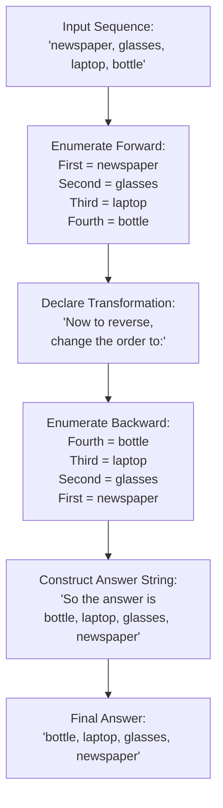
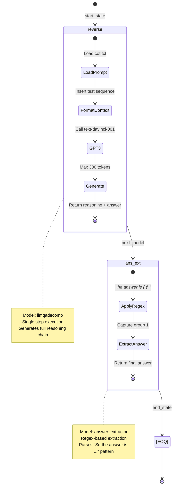
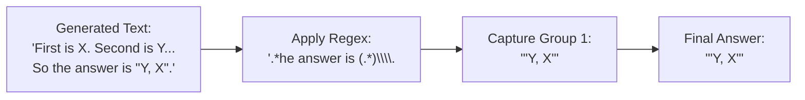

<!-- source: DeepWiki mcp.deepwiki.com · repo allenai/DecomP · page 3.2 Chain of Thought (CoT) Strategy · fetched 2026-10-26 -->

# Chain of Thought (CoT) Strategy

<details>
<summary>Relevant source files</summary>

The following files were used as context for generating this wiki page:

- [configs/inference/reverse/cot.jsonnet](configs/inference/reverse/cot.jsonnet)
- [configs/prompts/reverse/cot.txt](configs/prompts/reverse/cot.txt)

</details>


## Purpose and Scope

This document describes the Chain of Thought (CoT) prompting strategy implemented in DecomP. CoT is one of three core prompting approaches available in the system, using explicit natural language reasoning steps to solve tasks. For information about the decomposed sub-operation approach, see [Decomposed Prompting Strategy](#3.1). For recursive conditional logic, see [Unrolled Strategy](#3.3).

The CoT strategy is primarily demonstrated through the list reversal experiment, though the approach is generalizable to other tasks requiring step-by-step reasoning.

## Strategy Overview

The Chain of Thought strategy solves problems by explicitly enumerating intermediate reasoning steps in natural language. Rather than directly computing a result or breaking tasks into sub-operations, CoT models the problem-solving process as a human would explain it, making the reasoning transparent and interpretable.

### Key Characteristics

| Characteristic | Description |
|---------------|-------------|
| **Reasoning Style** | Explicit enumeration and transformation |
| **Verbosity** | Higher token usage due to detailed steps |
| **Interpretability** | High - every step is explained in natural language |
| **Structure** | Position enumeration → Reversal enumeration → Answer |
| **Model Type** | `llmqadecomp` with single-step execution |

Sources: [configs/inference/reverse/cot.jsonnet:1-28](), [configs/prompts/reverse/cot.txt:1-12]()

## Prompt Template Structure

The CoT prompt template uses a few-shot learning format with three key components per example:

```
QC: Reverse the sequence "..."
QS: [Reasoning steps]
A: [Final answer]
```

### Component Breakdown

- **QC (Question Context)**: States the task and input sequence
- **QS (Question Steps)**: Contains the natural language reasoning chain
- **A (Answer)**: Provides the final result in the expected format

The reasoning chain follows a consistent pattern:
1. Enumerate each element with its position (First is X, Second is Y...)
2. State the transformation (Now to reverse, change the order to...)
3. Enumerate in reversed order (Fifth is Y, Fourth is X...)
4. Conclude with the answer (So the answer is "...")

Sources: [configs/prompts/reverse/cot.txt:1-12]()

## Reasoning Pattern Example

### CoT Reasoning Flow for List Reversal



**Diagram: Natural language reasoning steps in CoT strategy**

Sources: [configs/prompts/reverse/cot.txt:1-4]()

## Concrete Examples from Template

The prompt template includes three examples demonstrating the strategy across different sequence lengths:

### Example 1: Four-element Sequence

```
QC: Reverse the sequence "newspaper, glasses, laptop, bottle".
QS: First is newspaper. Second is glasses. Third is laptop. Fourth is bottle. 
    Now to reverse, change the order to: Fourth is bottle. Third is laptop. 
    Second is glasses. First is newspaper. So the answer is 
    "bottle, laptop, glasses, newspaper".
A: "bottle, laptop, glasses, newspaper"
```

### Example 2: Three-element Sequence

```
QC: Reverse the sequence "laptop, photo, clip".
QS: First is laptop. Second is photo. Third is clip. Now to reverse, 
    change the order to: Third is clip. Second is photo. First is laptop. 
    So the answer is "clip, photo, laptop".
A: "clip, photo, laptop"
```

### Example 3: Five-element Sequence

```
QC: Reverse the sequence "driving license, button, packet, identity card, pineapple".
QS: First is driving license. Second is button. Third is packet. 
    Fourth is identity card. Fifth is pineapple. Now to reverse, 
    change the order to: Fifth is pineapple. Fourth is identity card. 
    Third is packet. Second is button. First is driving license. 
    So the answer is "pineapple, identity card, packet, button, driving license".
A: "pineapple, identity card, packet, button, driving license"
```

These examples train the model to follow the enumeration pattern regardless of sequence length.

Sources: [configs/prompts/reverse/cot.txt:1-12]()

## Configuration and Implementation

### Configuration File Structure

```mermaid
graph TB
    Config["cot.jsonnet<br/>Configuration File"]
    
    StartState["start_state: 'reverse'<br/>Entry point"]
    
    ReverseModel["reverse model:<br/>name: llmqadecomp<br/>prompt_file: cot.txt<br/>max_tokens: 300<br/>max_steps: 1<br/>next_model: ans_ext"]
    
    AnsExt["ans_ext model:<br/>name: answer_extractor<br/>regex: '.*he answer is (.*)\\\\.']
    
    ExecuteRouter["execute model:<br/>name: execute_router<br/>(unused in CoT)"]
    
    GenParams["gen_params:<br/>gen_model: gpt3<br/>engine: text-davinci-001"]
    
    Reader["reader:<br/>name: drop<br/>add_paras: true"]
    
    EndState["end_state: '[EOQ]'<br/>Termination marker"]
    
    Config --> StartState
    Config --> ReverseModel
    Config --> AnsExt
    Config --> ExecuteRouter
    Config --> GenParams
    Config --> Reader
    Config --> EndState
    
    ReverseModel --> GenParams
```

**Diagram: CoT configuration structure with code entities**

Sources: [configs/inference/reverse/cot.jsonnet:1-28]()

### Key Configuration Parameters

| Parameter | Value | Purpose |
|-----------|-------|---------|
| `start_state` | `"reverse"` | Initial model to execute |
| `end_state` | `"[EOQ]"` | Termination marker |
| `reverse.name` | `"llmqadecomp"` | Question decomposition model type |
| `reverse.prompt_file` | `"configs/prompts/reverse/cot.txt"` | CoT prompt template location |
| `reverse.max_tokens` | `300` | Maximum generation length |
| `reverse.max_steps` | `1` | Single-pass execution |
| `reverse.next_model` | `"ans_ext"` | Transition to answer extraction |
| `gen_model` | `"gpt3"` | Generation backend |
| `engine` | `"text-davinci-001"` | Specific GPT-3 model |
| `ans_ext.regex` | `".*he answer is (.*)\\."` | Answer extraction pattern |

Sources: [configs/inference/reverse/cot.jsonnet:1-28]()

## Inference Execution Flow

### State Machine Execution



**Diagram: CoT inference state machine with model names**

Sources: [configs/inference/reverse/cot.jsonnet:1-28]()

### Execution Characteristics

The CoT strategy uses a simple two-stage pipeline:

1. **Generation Stage (`reverse` model)**:
   - Loads the prompt template from [configs/prompts/reverse/cot.txt:1-12]()
   - Appends the test sequence as a new QC line
   - Calls GPT-3 to generate the QS (reasoning) and A (answer) sections
   - Limited to `max_steps: 1` - no iterative refinement
   - Generates up to 300 tokens

2. **Extraction Stage (`ans_ext` model)**:
   - Applies regex pattern to find "the answer is ..."
   - Extracts the content within quotes after this phrase
   - Returns the final answer for evaluation

Sources: [configs/inference/reverse/cot.jsonnet:6-17]()

## Answer Extraction

### Regex Pattern Analysis

The answer extractor uses the pattern: `".*he answer is (.*)\\."`

This pattern:
- Matches any prefix text (`.*`)
- Looks for the literal string "he answer is " (note: matches both "the answer is" and "he answer is")
- Captures everything after until a period (`(.*)\\`)
- Expects a terminating period

### Extraction Process



**Diagram: Answer extraction pipeline mapping code to behavior**

The captured text typically includes the surrounding quotes as part of the answer format expected by the evaluation system.

Sources: [configs/inference/reverse/cot.jsonnet:14-17]()

## Comparison with Other Strategies

### Strategy Comparison Table

| Aspect | CoT (this page) | Decomposed ([3.1](#3.1)) | Unrolled ([3.3](#3.3)) |
|--------|-----------------|--------------------------|------------------------|
| **Reasoning Style** | Natural language enumeration | Explicit sub-operations | Recursive conditional logic |
| **Token Efficiency** | Low (verbose reasoning) | Medium (structured steps) | High (algorithmic) |
| **Interpretability** | High (human-like explanation) | High (clear operations) | Medium (conditional branching) |
| **Steps Required** | Single generation | Multiple model calls | Recursive depth-dependent |
| **Model Transitions** | reverse → ans_ext | Multiple sub-models | Recursive decomposition |

### When to Use CoT

The Chain of Thought strategy is most effective when:
- Interpretability and explainability are priorities
- The task benefits from explicit position tracking
- Token usage is not a primary constraint
- Single-pass reasoning is sufficient

For tasks requiring explicit sub-task decomposition, see [Decomposed Prompting Strategy](#3.1). For tasks requiring recursive algorithmic approaches, see [Unrolled Strategy](#3.3).

Sources: [configs/inference/reverse/cot.jsonnet:1-28](), [configs/prompts/reverse/cot.txt:1-12]()

## Usage Example

To run inference using the CoT strategy for list reversal:

```bash
python -m decomp.inference.configurable_inference \
    --config configs/inference/reverse/cot.jsonnet \
    --input data/reverse/test_len_4.json \
    --output output/reverse_cot_predictions.json
```

This command:
1. Loads the CoT configuration from [configs/inference/reverse/cot.jsonnet:1-28]()
2. Applies the prompt template from [configs/prompts/reverse/cot.txt:1-12]()
3. Generates reasoning chains via GPT-3
4. Extracts answers using the regex pattern
5. Saves predictions for evaluation

For more details on running experiments, see [List Reversal](#4.2) and [Inference Configurations](#4.2.2).

Sources: [configs/inference/reverse/cot.jsonnet:1-28]()

---

