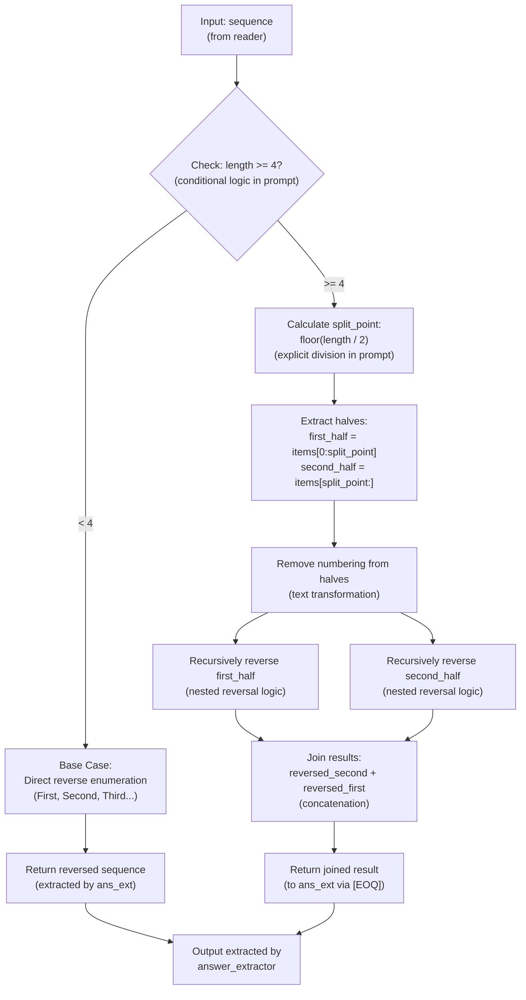
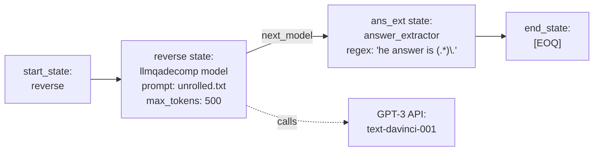
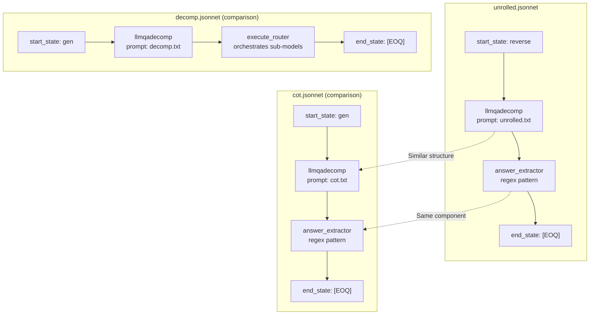

<!-- source: DeepWiki mcp.deepwiki.com · repo allenai/DecomP · page 3.3 Unrolled Strategy · fetched 2026-10-26 -->

# Unrolled Strategy

<details>
<summary>Relevant source files</summary>

The following files were used as context for generating this wiki page:

- [configs/inference/reverse/unrolled.jsonnet](configs/inference/reverse/unrolled.jsonnet)
- [configs/prompts/reverse/unrolled.txt](configs/prompts/reverse/unrolled.txt)

</details>


## Overview

The Unrolled Strategy is one of three core prompting approaches implemented in the DecomP repository for evaluating decomposed problem-solving. This strategy applies conditional logic with recursive decomposition, using a threshold-based decision to determine whether to split a problem into sub-problems or solve it directly.

For information about the other prompting strategies, see [Decomposed Prompting Strategy](#3.1) and [Chain of Thought (CoT) Strategy](#3.2). For task-specific implementations, see [List Reversal](#4.2).

**Scope**: This page documents the unrolled strategy's recursive algorithm, prompt structure, configuration setup, and execution flow as implemented for the list reversal task.

## Strategy Principles

The Unrolled Strategy uses a **divide-and-conquer** approach with explicit conditional branching based on problem size. Unlike the standard decomposed strategy which always applies the same decomposition steps, the unrolled strategy dynamically decides whether to:

1. **Split and recurse** if the problem exceeds a minimum threshold (≥ 4 items)
2. **Solve directly** if the problem is below the threshold (< 4 items)

This mimics recursive algorithm execution where each recursive call handles a smaller sub-problem until reaching a base case.

**Key characteristics**:
- Threshold-based conditional execution (minimum length = 4)
- Recursive decomposition for longer sequences
- Direct reversal for short sequences
- Mathematical calculation of split points (integer division)
- Explicit joining of sub-results

Sources: [configs/prompts/reverse/unrolled.txt:1-15]()

## Recursive Algorithm Structure

The unrolled strategy implements the following algorithm through natural language prompting:

```
function reverse_unrolled(sequence):
    if length(sequence) < 4:
        return direct_reverse(sequence)
    else:
        split_point = floor(length(sequence) / 2)
        first_half = sequence[0:split_point]
        second_half = sequence[split_point:]
        reversed_first = reverse_unrolled(first_half)
        reversed_second = reverse_unrolled(second_half)
        return join(reversed_second, reversed_first)
```

**Recursive Algorithm Flow with Code Mappings**



Sources: [configs/prompts/reverse/unrolled.txt:1-15]()

## Prompt Structure and Examples

The unrolled strategy prompt template contains three few-shot examples demonstrating different execution paths through the recursive algorithm.

### Example 1: Recursive Case (Length = 5)

From [configs/prompts/reverse/unrolled.txt:1-4]():

**Input**: `"driving license, button, packet, identity card, shoe"`

**Execution trace**:
1. Add numbering: `"1. driving license, 2. button, 3. packet, 4. identity card, 5. shoe"`
2. Check length: 5 items ≥ 4 → split
3. Calculate split: 5 / 2 = 2.5 → floor to 2
4. Extract first half (2 items): `"1. driving license, 2. button"`
5. Extract second half (3 items): `"3. packet, 4. identity card, 5. shoe"`
6. Remove numbering from halves
7. Reverse first half: `"button, driving license"`
8. Reverse second half: `"shoe, identity card, packet"`
9. Join: `"shoe, identity card, packet, button, driving license"`

**Output**: `"shoe, identity card, packet, button, driving license"`

### Example 2: Base Case (Length = 3)

From [configs/prompts/reverse/unrolled.txt:6-9]():

**Input**: `"laptop, photo, clip"`

**Execution trace**:
1. Add numbering: `"1. laptop, 2. photo, 3. clip"`
2. Check length: 3 items < 4 → don't split
3. Direct reversal: `"Third is clip. Second is photo. First is laptop."`
4. Output: `"clip, photo, laptop"`

**Output**: `"clip, photo, laptop"`

### Example 3: Threshold Case (Length = 4)

From [configs/prompts/reverse/unrolled.txt:11-14]():

**Input**: `"newspaper, glasses, laptop, bottle"`

**Execution trace**:
1. Add numbering: `"1. newspaper, 2. glasses, 3. laptop, 4. bottle"`
2. Check length: 4 items = 4 → split (threshold condition)
3. Calculate split: 4 / 2 = 2.0 → floor to 2
4. Extract first half (2 items): `"1. newspaper, 2. glasses"`
5. Extract second half (2 items): `"3. laptop, 4. bottle"`
6. Remove numbering from halves
7. Reverse first half: `"glasses, newspaper"`
8. Reverse second half: `"bottle, laptop"`
9. Join: `"bottle, laptop, glasses, newspaper"`

**Output**: `"bottle, laptop, glasses, newspaper"`

Sources: [configs/prompts/reverse/unrolled.txt:1-15]()

## Prompt Template Format

The prompt follows a structured dialogue format:

| Component | Description | Example |
|-----------|-------------|---------|
| `QC:` | Question Context - the input sequence to reverse | `Reverse the sequence "laptop, photo, clip".` |
| `QS:` | Question Steps - the reasoning trace showing the algorithm execution | `The sequence is "1. laptop, 2. photo, 3. clip". The sequence is 3 items long, which is less than the minimum length of 4...` |
| `A:` | Answer - the final reversed sequence | `"clip, photo, laptop"` |
| `QS: [EOQ]` | End of Question marker - signals completion | `[EOQ]` |

Each example demonstrates one complete execution path through the recursive algorithm, with all intermediate steps explicitly written out in natural language.

Sources: [configs/prompts/reverse/unrolled.txt:1-15]()

## Configuration Setup

### Model Configuration

The unrolled strategy is configured in [configs/inference/reverse/unrolled.jsonnet:1-27]():

**State Machine Configuration**



**Configuration breakdown**:

| Field | Value | Purpose |
|-------|-------|---------|
| `start_state` | `"reverse"` | Entry point into the state machine |
| `end_state` | `"[EOQ]"` | Termination signal |
| `models.reverse.name` | `"llmqadecomp"` | Model type for decomposition |
| `models.reverse.prompt_file` | `"configs/prompts/reverse/unrolled.txt"` | Path to prompt template |
| `models.reverse.next_model` | `"ans_ext"` | Transition to answer extraction |
| `models.reverse.max_tokens` | `500` | Maximum generation length |
| `models.reverse.engine` | `"text-davinci-001"` | GPT-3 engine specification |
| `models.ans_ext.name` | `"answer_extractor"` | Extract final answer via regex |
| `models.ans_ext.regex` | `".*he answer is (.*)\."` | Pattern to capture answer |
| `reader.name` | `"drop"` | Dataset reader type |
| `reader.add_paras` | `true` | Include context paragraphs |

Sources: [configs/inference/reverse/unrolled.jsonnet:1-27]()

### Execution Model Comparison

**Configuration Entity Mapping Across Strategies**



The unrolled strategy shares the same pipeline structure as the CoT strategy (single generation + extraction) but differs from the decomposed strategy which uses an `execute_router` for multi-stage execution.

Sources: [configs/inference/reverse/unrolled.jsonnet:1-27]()

## Computational Characteristics

### Token Usage

The unrolled strategy generates longer reasoning traces than direct methods due to:

1. **Explicit length checking**: `"The sequence is 5 items long, which is more than the minimum length of 4..."`
2. **Mathematical calculations**: `"Half of 5 is 5 / 2 = 2.5. Dropping the decimal, we get that the first half will be 2 items long..."`
3. **Index tracking**: `"The first half of the sequence ends with '2. button', so the second half starts after '2. button' with '3. packet'."`
4. **Recursive sub-computations**: Each half is reversed with full enumeration
5. **Joining operations**: `"Joining 'shoe, identity card, packet' and 'button, driving license'..."`

The `max_tokens: 500` parameter in [configs/inference/reverse/unrolled.jsonnet:10]() accommodates these verbose traces.

### Scalability Properties

| Sequence Length | Splits Required | Direct Reversals | Joins |
|-----------------|-----------------|------------------|-------|
| 3 (base case) | 0 | 1 | 0 |
| 4 (threshold) | 1 | 2 | 1 |
| 5 | 1 | 2 | 1 |
| 6 | 1 | 2 | 1 |
| 8 | 1 | 2 | 1 |
| 10 | 1 + recursion | multiple | multiple |

The recursive depth grows logarithmically with sequence length, but the prompt must generate all intermediate steps inline rather than through actual recursion.

Sources: [configs/prompts/reverse/unrolled.txt:1-15]()

## Answer Extraction

The `answer_extractor` model in [configs/inference/reverse/unrolled.jsonnet:13-16]() uses regex pattern matching to extract the final answer from the generated reasoning trace:

**Regex pattern**: `".*he answer is (.*)\."`

This pattern matches:
- `.*` - any characters (the reasoning steps)
- `he answer is ` - the literal text "he answer is" (note: matches "the answer is")
- `(.*)` - capture group for the actual answer
- `\.` - literal period

**Example extraction**:
```
Input: "...Joining 'bottle, laptop' and 'glasses, newspaper', the answer is 'bottle, laptop, glasses, newspaper'."
Captured: "bottle, laptop, glasses, newspaper"
```

The extractor transitions to the `end_state: "[EOQ]"` after extraction, completing the inference pipeline.

Sources: [configs/inference/reverse/unrolled.jsonnet:13-16]()

## Comparison with Other Strategies

**Decision Logic Comparison**

| Aspect | Unrolled | Decomposed | Chain of Thought |
|--------|----------|------------|------------------|
| **Conditional logic** | Explicit threshold (length ≥ 4) | No conditions (always decomposes) | No conditions (always enumerates) |
| **Recursion** | Simulated recursive calls | Flat decomposition | Flat enumeration |
| **Sub-problems** | Dynamic based on length | Fixed sub-operations | Single operation |
| **Token efficiency** | Medium (conditional paths) | Low (verbose steps) | High (direct reasoning) |
| **Prompt complexity** | High (multiple execution paths) | Medium (fixed steps) | Low (single pattern) |

The unrolled strategy is unique in demonstrating **conditional program logic** through prompting, making it suitable for problems where the solution approach varies based on input characteristics.

For detailed comparisons of prompt structures and outputs, see [Decomposed Prompting Strategy](#3.1) and [Chain of Thought (CoT) Strategy](#3.2).

Sources: [configs/prompts/reverse/unrolled.txt:1-15](), [configs/inference/reverse/unrolled.jsonnet:1-27]()

## Usage Example

To run inference using the unrolled strategy on list reversal:

```bash
python -m decomp.inference.configurable_inference \
    --config configs/inference/reverse/unrolled.jsonnet \
    --input_file data/reverse/reverse_LEN_4.json \
    --output_file output/unrolled_predictions.json
```

The inference pipeline will:
1. Load the configuration from `unrolled.jsonnet`
2. Initialize the `drop` reader with the input dataset
3. Enter the `reverse` state using the `llmqadecomp` model
4. Generate reasoning traces using the `unrolled.txt` prompt
5. Extract answers using the regex-based `answer_extractor`
6. Reach the `[EOQ]` end state
7. Write predictions to the output file

For evaluation of results, see [Evaluation and Results](#4.2.3).

Sources: [configs/inference/reverse/unrolled.jsonnet:1-27]()

---

