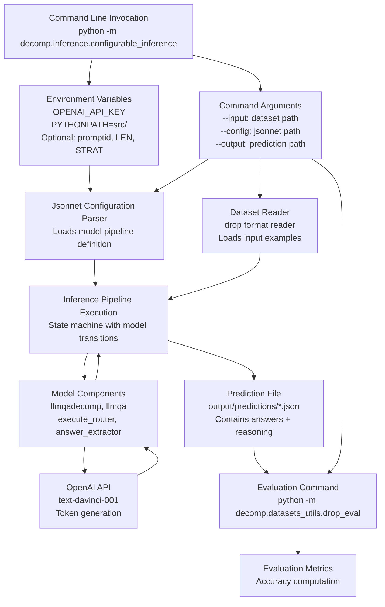

<!-- source: DeepWiki mcp.deepwiki.com · repo allenai/DecomP · page 4 Experiments · fetched 2026-10-26 -->

# Experiments

<details>
<summary>Relevant source files</summary>

The following files were used as context for generating this wiki page:

- [LICENSE](LICENSE)
- [README.md](README.md)

</details>


This page provides an overview of the three main experimental tasks supported by the DecomP repository. Each experiment evaluates how different prompting strategies (decomposed, chain-of-thought, unrolled) perform on specific types of reasoning tasks. For detailed information about the prompting strategies themselves, see [Core Concepts](#3). For implementation details of individual experiments, see [Letter Concatenation](#4.1), [List Reversal](#4.2), and [CommAQA Multi-hop Question Answering](#4.3).

## Overview

DecomP supports three distinct experimental tasks, each designed to evaluate different aspects of compositional reasoning:

| Experiment | Task Type | Dataset Source | Evaluation Focus | Strategies Available |
|------------|-----------|----------------|------------------|---------------------|
| Letter Concatenation | String Manipulation | Static JSON files | Position-based extraction and concatenation | Decomposed, CoT, CoT with Rollout |
| List Reversal | Sequence Reversal | Generated synthetically | Recursive decomposition and algorithmic reasoning | Decomposed, CoT, Unrolled |
| CommAQA | Multi-hop QA | Static JSON files (IID and CompGen splits) | Complex compositional question answering | Fine-grained Decomposed, Coarse-grained Decomposed, CoT |

All experiments follow a common workflow pattern: configuration selection → inference execution → prediction generation → evaluation. However, they differ significantly in their data requirements, configuration complexity, and the types of reasoning they evaluate.

**Sources:** [README.md:20-79]()

## Experimental Pipeline Architecture

The following diagram shows how each experiment type is structured and which components it uses:

```mermaid
graph TB
    subgraph LetterCat["Letter Concatenation"]
        LC_DATA["datasets/letter_cat/*.json<br/>Static datasets"]
        LC_CONFIG1["letter_cat_greedy_search.jsonnet"]
        LC_CONFIG2["cot_letter_cat_greedy_search.jsonnet"]
        LC_CONFIG3["cot_rollout_letter_cat_greedy_search.jsonnet"]
        LC_PROMPT["promptid variable<br/>p1, p2, or p3"]
    end
    
    subgraph ListRev["List Reversal"]
        LR_GEN["build_reverse_dataset.py<br/>Dynamic generation"]
        LR_WORD["wordlist.txt<br/>57 words"]
        LR_DATA["datasets/reverse/<br/>test_{LEN}_normal_words.json"]
        LR_CONFIG1["decomp.jsonnet"]
        LR_CONFIG2["cot.jsonnet"]
        LR_CONFIG3["unrolled.jsonnet"]
        LR_PARAM["LEN parameter<br/>4, 6, 8, 10"]
    end
    
    subgraph CommAQA["CommAQA"]
        CQ_DATA1["datasets/commaqa_e/<br/>iid_test_eg100.json"]
        CQ_DATA2["datasets/commaqa_e/<br/>compgen_test_eg300.json"]
        CQ_CONFIG1["commaqae_fine_greedy_search.jsonnet"]
        CQ_CONFIG2["commaqae_coarse_greedy_search.jsonnet"]
        CQ_CONFIG3["cot_commaqae_greedy_search.jsonnet"]
        CQ_PROMPT["promptid variable<br/>p1, p2, or p3"]
    end
    
    INFERENCE["configurable_inference module<br/>decomp.inference.configurable_inference"]
    
    EVAL["drop_eval module<br/>decomp.datasets_utils.drop_eval"]
    
    OUTPUT["output/predictions/<br/>*_predictions.json"]
    
    LC_DATA --> INFERENCE
    LC_CONFIG1 --> INFERENCE
    LC_CONFIG2 --> INFERENCE
    LC_CONFIG3 --> INFERENCE
    LC_PROMPT --> INFERENCE
    
    LR_WORD --> LR_GEN
    LR_GEN --> LR_DATA
    LR_DATA --> INFERENCE
    LR_CONFIG1 --> INFERENCE
    LR_CONFIG2 --> INFERENCE
    LR_CONFIG3 --> INFERENCE
    LR_PARAM --> LR_GEN
    
    CQ_DATA1 --> INFERENCE
    CQ_DATA2 --> INFERENCE
    CQ_CONFIG1 --> INFERENCE
    CQ_CONFIG2 --> INFERENCE
    CQ_CONFIG3 --> INFERENCE
    CQ_PROMPT --> INFERENCE
    
    INFERENCE --> OUTPUT
    OUTPUT --> EVAL
```



This diagram illustrates the key differences between experiments: Letter Concatenation and CommAQA use pre-existing datasets with variable prompt IDs, while List Reversal requires dataset generation with configurable parameters. All experiments converge at the `configurable_inference` module and use the same evaluation pipeline via `drop_eval`.

**Sources:** [README.md:20-79]()

## Common Workflow Components

All three experiments share the following execution pattern:

### 1. Configuration Selection

Each experiment uses Jsonnet configuration files located in `configs/inference/`. These configurations define:
- The model pipeline (which models execute and in what order)
- Model-specific parameters (temperature, max tokens, etc.)
- Prompt template paths
- Reader configuration (dataset format and context handling)

Configuration files follow naming patterns that indicate the strategy:
- `*_greedy_search.jsonnet` - Uses greedy decoding for generation
- `decomp*.jsonnet` - Uses decomposed prompting strategy
- `cot*.jsonnet` - Uses chain-of-thought strategy
- `unrolled*.jsonnet` - Uses unrolled recursive strategy (List Reversal only)

For more details on the configuration system, see [Configuration System](#5.2).

**Sources:** [README.md:23-26](), [README.md:33-35](), [README.md:52-55](), [README.md:65-68](), [README.md:75-76]()

### 2. Inference Execution

Inference is executed via the `configurable_inference` module with three required arguments:

| Argument | Description | Example |
|----------|-------------|---------|
| `--input` | Path to input dataset JSON file | `datasets/letter_cat/n5_eg100_pos2_space.json` |
| `--config` | Path to Jsonnet configuration file | `configs/inference/letter_cat/letter_cat_greedy_search.jsonnet` |
| `--output` | Path for output predictions JSON file | `output/predictions/letter_cat_predictions.json` |

Some experiments also use environment variables:
- `promptid` - Selects which prompt variant to use (Letter Concatenation and CommAQA)
- `LEN` - Specifies sequence length for dataset generation (List Reversal)
- `STRAT` - Specifies prompting strategy (List Reversal)

**Sources:** [README.md:23-31](), [README.md:38-60](), [README.md:64-73]()

### 3. Prediction Generation

The inference pipeline generates predictions in JSON format with the following structure:
- Each prediction corresponds to one input example
- Predictions include intermediate reasoning steps (for decomposed strategies)
- Final answers are extracted using the `answer_extractor` model component

For details on model components, see [Model Components](#5.3).

**Sources:** [README.md:26](), [README.md:55](), [README.md:68]()

### 4. Evaluation

All experiments use the same evaluation module: `decomp.datasets_utils.drop_eval`. This module compares predictions against gold standard answers and computes accuracy metrics.

The evaluation command pattern is:
```bash
python -m decomp.datasets_utils.drop_eval \
  --gold_path <path_to_dataset> \
  --prediction_path <path_to_predictions>
```

**Sources:** [README.md:28-31](), [README.md:57-59](), [README.md:70-72]()

## Experiment-Specific Characteristics

### Letter Concatenation

**Purpose:** Evaluates position-based extraction and string concatenation capabilities.

**Dataset:** Static files in `datasets/letter_cat/` with naming pattern indicating parameters (e.g., `n5_eg100_pos2_space.json` indicates 5 letters, 100 examples, position 2, with spaces).

**Unique Features:**
- Uses `promptid` environment variable to select from multiple prompt variants (p1, p2, p3)
- Supports CoT with rollout strategy via `cot_rollout_letter_cat_greedy_search.jsonnet`
- Focuses on testing extraction from specific positions in letter sequences

For detailed documentation, see [Letter Concatenation](#4.1).

**Sources:** [README.md:20-35]()

### List Reversal

**Purpose:** Evaluates recursive decomposition and algorithmic reasoning for sequence reversal.

**Dataset:** Generated dynamically using `build_reverse_dataset.py` with configurable length parameter.

**Unique Features:**
- Only experiment requiring dataset generation before inference
- Uses `wordlist.txt` vocabulary with 57 common words
- Supports three distinct strategies: decomposed, chain-of-thought, and unrolled
- Configurable sequence lengths (typically 4, 6, 8, 10)
- Tests scalability of reasoning strategies as sequence length increases

For detailed documentation, see [List Reversal](#4.2).

**Sources:** [README.md:37-60]()

### CommAQA Multi-hop Question Answering

**Purpose:** Evaluates complex compositional question answering with multi-hop reasoning.

**Dataset:** Static files in `datasets/commaqa_e/` with two evaluation splits:
- `iid_test_eg100.json` - In-distribution test set
- `compgen_test_eg300.json` - Compositional generalization test set

**Unique Features:**
- Most complex experiment with multi-stage decomposition
- Supports fine-grained and coarse-grained decomposition strategies
- Uses specialized sub-question models (`aw_qa`, `pos_qa`, `simp_qa`)
- Tests both in-distribution performance and compositional generalization
- Uses `promptid` environment variable for prompt selection (p1, p2, p3)

For detailed documentation, see [CommAQA Multi-hop Question Answering](#4.3).

**Sources:** [README.md:62-78]()

## Experiment Execution Flow

The following diagram maps the execution flow from command-line invocation to output files:



**Sources:** [README.md:12-16](), [README.md:20-79]()

## Experimental Parameters Summary

The following table summarizes key configurable parameters for each experiment:

| Parameter | Letter Concatenation | List Reversal | CommAQA |
|-----------|---------------------|---------------|---------|
| Dataset Source | Static files | Generated | Static files |
| Input Format | JSON with letter sequences | JSON with word lists | JSON with questions + context |
| Prompt Selection | `promptid` (p1/p2/p3) | Implicit in config | `promptid` (p1/p2/p3) |
| Strategy Variants | 3 (decomp, cot, cot_rollout) | 3 (decomp, cot, unrolled) | 3 (fine, coarse, cot) |
| Configurable Parameters | Fixed dataset | `LEN` (sequence length) | Test split selection |
| Evaluation Splits | Single test set | Generated per length | IID + CompGen |
| Generation Required | No | Yes | No |

**Sources:** [README.md:20-79]()

## Next Steps

For detailed information about running specific experiments:
- [Letter Concatenation](#4.1) - String manipulation experiment
- [List Reversal](#4.2) - Sequence reversal with dataset generation
- [CommAQA Multi-hop Question Answering](#4.3) - Complex compositional QA

For information about the underlying system architecture:
- [Inference Pipeline](#5.1) - Execution state machine
- [Configuration System](#5.2) - Jsonnet configuration format
- [Model Components](#5.3) - Individual model types

For information about datasets and prompts:
- [Datasets](#6) - Dataset formats and structures
- [Prompt Templates](#7) - Prompt template documentation

---

