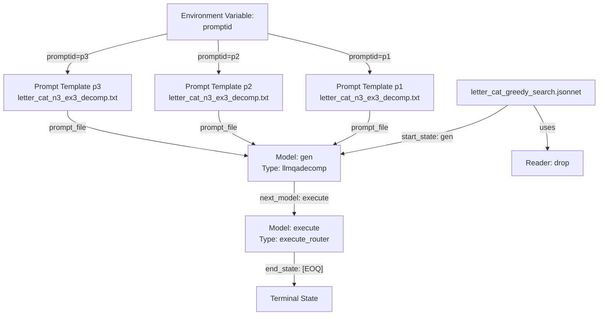
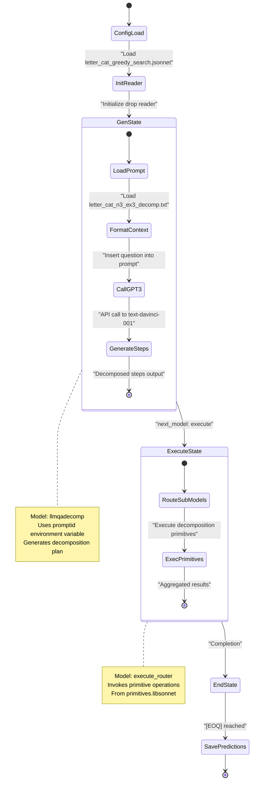
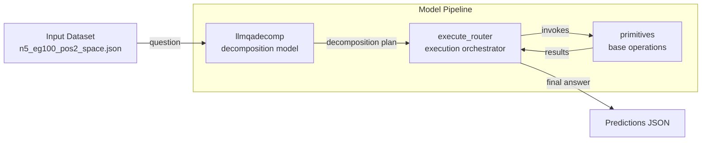

<!-- source: DeepWiki mcp.deepwiki.com · repo allenai/DecomP · page 4.1 Letter Concatenation · fetched 2026-10-26 -->

# Letter Concatenation

<details>
<summary>Relevant source files</summary>

The following files were used as context for generating this wiki page:

- [LICENSE](LICENSE)
- [README.md](README.md)
- [configs/inference/letter_cat/letter_cat_greedy_search.jsonnet](configs/inference/letter_cat/letter_cat_greedy_search.jsonnet)

</details>


## Purpose and Scope

This document describes the letter concatenation experiment in the DecomP repository. Letter concatenation is a string manipulation task that evaluates the ability of language models to extract specific characters from sequences and concatenate them. This experiment uses static pre-generated datasets and supports multiple prompting strategies.

For information about the other experimental tasks, see [List Reversal](#4.2) and [CommAQA Multi-hop Question Answering](#4.3). For details on the core prompting strategies themselves, see [Core Concepts](#3).

**Sources:** [README.md:20-35]()

## Task Description

The letter concatenation task requires extracting specific letters from a sequence and concatenating them in order. For example, given the sequence "A, B, C, D, E" and positions [1, 3, 5], the model should extract letters at those positions and produce "A, C, E".

The task evaluates:
- Position-based character extraction
- Sequential processing
- String concatenation
- Following explicit decomposition steps

**Sources:** [README.md:20-35]()

## Dataset Structure

Letter concatenation datasets are located in `datasets/letter_cat/` and follow the standard DecomP dataset format. The primary dataset used in experiments is:

- `n5_eg100_pos2_space.json` - Contains sequences of length 5 with 100 examples, extracting positions 2

Each dataset entry contains:
- `query_id`: Unique identifier for the query
- `question`: The input sequence and task description
- `answer`: The expected output string
- Additional metadata fields as per the DROP format

**Sources:** [README.md:24]()

## Configuration Options

Letter concatenation supports three main configuration approaches:

| Configuration | Strategy | Config File |
|--------------|----------|-------------|
| Decomposed Prompting | Multi-step decomposition with explicit sub-operations | `letter_cat_greedy_search.jsonnet` |
| Chain of Thought (CoT) | Natural language reasoning | `cot_letter_cat_greedy_search.jsonnet` |
| CoT with Rollout | Chain of thought with execution rollout | `cot_rollout_letter_cat_greedy_search.jsonnet` |

### Decomposed Prompting Configuration

The primary configuration uses decomposed prompting with variable prompt templates:



**Diagram: Letter Concatenation Configuration Structure**

The configuration uses the `promptid` environment variable to select between three prompt variants (p1, p2, p3), each providing different few-shot examples but following the same decomposition strategy.

**Sources:** [configs/inference/letter_cat/letter_cat_greedy_search.jsonnet:1-21]()

### Configuration File Details

The decomposed prompting configuration at [configs/inference/letter_cat/letter_cat_greedy_search.jsonnet]() defines:

| Field | Value | Description |
|-------|-------|-------------|
| `start_state` | `"gen"` | Initial model to execute |
| `end_state` | `"[EOQ]"` | Terminal state marker |
| `models.gen.name` | `"llmqadecomp"` | LLM-based QA decomposition model |
| `models.gen.prompt_file` | Dynamic path using `promptid` | Template path determined at runtime |
| `models.gen.next_model` | `"execute"` | Routes to execution router |
| `models.execute.name` | `"execute_router"` | Orchestrates sub-model execution |
| `reader.name` | `"drop"` | Dataset reader |

The prompt file path is constructed dynamically:
```
configs/prompts/letter_cat/letter_cat_{promptid}/letter_cat_n3_ex3_decomp.txt
```

Where `{promptid}` is replaced with the environment variable value (p1, p2, or p3).

**Sources:** [configs/inference/letter_cat/letter_cat_greedy_search.jsonnet:1-21]()

## Running Inference

### Basic Execution

To run letter concatenation inference with decomposed prompting:

```bash
promptid=p1 python -m decomp.inference.configurable_inference \
  --input datasets/letter_cat/n5_eg100_pos2_space.json \
  --config configs/inference/letter_cat/letter_cat_greedy_search.jsonnet \
  --output output/predictions/letter_cat_n5_eg100_pos2_space_decomp_predictions.json
```

### Prompt Variants

Change the `promptid` variable to experiment with different prompts:

```bash
# Try prompt variant p2
promptid=p2 python -m decomp.inference.configurable_inference \
  --input datasets/letter_cat/n5_eg100_pos2_space.json \
  --config configs/inference/letter_cat/letter_cat_greedy_search.jsonnet \
  --output output/predictions/letter_cat_n5_eg100_pos2_space_p2_predictions.json

# Try prompt variant p3
promptid=p3 python -m decomp.inference.configurable_inference \
  --input datasets/letter_cat/n5_eg100_pos2_space.json \
  --config configs/inference/letter_cat/letter_cat_greedy_search.jsonnet \
  --output output/predictions/letter_cat_n5_eg100_pos2_space_p3_predictions.json
```

### Alternative Strategies

To evaluate CoT baseline:
```bash
promptid=p1 python -m decomp.inference.configurable_inference \
  --input datasets/letter_cat/n5_eg100_pos2_space.json \
  --config configs/inference/letter_cat/cot_letter_cat_greedy_search.jsonnet \
  --output output/predictions/letter_cat_n5_eg100_pos2_space_cot_predictions.json
```

To evaluate CoT with rollout baseline:
```bash
promptid=p1 python -m decomp.inference.configurable_inference \
  --input datasets/letter_cat/n5_eg100_pos2_space.json \
  --config configs/inference/letter_cat/cot_rollout_letter_cat_greedy_search.jsonnet \
  --output output/predictions/letter_cat_n5_eg100_pos2_space_cot_rollout_predictions.json
```

**Sources:** [README.md:20-35]()

## Execution Pipeline

The letter concatenation inference follows a state machine execution model:



**Diagram: Letter Concatenation State Machine Execution Flow**

The pipeline executes in two main phases:
1. **Generation (`gen` state)**: The `llmqadecomp` model loads the prompt template, inserts the input question, and generates a decomposition plan via GPT-3
2. **Execution (`execute` state)**: The `execute_router` parses the decomposition and invokes the appropriate primitive operations defined in [configs/inference/primitives.libsonnet]()

**Sources:** [configs/inference/letter_cat/letter_cat_greedy_search.jsonnet:5-16](), [README.md:23-26]()

## Evaluation

After generating predictions, evaluate performance using the `drop_eval` module:

```bash
python -m decomp.datasets_utils.drop_eval \
  --gold_path datasets/letter_cat/n5_eg100_pos2_space.json \
  --prediction_path output/predictions/letter_cat_n5_eg100_pos2_space_decomp_predictions.json
```

The evaluator compares predicted answers against ground truth labels in the dataset and reports:
- Exact match accuracy
- F1 score (token-level overlap)
- Other DROP evaluation metrics

### Comparing Strategies

To compare different prompting strategies, run inference with each configuration and compare evaluation results:

| Strategy | Config | Expected Performance |
|----------|--------|---------------------|
| Decomposed (p1) | `letter_cat_greedy_search.jsonnet` | Baseline decomposed performance |
| Decomposed (p2) | `letter_cat_greedy_search.jsonnet` | Alternative prompt examples |
| Decomposed (p3) | `letter_cat_greedy_search.jsonnet` | Alternative prompt examples |
| CoT | `cot_letter_cat_greedy_search.jsonnet` | Natural reasoning baseline |
| CoT + Rollout | `cot_rollout_letter_cat_greedy_search.jsonnet` | CoT with execution trace |

**Sources:** [README.md:28-35]()

## Model Components

The letter concatenation experiment uses two primary model types:



**Diagram: Model Component Interaction**

### llmqadecomp Model

The `llmqadecomp` model (referenced at [configs/inference/letter_cat/letter_cat_greedy_search.jsonnet:9]()) performs:
- Loading the prompt template from the selected `promptid` directory
- Formatting the template with the input question
- Calling GPT-3 API (`text-davinci-001`) to generate a decomposition plan
- Outputting structured steps for the execution router

### execute_router Model

The `execute_router` model (referenced at [configs/inference/letter_cat/letter_cat_greedy_search.jsonnet:14-16]()) performs:
- Parsing the decomposition plan from `llmqadecomp`
- Routing to appropriate primitive operations
- Managing execution state and intermediate results
- Returning the final aggregated answer

### Primitive Operations

Primitive operations are defined in [configs/inference/primitives.libsonnet]() and are imported into the configuration at [configs/inference/letter_cat/letter_cat_greedy_search.jsonnet:1-3](). These provide basic string manipulation operations used by the execution router.

**Sources:** [configs/inference/letter_cat/letter_cat_greedy_search.jsonnet:1-21]()

## Required Environment Setup

Before running letter concatenation experiments, ensure the following environment variables are set:

```bash
export PYTHONPATH=src/
export OPENAI_API_KEY=<YOUR_API_KEY>
```

The `OPENAI_API_KEY` is required for GPT-3 API access. The `PYTHONPATH` ensures proper module resolution for the `decomp` package.

**Sources:** [README.md:12-16]()

## Output Format

Predictions are written to the specified output file in JSON format. Each prediction entry contains:
- `query_id`: Matching the input dataset
- `predicted_answer`: The model's generated answer
- `decomposition`: The intermediate steps (if applicable)
- Additional metadata about the inference process

The output format matches the DROP prediction schema to enable evaluation with `drop_eval`.

**Sources:** [README.md:26]()

---

