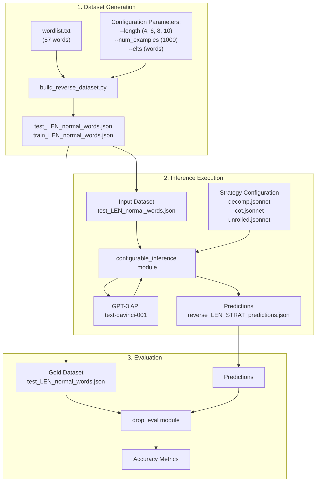
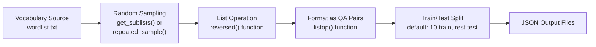
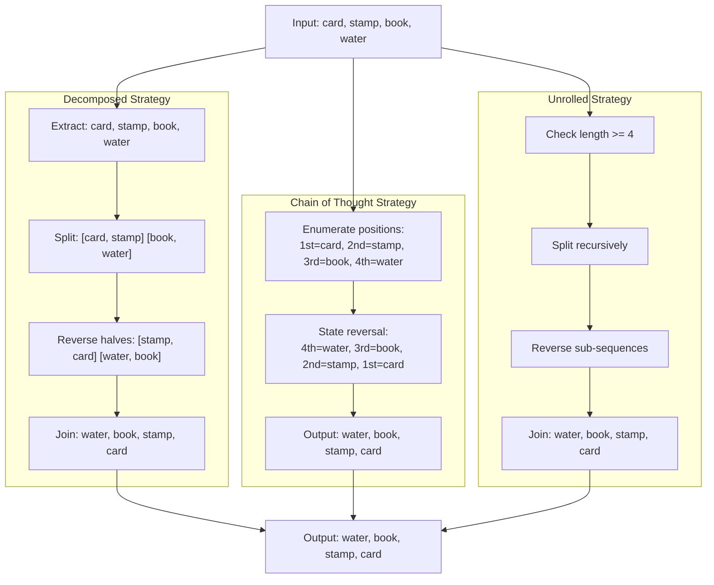
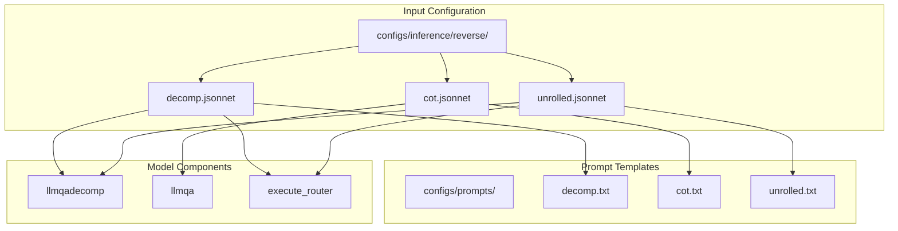

<!-- source: DeepWiki mcp.deepwiki.com · repo allenai/DecomP · page 4.2 List Reversal · fetched 2026-10-26 -->

# List Reversal

<details>
<summary>Relevant source files</summary>

The following files were used as context for generating this wiki page:

- [LICENSE](LICENSE)
- [README.md](README.md)
- [src/decomp/datasets_utils/build_reverse_dataset.py](src/decomp/datasets_utils/build_reverse_dataset.py)

</details>


## Purpose and Scope

This document describes the list reversal experiment in DecomP, which evaluates the ability of decomposed prompting strategies to reverse sequences of elements. The experiment is designed to test systematic algorithmic reasoning on sequences of varying lengths.

This page provides an overview of the list reversal workflow, from dataset generation through inference and evaluation. For detailed information on specific components:
- Dataset generation specifics: see [Dataset Generation](#4.2.1)
- Inference configuration details: see [Inference Configurations](#4.2.2)
- Evaluation procedures: see [Evaluation and Results](#4.2.3)

For information about the three prompting strategies (decomposed, chain of thought, unrolled), see [Core Concepts](#3).

---

## Task Overview

The list reversal task presents a sequence of elements and requires the model to output the sequence in reversed order. For example:

| Input Sequence | Expected Output |
|----------------|-----------------|
| `card, stamp, book, water, glasses` | `glasses, water, book, stamp, card` |
| `apple, dog, house` | `house, dog, apple` |

The task tests whether language models can perform systematic algorithmic transformations, with difficulty scaling by sequence length. The DecomP system evaluates three different prompting strategies on this task to compare their effectiveness.

**Sources:** [README.md:37-60]()

---

## Complete Workflow

The list reversal experiment follows a three-stage pipeline: dataset generation, inference execution, and evaluation. Unlike other experiments in DecomP (such as letter concatenation), list reversal requires dynamic dataset generation.



**Sources:** [README.md:37-60](), [src/decomp/datasets_utils/build_reverse_dataset.py:1-180]()

---

## Dataset Generation

List reversal datasets are generated synthetically using the `build_reverse_dataset.py` script. This allows researchers to create datasets with controlled properties such as sequence length and element types.

### Key Parameters

| Parameter | Description | Example Values |
|-----------|-------------|----------------|
| `--length` | Length of sequences to generate | `4`, `6`, `8`, `10` |
| `--elts` | Type of elements in sequences | `words`, `letters`, `numbers` |
| `--listop` | List operation to perform | `reversed`, `sorted`, `sort_last` |
| `--num_examples` | Total number of examples | `1000` |
| `--word_list` | Path to vocabulary file | `configs/data/wordlist.txt` |

### Generation Process



The script samples permutations of elements from the vocabulary, applies the specified list operation (reversal), and formats the results as question-answer pairs following the DROP dataset format.

**Command Example:**
```bash
LEN=10
python src/decomp/datasets_utils/build_reverse_dataset.py \
  --listop=reversed \
  --elts=words \
  --out_dir=datasets/reverse \
  --length=$LEN \
  --num_examples=1000
```

For detailed information about dataset generation parameters and output format, see [Dataset Generation](#4.2.1).

**Sources:** [README.md:41-50](), [src/decomp/datasets_utils/build_reverse_dataset.py:25-103]()

---

## Prompting Strategies

The list reversal experiment evaluates three distinct prompting strategies, each implementing a different approach to the reversal task:

### Strategy Comparison

| Strategy | Configuration File | Key Approach | Page Reference |
|----------|-------------------|--------------|----------------|
| **Decomposed** | `configs/inference/reverse/decomp.jsonnet` | Splits sequence into halves, reverses each, rejoins | [Decomposed Prompting](#3.1) |
| **Chain of Thought** | `configs/inference/reverse/cot.jsonnet` | Natural language reasoning through position enumeration | [Chain of Thought](#3.2) |
| **Unrolled** | `configs/inference/reverse/unrolled.jsonnet` | Recursive decomposition with conditional logic | [Unrolled Strategy](#3.3) |

### Strategy Execution Flow



Each strategy is implemented through a combination of configuration files (`.jsonnet`) and prompt templates (`.txt` files). The inference pipeline loads the appropriate configuration and executes the strategy-specific prompting approach.

For detailed information about inference configurations and how to select strategies, see [Inference Configurations](#4.2.2).

**Sources:** [README.md:38-40](), Diagram 4 from high-level architecture

---

## Running Inference

### Basic Workflow

The inference process uses the `configurable_inference` module with strategy-specific configurations:

```bash
# Set variables
LEN=10                    # Sequence length: 4, 6, 8, or 10
STRAT=decomp             # Strategy: decomp, cot, or unrolled

# Run inference
python -m decomp.inference.configurable_inference \
  --input datasets/reverse/test_${LEN}_normal_words.json \
  --config configs/inference/reverse/${STRAT}.jsonnet \
  --output output/predictions/reverse_${LEN}_${STRAT}_predictions.json
```

### Configuration Files Mapping



The configuration files define:
- Which model components to use (e.g., `llmqadecomp`, `llmqa`)
- Which prompt templates to load
- Model parameters (temperature, max tokens, etc.)
- Execution flow (`start_state`, `next_model` transitions)

**Sources:** [README.md:52-55]()

---

## Evaluation

After inference completes, predictions are evaluated against the gold dataset using the `drop_eval` module:

```bash
python -m decomp.datasets_utils.drop_eval \
  --gold_path datasets/reverse/test_${LEN}_normal_words.json \
  --prediction_path output/predictions/reverse_${LEN}_${STRAT}_predictions.json
```

The evaluation compares predicted reversed sequences against ground truth answers and reports exact match accuracy.

### Evaluation Metrics

| Metric | Description |
|--------|-------------|
| **Exact Match** | Percentage of predictions that exactly match the gold answer |
| **F1 Score** | Token-level overlap between prediction and gold (from DROP eval) |

For detailed information about evaluation procedures, metrics interpretation, and result analysis, see [Evaluation and Results](#4.2.3).

**Sources:** [README.md:57-59]()

---

## Complete Example

Here is a complete end-to-end example for running a list reversal experiment with sequences of length 10 using the decomposed prompting strategy:

```bash
# 1. Create output directory
mkdir -p datasets/reverse

# 2. Generate dataset
LEN=10
python src/decomp/datasets_utils/build_reverse_dataset.py \
  --listop=reversed \
  --elts=words \
  --out_dir=datasets/reverse \
  --length=$LEN \
  --num_examples=1000

# 3. Run inference with decomposed strategy
STRAT=decomp
python -m decomp.inference.configurable_inference \
  --input datasets/reverse/test_${LEN}_normal_words.json \
  --config configs/inference/reverse/${STRAT}.jsonnet \
  --output output/predictions/reverse_${LEN}_${STRAT}_predictions.json

# 4. Evaluate results
python -m decomp.datasets_utils.drop_eval \
  --gold_path datasets/reverse/test_${LEN}_normal_words.json \
  --prediction_path output/predictions/reverse_${LEN}_${STRAT}_predictions.json
```

### Output Files

The workflow produces the following files:

| File | Description |
|------|-------------|
| `datasets/reverse/test_10_normal_words.json` | Test dataset with 990 examples |
| `datasets/reverse/train_10_normal_words.json` | Training dataset with 10 examples |
| `output/predictions/reverse_10_decomp_predictions.json` | Model predictions |

**Sources:** [README.md:37-60]()

---

## File References

### Primary Components

| Component | File Path | Description |
|-----------|-----------|-------------|
| Dataset Generator | [src/decomp/datasets_utils/build_reverse_dataset.py]() | Generates synthetic list reversal datasets |
| Inference Engine | `src/decomp/inference/configurable_inference.py` | Executes inference pipeline |
| Evaluation Module | `src/decomp/datasets_utils/drop_eval.py` | Computes accuracy metrics |
| Word Vocabulary | `configs/data/wordlist.txt` | 57 common words for dataset generation |

### Configuration Files

| Strategy | Configuration Path |
|----------|-------------------|
| Decomposed | `configs/inference/reverse/decomp.jsonnet` |
| Chain of Thought | `configs/inference/reverse/cot.jsonnet` |
| Unrolled | `configs/inference/reverse/unrolled.jsonnet` |

### Prompt Templates

Prompt templates are located in `configs/prompts/` and are referenced by the configuration files. The specific templates used depend on the selected prompting strategy.

**Sources:** [README.md:37-60](), [src/decomp/datasets_utils/build_reverse_dataset.py:1-180]()

---

