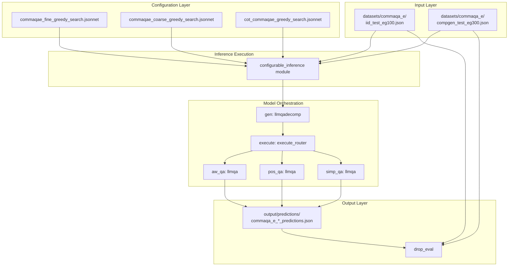
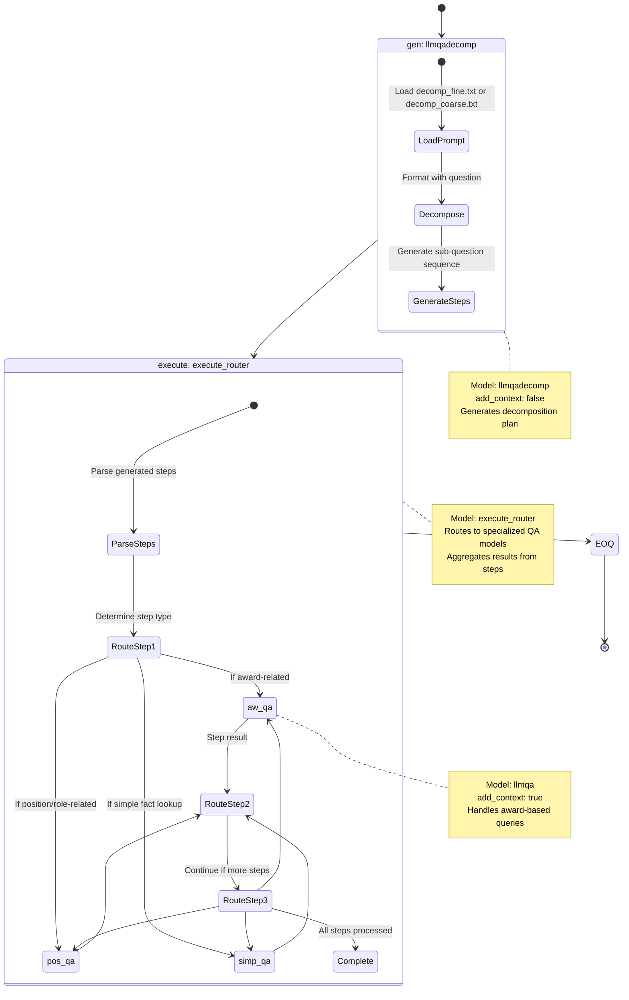
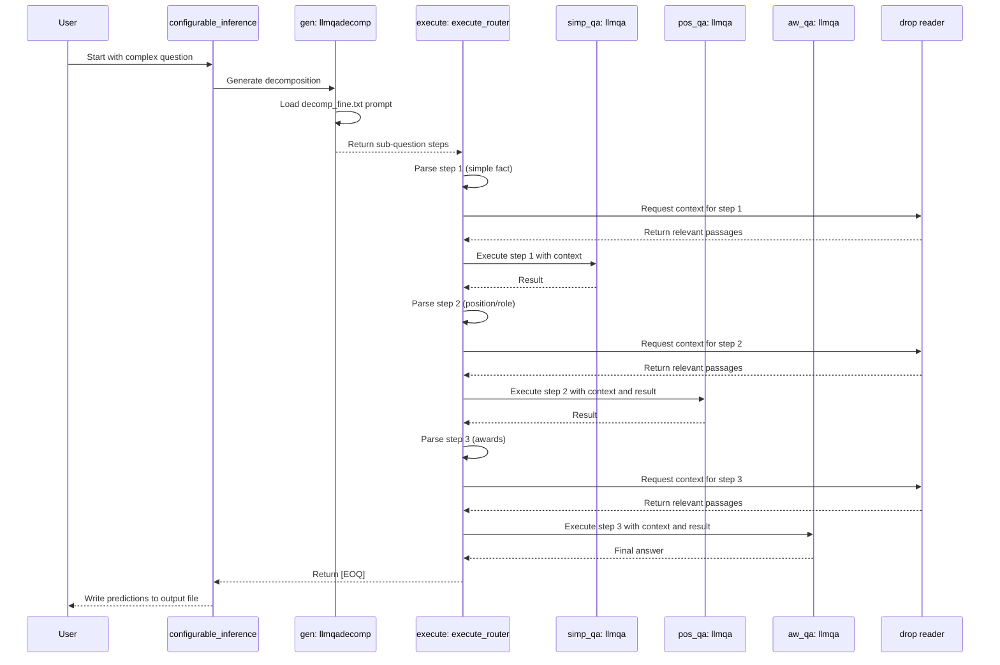

<!-- source: DeepWiki mcp.deepwiki.com · repo allenai/DecomP · page 4.3 CommAQA Multi-hop Question Answering · fetched 2026-10-26 -->

# CommAQA Multi-hop Question Answering

<details>
<summary>Relevant source files</summary>

The following files were used as context for generating this wiki page:

- [LICENSE](LICENSE)
- [README.md](README.md)
- [configs/inference/commaqa_e/commaqae_fine_greedy_search.jsonnet](configs/inference/commaqa_e/commaqae_fine_greedy_search.jsonnet)

</details>


This document describes the CommAQA (Compositional Multi-hop Question Answering) experiment in the DecomP repository. CommAQA evaluates the system's ability to answer complex questions that require multiple reasoning steps by decomposing them into simpler sub-questions. This experiment demonstrates DecomP's most sophisticated decomposition strategies for handling multi-hop reasoning over knowledge bases.

For detailed information about the specific decomposition approaches, see:
- Fine-grained decomposition strategy: [4.3.1](#4.3.1)
- Coarse-grained decomposition strategy: [4.3.2](#4.3.2)

For information about the core prompting strategies and inference pipeline architecture, see Core Concepts ([3](#3)) and System Architecture ([5](#5)).

## Overview

The CommAQA experiment tests the ability to answer compositional questions that require chaining multiple reasoning steps. A typical CommAQA question might ask "Which movies won awards given to the producer of X?" which requires:
1. Identifying what X refers to
2. Determining who produced X
3. Finding which awards that producer won
4. Listing movies that won those awards

Unlike the simpler Letter Concatenation ([4.1](#4.1)) and List Reversal ([4.2](#4.2)) experiments, CommAQA requires access to a knowledge base and sophisticated orchestration of multiple specialized question-answering models.



**CommAQA Experiment Architecture**

Sources: [README.md:62-78](), [configs/inference/commaqa_e/commaqae_fine_greedy_search.jsonnet:1-38]()

## Dataset Structure

CommAQA uses two dataset splits to evaluate different aspects of multi-hop reasoning:

| Split Type | File | Purpose | Examples |
|------------|------|---------|----------|
| IID (In-distribution) | `datasets/commaqa_e/iid_test_eg100.json` | Tests performance on question types seen during training | 100 |
| CompGen (Compositional Generalization) | `datasets/commaqa_e/compgen_test_eg300.json` | Tests ability to generalize to novel question compositions | 300 |

Each dataset entry follows the standard DecomP format with fields:
- `question`: The complex multi-hop question
- `answer`: The expected answer
- `context`: Supporting knowledge base passages (used when `add_context: true`)
- Additional metadata fields specific to CommAQA

Sources: [README.md:66-78]()

## Inference Workflow

The CommAQA inference process follows a state machine pattern where a decomposition model generates sub-questions and an execution router orchestrates specialized QA models to answer them.



**CommAQA State Machine Execution Flow**

The workflow is defined in the configuration file structure:
- **start_state**: `"gen"` - begins with the decomposition model [configs/inference/commaqa_e/commaqae_fine_greedy_search.jsonnet:5]()
- **end_state**: `"[EOQ]"` - terminates when end-of-question marker is reached [configs/inference/commaqa_e/commaqae_fine_greedy_search.jsonnet:6]()
- **next_model**: `"execute"` - transitions from gen to execute_router [configs/inference/commaqa_e/commaqae_fine_greedy_search.jsonnet:11]()

Sources: [configs/inference/commaqa_e/commaqae_fine_greedy_search.jsonnet:5-32]()

## Model Components

The CommAQA experiment utilizes multiple specialized model components, each configured with specific parameters:

### Decomposition Model (gen)

The `gen` model uses the `llmqadecomp` component to decompose complex questions into sub-steps.

| Parameter | Value | Purpose |
|-----------|-------|---------|
| `name` | `"llmqadecomp"` | Multi-step decomposition model |
| `prompt_file` | `configs/prompts/commaqa_e/commaqa_e_{promptid}/decomp_fine.txt` | Prompt template for decomposition |
| `next_model` | `"execute"` | Transition to execution router |
| `end_state` | `"[EOQ]"` | Termination marker |
| `add_context` | `false` | No context needed for decomposition |
| `gen_model` | `"gpt3"` | Uses GPT-3 API |

Sources: [configs/inference/commaqa_e/commaqae_fine_greedy_search.jsonnet:8-14]()

### Specialized QA Models

Three specialized QA models handle different question types:

**aw_qa (Award-based Questions)**
```jsonnet
"aw_qa": {
  "name": "llmqa",
  "prompt_file": "configs/prompts/commaqa_e/commaqa_e_{promptid}/aw_qa.txt",
  "add_context": true
}
```
Sources: [configs/inference/commaqa_e/commaqae_fine_greedy_search.jsonnet:15-19]()

**pos_qa (Position/Role Questions)**
```jsonnet
"pos_qa": {
  "name": "llmqa",
  "prompt_file": "configs/prompts/commaqa_e/commaqa_e_{promptid}/pos_qa.txt",
  "add_context": true
}
```
Sources: [configs/inference/commaqa_e/commaqae_fine_greedy_search.jsonnet:20-24]()

**simp_qa (Simple Factual Questions)**
```jsonnet
"simp_qa": {
  "name": "llmqa",
  "prompt_file": "configs/prompts/commaqa_e/commaqa_e_{promptid}/simp_qa.txt",
  "add_context": true
}
```
Sources: [configs/inference/commaqa_e/commaqae_fine_greedy_search.jsonnet:25-29]()

All specialized QA models have `add_context: true`, meaning they receive supporting passages from the knowledge base via the `drop` reader.

### Execution Router

The `execute` model uses the `execute_router` component to orchestrate the specialized QA models:

```jsonnet
"execute": {
  "name": "execute_router"
}
```

This component parses the decomposed steps from the `gen` model and routes each sub-question to the appropriate specialized QA model (`aw_qa`, `pos_qa`, or `simp_qa`).

Sources: [configs/inference/commaqa_e/commaqae_fine_greedy_search.jsonnet:30-32]()

## Reader Configuration

The CommAQA experiment uses a `drop` reader to provide knowledge base context:

```jsonnet
"reader": {
  "name": "drop",
  "add_paras": true
}
```

The `add_paras: true` setting ensures that supporting paragraphs from the knowledge base are included in the context for models where `add_context: true`.

Sources: [configs/inference/commaqa_e/commaqae_fine_greedy_search.jsonnet:34-37]()

## Configuration Options

CommAQA supports three main configuration strategies:

| Configuration | File | Decomposition Type | Use Case |
|--------------|------|-------------------|----------|
| Fine-grained | `commaqae_fine_greedy_search.jsonnet` | Detailed step-by-step breakdown | Specialized sub-question routing |
| Coarse-grained | `commaqae_coarse_greedy_search.jsonnet` | Higher-level decomposition | Broader reasoning steps |
| Chain of Thought | `cot_commaqae_greedy_search.jsonnet` | Natural language reasoning | Baseline comparison |

Each configuration can be used with different prompt variants specified by the `promptid` environment variable (`p1`, `p2`, `p3`).

Sources: [README.md:75-76]()

## Running CommAQA Inference

### Basic Execution

To run CommAQA inference with fine-grained decomposition:

```bash
promptid=p1 python -m decomp.inference.configurable_inference \
  --input datasets/commaqa_e/iid_test_eg100.json \
  --config configs/inference/commaqa/commaqae_fine_greedy_search.jsonnet \
  --output output/predictions/commaqa_e_iid_test_eg100_fine_decomp_predictions.json
```

Sources: [README.md:65-68]()

### Evaluation

Evaluate predictions against ground truth:

```bash
python -m decomp.datasets_utils.drop_eval \
  --gold_path datasets/commaqa_e/iid_test_eg100.json \
  --prediction_path output/predictions/commaqa_e_iid_test_eg100_fine_decomp_predictions.json
```

Sources: [README.md:70-72]()

### Testing Different Strategies

**Coarse-grained decomposition:**
```bash
promptid=p1 python -m decomp.inference.configurable_inference \
  --input datasets/commaqa_e/iid_test_eg100.json \
  --config configs/inference/commaqa/commaqae_coarse_greedy_search.jsonnet \
  --output output/predictions/commaqa_e_iid_test_eg100_coarse_decomp_predictions.json
```

**Chain of Thought baseline:**
```bash
promptid=p1 python -m decomp.inference.configurable_inference \
  --input datasets/commaqa_e/iid_test_eg100.json \
  --config configs/inference/commaqa/cot_commaqae_greedy_search.jsonnet \
  --output output/predictions/commaqa_e_iid_test_eg100_cot_predictions.json
```

Sources: [README.md:75-76]()

### Compositional Generalization Split

To test compositional generalization capabilities:

```bash
promptid=p1 python -m decomp.inference.configurable_inference \
  --input datasets/commaqa_e/compgen_test_eg300.json \
  --config configs/inference/commaqa/commaqae_fine_greedy_search.jsonnet \
  --output output/predictions/commaqa_e_compgen_test_eg300_fine_decomp_predictions.json
```

Sources: [README.md:77-78]()

## Command-Line Parameters

The following table summarizes the key parameters for CommAQA experiments:

| Parameter | Type | Description | Example Values |
|-----------|------|-------------|----------------|
| `promptid` | Environment Variable | Selects prompt variant | `p1`, `p2`, `p3` |
| `--input` | Command-line | Path to test dataset | `datasets/commaqa_e/iid_test_eg100.json` |
| `--config` | Command-line | Path to inference configuration | `configs/inference/commaqa/commaqae_fine_greedy_search.jsonnet` |
| `--output` | Command-line | Path for prediction output | `output/predictions/commaqa_e_*_predictions.json` |

Sources: [README.md:65-76]()

## Prompt Organization

CommAQA prompts are organized hierarchically by prompt ID:

```
configs/prompts/commaqa_e/
├── commaqa_e_p1/
│   ├── decomp_fine.txt      # Fine-grained decomposition
│   ├── decomp_coarse.txt    # Coarse-grained decomposition
│   ├── aw_qa.txt            # Award-based QA
│   ├── pos_qa.txt           # Position/role QA
│   └── simp_qa.txt          # Simple factual QA
├── commaqa_e_p2/
│   └── ...
└── commaqa_e_p3/
    └── ...
```

The `promptid` environment variable dynamically selects which prompt directory to use, as seen in the configuration template: `"configs/prompts/commaqa_e/commaqa_e_" + std.extVar("promptid") + "/decomp_fine.txt"`.

Sources: [configs/inference/commaqa_e/commaqae_fine_greedy_search.jsonnet:10,17,22,27]()

## Multi-hop Reasoning Flow

The following diagram illustrates how information flows through the multi-hop reasoning process:



**Multi-hop Reasoning Sequence Diagram**

This sequence shows how:
1. The `gen` model decomposes the question into sequential steps
2. The `execute_router` routes each step to the appropriate specialized model
3. Each specialized model receives context from the `drop` reader
4. Results from earlier steps inform later steps (multi-hop chaining)
5. The final result is aggregated and returned

Sources: [configs/inference/commaqa_e/commaqae_fine_greedy_search.jsonnet:5-37]()

---

