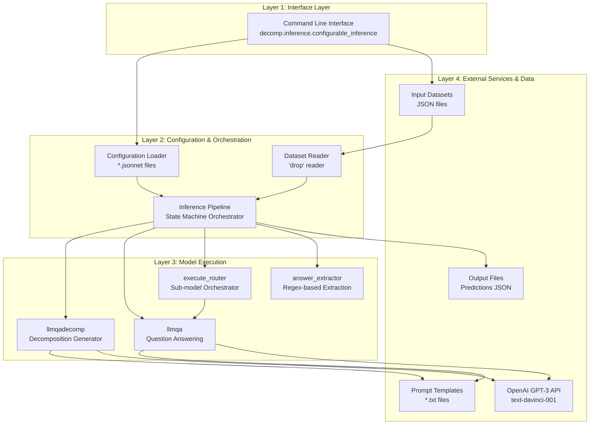
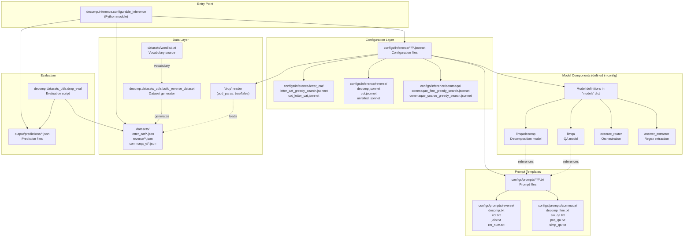
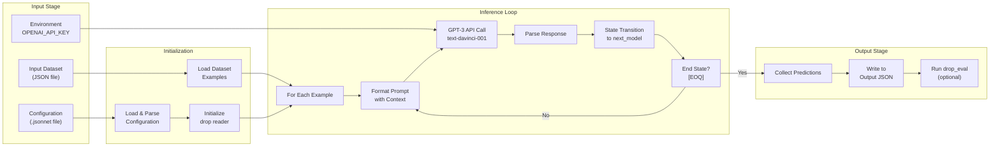

<!-- source: DeepWiki mcp.deepwiki.com · repo allenai/DecomP · page 5 System Architecture · fetched 2026-10-26 -->

# System Architecture

<details>
<summary>Relevant source files</summary>

The following files were used as context for generating this wiki page:

- [LICENSE](LICENSE)
- [README.md](README.md)
- [configs/inference/reverse/decomp.jsonnet](configs/inference/reverse/decomp.jsonnet)

</details>


## Purpose and Scope

This page provides a comprehensive overview of the DecomP system's internal architecture, including its layered design, core components, and execution model. This document focuses on the structural organization and relationships between major subsystems.

For detailed information about specific subsystems, see:
- Inference pipeline execution details: [Inference Pipeline](#5.1)
- Configuration file structure and syntax: [Configuration System](#5.2)
- Individual model types and their behaviors: [Model Components](#5.3)

For information about prompting strategies and experimental setups, see [Core Concepts](#3) and [Experiments](#4).

---

## High-Level Overview

The DecomP system is a configurable inference framework that enables researchers to evaluate different prompting strategies for natural language processing tasks. The architecture is designed around three core principles:

1. **Configuration-Driven Design**: All inference behavior is defined through declarative Jsonnet configuration files
2. **Modular Model Components**: Different model types can be composed to create complex multi-stage pipelines
3. **State Machine Execution**: Inference follows a finite state machine model with transitions between model states

The system accepts input datasets in JSON format, processes them through a configurable pipeline of language model calls, and produces predictions that can be evaluated against ground truth.

**Sources**: [README.md:1-83]()

---

## Layered Architecture

The DecomP system follows a four-layer architecture:



**Layer Responsibilities**:

| Layer | Purpose | Key Components |
|-------|---------|----------------|
| **Interface** | User interaction and command execution | CLI script with command-line arguments |
| **Configuration** | System behavior definition and data management | Jsonnet configs, inference pipeline, dataset reader |
| **Model Execution** | LLM interaction and result processing | llmqadecomp, llmqa, execute_router, answer_extractor |
| **External/Data** | External dependencies and I/O | GPT-3 API, datasets, prompts, output files |

**Sources**: [README.md:18-79](), [configs/inference/reverse/decomp.jsonnet:1-43]()

---

## Component Architecture

The following diagram shows the main code modules and their relationships using actual file paths and component names:



**Key Components**:

- **`configurable_inference`**: Main entry point that loads config and executes inference
- **Configuration files (`.jsonnet`)**: Define the state machine, model components, and execution parameters
- **Prompt files (`.txt`)**: Template files that guide LLM generation
- **Model components**: Logic components defined in config (`llmqadecomp`, `llmqa`, `execute_router`, `answer_extractor`)
- **`drop` reader**: Dataset reader that loads examples and optionally adds context
- **`drop_eval`**: Evaluation script that compares predictions to gold answers

**Sources**: [README.md:18-79](), [configs/inference/reverse/decomp.jsonnet:1-43]()

---

## Data Flow Architecture

This diagram shows how data flows through the system from input to output:



**Data Transformations**:

1. **Input**: Raw JSON dataset with questions/contexts
2. **Prompt Formatting**: Question + context inserted into prompt template
3. **LLM Generation**: GPT-3 generates text based on formatted prompt
4. **State Transition**: System determines next model based on configuration
5. **Answer Extraction**: Final answer extracted from generation chain
6. **Output**: Predictions written in JSON format compatible with evaluation

**Sources**: [README.md:18-79](), [configs/inference/reverse/decomp.jsonnet:1-43]()

---

## State Machine Execution Model

The inference pipeline operates as a finite state machine where each state corresponds to a model execution:

```mermaid
stateDiagram-v2
    [*] --> start_state
    
    state "Configuration Defines" as ConfigDef {
        state "start_state: string<br/>(initial model name)"
        state "end_state: string<br/>([EOQ] marker)"
        state "models: dict<br/>(model definitions)"
    }
    
    start_state --> ModelExecution
    
    state ModelExecution {
        [*] --> LoadModel
        LoadModel --> CheckType
        
        CheckType --> llmqadecomp_exec: name=llmqadecomp
        CheckType --> llmqa_exec: name=llmqa
        CheckType --> router_exec: name=execute_router
        CheckType --> extractor_exec: name=answer_extractor
        
        state "llmqadecomp" as llmqadecomp_exec {
            [*] --> LoadPrompt
            LoadPrompt --> FormatPrompt
            FormatPrompt --> CallGPT3
            CallGPT3 --> GenerateSteps
            GenerateSteps --> [*]
        }
        
        state "llmqa" as llmqa_exec {
            [*] --> LoadPrompt_qa
            LoadPrompt_qa --> FormatPrompt_qa
            FormatPrompt_qa --> CallGPT3_qa
            CallGPT3_qa --> [*]
        }
        
        state "execute_router" as router_exec {
            [*] --> ParseSteps
            ParseSteps --> RouteToSubModel
            RouteToSubModel --> ExecuteSubModel
            ExecuteSubModel --> CollectResults
            CollectResults --> [*]
        }
        
        state "answer_extractor" as extractor_exec {
            [*] --> ApplyRegex
            ApplyRegex --> ExtractAnswer
            ExtractAnswer --> [*]
        }
        
        llmqadecomp_exec --> Transition
        llmqa_exec --> Transition
        router_exec --> Transition
        extractor_exec --> Transition
        
        Transition --> [*]
    }
    
    ModelExecution --> CheckEndState
    
    CheckEndState --> ModelExecution: next_model != [EOQ]
    CheckEndState --> end_state: next_model = [EOQ]
    
    end_state --> [*]
```

**State Machine Configuration**:

The state machine is defined in the Jsonnet configuration with the following structure:

| Field | Type | Description |
|-------|------|-------------|
| `start_state` | string | Name of the initial model to execute |
| `end_state` | string | Terminal state marker (typically `[EOQ]`) |
| `models` | object | Dictionary of model definitions, keyed by model name |
| `models[name].name` | string | Model type (`llmqadecomp`, `llmqa`, `execute_router`, `answer_extractor`) |
| `models[name].next_model` | string | Name of next model to execute after this one |
| `models[name].prompt_file` | string | Path to prompt template (for generation models) |
| `models[name].max_tokens` | int | Maximum tokens to generate (for generation models) |
| `models[name].end_state` | string | Override end state condition (optional) |
| `models[name].max_steps` | int | Maximum execution steps (optional) |

**Sources**: [configs/inference/reverse/decomp.jsonnet:1-43]()

---

## Configuration-Driven Behavior

The system's behavior is entirely controlled by Jsonnet configuration files, which define:

**Example Configuration Structure** ([configs/inference/reverse/decomp.jsonnet:1-43]()):

```
{
  "start_state": "reverse",
  "end_state": "[EOQ]",
  "models": {
    "reverse": {
      "name": "llmqadecomp",
      "prompt_file": "configs/prompts/reverse/decomp.txt",
      "next_model": "execute",
      "max_tokens": 400,
      "end_state": "[EOQ]"
    },
    "execute": {
      "name": "execute_router"
    },
    "join": {
      "name": "llmqa",
      "prompt_file": "configs/prompts/reverse/join.txt"
    }
  },
  "reader": {
    "name": "drop",
    "add_paras": true
  }
}
```

**Configuration Parameters by Model Type**:

| Model Type | Required Parameters | Optional Parameters | Purpose |
|------------|-------------------|-------------------|---------|
| `llmqadecomp` | `name`, `prompt_file`, `next_model` | `max_tokens`, `end_state`, `max_steps`, `gen_model`, `engine` | Generates decomposed reasoning steps |
| `llmqa` | `name`, `prompt_file` | `max_tokens`, `gen_model`, `engine` | Generates answers to questions |
| `execute_router` | `name` | - | Routes to sub-models based on decomposed steps |
| `answer_extractor` | `name`, `regex` | - | Extracts answers using regex patterns |

**Sources**: [configs/inference/reverse/decomp.jsonnet:1-43](), [README.md:18-79]()

---

## External Dependencies

The system relies on the following external services and resources:

**GPT-3 API Integration**:
- **API Provider**: OpenAI
- **Model**: `text-davinci-001` (default, configurable via `engine` parameter)
- **Authentication**: Requires `OPENAI_API_KEY` environment variable
- **Usage**: All `llmqadecomp` and `llmqa` model types make API calls

**Dataset Format**:
- **Format**: JSON files with DROP dataset schema
- **Fields**: Typically includes `question`, `context`, `answer` fields
- **Reader**: `drop` reader component handles parsing

**Evaluation**:
- **Tool**: `decomp.datasets_utils.drop_eval` module
- **Metrics**: Compares predicted answers against gold standard
- **Output**: Accuracy and other metrics

**Sources**: [README.md:12-16](), [README.md:28-30](), [configs/inference/reverse/decomp.jsonnet:1-43]()

---

## Command-Line Interface

The system is invoked through the `configurable_inference` module:

**Basic Usage Pattern**:
```bash
python -m decomp.inference.configurable_inference \
  --input <dataset_path> \
  --config <config_path> \
  --output <output_path>
```

**Optional Environment Variables**:
```bash
export PYTHONPATH=src/
export OPENAI_API_KEY=<your_key>
promptid=p1  # Used by some configs to select prompt variants
```

**Parameters**:
- `--input`: Path to input dataset JSON file
- `--config`: Path to Jsonnet configuration file
- `--output`: Path for output predictions JSON file
- `promptid` (env): Prompt variant selector for experiments with multiple prompts

**Sources**: [README.md:18-79]()

---

## Extension Points

The architecture provides several extension points for customization:

1. **New Model Types**: Add new model components by implementing corresponding logic
2. **Custom Prompts**: Create new prompt templates in `configs/prompts/`
3. **New Configurations**: Define new experiment configs in `configs/inference/`
4. **Custom Readers**: Implement alternative dataset readers beyond `drop`
5. **New Experiments**: Combine existing model types in novel configurations

For detailed guidance on extending the system, see [Development Guide](#8).

**Sources**: [configs/inference/reverse/decomp.jsonnet:1-43]()

---

