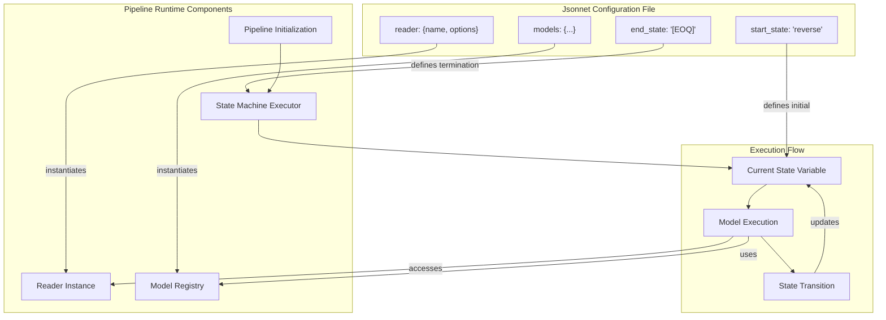
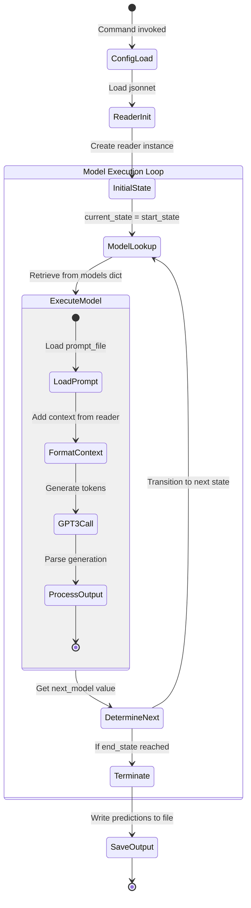
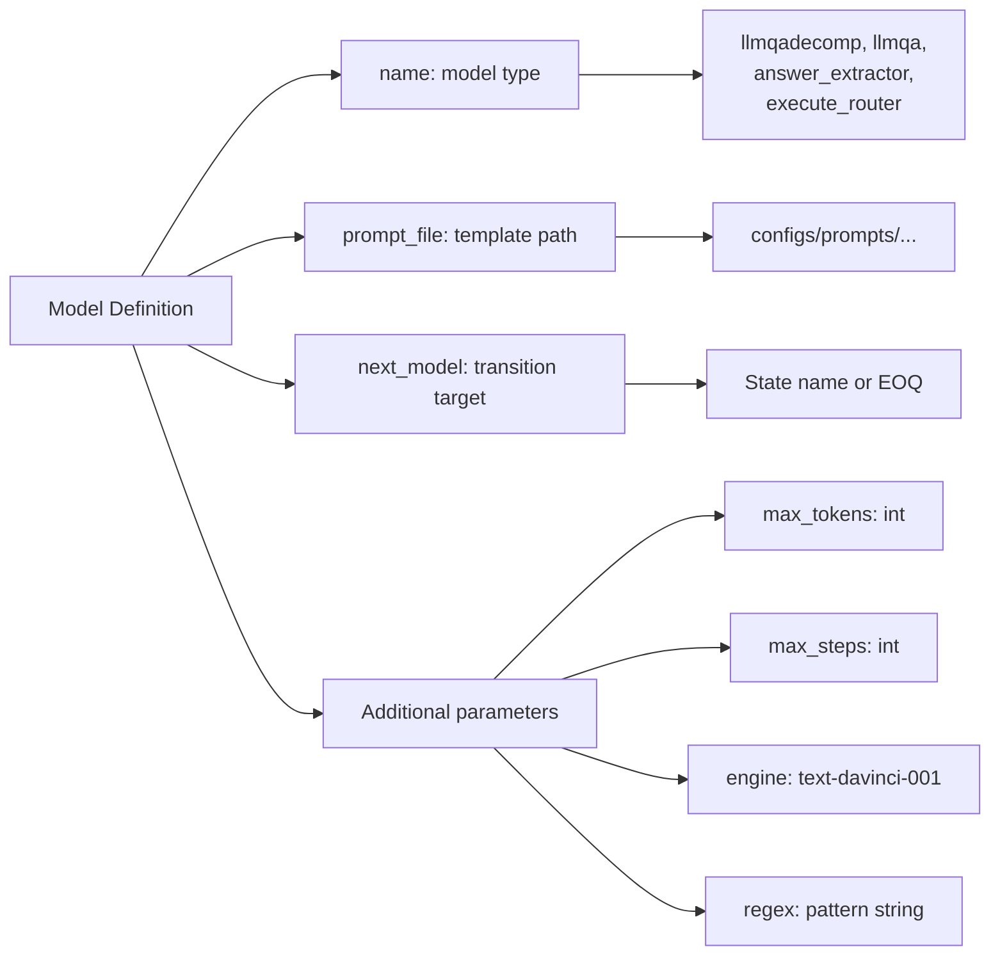
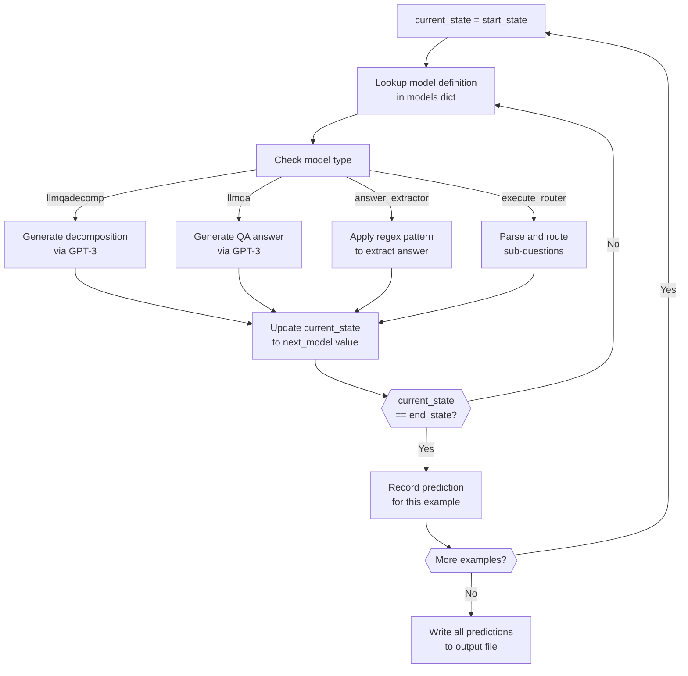
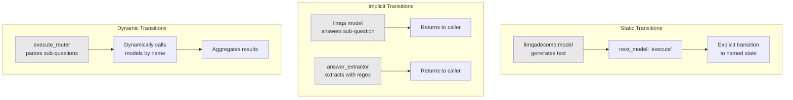
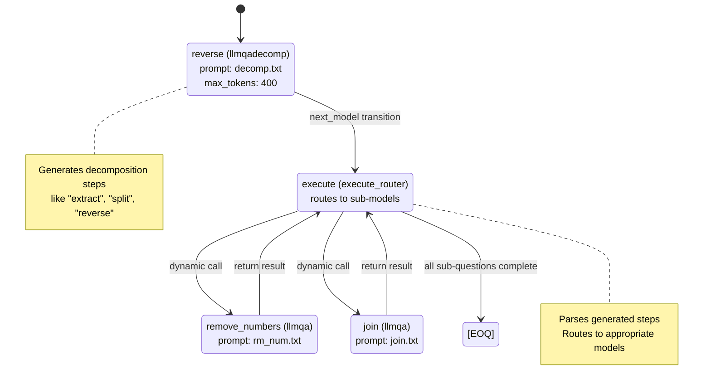
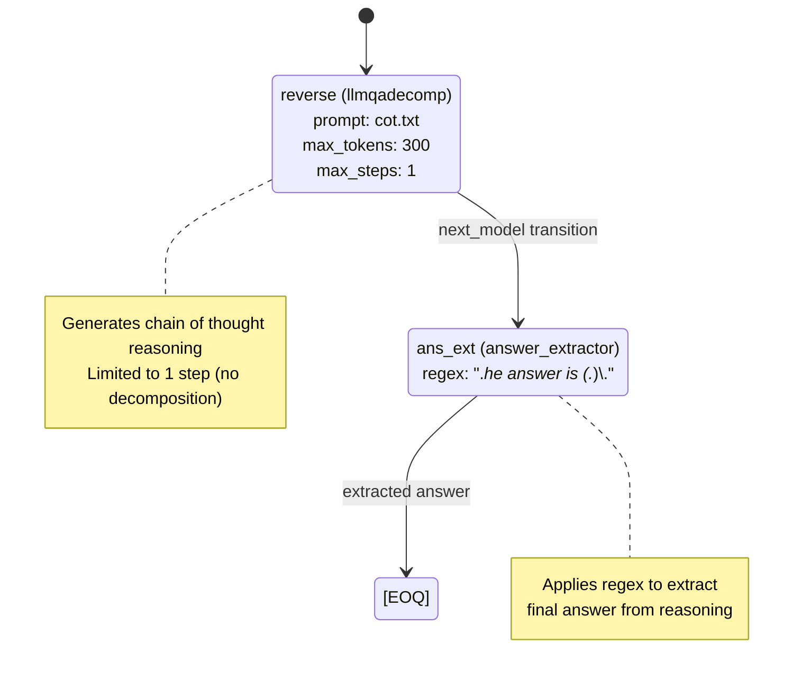
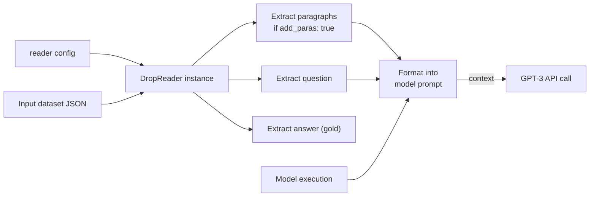

<!-- source: DeepWiki mcp.deepwiki.com · repo allenai/DecomP · page 5.1 Inference Pipeline · fetched 2026-10-26 -->

# Inference Pipeline

<details>
<summary>Relevant source files</summary>

The following files were used as context for generating this wiki page:

- [LICENSE](LICENSE)
- [README.md](README.md)
- [configs/inference/reverse/cot.jsonnet](configs/inference/reverse/cot.jsonnet)
- [configs/inference/reverse/decomp.jsonnet](configs/inference/reverse/decomp.jsonnet)

</details>


## Purpose and Scope

The inference pipeline is the core execution engine of the DecomP system. It orchestrates the end-to-end process of loading configurations, initializing data readers, executing language model calls through a state machine, and generating predictions. This page explains the pipeline's architecture, execution model, and configuration-driven design.

For details on the Jsonnet configuration files that drive the pipeline, see [Configuration System](#5.2). For information on individual model types (llmqadecomp, llmqa, answer_extractor, execute_router), see [Model Components](#5.3).

---

## System Entry Point

The inference pipeline is invoked through the `configurable_inference` module, which serves as the command-line interface to the system.

**Command Structure:**
```bash
python -m decomp.inference.configurable_inference \
  --input <dataset_path> \
  --config <config_file.jsonnet> \
  --output <predictions_path>
```

The module accepts three required parameters:
- `--input`: Path to the input dataset (JSON format)
- `--config`: Path to a Jsonnet configuration file defining the pipeline
- `--output`: Path where predictions will be saved

**Sources:** [README.md:23-30](), [README.md:52-59](), [README.md:65-72]()

---

## Pipeline Architecture

The inference pipeline operates as a configuration-driven state machine. Each execution follows a deterministic path through a series of model states, where each state performs a specific operation (generation, extraction, routing, or QA) and transitions to the next state.

### Configuration-to-Pipeline Mapping



**Diagram: Configuration elements map to runtime pipeline components**

**Sources:** [configs/inference/reverse/decomp.jsonnet:1-41](), [configs/inference/reverse/cot.jsonnet:1-26]()

---

## State Machine Execution Model

The pipeline executes as a state machine where each state corresponds to a model defined in the configuration. The execution follows this pattern:

### State Transition Flow



**Diagram: State machine execution flow showing transitions between models**

**Sources:** [configs/inference/reverse/decomp.jsonnet:3-11](), [configs/inference/reverse/cot.jsonnet:3-12]()

---

## Configuration Structure

Each configuration file defines the complete execution graph through four main sections:

### Core Configuration Elements

| Element | Type | Description | Example Values |
|---------|------|-------------|----------------|
| `start_state` | string | Initial model to execute | `"reverse"`, `"gen"` |
| `end_state` | string | Termination condition marker | `"[EOQ]"` |
| `models` | object | Dictionary of model definitions keyed by state name | `{"reverse": {...}, "execute": {...}}` |
| `reader` | object | Data reader configuration | `{"name": "drop", "add_paras": true}` |

**Sources:** [configs/inference/reverse/decomp.jsonnet:3-40]()

### Model Definition Schema

Each model in the `models` dictionary contains:



**Diagram: Structure of a model definition in the configuration**

**Sources:** [configs/inference/reverse/decomp.jsonnet:6-36]()

---

## Execution Phases

### Phase 1: Initialization

Upon invocation, the pipeline performs these initialization steps:

1. **Load Configuration**: Parse the Jsonnet configuration file
2. **Initialize Reader**: Create reader instance based on `reader.name` (typically `"drop"`)
3. **Load Dataset**: Read input JSON file into memory
4. **Initialize Models**: Prepare model registry from `models` dictionary
5. **Set Initial State**: Set `current_state = start_state`

**Configuration Example:**
```jsonnet
"reader": {
  "name": "drop",
  "add_paras": true
}
```

The `add_paras` option controls whether context paragraphs from the dataset are included in model prompts.

**Sources:** [configs/inference/reverse/decomp.jsonnet:37-40](), [configs/inference/reverse/cot.jsonnet:22-25]()

### Phase 2: Model Execution Loop

For each example in the dataset, the pipeline executes the following loop:



**Diagram: Execution loop for processing dataset examples through model states**

**Sources:** [configs/inference/reverse/decomp.jsonnet:3-36](), [configs/inference/reverse/cot.jsonnet:3-20]()

### Phase 3: Termination and Output

The execution loop terminates when `current_state` equals `end_state`, which is conventionally set to `"[EOQ]"` (End of Question). At this point, the final prediction is recorded for the current example.

After processing all examples in the dataset, predictions are written to the output file in JSON format compatible with the evaluation script.

**Sources:** [configs/inference/reverse/decomp.jsonnet:4](), [configs/inference/reverse/cot.jsonnet:4]()

---

## Model Types and Transitions

The pipeline supports four model types, each with distinct behavior:

### Model Type Comparison

| Model Type | Purpose | Generates Text | Uses Prompt | Transitions To | Configuration Keys |
|-----------|---------|----------------|-------------|----------------|-------------------|
| `llmqadecomp` | Decompose complex questions | Yes (GPT-3) | Yes | Any state | `prompt_file`, `next_model`, `max_tokens`, `max_steps`, `end_state` |
| `llmqa` | Answer simple questions | Yes (GPT-3) | Yes | Implicit (return) | `prompt_file` |
| `answer_extractor` | Extract answers via regex | No | No | Implicit (return) | `regex` |
| `execute_router` | Route to sub-questions | No | No | Dynamic (parsed) | None |

**Sources:** [configs/inference/reverse/decomp.jsonnet:6-36]()

### Transition Mechanisms



**Diagram: Three transition mechanisms used by different model types**

**Sources:** [configs/inference/reverse/decomp.jsonnet:6-27]()

---

## Concrete Example: Decomposed Reversal

This example shows the complete state machine for the decomposed list reversal strategy:

### State Diagram with Actual Configuration



**Diagram: Complete state machine for decomposed list reversal configuration**

### Configuration Mapping

The state diagram above directly corresponds to this configuration structure:

```jsonnet
{
  "start_state": "reverse",
  "end_state": "[EOQ]",
  "models": {
    "reverse": {
      "name": "llmqadecomp",
      "next_model": "execute",
      // ... generates decomposition
    },
    "execute": {
      "name": "execute_router"
      // ... routes to join/remove_numbers
    },
    "join": {
      "name": "llmqa",
      // ... called by execute_router
    },
    "remove_numbers": {
      "name": "llmqa",
      // ... called by execute_router
    }
  }
}
```

**Sources:** [configs/inference/reverse/decomp.jsonnet:1-41]()

---

## Concrete Example: Chain of Thought

A simpler configuration uses only two states:



**Diagram: Simplified state machine for chain of thought strategy**

**Sources:** [configs/inference/reverse/cot.jsonnet:1-26]()

---

## Generation Parameters

Models that generate text (llmqadecomp, llmqa) include generation parameters:

### Common Generation Parameters

| Parameter | Type | Description | Typical Value |
|-----------|------|-------------|---------------|
| `gen_model` | string | Generation backend | `"gpt3"` |
| `engine` | string | Specific GPT-3 model | `"text-davinci-001"` |
| `max_tokens` | integer | Maximum tokens to generate | `300` - `400` |
| `max_steps` | integer | Maximum decomposition steps | `1` (CoT), unlimited (decomp) |
| `end_state` | string | Early termination marker | `"[EOQ]"` |

**Configuration Pattern:**
```jsonnet
local gen_params = { 
  "gen_model": "gpt3", 
  "engine": "text-davinci-001"
};

"models": {
  "reverse": {
    "name": "llmqadecomp",
    "max_tokens": 400,
    // ... other params
  } + gen_params
}
```

The `+ gen_params` pattern merges the common generation parameters into each model definition.

**Sources:** [configs/inference/reverse/decomp.jsonnet:1-12](), [configs/inference/reverse/cot.jsonnet:1-13]()

---

## Reader Integration

The reader component provides dataset context to models during execution:

### Reader Configuration



**Diagram: Reader integration provides context to model prompts**

The `"drop"` reader name refers to the DROP dataset format, which is the standard format used across all experiments. The `add_paras` option controls whether context paragraphs are included in prompts:

- `true`: Include context paragraphs (used for CommAQA)
- `false` or omitted: Question-only prompts (used for synthetic tasks)

**Sources:** [configs/inference/reverse/decomp.jsonnet:37-40](), [configs/inference/reverse/cot.jsonnet:22-25]()

---

## Error Handling and Validation

The pipeline includes implicit validation at several points:

### Validation Checks

| Phase | Validation | Failure Behavior |
|-------|-----------|------------------|
| Configuration Load | Valid Jsonnet syntax | Parsing error, exit |
| Model Lookup | State exists in `models` dict | KeyError, exit |
| Transition | `next_model` target exists | KeyError, exit |
| Regex Extraction | Pattern matches output | Returns empty/null |
| End State | Eventually reaches `end_state` | May loop indefinitely |

**Note:** The system does not include explicit loop detection. Misconfigured transitions can cause infinite loops. Ensure that all execution paths eventually reach `end_state`.

**Sources:** [configs/inference/reverse/decomp.jsonnet:3-36]()

---

## Pipeline Outputs

Upon completion, the pipeline writes a JSON file containing predictions for all examples:

### Output Format

```json
{
  "example_id_1": {
    "prediction": "extracted or generated answer",
    "em": true,
    "f1": 1.0
  },
  "example_id_2": {
    "prediction": "another answer",
    "em": false,
    "f1": 0.75
  }
}
```

This output format is compatible with the `drop_eval` evaluation script for computing exact match (EM) and F1 scores.

**Sources:** [README.md:28-30]()

---

## Summary

The inference pipeline provides a flexible, configuration-driven framework for executing multi-step language model reasoning. Key characteristics:

1. **State Machine Architecture**: Models are states, transitions are explicit
2. **Configuration-Driven**: Entire execution graph defined in Jsonnet
3. **Modular Model Types**: Four distinct model types for different operations
4. **Flexible Transitions**: Static, implicit, and dynamic transition mechanisms
5. **Reader Integration**: Standardized context provision through DROP reader
6. **Deterministic Execution**: Same configuration produces same behavior

The pipeline supports diverse prompting strategies (decomposed, CoT, unrolled) through different configuration files without requiring code changes, making it ideal for systematic comparison of prompting approaches.

**Sources:** [README.md:18-79](), [configs/inference/reverse/decomp.jsonnet:1-41](), [configs/inference/reverse/cot.jsonnet:1-26]()

---

