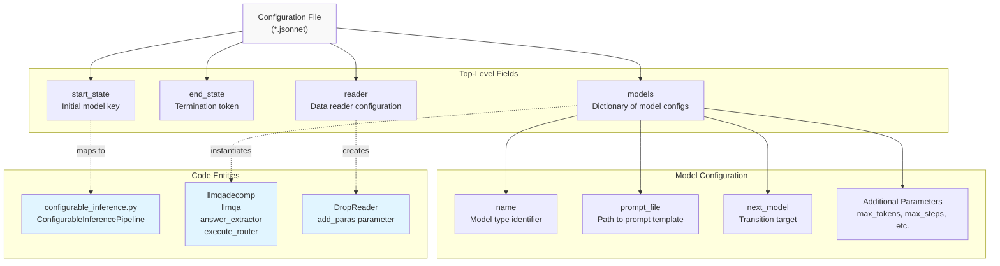
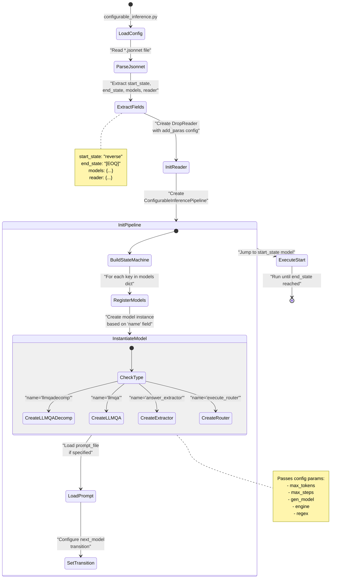
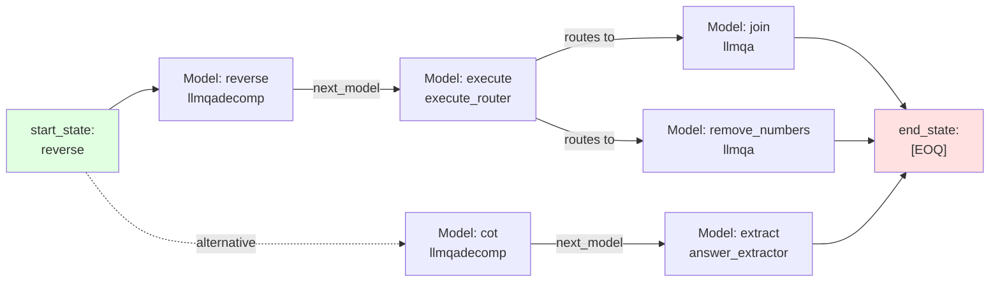

<!-- source: DeepWiki mcp.deepwiki.com · repo allenai/DecomP · page 5.2 Configuration System · fetched 2026-10-26 -->

# Configuration System

<details>
<summary>Relevant source files</summary>

The following files were used as context for generating this wiki page:

- [configs/inference/primitives.libsonnet](configs/inference/primitives.libsonnet)
- [configs/inference/reverse/decomp.jsonnet](configs/inference/reverse/decomp.jsonnet)

</details>


## Purpose and Scope

This document describes the Jsonnet-based configuration system that drives the DecomP inference pipeline. The configuration system defines the state machine, model parameters, prompts, and execution flow for inference experiments. For information about how these configurations are executed at runtime, see the Inference Pipeline ([5.1](#5.1)). For details on the individual model types that can be configured, see Model Components ([5.3](#5.3)).

## Configuration File Format

DecomP uses **Jsonnet** (a data templating language that extends JSON) for configuration files. Jsonnet enables:

- **Variables and composition** using `local` declarations
- **Object merging** with the `+` operator
- **External libraries** via `.libsonnet` files
- **Comments** for documentation

Configuration files are located in `configs/inference/` and are organized by experiment type (e.g., `reverse/`, `letter_cat/`, `commaqae/`).

**Sources:** [configs/inference/reverse/decomp.jsonnet:1-43]()

## Configuration Structure Overview



**Diagram: Configuration Structure to Code Entity Mapping**

**Sources:** [configs/inference/reverse/decomp.jsonnet:3-40]()

### Top-Level Configuration Fields

A configuration file defines four top-level fields:

| Field | Type | Purpose | Example |
|-------|------|---------|---------|
| `start_state` | string | Key of the initial model to execute | `"reverse"` |
| `end_state` | string | Token indicating pipeline termination | `"[EOQ]"` |
| `models` | object | Dictionary mapping model keys to model configurations | See below |
| `reader` | object | Configuration for the data reader component | `{"name": "drop", "add_paras": true}` |

**Sources:** [configs/inference/reverse/decomp.jsonnet:3-4,37-40]()

### Model Configuration Fields

Each entry in the `models` dictionary defines a model component with the following fields:

| Field | Required | Type | Description |
|-------|----------|------|-------------|
| `name` | Yes | string | Model type: `llmqadecomp`, `llmqa`, `answer_extractor`, `execute_router` |
| `prompt_file` | Conditional | string | Path to prompt template (required for `llmqadecomp`, `llmqa`) |
| `next_model` | No | string | Key of next model to execute after this one |
| `max_tokens` | No | integer | Maximum tokens for GPT-3 generation (default varies) |
| `max_steps` | No | integer | Maximum execution steps (for iterative models) |
| `end_state` | No | string | Alternative termination token for this model |
| `gen_model` | Conditional | string | Generation backend: `"gpt3"` (required for generative models) |
| `engine` | Conditional | string | GPT-3 engine: `"text-davinci-001"` (required for generative models) |
| `regex` | Conditional | string | Extraction pattern (required for `answer_extractor`) |

**Sources:** [configs/inference/reverse/decomp.jsonnet:6-35]()

## Configuration Composition Patterns

### Using Local Variables

Jsonnet allows defining reusable parameter sets with `local` variables:

```jsonnet
local gen_params = { 
  "gen_model": "gpt3", 
  "engine": "text-davinci-001"
};
```

These can be merged into model configurations using the `+` operator:

```jsonnet
"reverse": {
  "name": "llmqadecomp",
  "prompt_file": "configs/prompts/reverse/decomp.txt",
  "next_model": "execute",
  "max_tokens": 400,
  "end_state": "[EOQ]",
} + gen_params,
```

This pattern ensures consistent GPT-3 parameters across all generative models in the configuration.

**Sources:** [configs/inference/reverse/decomp.jsonnet:1,6-12]()

### External Libraries

Reusable model configurations can be defined in `.libsonnet` files and imported:

```jsonnet
// primitives.libsonnet defines common sub-models
{
  "str_position": {
    "name": "llmqadecomp",
    "prompt_file": "configs/prompts/task_primitives/str_position.txt",
  },
  "arr_position": {
    "name": "llmqa",
    "prompt_file": "configs/prompts/task_primitives/arr_position.txt",
  },
  // ...
}
```

These can be imported and merged into main configurations for composition of complex pipelines.

**Sources:** [configs/inference/primitives.libsonnet:1-18]()

## Configuration Execution Flow



**Diagram: Configuration Loading and Pipeline Initialization**

**Sources:** [configs/inference/reverse/decomp.jsonnet:1-43]()

## Reader Configuration

The `reader` field configures the data reader component that provides context to models:

```jsonnet
"reader": {
  "name": "drop",
  "add_paras": true
}
```

| Parameter | Type | Description |
|-----------|------|-------------|
| `name` | string | Reader type (currently only `"drop"` supported) |
| `add_paras` | boolean | Whether to include passage context in prompts |

The `DropReader` class uses `add_paras` to determine if paragraph context should be added to prompts when `add_context: true` is specified in prompt templates.

**Sources:** [configs/inference/reverse/decomp.jsonnet:37-40]()

## Model Type Configuration Examples

### Generative Model (llmqadecomp)

```jsonnet
"reverse": {
  "name": "llmqadecomp",
  "prompt_file": "configs/prompts/reverse/decomp.txt",
  "next_model": "execute",
  "max_tokens": 400,
  "end_state": "[EOQ]",
  "gen_model": "gpt3",
  "engine": "text-davinci-001"
}
```

Used for decomposition or generation tasks. Requires prompt file and GPT-3 parameters.

**Sources:** [configs/inference/reverse/decomp.jsonnet:6-12]()

### Question Answering Model (llmqa)

```jsonnet
"join": {
  "name": "llmqa",
  "prompt_file": "configs/prompts/reverse/join.txt",
  "gen_model": "gpt3",
  "engine": "text-davinci-001"
}
```

Used for single-step question answering without decomposition.

**Sources:** [configs/inference/reverse/decomp.jsonnet:28-31]()

### Answer Extractor

```jsonnet
"extract": {
  "name": "answer_extractor",
  "regex": ".* (?:is|reverse) \"(.*)\"\\.",
}
```

Extracts answers using regex patterns from generated text. No GPT-3 parameters needed.

**Sources:** [configs/inference/reverse/decomp.jsonnet:21-24]()

### Execution Router

```jsonnet
"execute": {
  "name": "execute_router"
}
```

Routes to sub-models based on decomposed steps. No additional parameters required.

**Sources:** [configs/inference/reverse/decomp.jsonnet:25-27]()

## State Transitions



**Diagram: State Transitions in decomp.jsonnet Configuration**

The `next_model` field defines explicit transitions between models. The `execute_router` model dynamically routes to sub-models based on decomposed steps without explicit `next_model` configuration.

**Sources:** [configs/inference/reverse/decomp.jsonnet:3-40]()

## Creating New Configurations

### Step 1: Define Generation Parameters

```jsonnet
local gen_params = { 
  "gen_model": "gpt3", 
  "engine": "text-davinci-001"
};
```

### Step 2: Set Top-Level Fields

```jsonnet
{
  "start_state": "my_initial_model",
  "end_state": "[EOQ]",
  "models": {
    // Model configurations here
  },
  "reader": {
    "name": "drop",
    "add_paras": true
  }
}
```

### Step 3: Define Model Pipeline

Each model in the pipeline needs:
- A unique key (used for `start_state` and `next_model` references)
- A `name` field specifying the model type
- Required parameters based on model type
- Optional `next_model` to specify transitions

### Step 4: Configure Prompts

Each generative model (`llmqadecomp`, `llmqa`) requires a `prompt_file` pointing to a template in `configs/prompts/`.

### Step 5: Set Transition Logic

Use `next_model` for deterministic transitions or `execute_router` for dynamic routing based on decomposed steps.

## Configuration Best Practices

| Practice | Rationale |
|----------|-----------|
| Use `local` variables for common parameters | Ensures consistency and reduces duplication |
| Set explicit `max_tokens` for generative models | Prevents excessive API costs |
| Use descriptive model keys | Makes state transitions easier to understand |
| Include `end_state` token in final models | Ensures proper pipeline termination |
| Document complex routing with comments | Jsonnet supports comments for clarity |

**Sources:** [configs/inference/reverse/decomp.jsonnet:1-43](), [configs/inference/primitives.libsonnet:1-18]()

---

