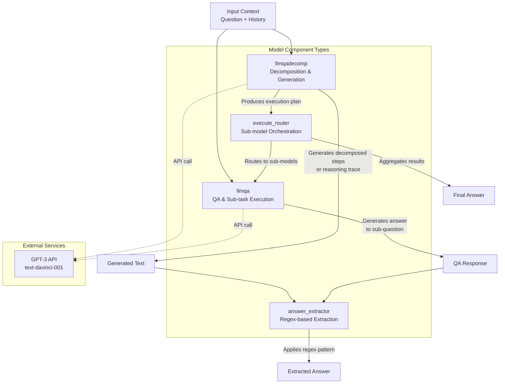
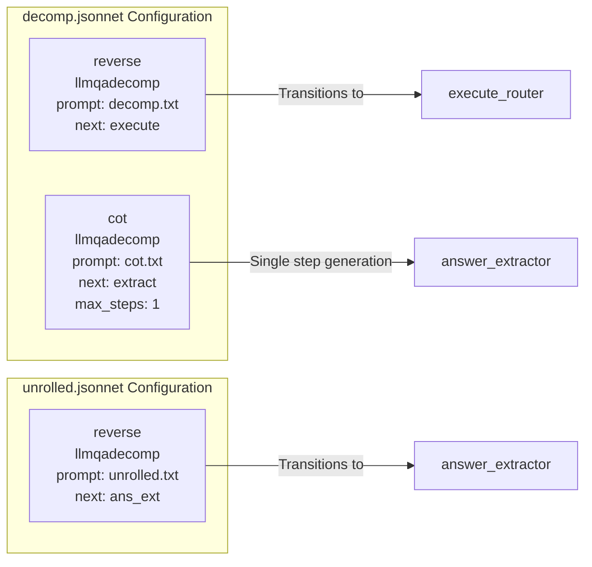
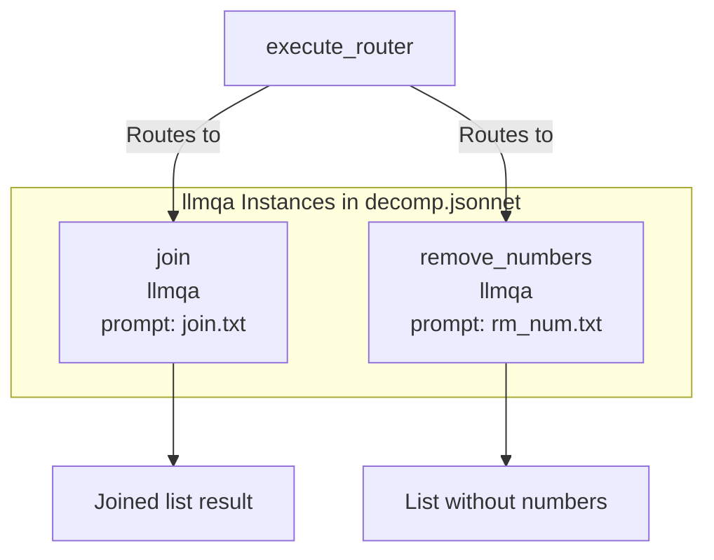
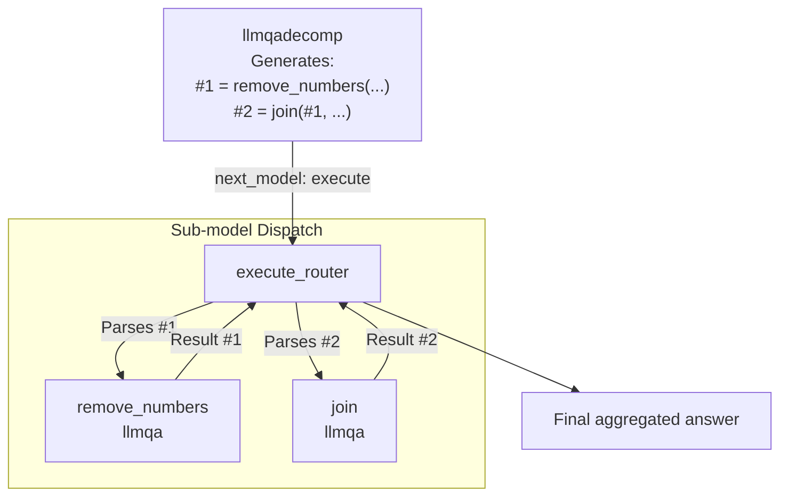
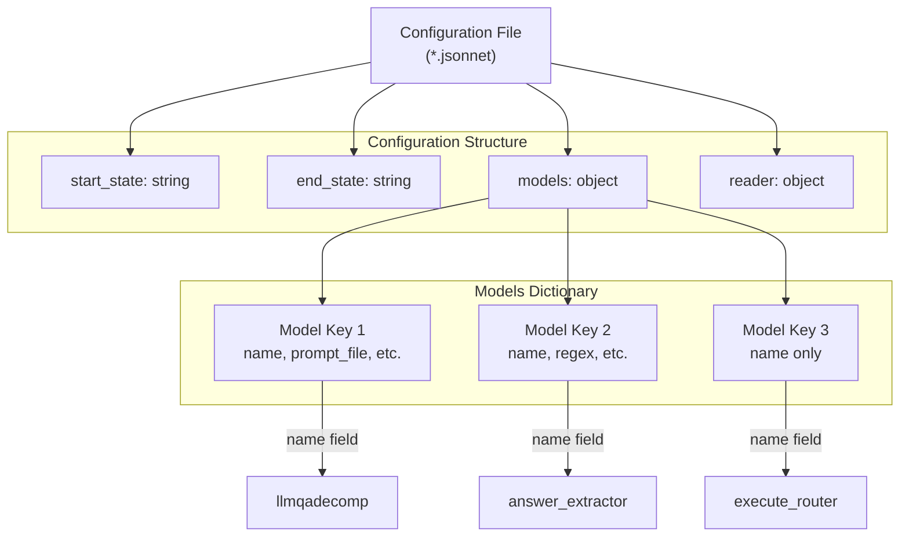
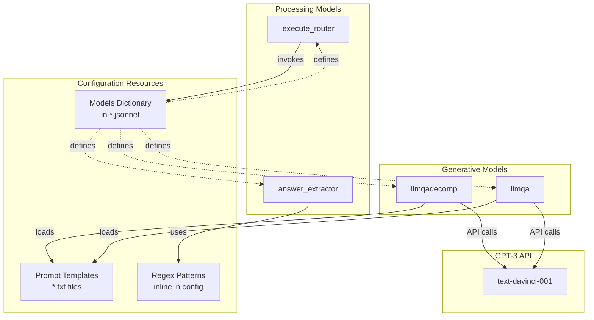

<!-- source: DeepWiki mcp.deepwiki.com · repo allenai/DecomP · page 5.3 Model Components · fetched 2026-10-26 -->

# Model Components

<details>
<summary>Relevant source files</summary>

The following files were used as context for generating this wiki page:

- [configs/inference/reverse/decomp.jsonnet](configs/inference/reverse/decomp.jsonnet)
- [configs/inference/reverse/unrolled.jsonnet](configs/inference/reverse/unrolled.jsonnet)

</details>


## Purpose and Scope

This document describes the four core model component types used in the DecomP inference pipeline: `llmqadecomp`, `llmqa`, `answer_extractor`, and `execute_router`. Each component serves a specific role in the multi-stage inference process. For information about how these models are orchestrated in the inference pipeline, see [Inference Pipeline](#5.1). For details on how to configure these models, see [Configuration System](#5.2).

---

## Model Component Architecture

The DecomP system defines models as discrete state nodes in the inference pipeline. Each model processes input, produces output, and transitions to a `next_model` state. The four model types represent different capabilities:



**Diagram: Model Component Type Relationships**

All model configurations are defined in the `models` dictionary within Jsonnet configuration files. Each model is identified by a unique key (e.g., "reverse", "cot", "extract") and specifies its `name` field to indicate which component type it instantiates.

**Sources:** [configs/inference/reverse/decomp.jsonnet:5-36](), [configs/inference/reverse/unrolled.jsonnet:5-20]()

---

## llmqadecomp Model

### Overview

The `llmqadecomp` model is a generative component that calls GPT-3 to produce decomposed reasoning steps, sub-questions, or execution plans. This is typically used as the primary decomposition engine in the inference pipeline.

### Configuration Parameters

| Parameter | Type | Required | Description |
|-----------|------|----------|-------------|
| `name` | string | Yes | Must be `"llmqadecomp"` |
| `prompt_file` | string | Yes | Path to prompt template file |
| `next_model` | string | Yes | State to transition to after generation |
| `max_tokens` | integer | Yes | Maximum tokens to generate |
| `end_state` | string | Yes | Termination state (typically `"[EOQ]"`) |
| `gen_model` | string | Yes | Generation backend (e.g., `"gpt3"`) |
| `engine` | string | Yes | Model engine (e.g., `"text-davinci-001"`) |
| `max_steps` | integer | No | Maximum generation iterations (optional) |

### Example Configuration

The `llmqadecomp` model appears in multiple configurations:



**Diagram: llmqadecomp Instances in Configuration Files**

In [configs/inference/reverse/decomp.jsonnet:6-12](), the `"reverse"` model uses `llmqadecomp` with the decomposed prompting strategy, generating up to 400 tokens before transitioning to the `execute_router`.

In [configs/inference/reverse/decomp.jsonnet:13-20](), the `"cot"` model uses `llmqadecomp` with chain-of-thought prompting, limited to a single generation step (`max_steps: 1`) before extracting the answer.

In [configs/inference/reverse/unrolled.jsonnet:6-12](), the `"reverse"` model uses `llmqadecomp` with the unrolled strategy, generating up to 500 tokens.

### Behavior

The `llmqadecomp` model:
1. Loads the prompt template from `prompt_file`
2. Formats the template with current context (question, history, retrieved passages)
3. Calls the GPT-3 API with the specified `engine`
4. Generates up to `max_tokens` tokens
5. Appends the generated text to the execution history
6. Transitions to `next_model` state

**Sources:** [configs/inference/reverse/decomp.jsonnet:6-20](), [configs/inference/reverse/unrolled.jsonnet:6-12]()

---

## llmqa Model

### Overview

The `llmqa` model is a question-answering component that generates responses to specific sub-questions or performs targeted operations (e.g., joining lists, removing numbers). It shares the same GPT-3 generation backend as `llmqadecomp` but is used for simpler, more focused tasks.

### Configuration Parameters

| Parameter | Type | Required | Description |
|-----------|------|----------|-------------|
| `name` | string | Yes | Must be `"llmqa"` |
| `prompt_file` | string | Yes | Path to prompt template file |
| `gen_model` | string | Yes | Generation backend (e.g., `"gpt3"`) |
| `engine` | string | Yes | Model engine (e.g., `"text-davinci-001"`) |

### Example Configuration



**Diagram: llmqa Sub-models for List Operations**

In [configs/inference/reverse/decomp.jsonnet:28-31](), the `"join"` model uses `llmqa` to concatenate reversed list halves.

In [configs/inference/reverse/decomp.jsonnet:32-35](), the `"remove_numbers"` model uses `llmqa` to strip numbering from lists.

### Behavior

The `llmqa` model:
1. Loads the prompt template from `prompt_file`
2. Formats the template with the current sub-question and context
3. Calls GPT-3 to generate an answer
4. Returns control to the calling model (typically `execute_router`)

Unlike `llmqadecomp`, `llmqa` models do not specify `next_model` or `end_state` because they are invoked by the `execute_router` and return control to it after execution.

**Sources:** [configs/inference/reverse/decomp.jsonnet:28-35]()

---

## answer_extractor Model

### Overview

The `answer_extractor` model uses regular expressions to extract structured answers from generated text. This component does not call external APIs; it performs local pattern matching on the output from generative models.

### Configuration Parameters

| Parameter | Type | Required | Description |
|-----------|------|----------|-------------|
| `name` | string | Yes | Must be `"answer_extractor"` |
| `regex` | string | Yes | Regular expression pattern to match |

### Example Configuration

The following table shows the different extraction patterns used across configurations:

| Model Key | Regex Pattern | Purpose |
|-----------|---------------|---------|
| `extract` | `.* (?:is\|reverse) \"(.*)\"\.` | Extracts answer from CoT reasoning |
| `ans_ext` | `.*he answer is (.*)\.` | Extracts answer from unrolled execution |

```mermaid
graph LR
    GENERATED["Generated Text:<br/>'... the reverse is \"E, D, C, B, A\".'"]
    
    EXTRACT["answer_extractor<br/>regex: .* (?:is|reverse) \"(.*)\"\."]
    
    ANS_EXT["answer_extractor<br/>regex: .*he answer is (.*)\."]
    
    GENERATED --> EXTRACT
    GENERATED --> ANS_EXT
    
    EXTRACT --> RESULT1["Captured Group: 'E, D, C, B, A'"]
    ANS_EXT --> RESULT2["Captured Group: extracted answer"]
```

**Diagram: answer_extractor Pattern Matching**

In [configs/inference/reverse/decomp.jsonnet:21-24](), the `"extract"` model extracts answers that match the pattern of "is" or "reverse" followed by a quoted string.

In [configs/inference/reverse/unrolled.jsonnet:13-16](), the `"ans_ext"` model extracts answers following the phrase "he answer is".

### Behavior

The `answer_extractor` model:
1. Receives the generated text from the previous model
2. Applies the regex pattern to extract the first matching group
3. Sets the extracted text as the final prediction
4. Transitions to the `end_state` (typically `"[EOQ]"`)

**Sources:** [configs/inference/reverse/decomp.jsonnet:21-24](), [configs/inference/reverse/unrolled.jsonnet:13-16]()

---

## execute_router Model

### Overview

The `execute_router` model orchestrates the execution of decomposed sub-tasks. It parses the decomposition output from `llmqadecomp`, invokes the appropriate sub-models, and aggregates results. This component implements the core routing logic for multi-stage decomposed inference.

### Configuration Parameters

| Parameter | Type | Required | Description |
|-----------|------|----------|-------------|
| `name` | string | Yes | Must be `"execute_router"` |

The `execute_router` has minimal configuration because its behavior is driven by the decomposition output format. It expects the decomposition to specify which sub-models to call.

### Example Configuration



**Diagram: execute_router Orchestration Flow**

In [configs/inference/reverse/decomp.jsonnet:9](), the `"reverse"` model's `next_model` is `"execute"`.

In [configs/inference/reverse/decomp.jsonnet:25-27](), the `"execute"` model is defined as an `execute_router` instance.

### Behavior

The `execute_router` model:
1. Receives decomposed execution plan from the previous generative model
2. Parses the plan to identify sub-model invocations (e.g., `#1 = remove_numbers(...)`)
3. For each sub-task:
   - Looks up the corresponding model in the configuration's `models` dictionary
   - Invokes that model with appropriate context
   - Stores the result with a reference ID (e.g., `#1`)
4. Makes results from earlier steps available to later steps
5. Returns the final result from the last step

This enables multi-hop reasoning where the output of one model serves as input to subsequent models.

**Sources:** [configs/inference/reverse/decomp.jsonnet:9](), [configs/inference/reverse/decomp.jsonnet:25-27](), [configs/inference/reverse/unrolled.jsonnet:17-19]()

---

## Model Configuration Pattern

### Common Configuration Structure

All model configurations follow a common pattern in Jsonnet files:



**Diagram: Configuration File Structure**

### Shared Parameters (gen_params)

Generative models (`llmqadecomp` and `llmqa`) share common parameters defined in a local variable:

In [configs/inference/reverse/decomp.jsonnet:1]():
```
local gen_params = { "gen_model": "gpt3", "engine": "text-davinci-001"};
```

This is merged into model configurations using the `+ gen_params` syntax, as seen in:
- [configs/inference/reverse/decomp.jsonnet:12]() for the `"reverse"` model
- [configs/inference/reverse/decomp.jsonnet:20]() for the `"cot"` model
- [configs/inference/reverse/decomp.jsonnet:31]() for the `"join"` model
- [configs/inference/reverse/decomp.jsonnet:35]() for the `"remove_numbers"` model

### Model State Transitions

Models transition between states using the `next_model` field:

| From Model | Model Type | Next Model | Transition Purpose |
|------------|------------|------------|-------------------|
| `reverse` | llmqadecomp | `execute` | Route to sub-task orchestrator |
| `cot` | llmqadecomp | `extract` | Extract final answer from reasoning |
| `reverse` (unrolled) | llmqadecomp | `ans_ext` | Extract answer from unrolled execution |
| (sub-models) | llmqa | (returns to caller) | Return control to execute_router |

**Sources:** [configs/inference/reverse/decomp.jsonnet:1-42](), [configs/inference/reverse/unrolled.jsonnet:1-26]()

---

## Model Type Comparison

The following table summarizes the characteristics of each model component type:

| Model Type | Calls GPT-3 | Uses Prompts | Has next_model | Primary Purpose |
|------------|-------------|--------------|----------------|-----------------|
| `llmqadecomp` | Yes | Yes | Yes | Task decomposition and reasoning generation |
| `llmqa` | Yes | Yes | No | Answer specific sub-questions |
| `answer_extractor` | No | No | Implicit | Extract structured answers using regex |
| `execute_router` | No | No | Implicit | Orchestrate sub-model execution |



**Diagram: Model Component Dependencies and Resources**

**Sources:** [configs/inference/reverse/decomp.jsonnet:1-42](), [configs/inference/reverse/unrolled.jsonnet:1-26]()

---

