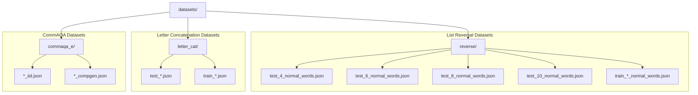
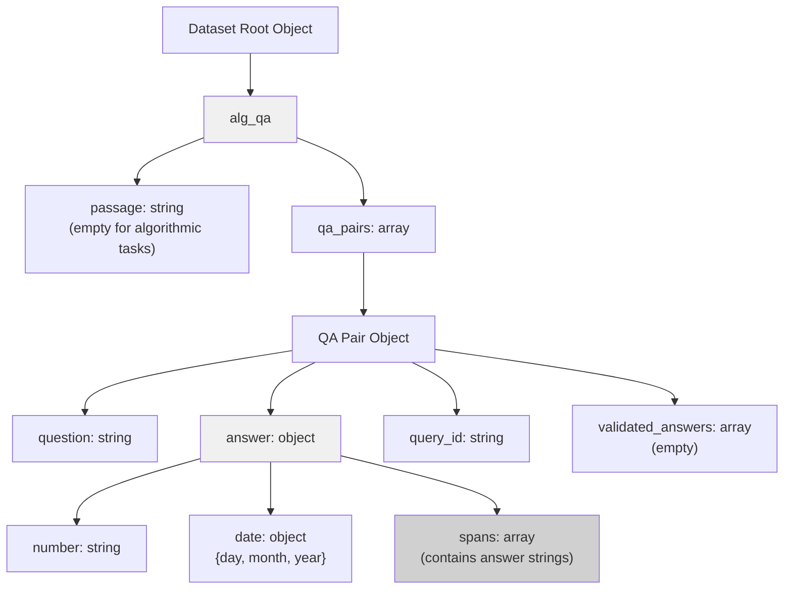
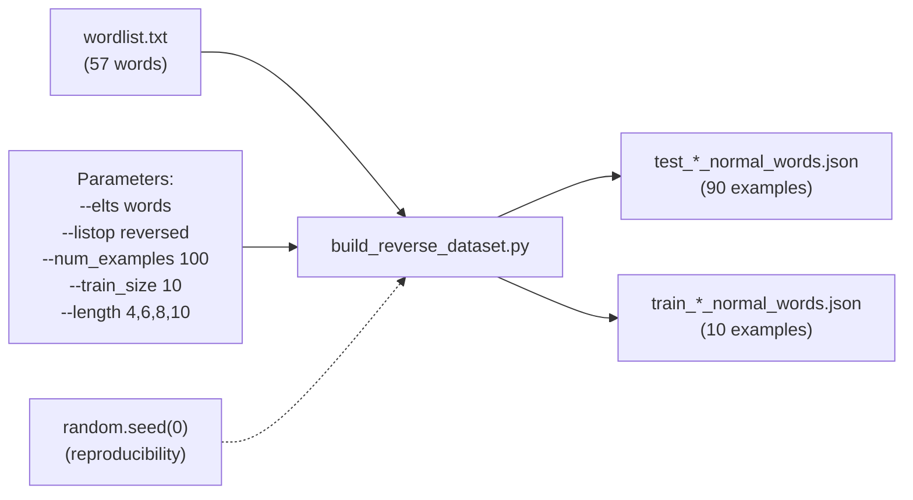
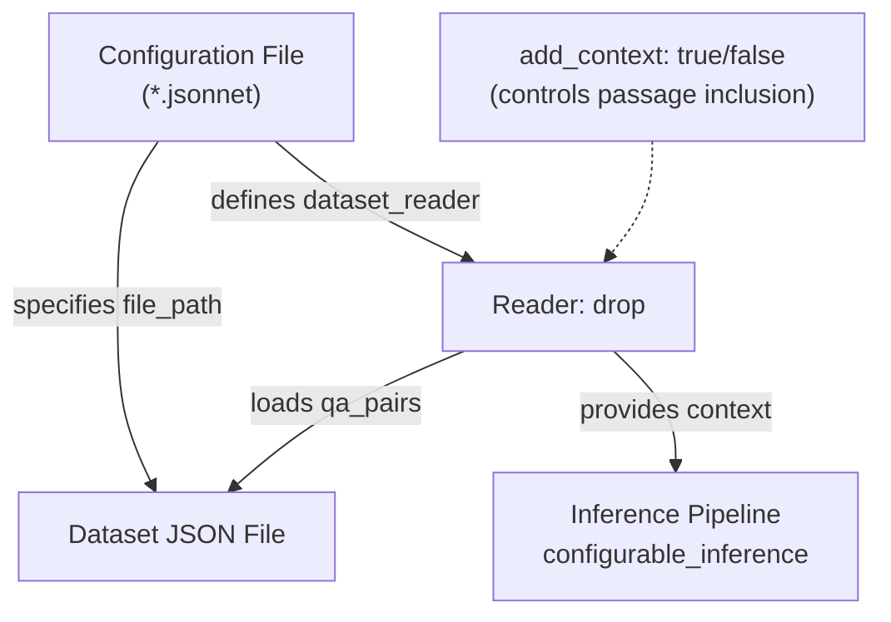

<!-- source: DeepWiki mcp.deepwiki.com · repo allenai/DecomP · page 6 Datasets · fetched 2026-10-26 -->

# Datasets

<details>
<summary>Relevant source files</summary>

The following files were used as context for generating this wiki page:

- [datasets/reverse/test_10_normal_words.json](datasets/reverse/test_10_normal_words.json)
- [src/decomp/datasets_utils/build_reverse_dataset.py](src/decomp/datasets_utils/build_reverse_dataset.py)

</details>


This page provides an overview of the dataset formats and available datasets in the DecomP repository. It documents the JSON schema structure, dataset locations, and the types of experimental datasets provided for evaluating decomposed prompting strategies.

For detailed information about specific dataset types, see:
- List Reversal Datasets: [6.1](#6.1)
- Wordlist Vocabulary: [6.2](#6.2)
- Dataset Format Specification: [6.3](#6.3)

For information about how to generate synthetic datasets, see Dataset Generation: [4.2.1](#4.2.1)

## Dataset Directory Structure

All datasets in the DecomP repository are stored in the `datasets/` directory and organized by experiment type. The following diagram shows the dataset organization:



**Sources:** [datasets/reverse/test_10_normal_words.json:1-1447]()

## Dataset Format: DROP-Style JSON Schema

All datasets in DecomP use a consistent JSON schema based on the DROP (Discrete Reasoning Over Paragraphs) dataset format. The following diagram illustrates the nested structure:



**Sources:** [datasets/reverse/test_10_normal_words.json:1-20]()

### Schema Fields

| Field Path | Type | Description |
|------------|------|-------------|
| `alg_qa` | object | Root container for algorithmic QA tasks |
| `alg_qa.passage` | string | Context passage (typically empty for algorithmic tasks) |
| `alg_qa.qa_pairs` | array | List of question-answer pairs |
| `qa_pairs[].question` | string | The task instruction or question |
| `qa_pairs[].answer` | object | Structured answer container |
| `qa_pairs[].answer.number` | string | Numeric answer (empty if answer is text) |
| `qa_pairs[].answer.date` | object | Date answer with day/month/year fields |
| `qa_pairs[].answer.spans` | array | Text answers (typically contains one string) |
| `qa_pairs[].query_id` | string | Unique identifier for the question |
| `qa_pairs[].validated_answers` | array | Additional validated answers (typically empty) |

**Sources:** [datasets/reverse/test_10_normal_words.json:1-20]()

## Dataset Types and Characteristics

DecomP includes three categories of datasets for different experimental tasks:

### List Reversal Datasets

| Dataset File | Sequence Length | Number of Examples | Element Type | Generation Mode |
|--------------|----------------|-------------------|--------------|-----------------|
| `test_4_normal_words.json` | 4 | 100 | Common words | Normal sampling |
| `test_6_normal_words.json` | 6 | 100 | Common words | Normal sampling |
| `test_8_normal_words.json` | 8 | 100 | Common words | Normal sampling |
| `test_10_normal_words.json` | 10 | 100 | Common words | Normal sampling |
| `train_*_normal_words.json` | Variable | 10 | Common words | Normal sampling |

These datasets are generated synthetically using [src/decomp/datasets_utils/build_reverse_dataset.py]() and contain list reversal tasks with sequences drawn from a 57-word vocabulary in [configs/data/wordlist.txt](). See [4.2](#4.2) for more details.

**Example question format:**
```
Reverse the sequence "banknote, sweet, phone card, identity card, credit card, case, passport, newspaper, painkiller, pen".
```

**Example answer format:**
```
pen, painkiller, newspaper, passport, case, credit card, identity card, phone card, sweet, banknote
```

**Sources:** [datasets/reverse/test_10_normal_words.json:1-20](), [src/decomp/datasets_utils/build_reverse_dataset.py:1-180]()

### Letter Concatenation Datasets

These datasets test string manipulation capabilities with letter sequences. They are stored in `datasets/letter_cat/` and use varying prompt configurations (p1, p2, p3) to test different decomposition strategies.

For experiment details, see Letter Concatenation: [4.1](#4.1)

### CommAQA Datasets

CommAQA (Compositional Multi-hop Question Answering) datasets are stored in `datasets/commaqa_e/` and include:

- **IID Split**: In-distribution test examples
- **CompGen Split**: Compositional generalization test examples (harder)

These datasets contain complex multi-hop questions requiring decomposition into simpler sub-questions. For detailed information, see CommAQA Multi-hop Question Answering: [4.3](#4.3)

**Sources:** Referenced from high-level architecture diagrams

## Dataset Generation Pipeline

The following diagram shows how list reversal datasets are generated using the `build_reverse_dataset.py` script:



The generation script supports multiple modes:

| Parameter | Options | Description |
|-----------|---------|-------------|
| `--elts` | `words`, `letters`, `numbers` | Type of elements in sequences |
| `--listop` | `reversed`, `sorted`, `sort_last` | Operation to perform |
| `--num_examples` | integer | Total number of examples to generate |
| `--train_size` | integer | Number of examples for training split |
| `--length` | integer(s) | Length(s) of sequences to generate |
| `--hard` | flag | Generate harder examples with shared properties |
| `--delim` | string | Delimiter between elements (default: ", ") |

**Sources:** [src/decomp/datasets_utils/build_reverse_dataset.py:25-103]()

## Dataset Reader Integration

Datasets are loaded into the inference pipeline using the `drop` reader configured in the jsonnet configuration files. The reader is initialized with paths to the dataset files:



The reader processes each `qa_pair` from the dataset and:
1. Extracts the `question` field as the input query
2. Optionally includes the `passage` field as context (for CommAQA)
3. Provides the `answer.spans[0]` as the ground truth for evaluation

**Sources:** Referenced from configuration system documentation [5.2](#5.2)

## File Naming Conventions

Dataset files follow consistent naming patterns to indicate their properties:

### List Reversal Pattern
```
{split}_{length}_{difficulty}_{element_type}.json
```

Examples:
- `test_10_normal_words.json`: Test split, 10-word sequences, normal difficulty
- `train_4_normal_words.json`: Training split, 4-word sequences, normal difficulty

### Letter Concatenation Pattern
```
{split}_{task_variant}.json
```

### CommAQA Pattern
```
{split}_{generalization_type}.json
```

Examples:
- `test_iid.json`: In-distribution test split
- `test_compgen.json`: Compositional generalization test split

**Sources:** [src/decomp/datasets_utils/build_reverse_dataset.py:90-103]()

## Summary

The DecomP repository provides three types of datasets:

1. **Synthetic List Reversal Datasets**: Generated programmatically with configurable sequence lengths and element types using [build_reverse_dataset.py]()
2. **Letter Concatenation Datasets**: Static datasets for string manipulation tasks
3. **CommAQA Datasets**: Complex multi-hop question answering datasets with IID and compositional generalization splits

All datasets follow the DROP JSON schema format with `alg_qa` structure, enabling consistent processing through the inference pipeline. The modular dataset generation and loading system allows researchers to easily create new experimental configurations and evaluate different prompting strategies.

---

