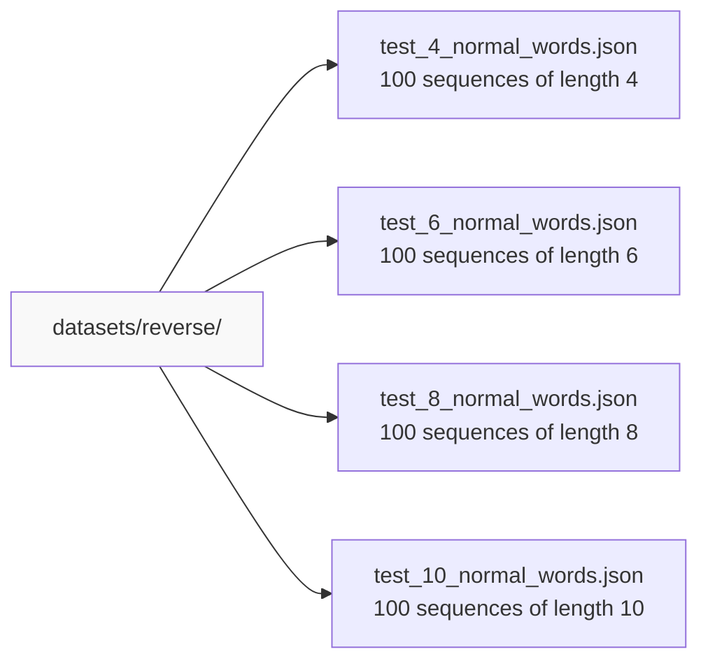
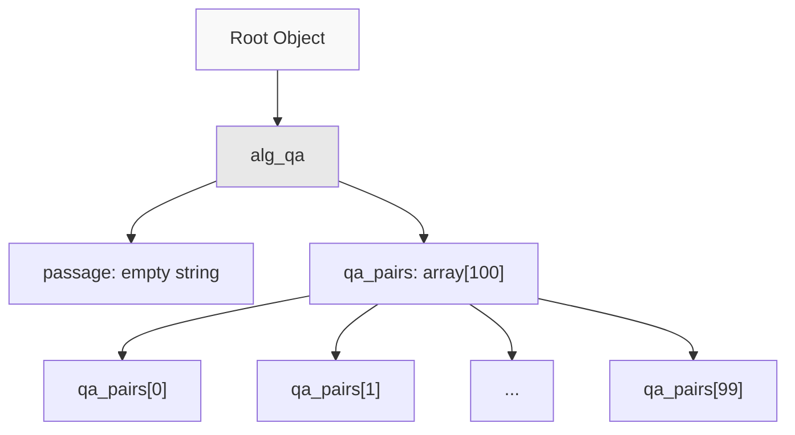
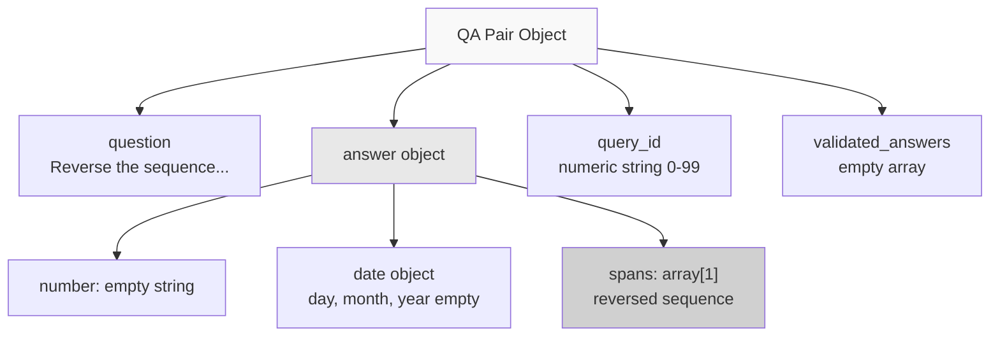
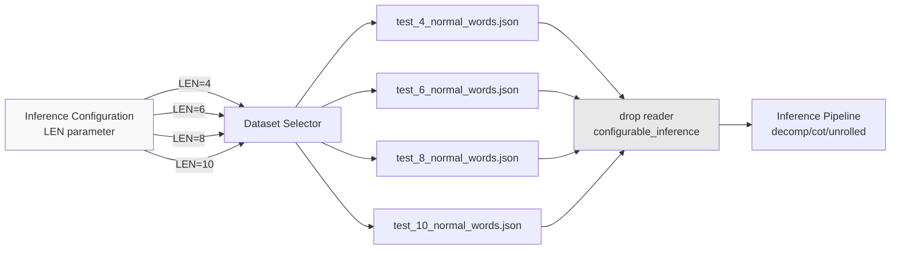

<!-- source: DeepWiki mcp.deepwiki.com · repo allenai/DecomP · page 6.1 List Reversal Datasets · fetched 2026-10-26 -->

# List Reversal Datasets

<details>
<summary>Relevant source files</summary>

The following files were used as context for generating this wiki page:

- [datasets/reverse/test_10_normal_words.json](datasets/reverse/test_10_normal_words.json)
- [datasets/reverse/test_4_normal_words.json](datasets/reverse/test_4_normal_words.json)
- [datasets/reverse/test_6_normal_words.json](datasets/reverse/test_6_normal_words.json)
- [datasets/reverse/test_8_normal_words.json](datasets/reverse/test_8_normal_words.json)

</details>


This document describes the structure, organization, and content of the list reversal test datasets used in the DecomP repository. These datasets contain synthetic examples for evaluating the ability of language models to reverse sequences of common objects.

For information about generating these datasets, see [Dataset Generation](#4.2.1). For the vocabulary used in these datasets, see [Wordlist Vocabulary](#6.2). For the general JSON schema specification, see [Dataset Format Specification](#6.3).

## Dataset Organization

The list reversal datasets are located in the `datasets/reverse/` directory and are organized by sequence length. Each file contains 100 test instances for a specific sequence length.

### File Naming Convention



**Sources:** [datasets/reverse/test_4_normal_words.json:1](), [datasets/reverse/test_6_normal_words.json:1](), [datasets/reverse/test_8_normal_words.json:1](), [datasets/reverse/test_10_normal_words.json:1]()

| File Name | Sequence Length | Number of Examples | Total Items |
|-----------|----------------|-------------------|-------------|
| `test_4_normal_words.json` | 4 | 100 | 400 |
| `test_6_normal_words.json` | 6 | 100 | 600 |
| `test_8_normal_words.json` | 8 | 100 | 800 |
| `test_10_normal_words.json` | 10 | 100 | 1000 |

## JSON Structure

Each dataset file follows the DROP dataset format with specific adaptations for the list reversal task.

### Top-Level Structure



**Sources:** [datasets/reverse/test_4_normal_words.json:1-3](), [datasets/reverse/test_6_normal_words.json:1-3](), [datasets/reverse/test_8_normal_words.json:1-3](), [datasets/reverse/test_10_normal_words.json:1-3]()

### Question-Answer Pair Structure



**Sources:** [datasets/reverse/test_4_normal_words.json:5-19](), [datasets/reverse/test_6_normal_words.json:5-19](), [datasets/reverse/test_8_normal_words.json:5-19](), [datasets/reverse/test_10_normal_words.json:5-19]()

### Field Descriptions

| Field Path | Type | Description |
|------------|------|-------------|
| `alg_qa` | object | Container for algorithmic QA data |
| `alg_qa.passage` | string | Always empty for list reversal tasks |
| `alg_qa.qa_pairs` | array | List of 100 question-answer pairs |
| `qa_pairs[i].question` | string | Natural language instruction to reverse a sequence |
| `qa_pairs[i].answer` | object | Contains the correct reversed sequence |
| `qa_pairs[i].answer.number` | string | Empty (not used for this task) |
| `qa_pairs[i].answer.date` | object | Empty (not used for this task) |
| `qa_pairs[i].answer.spans` | array | Single-element array with reversed sequence |
| `qa_pairs[i].query_id` | string | Unique identifier "0" through "99" |
| `qa_pairs[i].validated_answers` | array | Empty (no human validation) |

## Example Instances

### Length 4 Example

```json
{
  "question": "Reverse the sequence \"alarm clock, purse, umbrella, case\".",
  "answer": {
    "number": "",
    "date": {
      "day": "",
      "month": "",
      "year": ""
    },
    "spans": [
      "case, umbrella, purse, alarm clock"
    ]
  },
  "query_id": "57",
  "validated_answers": []
}
```

**Sources:** [datasets/reverse/test_4_normal_words.json:5-20]()

### Length 10 Example

```json
{
  "question": "Reverse the sequence \"banknote, sweet, phone card, identity card, credit card, case, passport, newspaper, painkiller, pen\".",
  "answer": {
    "number": "",
    "date": {
      "day": "",
      "month": "",
      "year": ""
    },
    "spans": [
      "pen, painkiller, newspaper, passport, case, credit card, identity card, phone card, sweet, banknote"
    ]
  },
  "query_id": "28",
  "validated_answers": []
}
```

**Sources:** [datasets/reverse/test_10_normal_words.json:5-20]()

## Sequence Characteristics

### Vocabulary

All sequences consist of common everyday objects drawn from a fixed vocabulary. The items include:

- Personal items: `wallet`, `purse`, `keys`, `phone card`, `credit card`, `identity card`, `driving licence`, `passport`
- Stationery: `pen`, `pencil`, `notebook`, `paper clip`, `stamp`, `rubber`
- Electronics: `mobile phone`, `laptop`, `camera`, `player`, `battery`, `light bulb`, `alarm clock`
- Hygiene items: `toothbrush`, `comb`, `brush`, `tissue`, `mirror`, `sunscreen`
- Miscellaneous: `glasses`, `watch`, `bottle`, `magazine`, `newspaper`, `cigarette`, `umbrella`

The complete vocabulary list is maintained in `wordlist.txt`. See [Wordlist Vocabulary](#6.2) for details.

**Sources:** [datasets/reverse/test_4_normal_words.json:6-1444](), [datasets/reverse/test_6_normal_words.json:6-1444](), [datasets/reverse/test_8_normal_words.json:6-1444](), [datasets/reverse/test_10_normal_words.json:6-1444]()

### Randomization Properties

| Property | Description |
|----------|-------------|
| **Item Selection** | Items are randomly sampled from the vocabulary without replacement within each sequence |
| **Order** | Original sequences have random orderings |
| **Duplicates** | No duplicate items within a single sequence |
| **Distribution** | All vocabulary items appear with approximately equal frequency across the dataset |

### Question Format

All questions follow the template: `"Reverse the sequence \"<item1>, <item2>, ..., <itemN>\"."`

- Items are separated by `", "` (comma-space)
- The entire sequence is enclosed in escaped quotes
- No additional context or instructions are provided

**Sources:** [datasets/reverse/test_4_normal_words.json:6](), [datasets/reverse/test_6_normal_words.json:6](), [datasets/reverse/test_8_normal_words.json:6](), [datasets/reverse/test_10_normal_words.json:6]()

### Answer Format

The correct answer is provided in the `spans` array as a single string:

- Items appear in reverse order compared to the question
- Items are separated by `", "` (comma-space)
- No punctuation at the end
- Exactly mirrors the format of the input sequence

**Sources:** [datasets/reverse/test_4_normal_words.json:14-16](), [datasets/reverse/test_6_normal_words.json:14-16](), [datasets/reverse/test_8_normal_words.json:14-16](), [datasets/reverse/test_10_normal_words.json:14-16]()

## Integration with Inference Pipeline

### Dataset Selection by Configuration



**Sources:** [datasets/reverse/test_4_normal_words.json:1](), [datasets/reverse/test_6_normal_words.json:1](), [datasets/reverse/test_8_normal_words.json:1](), [datasets/reverse/test_10_normal_words.json:1]()

### Usage Pattern

The datasets are consumed by the inference pipeline as follows:

1. **Configuration Loading**: The inference configuration specifies which dataset file to use based on the `LEN` parameter
2. **Reading**: The `drop` reader loads the dataset and parses the `qa_pairs` array
3. **Iteration**: Each QA pair is processed sequentially through the inference pipeline
4. **Prompting**: The `question` field is used to construct the prompt for the language model
5. **Evaluation**: The model's output is compared against the `answer.spans[0]` value
6. **Output**: Predictions are written to `reverse_*_predictions.json` files

## Dataset Statistics

### Size Metrics

| Metric | Value |
|--------|-------|
| **Total Files** | 4 |
| **Total Instances** | 400 |
| **Sequence Lengths** | 4, 6, 8, 10 |
| **Instances per Length** | 100 |
| **Unique Query IDs** | 0-99 (per file) |

### Computational Properties

| Property | Value |
|----------|-------|
| **Vocabulary Size** | 57 words |
| **Average Word Length** | ~8 characters |
| **Min Sequence Items** | 4 |
| **Max Sequence Items** | 10 |
| **Question Length Range** | ~60-200 characters |
| **Answer Length Range** | ~50-190 characters |

### File Size Information

| File | Approximate Size |
|------|-----------------|
| `test_4_normal_words.json` | ~35 KB |
| `test_6_normal_words.json` | ~45 KB |
| `test_8_normal_words.json` | ~55 KB |
| `test_10_normal_words.json` | ~70 KB |

**Sources:** [datasets/reverse/test_4_normal_words.json:1-1447](), [datasets/reverse/test_6_normal_words.json:1-1447](), [datasets/reverse/test_8_normal_words.json:1-1447](), [datasets/reverse/test_10_normal_words.json:1-1450]()

## Query ID Distribution

Each dataset file contains 100 unique query IDs ranging from "0" to "99", assigned in a deterministic but non-sequential order. The query IDs are used to:

- Uniquely identify each instance within a dataset file
- Track predictions during evaluation
- Match model outputs to ground truth answers

The query IDs do not necessarily correspond to the order of instances in the file, as evidenced by the first instance in `test_4_normal_words.json` having `query_id: "57"`.

**Sources:** [datasets/reverse/test_4_normal_words.json:18](), [datasets/reverse/test_6_normal_words.json:18](), [datasets/reverse/test_8_normal_words.json:18](), [datasets/reverse/test_10_normal_words.json:18]()

---

