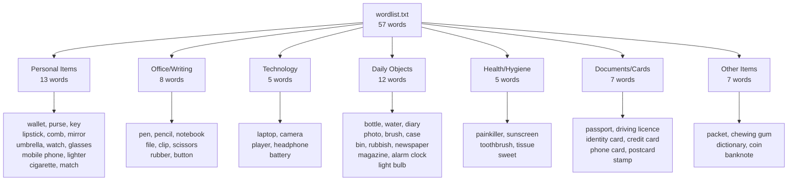
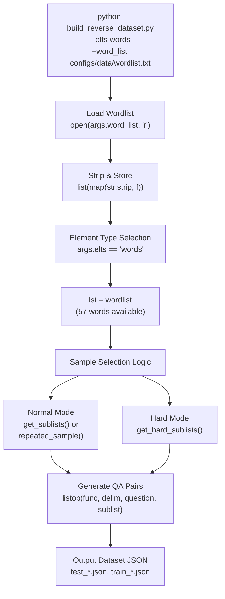
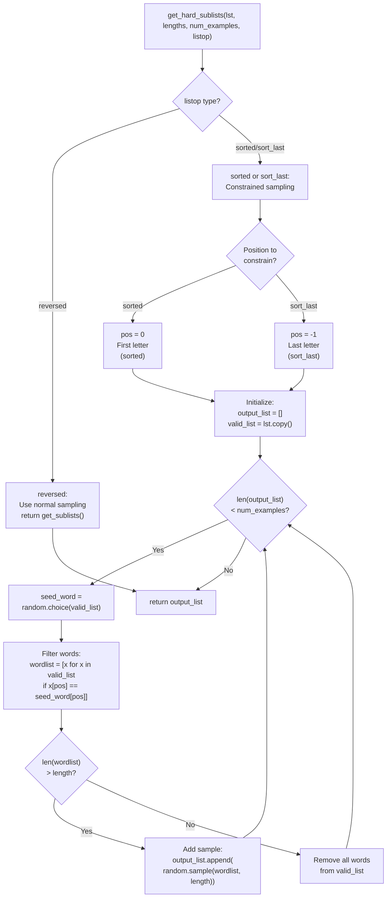

<!-- source: DeepWiki mcp.deepwiki.com · repo allenai/DecomP · page 6.2 Wordlist Vocabulary · fetched 2026-10-26 -->

# Wordlist Vocabulary

<details>
<summary>Relevant source files</summary>

The following files were used as context for generating this wiki page:

- [configs/data/wordlist.txt](configs/data/wordlist.txt)
- [src/decomp/datasets_utils/build_reverse_dataset.py](src/decomp/datasets_utils/build_reverse_dataset.py)

</details>


## Purpose and Scope

The wordlist vocabulary is a curated collection of 57 common English words used to generate synthetic list reversal datasets in the DecomP framework. This file provides the base vocabulary for constructing word-based list manipulation tasks that test language models' ability to perform symbolic operations on natural language sequences.

For information about how this wordlist is used to generate datasets, see [Dataset Generation](#4.2.1). For details on the generated dataset formats, see [List Reversal Datasets](#6.1).

**Sources:** [configs/data/wordlist.txt:1-56](), [src/decomp/datasets_utils/build_reverse_dataset.py:34-51]()

## File Location and Format

The wordlist is located at `configs/data/wordlist.txt` and serves as the default vocabulary source for the `build_reverse_dataset.py` script. The file contains one word or phrase per line, with a total of 57 entries including an empty line at the end.

| Property | Value |
|----------|-------|
| File Path | `configs/data/wordlist.txt` |
| Total Lines | 56 (excluding empty line) |
| Format | Plain text, one item per line |
| Encoding | UTF-8 |
| Default Usage | `--word_list` parameter in `build_reverse_dataset.py` |

The wordlist is loaded as a simple list of strings where each line is stripped of whitespace:

```python
with open(args.word_list, "r") as f:
    wordlist = list(map(str.strip, f))
```

**Sources:** [configs/data/wordlist.txt:1-56](), [src/decomp/datasets_utils/build_reverse_dataset.py:42-43]()

## Word Categories and Selection Criteria

The wordlist contains everyday objects and items that are concrete, familiar, and commonly used in daily life. The vocabulary was selected to ensure diversity across multiple categories while maintaining consistent word complexity.

### Word Categories



### Selection Characteristics

- **Concrete Nouns**: All items are tangible physical objects
- **Familiarity**: Common items that most language models have been trained on
- **Length Variation**: Words range from short (3 letters: "key", "pen") to multi-word phrases (15 letters: "chewing gum")
- **Alphabetic Diversity**: Words starting with different letters to support alphabetic sorting tasks
- **No Duplicates**: Each word appears exactly once in the list

**Sources:** [configs/data/wordlist.txt:1-56]()

## Usage in Dataset Generation

The wordlist is integrated into the `build_reverse_dataset.py` script and used when the `--elts` parameter is set to `"words"`. The script samples from this vocabulary to create list reversal, sorting, and other list manipulation tasks.

### Integration Flow



### Code Integration Points

The wordlist is used in three key locations within `build_reverse_dataset.py`:

1. **Loading** [src/decomp/datasets_utils/build_reverse_dataset.py:42-43](): The file is opened and read line by line
2. **Selection** [src/decomp/datasets_utils/build_reverse_dataset.py:45-51](): The wordlist is assigned to the `lst` variable when `args.elts == "words"`
3. **Sampling** [src/decomp/datasets_utils/build_reverse_dataset.py:53-61](): Words are sampled from the list using various strategies

| Mode | Function | Sampling Strategy |
|------|----------|-------------------|
| Normal | `get_sublists()` | Permutation-based sampling without replacement |
| Normal (overflow) | `repeated_sample()` | Random sampling with replacement |
| Hard | `get_hard_sublists()` | Constrained sampling by first/last letter |

**Sources:** [src/decomp/datasets_utils/build_reverse_dataset.py:25-62]()

## Hard Mode Generation

When the `--hard` flag is used with word-based lists, the dataset generator employs special logic that leverages specific characteristics of the wordlist vocabulary. This mode creates more challenging examples by constraining word selection based on alphabetic properties.

### Hard Mode Algorithm



### Hard Mode Constraints

In hard mode for `sorted` and `sort_last` operations, the algorithm ensures that sampled sublists share a common first or last letter, making the sorting task more challenging:

- **Sorted (alphabetically)**: All words in a sublist start with the same letter
  - Example: "pen, pencil, passport, player" (all start with 'p')
  
- **Sort_last (by last letter)**: All words in a sublist end with the same letter
  - Example: "bottle, mobile phone, cigarette, magazine" (all end with 'e')

This constraint forces the language model to examine internal letters rather than relying on obvious first/last letter differences.

**Sources:** [src/decomp/datasets_utils/build_reverse_dataset.py:130-151]()

## Wordlist Content Reference

The complete 57-word vocabulary is organized below for reference:

| Category | Words |
|----------|-------|
| **Personal Care** | diary, glasses, watch, lipstick, purse, comb, mirror, toothbrush |
| **Writing/Office** | pen, pencil, rubber, clip, scissors, file, notebook, button |
| **Technology** | camera, laptop, mobile phone, phone card, player, headphone, battery, light bulb |
| **Documents** | stamp, postcard, dictionary, credit card, identity card, passport, driving licence, banknote |
| **Daily Items** | bottle, water, packet, chewing gum, tissue, sweet, photo, brush, umbrella, lighter, cigarette, match, case, wallet, key, coin, bin, rubbish, newspaper, magazine, alarm clock |
| **Health/Hygiene** | painkiller, sunscreen |

**Note**: The wordlist includes multi-word phrases (e.g., "chewing gum", "credit card") which are treated as single elements in list operations.

**Sources:** [configs/data/wordlist.txt:1-56]()

## Customization and Extension

While the default wordlist contains 57 words, users can provide custom wordlists using the `--word_list` parameter when running `build_reverse_dataset.py`:

```bash
python src/decomp/datasets_utils/build_reverse_dataset.py \
    --elts words \
    --word_list path/to/custom_wordlist.txt \
    --num_examples 100 \
    --length 6
```

### Custom Wordlist Requirements

- **Format**: Plain text file with one word/phrase per line
- **Minimum Size**: At least as many words as the maximum `--length` parameter
- **Uniqueness**: No duplicate entries (to ensure valid permutation sampling)
- **Character Set**: UTF-8 compatible strings

### Recommended Characteristics

For optimal results when creating custom wordlists:

1. **Alphabetic Diversity**: Include words starting with different letters
2. **Length Variation**: Mix of short and longer words/phrases
3. **Concrete Terms**: Prefer tangible objects over abstract concepts
4. **Familiarity**: Use words likely to be in the language model's training data

**Sources:** [src/decomp/datasets_utils/build_reverse_dataset.py:34-43]()

---

