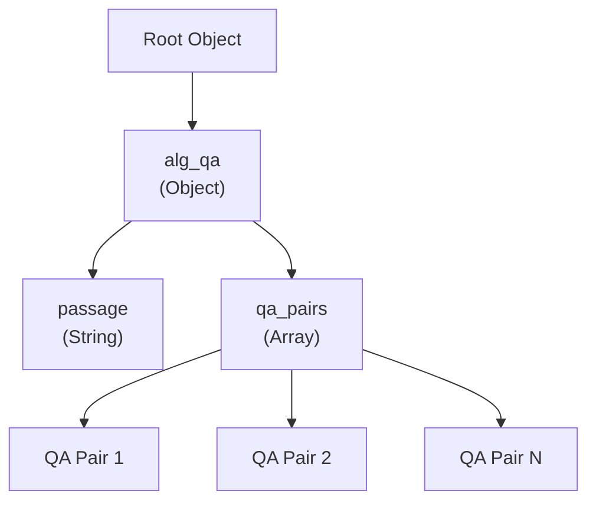
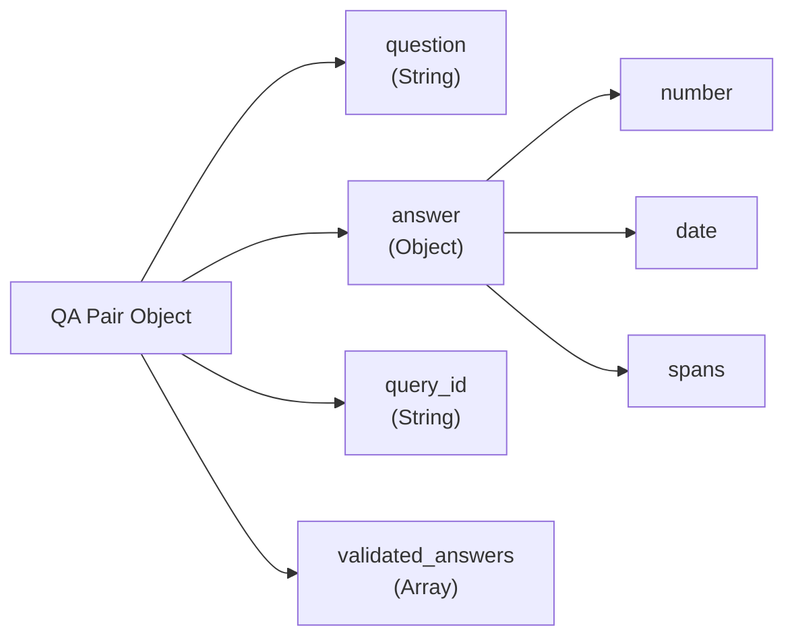
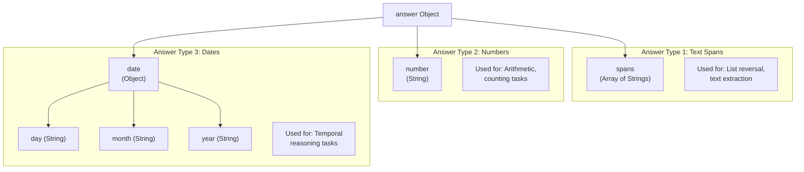

<!-- source: DeepWiki mcp.deepwiki.com · repo allenai/DecomP · page 6.3 Dataset Format Specification · fetched 2026-10-26 -->

# Dataset Format Specification

<details>
<summary>Relevant source files</summary>

The following files were used as context for generating this wiki page:

- [datasets/reverse/test_10_normal_words.json](datasets/reverse/test_10_normal_words.json)

</details>


This document defines the JSON schema and data structure used for all datasets in the DecomP repository. All input datasets and output predictions conform to this standardized format, which is based on the DROP (Discrete Reasoning Over Paragraphs) dataset schema.

For information about specific dataset contents, see [List Reversal Datasets](#6.1). For dataset generation procedures, see [Dataset Generation](#4.2.1).

## Overview

All DecomP datasets use a nested JSON structure with a top-level `alg_qa` key containing passage text and question-answer pairs. This format supports multiple answer types (spans, numbers, dates) and is compatible with the `drop` reader component used throughout the inference pipeline.

The same format is used for:
- Input test datasets (e.g., `test_10_normal_words.json`)
- Model prediction outputs (written by the inference pipeline)
- Evaluation ground truth files

## Root Structure

The dataset JSON file contains a single top-level object with the key `alg_qa`:

```json
{
  "alg_qa": {
    "passage": "",
    "qa_pairs": [ ... ]
  }
}
```

### Top-Level Schema



**Sources:** [datasets/reverse/test_10_normal_words.json:1-3]()

| Field | Type | Description |
|-------|------|-------------|
| `alg_qa` | Object | Container for all dataset content |
| `passage` | String | Context passage (empty string for algorithmic tasks) |
| `qa_pairs` | Array | List of question-answer pair objects |

## QA Pair Structure

Each element in the `qa_pairs` array represents a single question-answer instance:



**Sources:** [datasets/reverse/test_10_normal_words.json:4-20]()

### QA Pair Fields

| Field | Type | Required | Description |
|-------|------|----------|-------------|
| `question` | String | Yes | The question or task prompt |
| `answer` | Object | Yes | Answer object containing the ground truth |
| `query_id` | String | Yes | Unique identifier for this question |
| `validated_answers` | Array | Yes | Additional validated answers (typically empty) |

### Example QA Pair

```json
{
  "question": "Reverse the sequence \"banknote, sweet, phone card, identity card, credit card, case, passport, newspaper, painkiller, pen\".",
  "answer": {
    "number": "",
    "date": {
      "day": "",
      "month": "",
      "year": ""
    },
    "spans": [
      "pen, painkiller, newspaper, passport, case, credit card, identity card, phone card, sweet, banknote"
    ]
  },
  "query_id": "28",
  "validated_answers": []
}
```

**Sources:** [datasets/reverse/test_10_normal_words.json:5-20]()

## Answer Object Schema

The `answer` object supports three mutually exclusive answer types, inherited from the DROP format:



**Sources:** [datasets/reverse/test_10_normal_words.json:7-17]()

### Answer Type Fields

| Field | Type | Description | Example Usage |
|-------|------|-------------|---------------|
| `spans` | Array of Strings | Text-based answers; typically one element | List reversal results |
| `number` | String | Numeric answer as string | Empty for non-numeric tasks |
| `date` | Object | Structured date with day/month/year | Empty for non-temporal tasks |

### Answer Type Usage

For list reversal datasets, only the `spans` field is populated:
- `spans` contains a single-element array with the reversed sequence
- `number` is set to empty string `""`
- `date` fields (`day`, `month`, `year`) are all empty strings `""`

This design allows the same format to be used across different task types while maintaining compatibility with the DROP evaluation metrics.

**Sources:** [datasets/reverse/test_10_normal_words.json:14-16, 30-32]()

## Field Mapping to Code Components

The dataset format integrates with several code components in the inference pipeline:

```mermaid
graph TB
    DATASET["Dataset File<br/>*.json"]
    
    subgraph "drop Reader Component"
        READER["Reader loads alg_qa"]
        PASSAGE_FIELD["Extracts passage"]
        QA_FIELD["Extracts qa_pairs"]
    end
    
    subgraph "Inference Pipeline"
        QUESTION_EXTRACT["Question → Model Input"]
        ANSWER_EXTRACT["Answer → Ground Truth"]
        QUERY_ID_TRACK["query_id → Tracking"]
    end
    
    subgraph "Output Predictions"
        PRED_FILE["Predictions JSON"]
        SAME_FORMAT["Same alg_qa structure"]
        PRED_SPANS["Model outputs in spans"]
    end
    
    subgraph "Evaluation"
        DROP_EVAL["drop_eval metrics"]
        COMPARE["Compare predictions<br/>to ground truth"]
    end
    
    DATASET --> READER
    READER --> PASSAGE_FIELD
    READER --> QA_FIELD
    
    QA_FIELD --> QUESTION_EXTRACT
    QA_FIELD --> ANSWER_EXTRACT
    QA_FIELD --> QUERY_ID_TRACK
    
    QUESTION_EXTRACT --> PRED_FILE
    PRED_FILE --> SAME_FORMAT
    SAME_FORMAT --> PRED_SPANS
    
    PRED_FILE --> DROP_EVAL
    DATASET --> DROP_EVAL
    DROP_EVAL --> COMPARE
```



**Sources:** [datasets/reverse/test_10_normal_words.json:1-1447]()

## Complete Dataset Example

A minimal complete dataset file structure:

```json
{
  "alg_qa": {
    "passage": "",
    "qa_pairs": [
      {
        "question": "Reverse the sequence \"brush, postcard, coin, cigarette, match, lipstick, file, headphone, purse, water\".",
        "answer": {
          "number": "",
          "date": {
            "day": "",
            "month": "",
            "year": ""
          },
          "spans": [
            "water, purse, headphone, file, lipstick, match, cigarette, coin, postcard, brush"
          ]
        },
        "query_id": "1",
        "validated_answers": []
      }
    ]
  }
}
```

**Sources:** [datasets/reverse/test_10_normal_words.json:486-500]()

## Field Requirements by Task Type

Different experimental tasks use the same format but populate different fields:

| Task Type | passage | question | spans | number | date | query_id |
|-----------|---------|----------|-------|--------|------|----------|
| List Reversal | Empty | Required | Required | Empty | Empty | Required |
| Letter Concatenation | Empty | Required | Required | Empty | Empty | Required |
| CommAQA | May contain context | Required | Required | Empty | Empty | Required |

The `add_context` configuration option in some experiments determines whether the `passage` field is populated with contextual information from a knowledge base.

## Validation Rules

Valid dataset files must satisfy the following constraints:

1. **Structure Requirements:**
   - Root object must contain exactly one key: `alg_qa`
   - `alg_qa.qa_pairs` must be a non-empty array
   - Each QA pair must contain all four required fields

2. **Answer Object Requirements:**
   - At least one of `spans`, `number`, or `date` must be non-empty
   - For list reversal tasks, `spans` must contain exactly one string element
   - Empty fields should be empty strings or empty objects, not `null`

3. **Query ID Requirements:**
   - Each `query_id` should be unique within a dataset
   - Query IDs are used for tracking predictions during evaluation

**Sources:** [datasets/reverse/test_10_normal_words.json:1-1447]()

## Prediction Output Format

Model predictions are written to JSON files using the identical format. The inference pipeline:

1. Reads the input dataset structure
2. Processes each question through the model
3. Writes predictions to `answer.spans[0]`
4. Preserves the original `query_id` for evaluation
5. Outputs a file with the same `alg_qa` structure

This format consistency enables direct comparison between predictions and ground truth using the `drop_eval` metrics.

**Sources:** [datasets/reverse/test_10_normal_words.json:1-3]()

---

