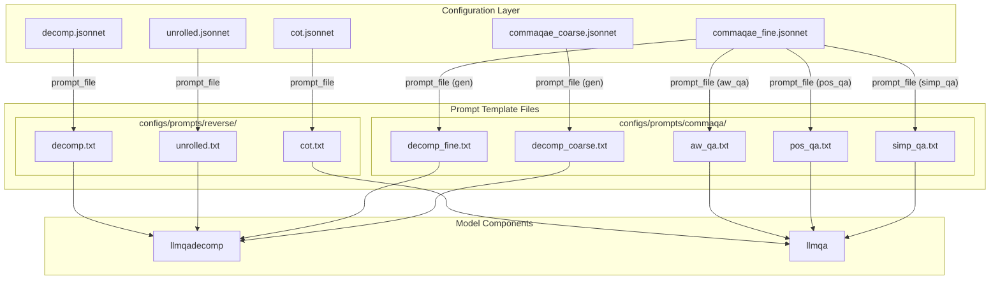
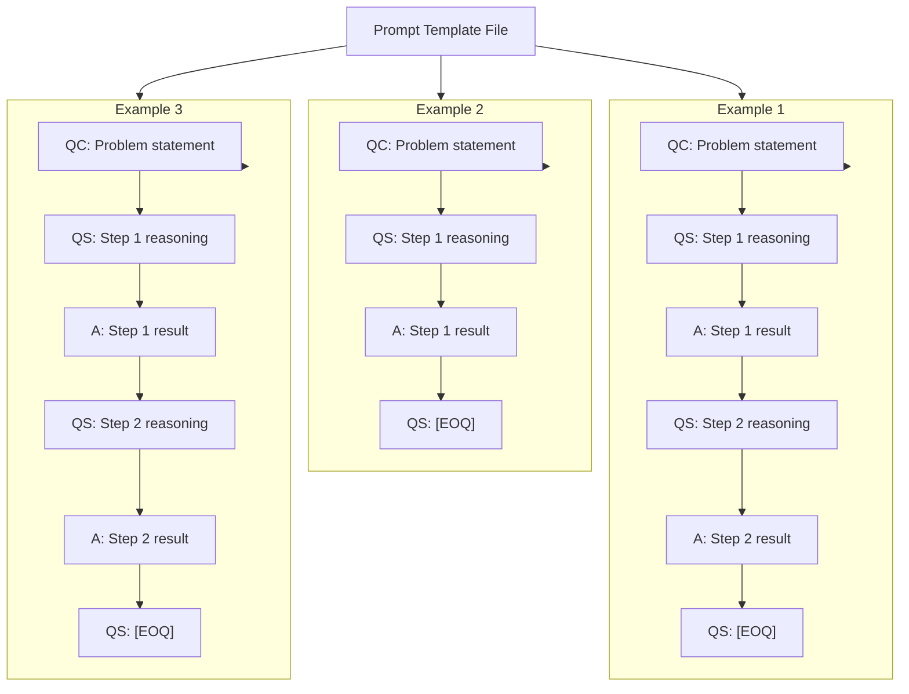

<!-- source: DeepWiki mcp.deepwiki.com · repo allenai/DecomP · page 7 Prompt Templates · fetched 2026-10-26 -->

# Prompt Templates

<details>
<summary>Relevant source files</summary>

The following files were used as context for generating this wiki page:

- [configs/prompts/reverse/cot.txt](configs/prompts/reverse/cot.txt)
- [configs/prompts/reverse/decomp.txt](configs/prompts/reverse/decomp.txt)

</details>


## Purpose and Scope

This page provides a reference guide for all prompt templates used in the DecomP system. Prompt templates define the few-shot examples that guide the language model (GPT-3) to perform specific reasoning strategies. These templates are text files that demonstrate the desired behavior through input-output examples.

For detailed documentation of specific prompt types:
- List reversal prompts: see [List Reversal Prompts](#7.1)
- CommAQA question answering prompts: see [CommAQA Prompts](#7.2)
- Sub-question specialized prompts: see [Sub-question Prompts](#7.3)

For information about how prompts are loaded and used in the inference pipeline, see [Inference Pipeline](#5.1) and [Model Components](#5.3).

---

## Overview

Prompt templates in DecomP serve as few-shot learning examples that demonstrate reasoning patterns to the language model. Each template consists of multiple example problems with their step-by-step solutions, formatted in a consistent question-answer structure. The model uses these examples to understand how to decompose and solve new problems.

### Key Characteristics

| Characteristic | Description |
|---------------|-------------|
| **Format** | Structured text with QC (Question Context), QS (Question Steps), and A (Answer) markers |
| **Location** | Stored in `configs/prompts/` directory, organized by task type |
| **Loading** | Referenced in configuration files via `prompt_file` parameter |
| **Purpose** | Provide few-shot examples for specific reasoning strategies |
| **Customization** | Can be modified or new templates added for different tasks |

---

## Prompt File Organization

The following diagram shows how prompt files are organized and referenced by configuration files:

### Diagram: Prompt Template Structure and Usage



**Sources:** [configs/prompts/reverse/cot.txt:1-12](), [configs/prompts/reverse/decomp.txt:1-41]()

---

## Prompt Template Format

All prompt templates follow a consistent structure that enables few-shot learning. The format uses specific markers to delineate different parts of the interaction:

### Standard Format Components

| Component | Marker | Description |
|-----------|--------|-------------|
| **Question Context** | `QC:` | The original problem statement or input |
| **Question Step** | `QS:` | A reasoning step or sub-question |
| **Answer** | `A:` | The response to the previous question step |
| **End of Question** | `[EOQ]` | Signals completion of the current example |

### Diagram: Prompt Template Anatomy



**Sources:** [configs/prompts/reverse/decomp.txt:1-41]()

---

## Decomposition Operation Tags

Decomposed prompts use special operation tags within the `QS:` field to indicate the type of reasoning step being performed. These tags are placed in square brackets at the beginning of the step.

### Operation Tags Reference

| Tag | Purpose | Used In |
|-----|---------|---------|
| `[extract]` | Extract a portion of the input sequence | decomp.txt |
| `[remove_numbers]` | Strip numbering from a sequence | decomp.txt |
| `[reverse]` | Reverse the order of a sequence | decomp.txt |
| `[join]` | Concatenate two sequences | decomp.txt |
| `[cot]` | Apply chain-of-thought reasoning | decomp.txt |
| `[EOQ]` | End of question marker | All prompts |

### Example: Decomposed Prompt Structure

From [configs/prompts/reverse/decomp.txt:25-40]():

```
QC: Reverse the sequence "newspaper, glasses, laptop, bottle".
QS: [extract] The sequence is "1. newspaper, 2. glasses, 3. laptop, 4. bottle"...
A: "1. newspaper, 2. glasses"
QS: [extract] The first half of the sequence ends with "2. glasses"...
A: "3. laptop, 4. bottle"
QS: [remove_numbers] Remove the numbers from #1.
A: "newspaper, glasses"
QS: [remove_numbers] Remove the numbers from #2.
A: "laptop, bottle"
QS: [reverse] Reverse the sequence #3.
A: "glasses, newspaper"
QS: [reverse] Reverse the sequence #4.
A: "bottle, laptop"
QS: [join] #6 #5
A: "bottle, laptop, glasses, newspaper"
QS: [EOQ]
```

**Sources:** [configs/prompts/reverse/decomp.txt:25-40]()

---

## Chain of Thought Prompt Structure

Chain of Thought (CoT) prompts use natural language reasoning without explicit operation tags. The reasoning is expressed conversationally, enumerating positions and explaining the reversal process.

### Example: CoT Prompt Structure

From [configs/prompts/reverse/cot.txt:1-7]():

```
QC: Reverse the sequence "newspaper, glasses, laptop, bottle".
QS: First is newspaper. Second is glasses. Third is laptop. Fourth is bottle. 
    Now to reverse, change the order to: Fourth is bottle. Third is laptop. 
    Second is glasses. First is newspaper. 
    So the answer is "bottle, laptop, glasses, newspaper".
A: "bottle, laptop, glasses, newspaper"
```

The CoT format:
1. Enumerates positions (First, Second, Third, etc.)
2. States the reversal explicitly (Fourth, Third, Second, First)
3. Provides natural language explanation
4. Concludes with the answer

**Sources:** [configs/prompts/reverse/cot.txt:1-12]()

---

## Prompt Template Catalog

The following table catalogs all prompt templates in the repository:

| File Path | Strategy | Task | Model Type | Description |
|-----------|----------|------|------------|-------------|
| `configs/prompts/reverse/decomp.txt` | Decomposed | List Reversal | llmqadecomp | Breaks reversal into extract, remove_numbers, reverse, join operations |
| `configs/prompts/reverse/cot.txt` | Chain of Thought | List Reversal | llmqa | Uses position enumeration and natural language reasoning |
| `configs/prompts/reverse/unrolled.txt` | Unrolled | List Reversal | llmqadecomp | Applies recursive decomposition with conditional logic |
| `configs/prompts/commaqa/decomp_fine.txt` | Fine-grained | CommAQA | llmqadecomp | Decomposes multi-hop questions into specialized sub-queries |
| `configs/prompts/commaqa/decomp_coarse.txt` | Coarse-grained | CommAQA | llmqadecomp | Higher-level decomposition for multi-hop questions |
| `configs/prompts/commaqa/aw_qa.txt` | Sub-question | CommAQA | llmqa | Award-based question answering |
| `configs/prompts/commaqa/pos_qa.txt` | Sub-question | CommAQA | llmqa | Position-based question answering |
| `configs/prompts/commaqa/simp_qa.txt` | Sub-question | CommAQA | llmqa | Simple fact lookup questions |

**Sources:** [configs/prompts/reverse/cot.txt:1-12](), [configs/prompts/reverse/decomp.txt:1-41]()

---

## How Prompts Are Loaded

The following diagram shows the code flow for loading and using prompt templates:

### Diagram: Prompt Loading Pipeline

```mermaid
graph LR
    CONFIG["Configuration File<br/>(*.jsonnet)"]
    
    subgraph InferencePipeline["decomp.inference.configurable_inference"]
        LOAD_CONFIG["load_archive<br/>from_params"]
        MODEL_INIT["Model initialization<br/>(llmqadecomp/llmqa)"]
        PROMPT_LOAD["Load prompt_file<br/>parameter"]
        FILE_READ["Read .txt file<br/>from configs/prompts/"]
    end
    
    subgraph ModelExecution["Model Execution"]
        FORMAT["Format prompt<br/>with context"]
        GPT3["GPT-3 API call<br/>text-davinci-001"]
        PARSE["Parse response<br/>(QS:/A: pattern)"]
    end
    
    CONFIG -->|"prompt_file path"| LOAD_CONFIG
    LOAD_CONFIG --> MODEL_INIT
    MODEL_INIT --> PROMPT_LOAD
    PROMPT_LOAD --> FILE_READ
    FILE_READ -->|"Template text"| FORMAT
    FORMAT --> GPT3
    GPT3 --> PARSE
```



Each model component defined in the configuration specifies a `prompt_file` parameter pointing to the template file. During initialization, the model loads this file and uses it as the prefix for all API calls to GPT-3.

**Sources:** [configs/prompts/reverse/cot.txt:1-12](), [configs/prompts/reverse/decomp.txt:1-41]()

---

## Reference Mechanism

Decomposed prompts use a reference mechanism to refer to previous answers within the same example. References are denoted by `#N` where N is the step number.

### Reference Examples

| Reference | Meaning | Example Usage |
|-----------|---------|---------------|
| `#1` | Result from step 1 | `QS: [remove_numbers] Remove the numbers from #1.` |
| `#2` | Result from step 2 | `QS: [remove_numbers] Remove the numbers from #2.` |
| `#3` | Result from step 3 | `QS: [reverse] Reverse the sequence #3.` |
| `#6 #5` | Join results 6 and 5 | `QS: [join] #6 #5` |

From [configs/prompts/reverse/decomp.txt:6-15]():
- Step 1 extracts first half: `"1. driving license, 2. button"`
- Step 3 references `#1` to remove numbers: `Remove the numbers from #1.`
- Step 5 references `#3` to reverse: `Reverse the sequence #3.`
- Step 7 references `#6 #5` to join: `#6 #5`

This creates a chain of operations where later steps build on earlier results.

**Sources:** [configs/prompts/reverse/decomp.txt:6-15]()

---

## Prompt Customization

To create custom prompts for new tasks:

1. **Choose a format**: Decide between decomposed (with operation tags) or CoT (natural language)
2. **Create examples**: Provide 2-4 complete examples showing the reasoning pattern
3. **Save the file**: Place in `configs/prompts/{task_name}/` directory
4. **Reference in config**: Set `prompt_file` parameter in the model configuration
5. **Test**: Run inference to verify the prompt produces expected behavior

For guidance on creating custom prompts, see [Creating Custom Prompts](#8.3).

**Sources:** [configs/prompts/reverse/cot.txt:1-12](), [configs/prompts/reverse/decomp.txt:1-41]()

---

## Related Pages

- [List Reversal Prompts](#7.1) - Detailed documentation of all list reversal prompt templates
- [CommAQA Prompts](#7.2) - Documentation of CommAQA question decomposition prompts
- [Sub-question Prompts](#7.3) - Specialized prompts for CommAQA sub-questions
- [Model Components](#5.3) - How models load and use prompt templates
- [Configuration System](#5.2) - How to reference prompts in configuration files

---

