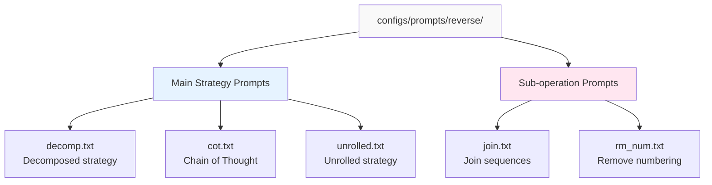
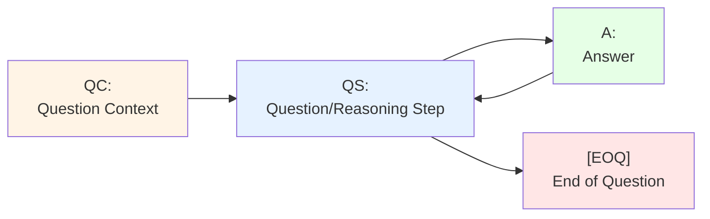
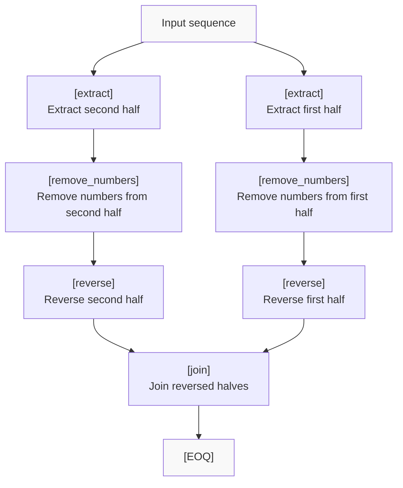
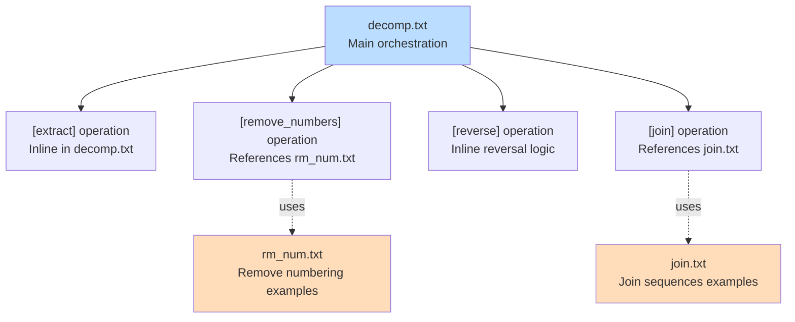
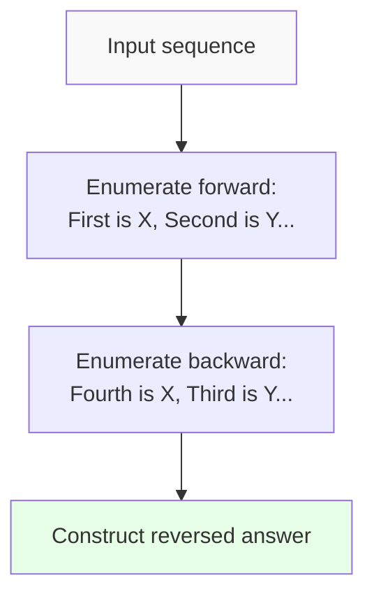
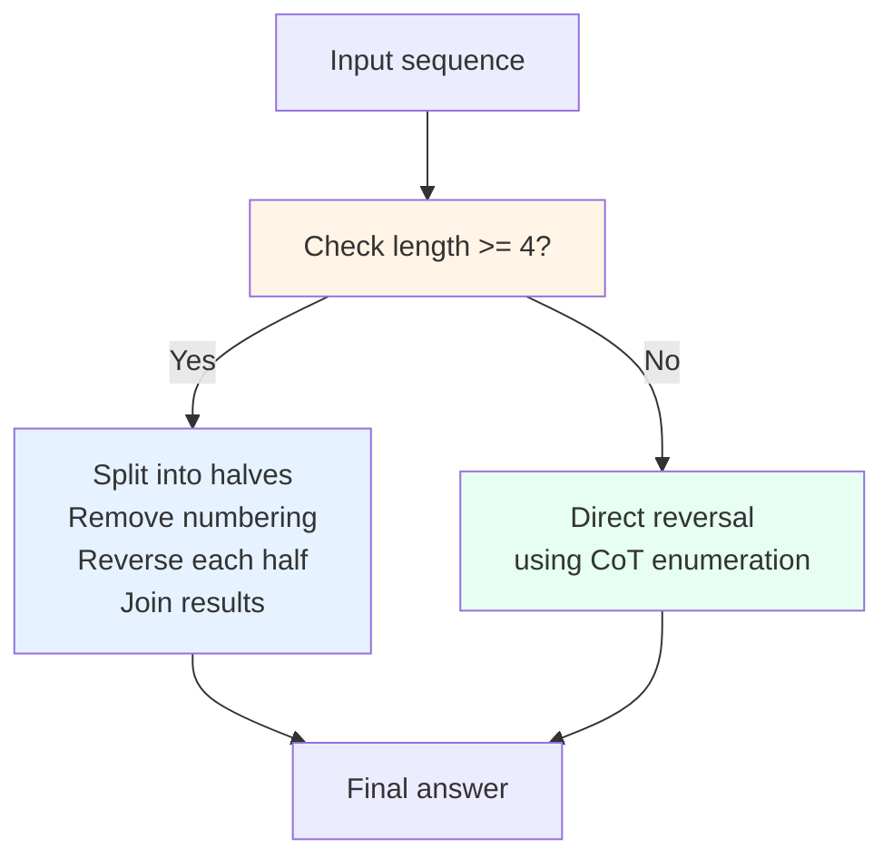
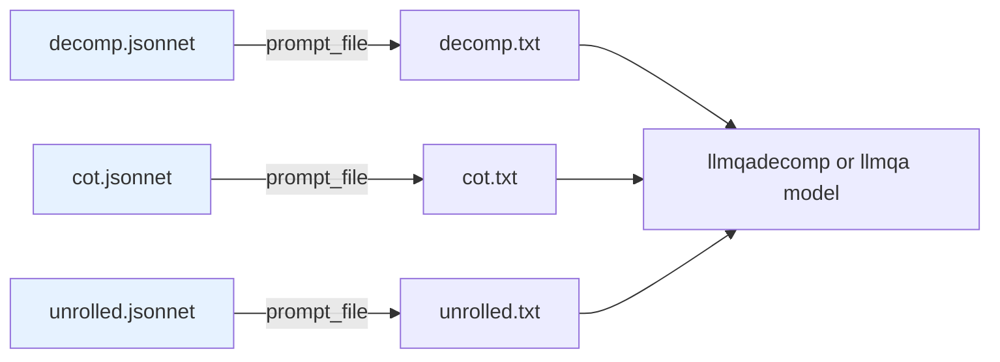
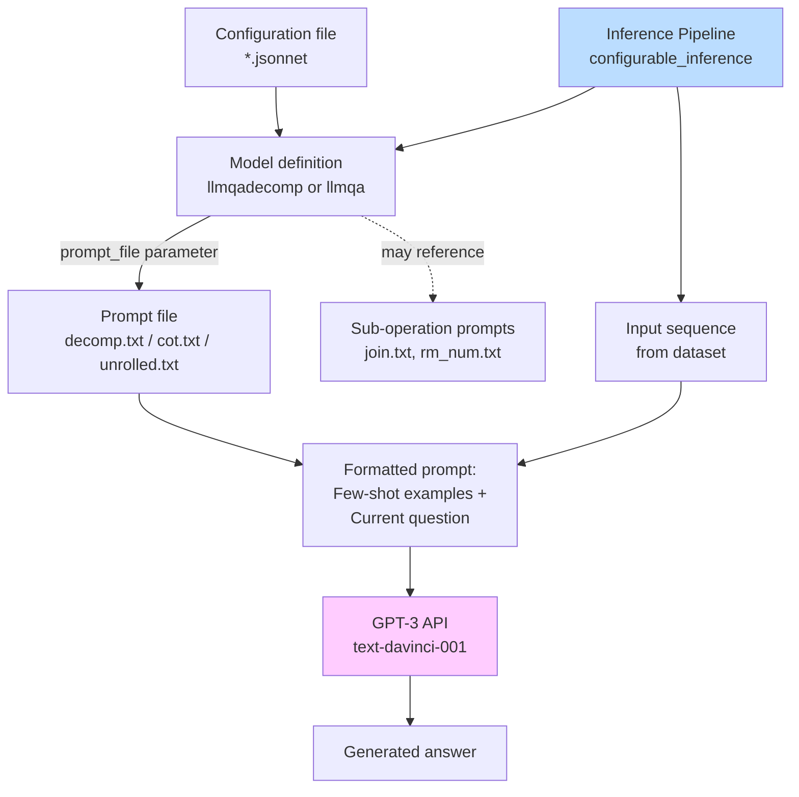

<!-- source: DeepWiki mcp.deepwiki.com · repo allenai/DecomP · page 7.1 List Reversal Prompts · fetched 2026-10-26 -->

# List Reversal Prompts

<details>
<summary>Relevant source files</summary>

The following files were used as context for generating this wiki page:

- [configs/prompts/reverse/cot.txt](configs/prompts/reverse/cot.txt)
- [configs/prompts/reverse/decomp.txt](configs/prompts/reverse/decomp.txt)
- [configs/prompts/reverse/join.txt](configs/prompts/reverse/join.txt)
- [configs/prompts/reverse/rm_num.txt](configs/prompts/reverse/rm_num.txt)
- [configs/prompts/reverse/unrolled.txt](configs/prompts/reverse/unrolled.txt)

</details>


## Purpose and Scope

This page documents all prompt templates used for the list reversal experiment in the DecomP repository. These prompts demonstrate three different prompting strategies—decomposed, chain of thought, and unrolled—for teaching language models to reverse sequences of items.

For information about list reversal dataset generation and inference configurations, see [Dataset Generation](#4.2.1) and [Inference Configurations](#4.2.2). For other prompt templates in the repository, see [CommAQA Prompts](#7.2).

**Sources:** [configs/prompts/reverse/decomp.txt:1-41](), [configs/prompts/reverse/cot.txt:1-12](), [configs/prompts/reverse/unrolled.txt:1-15]()

## Prompt File Organization

All list reversal prompt files are located in the `configs/prompts/reverse/` directory. The prompt structure follows a few-shot learning format, providing 2-3 examples per file to guide the language model.



**File Purpose Summary:**

| File | Strategy | Lines | Examples | Used By |
|------|----------|-------|----------|---------|
| `decomp.txt` | Decomposed | 41 | 3 | `decomp.jsonnet` |
| `cot.txt` | Chain of Thought | 12 | 3 | `cot.jsonnet` |
| `unrolled.txt` | Unrolled | 15 | 3 | `unrolled.jsonnet` |
| `join.txt` | Join operation | 15 | 5 | Used within decomposed |
| `rm_num.txt` | Remove numbers | 9 | 3 | Used within decomposed |

**Sources:** [configs/prompts/reverse/decomp.txt:1-41](), [configs/prompts/reverse/cot.txt:1-12](), [configs/prompts/reverse/unrolled.txt:1-15](), [configs/prompts/reverse/join.txt:1-15](), [configs/prompts/reverse/rm_num.txt:1-9]()

## Prompt Format Structure

All list reversal prompts follow a structured format with specific markers to guide the inference pipeline:



**Format Elements:**

- **QC**: Question Context - The original task description
- **QS**: Question Step - A reasoning step or sub-question (may include operation tags like `[extract]`, `[reverse]`, `[join]`)
- **A**: Answer - The response to the preceding question step
- **[EOQ]**: End of Question marker - Signals completion to the inference pipeline

In the decomposed strategy, the `QS` lines include operation tags such as:
- `[extract]` - Extract a portion of the sequence
- `[remove_numbers]` - Remove numbering from a sequence
- `[reverse]` - Reverse a sequence
- `[join]` - Concatenate two sequences
- `[cot]` - Chain of thought reasoning
- `[EOQ]` - End of question

**Sources:** [configs/prompts/reverse/decomp.txt:1-41](), [configs/prompts/reverse/cot.txt:1-12]()

## Decomposed Strategy Prompt

The decomposed strategy prompt (`decomp.txt`) breaks the reversal task into explicit sub-operations. This is the most complex prompt template, demonstrating full decomposition with intermediate steps.

### Strategy Overview



### Example Structure

The prompt contains three complete examples showing different sequence lengths:

1. **5-item sequence** (lines 1-17): "driving license, button, packet, identity card, shoe"
   - Splits into first half (2 items) and second half (3 items)
   - Demonstrates full decomposition pipeline

2. **3-item sequence** (lines 18-23): "laptop, photo, clip"
   - Below minimum length of 4, so no splitting occurs
   - Uses direct `[cot]` operation for reversal

3. **4-item sequence** (lines 25-40): "newspaper, glasses, laptop, bottle"
   - Exactly at minimum length threshold, so splitting occurs
   - Splits into two 2-item halves

**Key Prompt Features:**

- **Length threshold logic**: Sequences with length ≥ 4 are split; shorter sequences use chain-of-thought
- **Numbering system**: Items are numbered (e.g., "1. item, 2. item") for precise extraction
- **Reference system**: Uses `#N` to reference previous answers (e.g., `#1`, `#2`)
- **Explicit arithmetic**: Shows calculations like "5 / 2 = 2.5" and "5 - 2 = 3"

**Sources:** [configs/prompts/reverse/decomp.txt:1-41]()

### Decomposed Strategy Operations

The decomposed prompt references sub-operation prompts that handle specific tasks:



**Sources:** [configs/prompts/reverse/decomp.txt:6-15](), [configs/prompts/reverse/rm_num.txt:1-9](), [configs/prompts/reverse/join.txt:1-15]()

## Chain of Thought (CoT) Prompt

The CoT strategy prompt (`cot.txt`) uses natural language reasoning to enumerate positions explicitly without decomposition into sub-operations.

### Strategy Pattern



### Example Walkthrough

For the sequence "newspaper, glasses, laptop, bottle" (lines 9-11):

```
QS: First is newspaper. Second is glasses. Third is laptop. Fourth is bottle. 
    Now to reverse, change the order to: 
    Fourth is bottle. Third is laptop. Second is glasses. First is newspaper. 
    So the answer is "bottle, laptop, glasses, newspaper".
```

**Key Characteristics:**

- **Position enumeration**: Explicitly states ordinal positions (First, Second, Third, etc.)
- **Single-step reasoning**: No intermediate operations or sub-questions
- **Direct reversal**: States the reversed order immediately after enumeration
- **Self-contained**: Each example is complete within a single QS/A pair

**Prompt Examples:**

| Sequence Length | Example Items | Lines |
|----------------|---------------|-------|
| 4 items | newspaper, glasses, laptop, bottle | 9-11 |
| 3 items | laptop, photo, clip | 5-7 |
| 5 items | driving license, button, packet, identity card, pineapple | 9-11 |

**Sources:** [configs/prompts/reverse/cot.txt:1-12]()

## Unrolled Strategy Prompt

The unrolled strategy prompt (`unrolled.txt`) combines decomposition logic with chain-of-thought reasoning in a single continuous narrative, without explicit operation tags or step references.

### Strategy Flow



### Comparison with Decomposed Strategy

The unrolled prompt performs the same logical operations as the decomposed strategy but presents them in a monolithic reasoning chain:

**Decomposed (6 QS/A pairs):**
```
QS: [extract] ... first half ...
A: "1. driving license, 2. button"
QS: [extract] ... second half ...
A: "3. packet, 4. identity card, 5. shoe"
...
```

**Unrolled (1 QS/A pair):**
```
QS: The sequence is ... The first half (2 items) is "1. driving license, 2. button". 
    ... The second half (3 items) is "3. packet, 4. identity card, 5. shoe". 
    Removing the numbers ... Reversing ... Joining ... the answer is "..."
A: "shoe, identity card, packet, button, driving license"
```

**Key Differences:**

| Aspect | Decomposed | Unrolled |
|--------|-----------|----------|
| Operation tags | Explicit `[extract]`, `[reverse]`, etc. | No tags |
| Step separation | Multiple QS/A pairs per example | Single QS/A pair per example |
| Intermediate results | Each step produces a separate answer | All results in one narrative |
| Reference system | Uses `#N` to reference previous answers | Inline descriptions |
| Token efficiency | More tokens due to repeated QS/A markers | Fewer structural tokens |

**Sources:** [configs/prompts/reverse/unrolled.txt:1-15](), [configs/prompts/reverse/decomp.txt:1-41]()

## Sub-operation Prompts

The decomposed strategy uses specialized prompts for atomic operations. These are referenced by the inference pipeline when processing operation tags.

### Join Operation Prompt

The `join.txt` prompt demonstrates concatenating two sequences into one.

**File Location:** [configs/prompts/reverse/join.txt:1-15]()

**Format:**
```
Q: "sequence1" "sequence2".
A: "sequence1, sequence2"
```

**Examples:**

| First Sequence | Second Sequence | Result | Lines |
|---------------|-----------------|--------|-------|
| "bottle, laptop" | "glasses, newspaper" | "bottle, laptop, glasses, newspaper" | 1-2 |
| "identity card, packet, button" | "magazine, notebook, glasses" | "identity card, packet, button, magazine, notebook, glasses" | 4-5 |
| "passport, umbrella, radio, mobile phone, photo" | "player" | "passport, umbrella, radio, mobile phone, photo, player" | 7-8 |

**Characteristics:**
- Simple Q/A format (no QC/QS structure)
- Two quoted sequences as input
- Single concatenated sequence as output
- Preserves comma-space formatting

**Sources:** [configs/prompts/reverse/join.txt:1-15]()

### Remove Numbers Prompt

The `rm_num.txt` prompt demonstrates removing numeric prefixes from sequences.

**File Location:** [configs/prompts/reverse/rm_num.txt:1-9]()

**Format:**
```
Q: Remove the numbers from "N. item, N. item, ...".
A: "item, item, ..."
```

**Examples:**

| Input | Output | Lines |
|-------|--------|-------|
| "4. bottle, 3. laptop, 2. glasses, 1. newspaper" | "bottle, laptop, glasses, newspaper" | 1-2 |
| "1. identity card, 2. packet, 3. button" | "identity card, packet, button" | 4-5 |
| "1. player, 2. passport, 3. umbrella, 4. radio" | "player, passport, umbrella, radio" | 7-8 |

**Characteristics:**
- Simple Q/A format
- Explicit instruction "Remove the numbers from"
- Handles various numbering patterns
- Preserves item order and comma-space formatting

**Sources:** [configs/prompts/reverse/rm_num.txt:1-9]()

## Strategy Comparison

The three main strategies demonstrate different approaches to the same task. The following table summarizes their key differences:

| Aspect | Decomposed | Chain of Thought | Unrolled |
|--------|-----------|------------------|----------|
| **File** | `decomp.txt` | `cot.txt` | `unrolled.txt` |
| **Lines** | 41 | 12 | 15 |
| **Examples** | 3 | 3 | 3 |
| **Steps per example** | 6-10 QS/A pairs | 1 QS/A pair | 1 QS/A pair |
| **Operation tags** | Yes (`[extract]`, `[reverse]`, etc.) | No | No |
| **Sub-prompts** | Uses `join.txt`, `rm_num.txt` | None | None |
| **Splitting logic** | Explicit with length check | N/A (always direct) | Explicit with length check |
| **Intermediate results** | Stored and referenced with `#N` | Implicit in reasoning | Inline in narrative |
| **Token count** | Highest (detailed steps) | Lowest (concise) | Medium (narrative) |
| **Reasoning style** | Procedural/algorithmic | Positional enumeration | Narrative explanation |

### Prompt Selection in Configuration Files

The inference pipeline selects which prompt to use based on the configuration file:



**Configuration References:**
- Decomposed: [configs/decomp.jsonnet]() specifies `prompt_file: "configs/prompts/reverse/decomp.txt"`
- Chain of Thought: [configs/cot.jsonnet]() specifies `prompt_file: "configs/prompts/reverse/cot.txt"`
- Unrolled: [configs/unrolled.jsonnet]() specifies `prompt_file: "configs/prompts/reverse/unrolled.txt"`

**Sources:** [configs/prompts/reverse/decomp.txt:1-41](), [configs/prompts/reverse/cot.txt:1-12](), [configs/prompts/reverse/unrolled.txt:1-15]()

## Prompt Usage in Inference Pipeline

The following diagram shows how these prompts are loaded and used by the inference system:



**Processing Flow:**

1. Configuration file (e.g., `decomp.jsonnet`) specifies which prompt file to use
2. Inference pipeline loads the prompt file from `configs/prompts/reverse/`
3. For each test instance, the prompt examples are concatenated with the current question
4. The formatted prompt is sent to GPT-3 API
5. GPT-3 generates the answer following the demonstrated pattern
6. In decomposed strategy, sub-operation prompts (`join.txt`, `rm_num.txt`) may be invoked for specific operation tags

**Sources:** [configs/prompts/reverse/decomp.txt:1-41](), [configs/prompts/reverse/cot.txt:1-12](), [configs/prompts/reverse/unrolled.txt:1-15]()

---

