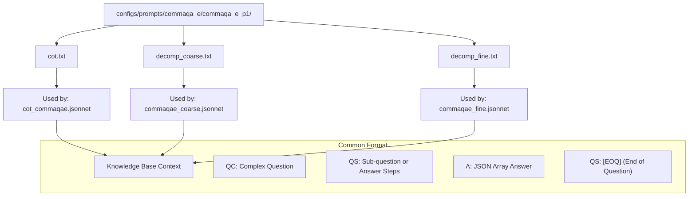
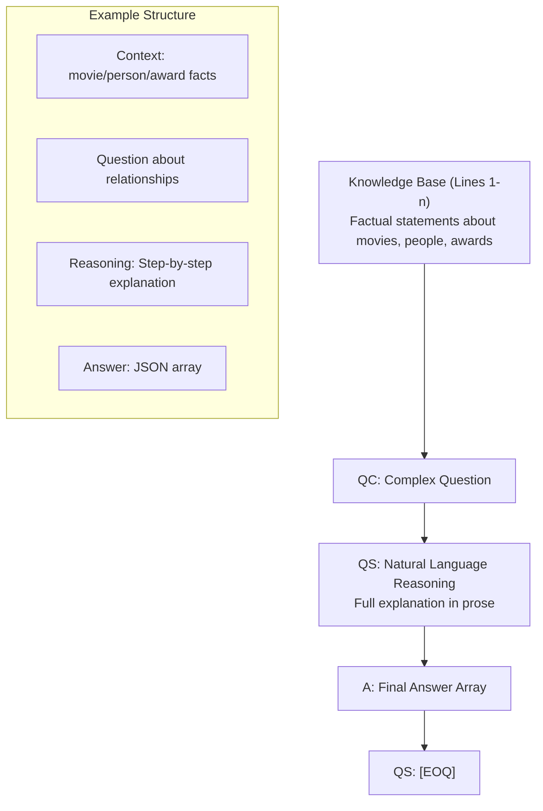
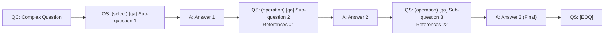
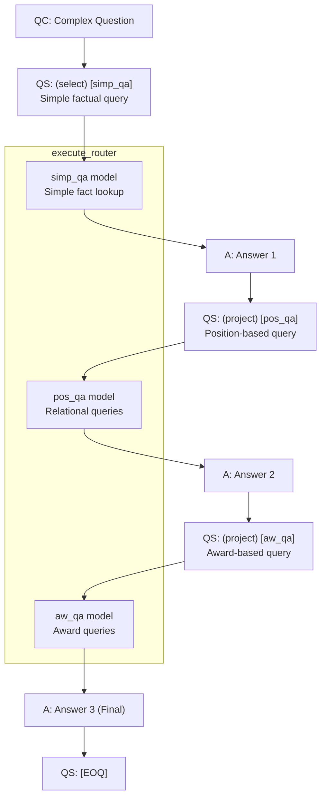
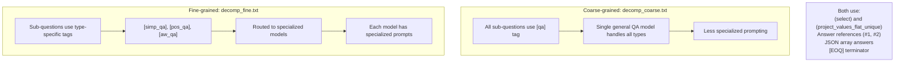
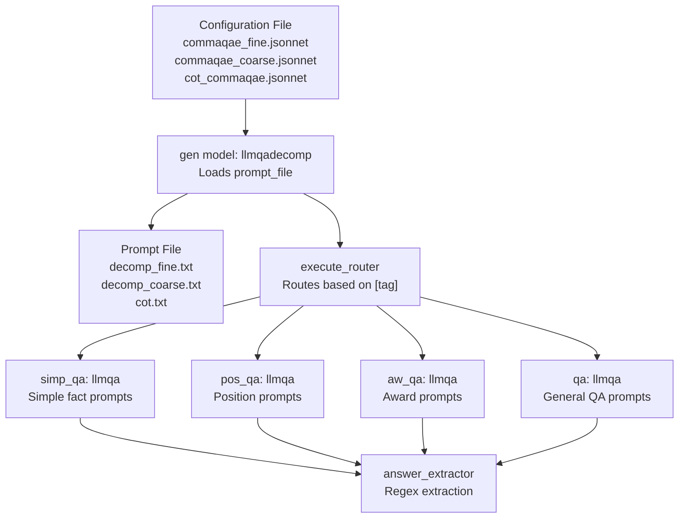

<!-- source: DeepWiki mcp.deepwiki.com · repo allenai/DecomP · page 7.2 CommAQA Prompts · fetched 2026-10-26 -->

# CommAQA Prompts

<details>
<summary>Relevant source files</summary>

The following files were used as context for generating this wiki page:

- [configs/prompts/commaqa_e/commaqa_e_p1/cot.txt](configs/prompts/commaqa_e/commaqa_e_p1/cot.txt)
- [configs/prompts/commaqa_e/commaqa_e_p1/decomp_coarse.txt](configs/prompts/commaqa_e/commaqa_e_p1/decomp_coarse.txt)
- [configs/prompts/commaqa_e/commaqa_e_p1/decomp_fine.txt](configs/prompts/commaqa_e/commaqa_e_p1/decomp_fine.txt)

</details>


## Purpose and Scope

This document describes the prompt templates used for the CommAQA multi-hop question answering experiment. CommAQA (Compositional Multi-hop Question Answering) tasks require decomposing complex questions into simpler sub-questions that can be answered sequentially.

Three prompt strategies are available for CommAQA:
- **Chain of Thought (CoT)**: Full natural language reasoning without explicit decomposition
- **Coarse-grained Decomposition**: Breaks questions into sub-queries using a single general QA model
- **Fine-grained Decomposition**: Breaks questions into sub-queries with specialized model routing

For information about the CommAQA experiment setup and configuration, see [CommAQA Multi-hop Question Answering](#4.3). For detailed documentation of the specialized sub-question prompts (`aw_qa`, `pos_qa`, `simp_qa`), see [Sub-question Prompts](#7.3).

## Prompt Template Files

The CommAQA prompts are located in `configs/prompts/commaqa_e/commaqa_e_p1/`. The following table summarizes the available prompt templates:

| File | Strategy | Model Tag | Purpose |
|------|----------|-----------|---------|
| `cot.txt` | Chain of Thought | N/A | Natural language reasoning with full context explanation |
| `decomp_coarse.txt` | Coarse-grained | `[qa]` | Decomposed prompting with single general QA model |
| `decomp_fine.txt` | Fine-grained | `[simp_qa]`, `[pos_qa]`, `[aw_qa]` | Decomposed prompting with specialized sub-question routing |

**Sources:** [configs/prompts/commaqa_e/commaqa_e_p1/cot.txt](), [configs/prompts/commaqa_e/commaqa_e_p1/decomp_coarse.txt](), [configs/prompts/commaqa_e/commaqa_e_p1/decomp_fine.txt]()

## Prompt Structure and Format

### Prompt File Organization



**Sources:** [configs/prompts/commaqa_e/commaqa_e_p1/]()

### Common Format Elements

All CommAQA prompts follow a structured format with these key markers:

| Marker | Purpose | Example |
|--------|---------|---------|
| `QC:` | Complex question to be answered | `QC: What awards have movies produced by people born in 1910 won?` |
| `QS:` | Sub-question or reasoning step | `QS: Who were born in the year 1910?` |
| `A:` | Answer in JSON array format | `A: ["Teeplemole", "Muntaril"]` |
| `[EOQ]` | End of question marker | `QS: [EOQ]` |

The prompts contain multiple example question-answer pairs separated by blank lines. Each example demonstrates the complete reasoning pattern from complex question to final answer.

**Sources:** [configs/prompts/commaqa_e/commaqa_e_p1/cot.txt:1-23](), [configs/prompts/commaqa_e/commaqa_e_p1/decomp_coarse.txt:1-49](), [configs/prompts/commaqa_e/commaqa_e_p1/decomp_fine.txt:1-49]()

## Chain of Thought Prompts

### Prompt Anatomy: cot.txt



**Sources:** [configs/prompts/commaqa_e/commaqa_e_p1/cot.txt]()

The Chain of Thought prompt strategy provides examples where the model explains its reasoning in natural language without explicit decomposition markers. 

### Example Format

```
movie: Premercy ; directed by: Muntaril. movie: Skirtsicine ; director: Teeplemole. ...
QC: What awards have movies produced by people born in 1910 won?
QS: The people born in 1910 were Muntaril and Teeplemole. Teeplemole produced 
the movies Featsaw and Zalate. Muntaril produced the movie Premercy. Featsaw 
was awarded the Zorgion award. Premercy was awarded the Chowwurst award. Zalate 
was awarded the Hallowcock award. So the answer is ["Zorgion", "Chowwurst", 
"Hallowcock"].
A: ["Zorgion", "Chowwurst", "Hallowcock"]
QS: [EOQ]
```

The reasoning steps are written as continuous prose that chains together the logical steps needed to answer the question, without separating them into distinct sub-questions.

**Sources:** [configs/prompts/commaqa_e/commaqa_e_p1/cot.txt:1-5]()

## Coarse-grained Decomposition Prompts

### Structure and Operational Semantics



**Sources:** [configs/prompts/commaqa_e/commaqa_e_p1/decomp_coarse.txt]()

The coarse-grained decomposition strategy breaks complex questions into explicit sub-questions. Each sub-question is tagged with:

1. **Operational semantic**: `(select)` or `(project_values_flat_unique)`
2. **Model tag**: `[qa]` - routes to a general QA model
3. **Sub-question text**: Natural language question
4. **Answer references**: `#1`, `#2` refer to previous answers

### Operational Semantics Tags

| Tag | Purpose | Example |
|-----|---------|---------|
| `(select)` | Initial filtering or selection query | `(select) [qa] Who were born in the year 1910?` |
| `(project_values_flat_unique)` | Projects and flattens unique values from previous results | `(project_values_flat_unique) [qa] For which movies was #1 the producer?` |

### Answer Referencing

Sub-questions can reference previous answers using numbered placeholders:

- `#1` - refers to the first answer
- `#2` - refers to the second answer
- `#3` - refers to the third answer (if present)

Example:
```
QS: (select) [qa] Who were born in the year 1910?
A: ["Teeplemole", "Muntaril"]
QS: (project_values_flat_unique) [qa] For which movies was #1 the producer?
```

Here, `#1` expands to `["Teeplemole", "Muntaril"]` when the sub-question is processed.

**Sources:** [configs/prompts/commaqa_e/commaqa_e_p1/decomp_coarse.txt:1-8]()

### Example Flow

```
QC: What awards have movies produced by people born in 1910 won?

QS: (select) [qa] Who were born in the year 1910?
A: ["Teeplemole", "Muntaril"]

QS: (project_values_flat_unique) [qa] For which movies was #1 the producer?
A: ["Featsaw", "Zalate", "Premercy"]

QS: (project_values_flat_unique) [qa] Which awards were given to #2?
A: ["Zorgion", "Chowwurst", "Hallowcock"]

QS: [EOQ]
```

**Sources:** [configs/prompts/commaqa_e/commaqa_e_p1/decomp_coarse.txt:1-8]()

## Fine-grained Decomposition Prompts

### Specialized Sub-question Routing



**Sources:** [configs/prompts/commaqa_e/commaqa_e_p1/decomp_fine.txt]()

Fine-grained decomposition differs from coarse-grained by routing sub-questions to specialized models based on question type:

### Sub-question Type Tags

| Tag | Model | Question Type | Example |
|-----|-------|---------------|---------|
| `[simp_qa]` | Simple QA | Factual lookups (birth year, country) | `Who were born in the year 1910?` |
| `[pos_qa]` | Position QA | Relational queries (actor, producer, director, writer) | `For which movies was #1 the producer?` |
| `[aw_qa]` | Award QA | Award-related queries | `Which awards were given to #2?` |

These tags are processed by the `execute_router` component, which dispatches each sub-question to the appropriate specialized model. See [Sub-question Prompts](#7.3) for detailed documentation of each specialized prompt.

**Sources:** [configs/prompts/commaqa_e/commaqa_e_p1/decomp_fine.txt:1-49]()

### Comparison: Coarse vs Fine-grained



**Sources:** [configs/prompts/commaqa_e/commaqa_e_p1/decomp_coarse.txt](), [configs/prompts/commaqa_e/commaqa_e_p1/decomp_fine.txt]()

### Example: Fine-grained Flow

```
QC: What awards have movies produced by people born in 1910 won?

QS: (select) [simp_qa] Who were born in the year 1910?
A: ["Teeplemole", "Muntaril"]

QS: (project_values_flat_unique) [pos_qa] For which movies was #1 the producer?
A: ["Featsaw", "Zalate", "Premercy"]

QS: (project_values_flat_unique) [aw_qa] Which awards were given to #2?
A: ["Zorgion", "Chowwurst", "Hallowcock"]

QS: [EOQ]
```

Notice how identical questions use different model tags compared to the coarse-grained version:
- Birth year query → `[simp_qa]` (simple fact)
- Producer relationship → `[pos_qa]` (position-based)
- Award query → `[aw_qa]` (award-specific)

**Sources:** [configs/prompts/commaqa_e/commaqa_e_p1/decomp_fine.txt:1-8]()

## Complete Prompt Examples

### Multi-hop Question Pattern

All three prompt files contain multiple complete examples following similar multi-hop patterns. Here are the question types included:

| Example # | Question Pattern | Hops | Operations |
|-----------|------------------|------|------------|
| 1 | Awards won by movies produced by people born in year X | 3 | Select by birth year → Project producers → Project awards |
| 2 | Movies acted in by people from country X | 2 | Select by country → Project movies acted in |
| 3 | Awards received by actors in award-winning movies | 3 | Select movies by award → Project actors → Project awards |
| 4 | Awards won by movies directed by award winners | 3 | Select people by award → Project directed movies → Project movie awards |
| 5 | Awards won by movies written by people born in year X | 3 | Select by birth year → Project written movies → Project awards |
| 6 | Movies directed by directors from country X | 2 | Select by country → Project directed movies |

Each example demonstrates how to handle different relationship types (producer, actor, director, writer) and query patterns (birth year, country, awards).

**Sources:** [configs/prompts/commaqa_e/commaqa_e_p1/decomp_fine.txt:1-49](), [configs/prompts/commaqa_e/commaqa_e_p1/decomp_coarse.txt:1-49](), [configs/prompts/commaqa_e/commaqa_e_p1/cot.txt:1-23]()

## Integration with Model Components

### Prompt Loading and Execution Flow



**Sources:** [configs/prompts/commaqa_e/commaqa_e_p1/]()

The `llmqadecomp` model loads the prompt file specified in the configuration and generates sub-questions. The `execute_router` component then:

1. Parses the model tag (`[simp_qa]`, `[pos_qa]`, `[aw_qa]`, or `[qa]`)
2. Routes the sub-question to the appropriate specialized model
3. Each model uses its own prompt file (see [Sub-question Prompts](#7.3))
4. The `answer_extractor` extracts the JSON array answer

For CoT prompts, no routing occurs - the `llmqadecomp` model generates the entire reasoning chain and final answer directly.

**Sources:** [configs/prompts/commaqa_e/commaqa_e_p1/cot.txt](), [configs/prompts/commaqa_e/commaqa_e_p1/decomp_fine.txt](), [configs/prompts/commaqa_e/commaqa_e_p1/decomp_coarse.txt]()

## Answer Format Specification

All CommAQA prompts produce answers in JSON array format:

```json
["Item1", "Item2", "Item3"]
```

Key characteristics:
- Always a JSON array, even for single-item answers
- String elements enclosed in double quotes
- Comma-separated
- No trailing commas
- Array can be empty: `[]`

Examples:
```
A: ["Teeplemole", "Muntaril"]
A: ["Featsaw", "Zalate", "Premercy"]
A: ["Zorgion", "Chowwurst", "Hallowcock"]
A: []
```

The `answer_extractor` component uses regex patterns to extract these JSON arrays from the model output.

**Sources:** [configs/prompts/commaqa_e/commaqa_e_p1/decomp_fine.txt:3-7](), [configs/prompts/commaqa_e/commaqa_e_p1/decomp_coarse.txt:3-7](), [configs/prompts/commaqa_e/commaqa_e_p1/cot.txt:4]()

---

