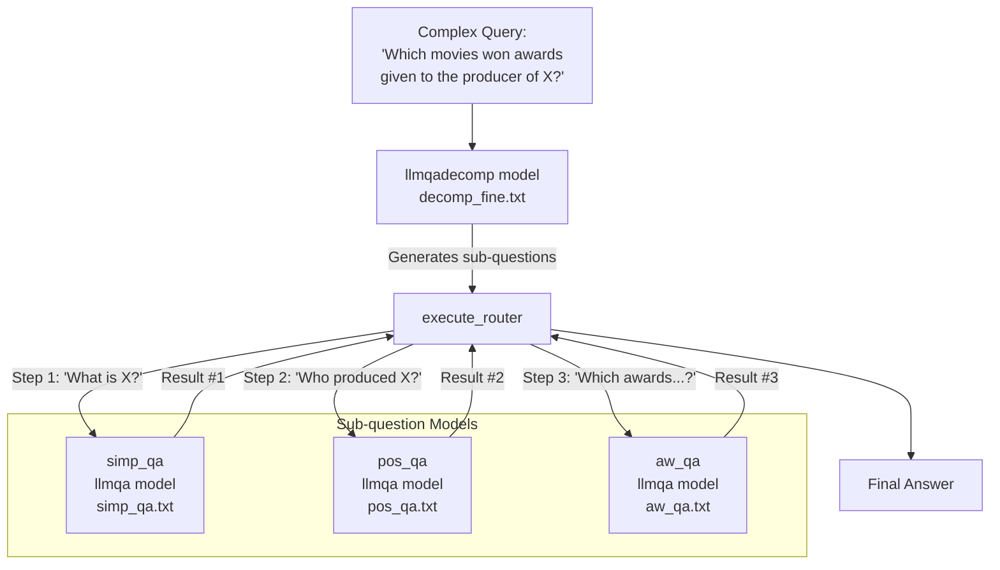
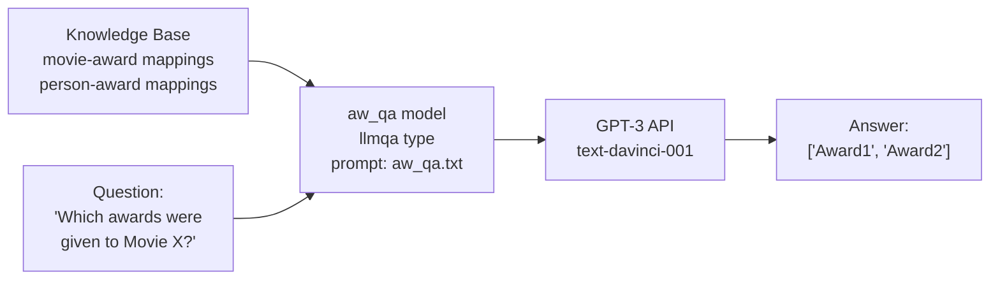
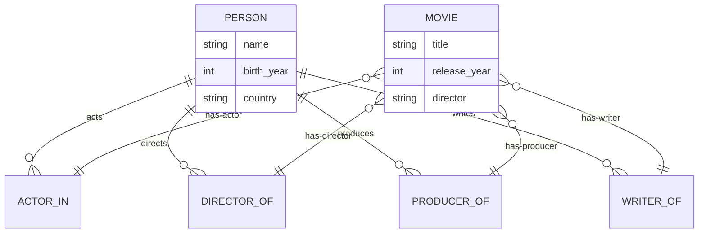
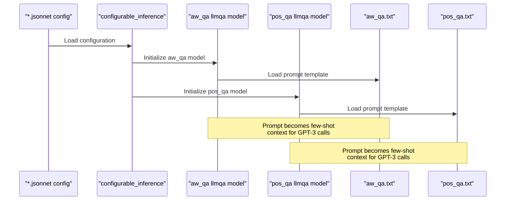
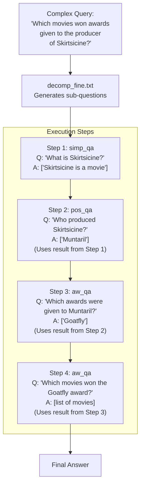

<!-- source: DeepWiki mcp.deepwiki.com · repo allenai/DecomP · page 7.3 Sub-question Prompts · fetched 2026-10-26 -->

# Sub-question Prompts

<details>
<summary>Relevant source files</summary>

The following files were used as context for generating this wiki page:

- [configs/prompts/commaqa_e/commaqa_e_p1/aw_qa.txt](configs/prompts/commaqa_e/commaqa_e_p1/aw_qa.txt)
- [configs/prompts/commaqa_e/commaqa_e_p1/pos_qa.txt](configs/prompts/commaqa_e/commaqa_e_p1/pos_qa.txt)

</details>


This document provides a reference for the specialized prompt templates used by sub-question answering models in the CommAQA experiment. These prompts are loaded by specific `llmqa` model instances (`aw_qa`, `pos_qa`, `simp_qa`) that handle different categories of decomposed questions in the CommAQA fine-grained decomposition strategy.

For information about the overall CommAQA decomposition pipeline, see [CommAQA Multi-hop Question Answering](#4.3). For the main decomposition prompts that generate sub-questions, see [CommAQA Prompts](#7.2).

## Overview

Sub-question prompts are few-shot prompt templates that provide examples of how to answer specific types of factual questions extracted from a knowledge base. In the CommAQA pipeline, the `llmqadecomp` model first decomposes a complex question into simpler sub-questions, then the `execute_router` orchestrates specialized `llmqa` models to answer each sub-question based on its type.

### Sub-question Types

| Model Name | Question Type | Example Question | Purpose |
|------------|---------------|------------------|---------|
| `aw_qa` | Award-based | "Which awards were given to X?" | Retrieves awards associated with movies or people |
| `pos_qa` | Position-based | "For which movies was X the producer?" | Retrieves movies where a person held a specific role |
| `simp_qa` | Simple fact lookup | "What is X?" | Handles basic factual queries |

**Diagram: Sub-question Model Selection in CommAQA Pipeline**



Sources: [configs/prompts/commaqa_e/commaqa_e_p1/aw_qa.txt:1-27](), [configs/prompts/commaqa_e/commaqa_e_p1/pos_qa.txt:1-27]()

## Prompt File Locations

The sub-question prompt templates are located in the CommAQA prompt directory structure:

```
configs/prompts/commaqa_e/commaqa_e_p1/
├── aw_qa.txt        # Award-related questions
├── pos_qa.txt       # Position-based questions  
└── simp_qa.txt      # Simple fact lookup (if available)
```

Each prompt file is referenced by the corresponding `llmqa` model configuration in the CommAQA jsonnet config files.

Sources: [configs/prompts/commaqa_e/commaqa_e_p1/aw_qa.txt:1](), [configs/prompts/commaqa_e/commaqa_e_p1/pos_qa.txt:1]()

## Award Questions (aw_qa)

The `aw_qa` prompt template handles questions about awards given to movies or people. This prompt is loaded by an `llmqa` model instance named `aw_qa` in the CommAQA fine-grained decomposition configuration.

### Prompt Structure

The prompt file [configs/prompts/commaqa_e/commaqa_e_p1/aw_qa.txt:1-27]() consists of:

1. **Context block**: A dense paragraph of factual statements about movies, people, awards, and their relationships
2. **Question-Answer pairs**: 2 example Q&A pairs using the provided context
3. **Repeating pattern**: Multiple context blocks followed by example Q&A pairs (4 blocks total)

### Example Format

```
[Context: Dense facts about movies, directors, actors, awards, years, etc.]
Q: Which awards were given to Zalate?
A: ["Hallowcock"]

Q: Which awards were given to Premercy?
A: ["Chowwurst"]
```

### Question Types Handled

The `aw_qa` model answers two main question patterns:

| Question Pattern | Example | Answer Format |
|------------------|---------|---------------|
| Awards given to a movie | "Which awards were given to Zalate?" | `["Hallowcock"]` |
| Awards won by a person | "Who has been awarded the Modiparity award?" | `["Bioperatology"]` |
| Movies with specific award | "Which movies were given the Erowid award?" | `["Dewbar", "Caudacite"]` |

**Diagram: Award Question Processing Flow**



Sources: [configs/prompts/commaqa_e/commaqa_e_p1/aw_qa.txt:1-27]()

### Context Format Details

The context blocks in `aw_qa.txt` contain structured facts formatted as:
- `movie: X ; awarded: Y` - Movie award relationships
- `person: X ; award: Y` - Person award relationships
- `award: X ; winner: Y` - Award winner relationships

The model learns to extract relevant award information based on the entity mentioned in the question.

Sources: [configs/prompts/commaqa_e/commaqa_e_p1/aw_qa.txt:1-8]()

## Position Questions (pos_qa)

The `pos_qa` prompt template handles questions about positions or roles people hold in relation to movies (e.g., producer, director, actor, writer). This prompt is loaded by an `llmqa` model instance named `pos_qa`.

### Prompt Structure

The prompt file [configs/prompts/commaqa_e/commaqa_e_p1/pos_qa.txt:1-27]() follows the same overall structure as `aw_qa.txt`:

1. Dense context paragraphs with movie and person facts
2. Question-Answer examples demonstrating position-based queries
3. Multiple context blocks (4 blocks total) for few-shot learning

### Example Format

```
[Context: Dense facts about movies, directors, actors, producers, writers, etc.]
Q: For which movies was Teeplemole the producer?
A: ["Featsaw", "Zalate"]

Q: For which movies was Muntaril the producer?
A: ["Premercy"]
```

### Question Types Handled

The `pos_qa` model handles various position-based relationship queries:

| Question Pattern | Example | Role Type |
|------------------|---------|-----------|
| Producer relationships | "For which movies was X the producer?" | Production |
| Actor appearances | "Which movies has X been an actor in?" | Acting |
| Director credits | "Which movies has X directed?" | Direction |
| Writer credits | "What movies has X written?" | Writing |

**Diagram: Position Question Entity Relationships**



Sources: [configs/prompts/commaqa_e/commaqa_e_p1/pos_qa.txt:1-27]()

### Context Format Details

The context blocks in `pos_qa.txt` contain facts about positions formatted as:
- `X produced the movie Y with others` - Producer relationships
- `X was an actor in the movie Y` - Actor relationships
- `movie: X ; directed by: Y` - Director relationships
- `movie: X ; written by: Y` - Writer relationships

The prompt provides natural language variations of the same relationship type (e.g., "was an actor in", "acted in") to help the model generalize.

Sources: [configs/prompts/commaqa_e/commaqa_e_p1/pos_qa.txt:1-22]()

## Simple Questions (simp_qa)

The `simp_qa` model handles basic factual lookup questions that don't fall into the specialized categories of awards or positions. While a `simp_qa.txt` prompt file is referenced in CommAQA configurations, it is not included in the provided files for documentation.

Based on the CommAQA pipeline architecture, `simp_qa` typically handles questions like:
- "What is X?" - Entity identification
- "When was X released?" - Date queries
- "Where is X from?" - Location queries

The prompt format would follow the same few-shot pattern as `aw_qa` and `pos_qa`.

Sources: Configuration architecture inferred from system design

## Prompt Configuration in Jsonnet

Sub-question prompts are integrated into the CommAQA pipeline through jsonnet configuration files. Each specialized `llmqa` model references its corresponding prompt file.

### Example Configuration Pattern

```
{
  aw_qa: {
    type: "llmqa",
    prompt_file: "configs/prompts/commaqa_e/commaqa_e_p1/aw_qa.txt",
    max_tokens: 50,
    model_name: "text-davinci-001"
  },
  pos_qa: {
    type: "llmqa", 
    prompt_file: "configs/prompts/commaqa_e/commaqa_e_p1/pos_qa.txt",
    max_tokens: 50,
    model_name: "text-davinci-001"
  }
}
```

The `execute_router` model then references these sub-models and routes decomposed questions to the appropriate handler.

Sources: System architecture from Diagram 5, configuration patterns

**Diagram: Prompt Loading and Model Initialization**



Sources: [configs/prompts/commaqa_e/commaqa_e_p1/aw_qa.txt:1](), [configs/prompts/commaqa_e/commaqa_e_p1/pos_qa.txt:1]()

## Common Prompt Characteristics

All sub-question prompts share several design characteristics:

### Few-shot Learning Pattern

Each prompt provides 4 context blocks with 2 Q&A examples each, totaling 8 examples. This gives the language model sufficient context to understand:
- The knowledge base format and structure
- The expected question types
- The answer format (JSON list notation)

### Answer Format

All sub-question prompts return answers in JSON list format:
- Single answer: `["Value"]`
- Multiple answers: `["Value1", "Value2", "Value3"]`
- No answer: `[]`

This consistent format allows the `execute_router` to parse results reliably and pass them to subsequent sub-questions.

### Dense Context Encoding

Context is provided as dense paragraph text rather than structured data. This encoding includes:
- Multiple fact types intermixed
- Natural language variations of relationships
- Temporal information (years)
- Multiple entity types (movies, people, awards, countries)

This design tests the model's ability to extract relevant facts from unstructured text.

Sources: [configs/prompts/commaqa_e/commaqa_e_p1/aw_qa.txt:1-27](), [configs/prompts/commaqa_e/commaqa_e_p1/pos_qa.txt:1-27]()

## Usage in Multi-hop Reasoning

Sub-question prompts enable multi-hop reasoning by allowing each decomposed step to build on previous results. The `execute_router` orchestrates this process:

1. **Step 1**: Use `simp_qa` to resolve entity references
2. **Step 2**: Use `pos_qa` to find related entities through position relationships
3. **Step 3**: Use `aw_qa` to query awards for entities from Step 2

**Diagram: Multi-hop Query Execution with Sub-question Prompts**



Sources: [configs/prompts/commaqa_e/commaqa_e_p1/aw_qa.txt:1-27](), [configs/prompts/commaqa_e/commaqa_e_p1/pos_qa.txt:1-27]()

## Creating Custom Sub-question Prompts

To add new specialized sub-question types for CommAQA:

1. Create a new prompt file in `configs/prompts/commaqa_e/commaqa_e_p1/`
2. Follow the few-shot format: context blocks with Q&A examples
3. Ensure answer format uses JSON list notation
4. Add 4 diverse context blocks with 2 examples each
5. Reference the prompt in a new `llmqa` model in the jsonnet config
6. Update the `execute_router` to route appropriate questions to the new model

For more information on creating custom prompts, see [Creating Custom Prompts](#8.3).

Sources: Inferred from existing prompt structure and system architecture

---

