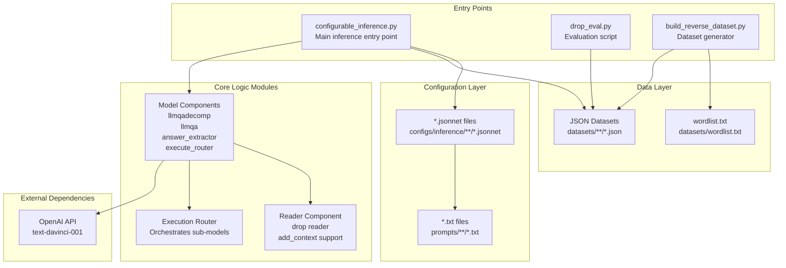
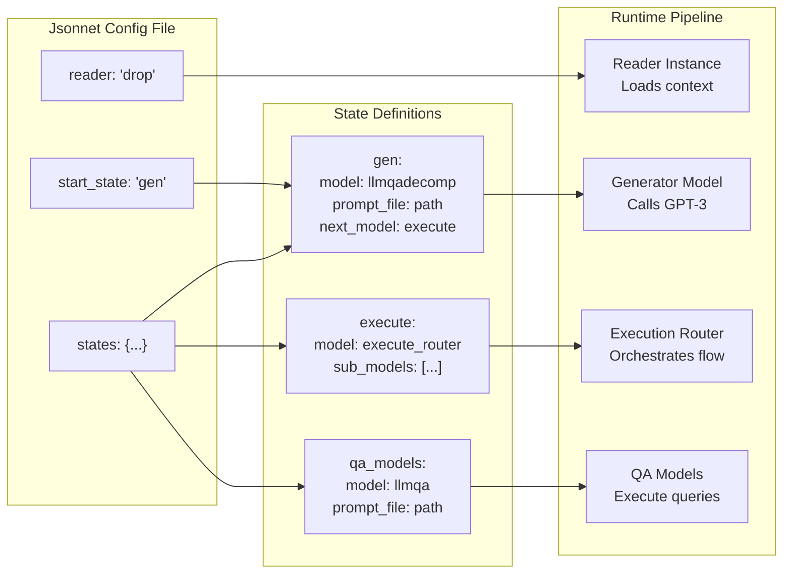
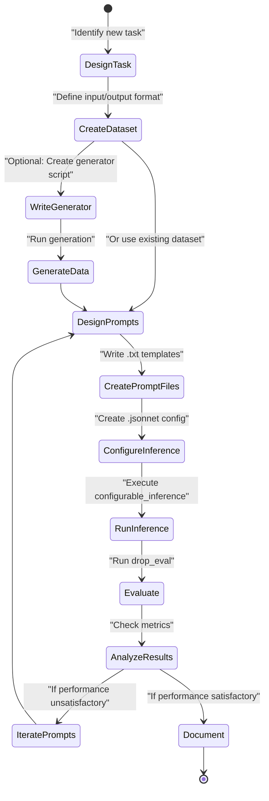

<!-- source: DeepWiki mcp.deepwiki.com · repo allenai/DecomP · page 8 Development Guide · fetched 2026-10-26 -->

# Development Guide

<details>
<summary>Relevant source files</summary>

The following files were used as context for generating this wiki page:

- [.gitignore](.gitignore)
- [LICENSE](LICENSE)
- [README.md](README.md)

</details>


This guide is for developers who want to extend or modify the DecomP system. It covers the development environment setup, key extension points, code organization principles, and development workflows. For specific tasks, see:
- Repository file and directory organization: [8.1](#8.1)
- Step-by-step tutorial for adding new experimental tasks: [8.2](#8.2)
- Instructions for creating custom prompt templates: [8.3](#8.3)

For running existing experiments as a user, see [Getting Started](#2).

---

## Development Environment Setup

### Prerequisites

**Python Environment**: The DecomP system requires Python 3.8 with conda for environment management.

**Required Environment Variables**:
- `PYTHONPATH`: Must be set to `src/` to enable module imports
- `OPENAI_API_KEY`: Required for GPT-3 API access

**Installation Steps**:
```bash
conda create -n decomp python=3.8
pip install -r requirements.txt
export PYTHONPATH=src/
export OPENAI_API_KEY=<YOUR_API_KEY>
```

**Directory Creation**: Create output directories before running inference:
```bash
mkdir -p output/predictions
mkdir -p datasets/reverse
```

Sources: [README.md:5-16]()

---

## Core System Components

### Component Architecture

The following diagram maps the high-level system components to their actual code locations:



Sources: [README.md:18-83]()

---

### Module Path Structure

The following table maps functional components to their Python module paths:

| Component | Module Path | Purpose |
|-----------|-------------|---------|
| Main Inference | `decomp.inference.configurable_inference` | Orchestrates the entire inference pipeline |
| Evaluation | `decomp.datasets_utils.drop_eval` | Compares predictions against ground truth |
| Dataset Generation | `decomp.datasets_utils.build_reverse_dataset` | Generates synthetic list reversal datasets |
| Model: llmqadecomp | (defined in configs) | Decomposes complex queries into sub-steps |
| Model: llmqa | (defined in configs) | Executes QA over context |
| Model: answer_extractor | (defined in configs) | Extracts final answers using regex |
| Model: execute_router | (defined in configs) | Routes execution to specialized sub-models |

Sources: [README.md:23-76]()

---

## Configuration System Architecture

### Configuration File Structure

The system uses Jsonnet configuration files that define the inference pipeline structure. The following diagram shows how configuration elements map to runtime components:



**Key Configuration Locations**:
- Letter Concatenation: `configs/inference/letter_cat/*.jsonnet`
- List Reversal: `configs/inference/reverse/*.jsonnet`
- CommAQA: `configs/inference/commaqa/*.jsonnet`

**Configuration Parameters**:
- `start_state`: Entry point state name
- `states`: Dictionary mapping state names to model definitions
- `reader`: Dataset reader type (e.g., "drop")
- `add_context`: Boolean for including context in prompts
- `prompt_file`: Path to prompt template
- `next_model`: State transition specification
- `max_tokens`: Token limit for generation
- `max_steps`: Step limit for multi-step execution

Sources: [README.md:23-76]()

---

## Extension Points

### Primary Extension Points

The DecomP system provides four primary extension points for developers:

1. **New Experiments** (Task-level)
   - Add new dataset formats
   - Create corresponding Jsonnet configurations
   - Design task-specific prompt templates
   - See [Adding New Experiments](#8.2) for detailed guidance

2. **Custom Prompts** (Prompt-level)
   - Create new `.txt` files in `prompts/` directory
   - Reference from configuration `prompt_file` parameter
   - Support variable substitution patterns
   - See [Creating Custom Prompts](#8.3) for detailed guidance

3. **Model Components** (Architecture-level)
   - Extend existing model types (llmqadecomp, llmqa)
   - Implement new routing logic in execute_router
   - Add extraction patterns to answer_extractor
   - Requires modification of core inference code

4. **Dataset Generators** (Data-level)
   - Create new generator scripts similar to `build_reverse_dataset.py`
   - Follow JSON dataset format specification
   - Support parameterization for systematic evaluation

Sources: [README.md:18-83]()

---

## Development Workflow

### Experiment Development Cycle



**Typical Command Sequence**:

1. **Generate Dataset** (if synthetic):
   ```bash
   python src/decomp/datasets_utils/build_reverse_dataset.py \
     --listop=reversed --elts=words --out_dir=datasets/reverse \
     --length=10 --num_examples=1000
   ```

2. **Run Inference**:
   ```bash
   promptid=p1 python -m decomp.inference.configurable_inference \
     --input datasets/reverse/test_10_normal_words.json \
     --config configs/inference/reverse/decomp.jsonnet \
     --output output/predictions/reverse_10_decomp_predictions.json
   ```

3. **Evaluate Results**:
   ```bash
   python -m decomp.datasets_utils.drop_eval \
     --gold_path datasets/reverse/test_10_normal_words.json \
     --prediction_path output/predictions/reverse_10_decomp_predictions.json
   ```

4. **Iterate**: Modify prompts or configuration based on results

Sources: [README.md:38-60]()

---

## Key Command-Line Interfaces

### configurable_inference.py

**Purpose**: Main entry point for running inference experiments.

**Required Arguments**:
- `--input`: Path to input dataset JSON file
- `--config`: Path to Jsonnet configuration file
- `--output`: Path for output predictions JSON file

**Environment Variables**:
- `promptid`: Selects which prompt variant to use (e.g., p1, p2, p3)
- `PYTHONPATH`: Must be set to `src/`
- `OPENAI_API_KEY`: Required for API access

**Example Usage**:
```bash
promptid=p1 python -m decomp.inference.configurable_inference \
  --input datasets/letter_cat/n5_eg100_pos2_space.json \
  --config configs/inference/letter_cat/letter_cat_greedy_search.jsonnet \
  --output output/predictions/letter_cat_predictions.json
```

Sources: [README.md:23-31](), [README.md:52-55](), [README.md:65-68]()

---

### drop_eval.py

**Purpose**: Evaluates predictions against ground truth datasets.

**Required Arguments**:
- `--gold_path`: Path to ground truth dataset JSON file
- `--prediction_path`: Path to predictions JSON file

**Output**: Prints evaluation metrics to stdout.

**Example Usage**:
```bash
python -m decomp.datasets_utils.drop_eval \
  --gold_path datasets/letter_cat/n5_eg100_pos2_space.json \
  --prediction_path output/predictions/letter_cat_predictions.json
```

Sources: [README.md:28-30](), [README.md:57-59](), [README.md:70-72]()

---

### build_reverse_dataset.py

**Purpose**: Generates synthetic list reversal datasets with configurable parameters.

**Required Arguments**:
- `--listop`: Operation type (use `reversed` for reversal)
- `--elts`: Element type (use `words` for word-based lists)
- `--out_dir`: Output directory for generated datasets
- `--length`: Length of sequences to generate
- `--num_examples`: Number of examples to generate

**Output**: Creates JSON file at `{out_dir}/test_{length}_normal_{elts}.json`

**Example Usage**:
```bash
python src/decomp/datasets_utils/build_reverse_dataset.py \
  --listop=reversed --elts=words --out_dir=datasets/reverse \
  --length=10 --num_examples=1000
```

**Vocabulary Source**: Uses `datasets/wordlist.txt` containing 57 common words.

Sources: [README.md:45-50]()

---

## Experiment Configuration Patterns

### Configuration File Naming Conventions

| Pattern | Example | Purpose |
|---------|---------|---------|
| `{task}_{strategy}.jsonnet` | `decomp.jsonnet` | Base decomposed prompting configuration |
| `cot_{task}.jsonnet` | `cot.jsonnet` | Chain-of-Thought baseline |
| `cot_rollout_{task}.jsonnet` | `cot_rollout_letter_cat.jsonnet` | CoT with rollout verification |
| `{task}_greedy_search.jsonnet` | `letter_cat_greedy_search.jsonnet` | Greedy decoding configuration |
| `{task}e_fine.jsonnet` | `commaqae_fine.jsonnet` | Fine-grained decomposition |
| `{task}e_coarse.jsonnet` | `commaqae_coarse.jsonnet` | Coarse-grained decomposition |

Sources: [README.md:33-35](), [README.md:75-76]()

---

### Prompt Selection via Environment Variable

The `promptid` environment variable enables A/B testing of different prompt variants:

```bash
# Test first prompt variant
promptid=p1 python -m decomp.inference.configurable_inference --input ... --config ...

# Test second prompt variant
promptid=p2 python -m decomp.inference.configurable_inference --input ... --config ...

# Test third prompt variant
promptid=p3 python -m decomp.inference.configurable_inference --input ... --config ...
```

**Prompt Variant Mapping**:
- `p1`: Default/primary prompt template
- `p2`: Alternative formulation (task-specific)
- `p3`: Another alternative formulation (task-specific)

The actual prompt file paths are defined in the Jsonnet configuration and selected based on `promptid`.

Sources: [README.md:33-35](), [README.md:75-76]()

---

## Dataset Format Requirements

### JSON Dataset Structure

All datasets follow a consistent JSON format for compatibility with the inference and evaluation pipelines:

**Required Fields**:
- Input representation (task-specific field names)
- Ground truth answer field
- Unique identifier for each example

**Example Structure** (List Reversal):
```json
{
  "query_id": "unique_id",
  "question": "A, B, C, D",
  "answer": "D, C, B, A"
}
```

**File Naming Convention**:
- Descriptive task prefix (e.g., `test_`, `iid_test_`, `compgen_test_`)
- Parameter specification (e.g., `10` for length)
- Type descriptor (e.g., `normal_words`)
- Extension: `.json`

**Example**: `test_10_normal_words.json`, `iid_test_eg100.json`

Sources: [README.md:24](), [README.md:53](), [README.md:66]()

---

## Testing Strategy

### Validation Approach

The DecomP system uses empirical validation through evaluation metrics rather than unit tests:

**Evaluation Metrics**:
- Exact match accuracy (primary metric)
- Per-example comparison with ground truth
- Computed by `drop_eval.py`

**Validation Workflow**:
1. Run inference on test dataset
2. Compare predictions to gold labels
3. Analyze accuracy metrics
4. Examine failure cases manually

**Regression Testing**:
- Maintain prediction outputs for known configurations
- Compare new runs against baseline predictions
- Track accuracy changes across code modifications

**Manual Inspection**:
- Review generated outputs in `output/predictions/*.json`
- Check intermediate steps in multi-stage decomposition
- Verify prompt template substitutions

Sources: [README.md:28-30](), [README.md:57-59](), [README.md:70-72]()

---

## Debugging and Troubleshooting

### Common Issues and Solutions

| Issue | Symptom | Solution |
|-------|---------|----------|
| Import errors | `ModuleNotFoundError: No module named 'decomp'` | Set `export PYTHONPATH=src/` |
| API errors | `openai.error.AuthenticationError` | Set valid `OPENAI_API_KEY` environment variable |
| Missing output directory | `FileNotFoundError: [Errno 2] No such file or directory` | Create directory: `mkdir -p output/predictions` |
| Missing dataset | Dataset file not found | Generate dataset first or check file path |
| Invalid promptid | Config fails to load prompt | Use valid promptid (p1, p2, p3) or check config |

**Debugging Tips**:
- Check environment variables: `echo $PYTHONPATH $OPENAI_API_KEY`
- Verify file paths before running commands
- Review Jsonnet configuration for syntax errors
- Examine intermediate outputs in prediction files
- Check OpenAI API rate limits and quota

Sources: [README.md:12-16](), [README.md:42]()

---

## Related Documentation

For detailed information on specific development tasks:

- **Repository organization**: See [Repository Structure](#8.1) for directory layout and file organization
- **Adding experiments**: See [Adding New Experiments](#8.2) for step-by-step tutorial
- **Prompt engineering**: See [Creating Custom Prompts](#8.3) for prompt template design
- **Configuration details**: See [Configuration System](#5.2) for Jsonnet configuration reference
- **Model components**: See [Model Components](#5.3) for model type specifications
- **Dataset formats**: See [Dataset Format Specification](#6.3) for JSON schema details

Sources: [README.md:1-83]()

---

