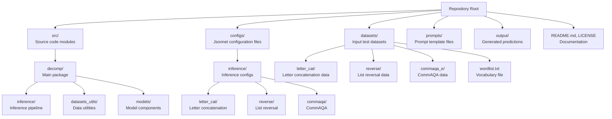
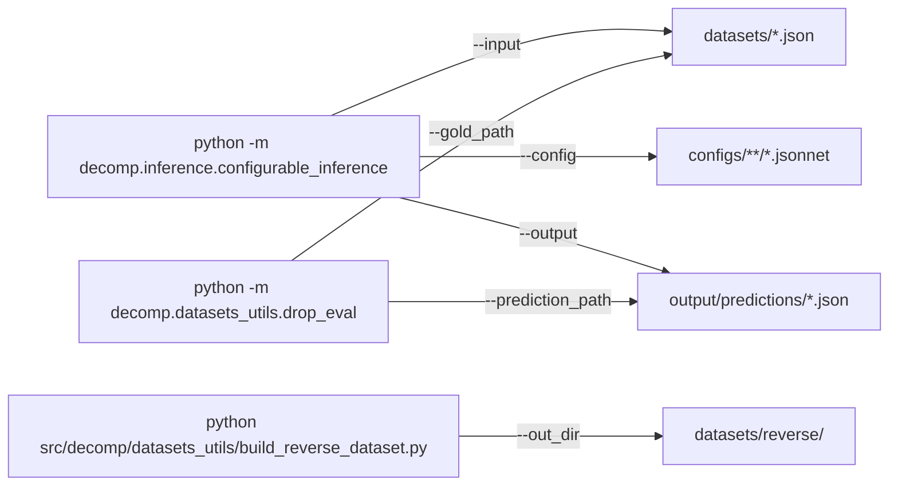
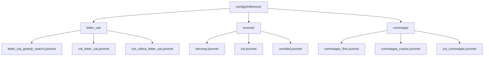
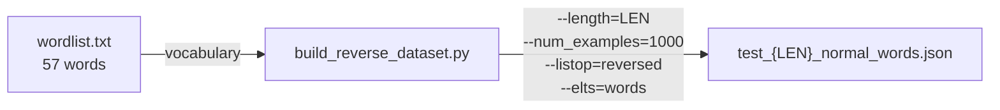
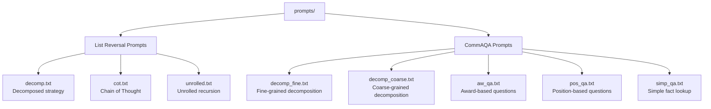
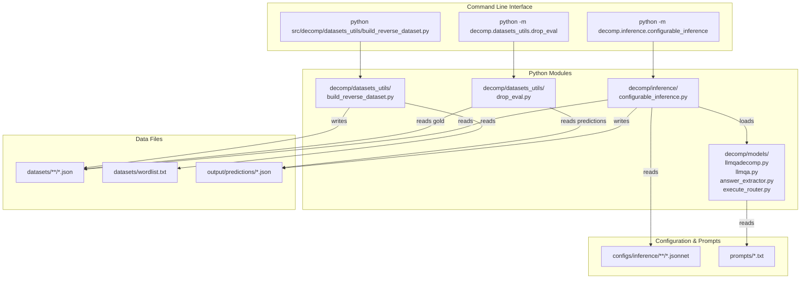
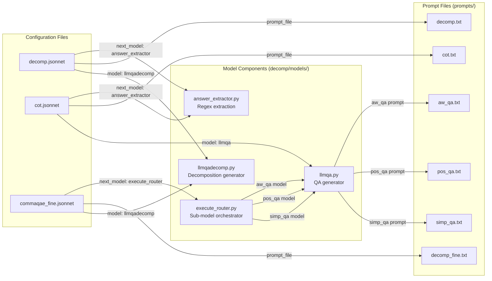

<!-- source: DeepWiki mcp.deepwiki.com · repo allenai/DecomP · page 8.1 Repository Structure · fetched 2026-10-26 -->

# Repository Structure

<details>
<summary>Relevant source files</summary>

The following files were used as context for generating this wiki page:

- [.gitignore](.gitignore)
- [LICENSE](LICENSE)
- [README.md](README.md)

</details>


## Purpose and Scope

This document describes the organization of directories and files in the DecomP repository. It provides a reference for understanding where different components are located and how they are structured within the codebase. For details on running experiments, see [Getting Started](#2). For information on the inference system architecture, see [System Architecture](#5).

## Repository Overview

The DecomP repository follows a standard Python project structure with clear separation between source code, data, configuration, and output artifacts.



**Sources:** [README.md:1-83](), [.gitignore:1-14]()

## Directory Structure Details

### Source Code (`src/`)

The `src/` directory contains the `decomp` Python package, which is the main codebase for the inference system. The `PYTHONPATH` environment variable must be set to `src/` for the package to be importable.

| Subdirectory | Purpose | Key Files |
|--------------|---------|-----------|
| `decomp/inference/` | Inference pipeline implementation | `configurable_inference.py` |
| `decomp/datasets_utils/` | Dataset generation and evaluation | `build_reverse_dataset.py`, `drop_eval.py` |
| `decomp/models/` | Model component implementations | `llmqadecomp.py`, `llmqa.py`, `answer_extractor.py`, `execute_router.py` |

The module structure follows this pattern for invocation:



**Sources:** [README.md:14-15](), [README.md:23-76]()

### Configuration Files (`configs/`)

The `configs/` directory contains Jsonnet configuration files that define inference pipeline behavior. These configurations specify model components, prompting strategies, and execution parameters.



Each configuration file defines:
- **Model pipeline**: Sequence of model components to execute
- **Prompt files**: References to prompt templates in `prompts/`
- **Transition logic**: How models pass data to subsequent stages
- **Generation parameters**: Token limits, sampling strategies

For detailed configuration structure, see [Configuration System](#5.2).

**Sources:** [README.md:25-26](), [README.md:33-35](), [README.md:54-55](), [README.md:67-68](), [README.md:75-76]()

### Dataset Files (`datasets/`)

The `datasets/` directory stores input test datasets in JSON format. Each experiment type has its own subdirectory.

| Directory | Content | Format |
|-----------|---------|--------|
| `datasets/letter_cat/` | Letter concatenation test cases | Static JSON files with pattern `n{N}_eg{E}_pos{P}_space.json` |
| `datasets/reverse/` | List reversal test cases | Generated JSON files with pattern `test_{LEN}_normal_words.json` |
| `datasets/commaqa_e/` | CommAQA multi-hop QA | Static JSON files: `iid_test_eg100.json`, `compgen_test_eg300.json` |
| `datasets/wordlist.txt` | Vocabulary for generation | Plain text file with 57 common words |

The list reversal datasets are generated on-demand using the generation script:



**Sources:** [README.md:24](), [README.md:45-50](), [README.md:53](), [README.md:66](), [README.md:77-78]()

### Prompt Templates (`prompts/`)

The `prompts/` directory contains text files with prompt templates used by different models and strategies. These templates are referenced by configuration files and filled with runtime data during inference.



Each prompt file contains:
- **Few-shot examples**: Demonstrations of the task
- **Format instructions**: How to structure the output
- **Placeholder markers**: Variables filled during inference (e.g., `{question}`, `{context}`)

For details on prompt structure, see [Prompt Templates](#7).

**Sources:** System architecture diagrams referencing prompt files

### Output Directory (`output/`)

The `output/` directory stores generated predictions from inference runs. This directory is typically excluded from version control via `.gitignore`.

```
output/
└── predictions/
    ├── letter_cat_n5_eg100_pos2_space_decomp_predictions.json
    ├── reverse_{LEN}_{STRAT}_predictions.json
    └── commaqa_e_iid_test_eg100_fine_decomp_predictions.json
```

Output files follow a naming convention based on:
- **Input dataset name**: Identifies the test set used
- **Strategy identifier**: Indicates the prompting approach (decomp, cot, unrolled)
- **Suffix**: Always ends with `_predictions.json`

These prediction files are consumed by `drop_eval.py` for evaluation against gold standard datasets.

**Sources:** [README.md:26](), [README.md:55](), [README.md:68](), [.gitignore:9]()

## Root Level Files

The repository root contains essential project documentation and configuration files:

| File | Purpose |
|------|---------|
| `README.md` | Installation instructions, setup guide, and experiment examples |
| `LICENSE` | Apache License 2.0 legal terms |
| `.gitignore` | Specifies files excluded from version control (output/, Python bytecode) |
| `requirements.txt` | Python package dependencies for installation |

**Sources:** [README.md:1-83](), [LICENSE:1-202](), [.gitignore:1-14]()

## Module Organization and Execution Flow

The following diagram maps command-line invocations to their corresponding Python modules and the files they interact with:



**Sources:** [README.md:23-59]()

## Configuration-to-Code Mapping

This diagram shows how configuration files map to specific code components in the inference pipeline:



**Sources:** System architecture diagrams, [README.md:33-76]()

## File Path Patterns and Naming Conventions

The repository uses consistent naming patterns for different file types:

### Configuration Files
```
configs/inference/{experiment}/{strategy}[_greedy_search].jsonnet

Examples:
- configs/inference/reverse/decomp.jsonnet
- configs/inference/letter_cat/cot_letter_cat.jsonnet
- configs/inference/commaqa/commaqae_fine_greedy_search.jsonnet
```

### Dataset Files
```
datasets/{experiment}/{descriptor}.json
datasets/reverse/test_{length}_normal_words.json
datasets/letter_cat/n{n}_eg{examples}_pos{position}_space.json
datasets/commaqa_e/{split}_test_eg{examples}.json

Examples:
- datasets/reverse/test_10_normal_words.json
- datasets/letter_cat/n5_eg100_pos2_space.json
- datasets/commaqa_e/iid_test_eg100.json
```

### Output Prediction Files
```
output/predictions/{experiment}_{descriptor}_{strategy}_predictions.json

Examples:
- output/predictions/reverse_10_decomp_predictions.json
- output/predictions/letter_cat_n5_eg100_pos2_space_decomp_predictions.json
- output/predictions/commaqa_e_iid_test_eg100_fine_decomp_predictions.json
```

**Sources:** [README.md:26](), [README.md:53](), [README.md:24](), [README.md:66]()

## Environment Variables and Setup

The repository requires specific environment configuration:

| Variable | Purpose | Example |
|----------|---------|---------|
| `PYTHONPATH` | Points to source code root | `export PYTHONPATH=src/` |
| `OPENAI_API_KEY` | Authentication for GPT-3 API | `export OPENAI_API_KEY=<YOUR_API_KEY>` |

These must be set before running any inference commands.

**Sources:** [README.md:12-16]()

## Summary

The DecomP repository structure separates concerns clearly:
- **Source code** in `src/decomp/` with modular components
- **Configurations** in `configs/inference/` defining pipelines
- **Datasets** in `datasets/` organized by experiment
- **Prompts** in `prompts/` as reusable templates
- **Outputs** in `output/predictions/` for generated results

This organization allows researchers to:
1. Run experiments with different configurations without code changes
2. Generate or add new datasets independently
3. Modify prompt strategies without touching model code
4. Track outputs separately from source control

For information on extending this structure with new experiments, see [Adding New Experiments](#8.2).

---

