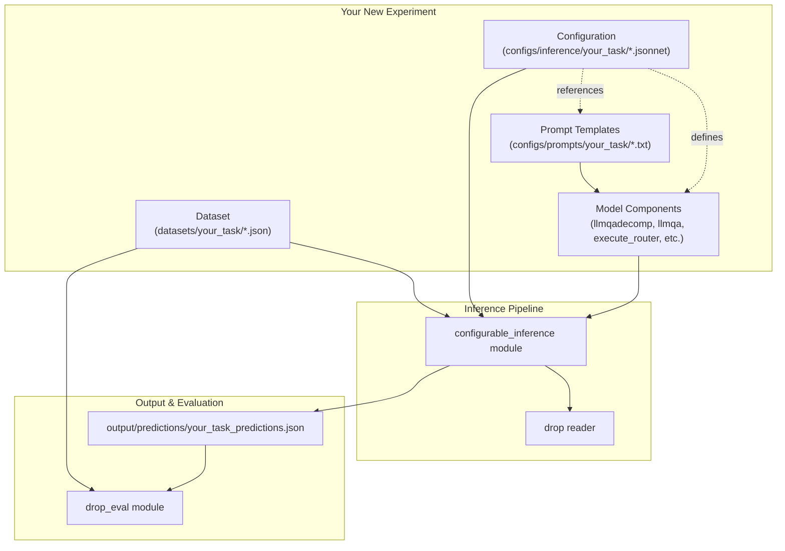
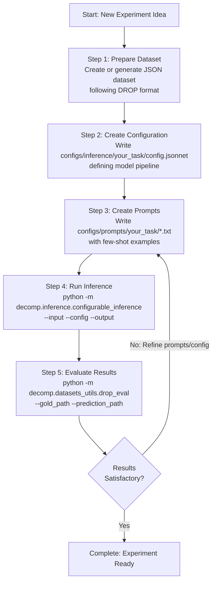
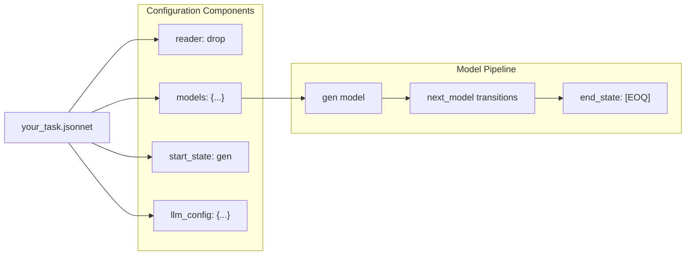
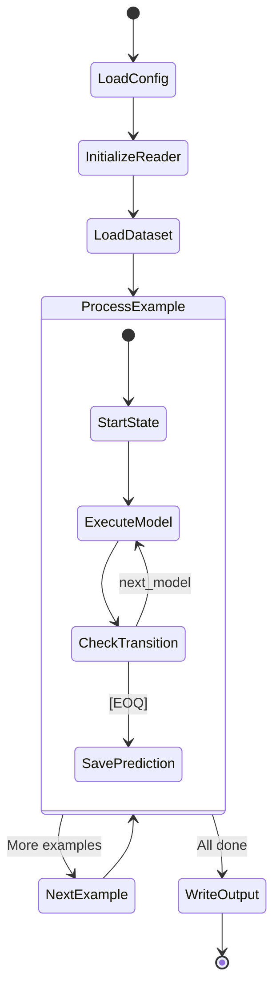
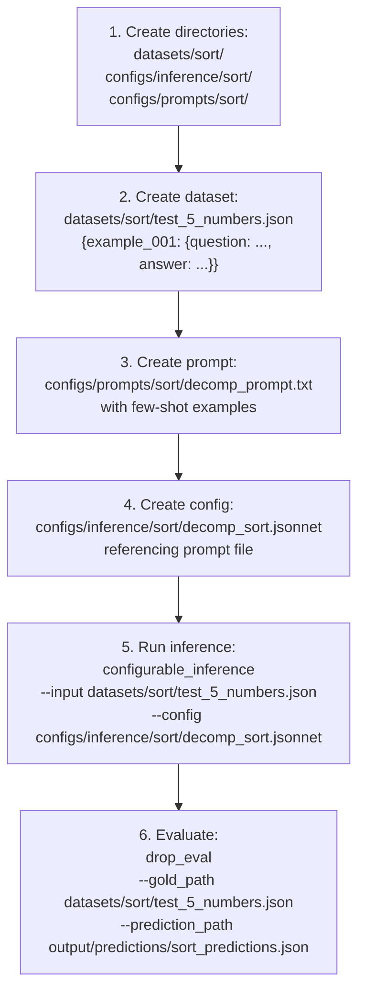

<!-- source: DeepWiki mcp.deepwiki.com · repo allenai/DecomP · page 8.2 Adding New Experiments · fetched 2026-10-26 -->

# Adding New Experiments

<details>
<summary>Relevant source files</summary>

The following files were used as context for generating this wiki page:

- [LICENSE](LICENSE)
- [README.md](README.md)
- [configs/inference/primitives.libsonnet](configs/inference/primitives.libsonnet)

</details>


## Purpose and Scope

This page provides a tutorial for developers who want to add new experimental tasks to the DecomP framework. It covers the complete process from dataset preparation to evaluation, including creating configuration files and prompt templates. For information about the underlying configuration system mechanics, see [Configuration System](#5.2). For details on prompt template design, see [Creating Custom Prompts](#8.3). For dataset format specifications, see [Dataset Format Specification](#6.3).

---

## Overview of Experiment Components

Every experiment in DecomP consists of four main components that work together through the configurable inference pipeline:



**Sources:** [README.md:1-83](), High-Level System Architecture diagrams

| Component | Purpose | Examples |
|-----------|---------|----------|
| **Dataset** | Input data in DROP JSON format | `datasets/letter_cat/*.json`, `datasets/reverse/*.json` |
| **Configuration** | Jsonnet file defining the inference pipeline | `configs/inference/letter_cat/letter_cat_greedy_search.jsonnet` |
| **Prompt Templates** | Text files containing few-shot examples and instructions | `configs/prompts/task_primitives/*.txt` |
| **Model Components** | Reusable inference models (`llmqa`, `llmqadecomp`, etc.) | Defined in configuration files |

**Sources:** [README.md:18-78]()

---

## Step-by-Step Tutorial

### Workflow Diagram



**Sources:** [README.md:18-78]()

---

### Step 1: Prepare Dataset

Your dataset must follow the DROP JSON format. Each dataset file is a JSON object where each key is a unique example ID and each value contains the question and answer.

#### Dataset Structure

```json
{
  "example_001": {
    "question": "Your task description or question",
    "answer": "Expected answer"
  },
  "example_002": {
    "question": "Another question",
    "answer": "Another answer"
  }
}
```

#### Option A: Static Dataset

For predefined tasks like letter concatenation or CommAQA, create static JSON files:

```
datasets/
└── your_task/
    ├── train.json
    ├── test.json
    └── dev.json
```

#### Option B: Generated Dataset

For synthetic tasks like list reversal, create a dataset generator script following the pattern in [src/decomp/datasets_utils/build_reverse_dataset.py:1-end](). Your generator should:

1. Accept command-line arguments for configuration (length, number of examples, etc.)
2. Generate examples programmatically
3. Output to a specified directory in DROP JSON format

Example command pattern:
```bash
python src/decomp/datasets_utils/build_your_task_dataset.py \
  --param1=value1 \
  --param2=value2 \
  --out_dir=datasets/your_task \
  --num_examples=1000
```

**Sources:** [README.md:37-60](), [README.md:41-50]()

---

### Step 2: Create Configuration File

Configuration files in the `configs/inference/` directory define the inference pipeline using Jsonnet. Create a directory for your task and add configuration files for different strategies.

#### Configuration File Location

```
configs/
└── inference/
    └── your_task/
        ├── decomp_strategy.jsonnet
        ├── cot_strategy.jsonnet
        └── custom_strategy.jsonnet
```

#### Configuration Structure



**Sources:** [configs/inference/primitives.libsonnet:1-18]()

#### Key Configuration Fields

| Field | Purpose | Example Values |
|-------|---------|----------------|
| `reader` | Data reader type | `"drop"` |
| `models` | Dictionary of model definitions | `{"gen": {...}, "execute": {...}}` |
| `start_state` | Initial model to execute | `"gen"` |
| `llm_config` | LLM parameters | `{"temperature": 0, "max_tokens": 256}` |

#### Model Definition Structure

Each model in the `models` dictionary follows this pattern:

```jsonnet
"model_name": {
  "name": "llmqadecomp",  // or "llmqa", "answer_extractor", "execute_router"
  "prompt_file": "configs/prompts/your_task/prompt.txt",
  "add_context": false,  // true if model needs input passage
  "next_model": "next_model_name",  // or ["[EOQ]"] to end
  // Additional model-specific parameters
}
```

**Sources:** [configs/inference/primitives.libsonnet:1-18]()

#### Example: Simple Single-Model Configuration

For a straightforward task with one generation step:

```jsonnet
{
  "reader": "drop",
  "models": {
    "gen": {
      "name": "llmqadecomp",
      "prompt_file": "configs/prompts/your_task/main_prompt.txt",
      "add_context": false,
      "next_model": ["[EOQ]"]
    }
  },
  "start_state": "gen",
  "llm_config": {
    "temperature": 0,
    "max_tokens": 256,
    "top_p": 1.0,
    "stop_tokens": ["\n\n"]
  }
}
```

#### Example: Multi-Model Pipeline Configuration

For complex decomposition with sub-models (like CommAQA):

```jsonnet
{
  "reader": "drop",
  "models": {
    "gen": {
      "name": "llmqadecomp",
      "prompt_file": "configs/prompts/your_task/decompose.txt",
      "add_context": true,
      "next_model": "execute"
    },
    "execute": {
      "name": "execute_router",
      "models": {
        "submodel_a": {
          "name": "llmqa",
          "prompt_file": "configs/prompts/your_task/submodel_a.txt",
          "add_context": true
        },
        "submodel_b": {
          "name": "llmqa",
          "prompt_file": "configs/prompts/your_task/submodel_b.txt",
          "add_context": true
        }
      },
      "next_model": ["[EOQ]"]
    }
  },
  "start_state": "gen"
}
```

**Sources:** [configs/inference/primitives.libsonnet:1-18]()

---

### Step 3: Create Prompt Templates

Prompt templates are text files that contain few-shot examples demonstrating the task. They are referenced by the `prompt_file` field in your configuration.

#### Prompt File Location

```
configs/
└── prompts/
    └── your_task/
        ├── main_prompt.txt
        ├── submodel_a.txt
        └── submodel_b.txt
```

#### Prompt Template Structure

Prompts follow this general pattern:

```
[Few-shot examples demonstrating the task]

Example 1:
Q: [Question 1]
A: [Answer 1]

Example 2:
Q: [Question 2]
A: [Answer 2]

...

Q: {{passage}} {{question}}
A:
```

The placeholders `{{passage}}` and `{{question}}` are automatically populated by the inference pipeline:
- `{{question}}`: Replaced with the current question from the dataset
- `{{passage}}`: Replaced with context (if `add_context: true` in configuration)

#### Using Environment Variables for Prompt Selection

For experiments with multiple prompt variants, use environment variables:

```bash
promptid=p1 python -m decomp.inference.configurable_inference ...
```

In your prompt filename, use the pattern: `prompt_${promptid}.txt`

Configuration reference:
```jsonnet
"prompt_file": "configs/prompts/your_task/prompt_${promptid}.txt"
```

This allows you to test different prompts without changing the configuration file.

**Sources:** [README.md:21-35](), [README.md:64-76]()

---

### Step 4: Run Inference

The [decomp.inference.configurable_inference]() module orchestrates the entire inference process. It loads your configuration, initializes models, processes the dataset, and generates predictions.

#### Command Template

```bash
python -m decomp.inference.configurable_inference \
  --input datasets/your_task/test.json \
  --config configs/inference/your_task/your_config.jsonnet \
  --output output/predictions/your_task_predictions.json
```

#### Required Arguments

| Argument | Purpose | Example |
|----------|---------|---------|
| `--input` | Path to input dataset (JSON) | `datasets/your_task/test.json` |
| `--config` | Path to configuration file (jsonnet) | `configs/inference/your_task/config.jsonnet` |
| `--output` | Path for output predictions (JSON) | `output/predictions/results.json` |

#### Inference Execution Flow



**Sources:** [README.md:18-78]()

#### Output Format

The inference module produces a JSON file where each key is an example ID and each value contains the prediction:

```json
{
  "example_001": {
    "prediction": "Generated answer"
  },
  "example_002": {
    "prediction": "Another generated answer"
  }
}
```

#### Environment Variables

Before running inference, ensure required environment variables are set:

```bash
export PYTHONPATH=src/
export OPENAI_API_KEY=<YOUR_API_KEY>
```

**Sources:** [README.md:12-16]()

---

### Step 5: Evaluate Results

The [decomp.datasets_utils.drop_eval]() module compares predictions against ground truth to compute accuracy metrics.

#### Evaluation Command

```bash
python -m decomp.datasets_utils.drop_eval \
  --gold_path datasets/your_task/test.json \
  --prediction_path output/predictions/your_task_predictions.json
```

#### Arguments

| Argument | Purpose |
|----------|---------|
| `--gold_path` | Path to dataset with ground truth answers |
| `--prediction_path` | Path to predictions file generated by inference |

#### Evaluation Metrics

The evaluation module computes exact match accuracy by comparing predicted answers to gold answers. It outputs:
- Overall accuracy percentage
- Number of correct predictions
- Total number of examples

**Sources:** [README.md:28-31](), [README.md:57-60](), [README.md:70-73]()

---

## Complete Example: Adding a Number Sorting Experiment

This section demonstrates adding a complete new experiment for sorting lists of numbers.

### Directory Structure

```
datasets/sort/
  └── test_5_numbers.json

configs/inference/sort/
  └── decomp_sort.jsonnet

configs/prompts/sort/
  └── decomp_prompt.txt

output/predictions/
  └── sort_predictions.json
```

### Component Creation Sequence



**Sources:** [README.md:18-78]()

### Dataset File Example

`datasets/sort/test_5_numbers.json`:
```json
{
  "sort_001": {
    "question": "Sort these numbers in ascending order: 3, 7, 1, 9, 2",
    "answer": "1, 2, 3, 7, 9"
  },
  "sort_002": {
    "question": "Sort these numbers in ascending order: 15, 4, 8, 12, 6",
    "answer": "4, 6, 8, 12, 15"
  }
}
```

### Configuration File Example

`configs/inference/sort/decomp_sort.jsonnet`:
```jsonnet
{
  "reader": "drop",
  "models": {
    "gen": {
      "name": "llmqadecomp",
      "prompt_file": "configs/prompts/sort/decomp_prompt.txt",
      "add_context": false,
      "next_model": ["[EOQ]"]
    }
  },
  "start_state": "gen",
  "llm_config": {
    "temperature": 0,
    "max_tokens": 128,
    "top_p": 1.0,
    "stop_tokens": ["\n\n"]
  }
}
```

### Execution Commands

```bash
# 1. Run inference
python -m decomp.inference.configurable_inference \
  --input datasets/sort/test_5_numbers.json \
  --config configs/inference/sort/decomp_sort.jsonnet \
  --output output/predictions/sort_predictions.json

# 2. Evaluate results
python -m decomp.datasets_utils.drop_eval \
  --gold_path datasets/sort/test_5_numbers.json \
  --prediction_path output/predictions/sort_predictions.json
```

**Sources:** [README.md:18-78]()

---

## Reusing Existing Model Primitives

The DecomP framework provides reusable model components in [configs/inference/primitives.libsonnet:1-18](). You can import and use these in your configurations to avoid duplication.

### Available Primitives

| Primitive | Model Type | Purpose |
|-----------|------------|---------|
| `str_position` | `llmqadecomp` | Extract character at position from string |
| `arr_position` | `llmqa` | Extract element at position from array |
| `merge` | `llmqa` | Merge two sequences |
| `split` | `llmqa` | Split sequence into parts |

### Using Primitives in Configuration

```jsonnet
local primitives = import "primitives.libsonnet";

{
  "reader": "drop",
  "models": {
    "gen": {
      "name": "llmqadecomp",
      "prompt_file": "configs/prompts/your_task/main.txt",
      "next_model": "split_step"
    },
    "split_step": primitives.split + {
      "next_model": ["[EOQ]"]
    }
  },
  "start_state": "gen"
}
```

This approach allows you to compose complex pipelines from pre-defined, tested components.

**Sources:** [configs/inference/primitives.libsonnet:1-18]()

---

## Common Patterns and Best Practices

### Single-Model vs. Multi-Model Pipelines

**Single-Model Pattern (Simpler Tasks):**
- One `gen` model generates the final answer directly
- Used in: Basic list reversal, letter concatenation with simple prompts
- Configuration: `gen` model with `next_model: ["[EOQ]"]`

**Multi-Model Pattern (Complex Tasks):**
- `gen` model decomposes the task
- `execute_router` orchestrates sub-models
- Multiple specialized models handle sub-tasks
- Used in: CommAQA fine-grained decomposition
- Configuration: `gen` → `execute_router` → sub-models → `[EOQ]`

### Configuration Naming Conventions

Follow these naming patterns for consistency:

```
configs/inference/{task_name}/
  ├── {task_name}_decomp.jsonnet          # Decomposed strategy
  ├── {task_name}_cot.jsonnet             # Chain of Thought strategy
  ├── {task_name}_unrolled.jsonnet        # Unrolled strategy (if applicable)
  └── {task_name}_custom_variant.jsonnet  # Custom strategies
```

### Prompt File Organization

```
configs/prompts/{task_name}/
  ├── main_prompt_p1.txt      # Prompt variant 1
  ├── main_prompt_p2.txt      # Prompt variant 2
  ├── main_prompt_p3.txt      # Prompt variant 3
  └── submodel_*.txt          # Sub-model prompts (if using execute_router)
```

**Sources:** [README.md:21-78]()

---

## Troubleshooting Guide

### Common Issues

| Issue | Cause | Solution |
|-------|-------|----------|
| Configuration file not found | Incorrect path in `--config` | Verify path relative to repository root |
| Prompt file not found | Wrong `prompt_file` path in config | Check path relative to repository root |
| OPENAI_API_KEY error | Environment variable not set | Run `export OPENAI_API_KEY=<key>` |
| Module not found | PYTHONPATH not set | Run `export PYTHONPATH=src/` |
| Invalid JSON output | Syntax error in dataset | Validate JSON format |
| Model transition error | Invalid `next_model` reference | Ensure referenced model exists in config |

### Debugging Tips

1. **Test with small dataset first**: Create a dataset with 2-3 examples to verify the pipeline works
2. **Check prompt formatting**: Ensure `{{passage}}` and `{{question}}` placeholders are correct
3. **Validate configuration syntax**: Use a JSON/Jsonnet linter to check for syntax errors
4. **Inspect intermediate outputs**: Add temporary models with `next_model: ["[EOQ]"]` to see intermediate results
5. **Review API responses**: Check for API rate limits or token limit issues

**Sources:** [README.md:12-16]()

---

## Summary Checklist

Use this checklist when adding a new experiment:

- [ ] **Dataset prepared** in DROP JSON format at `datasets/{task_name}/*.json`
- [ ] **Configuration file created** at `configs/inference/{task_name}/*.jsonnet`
  - [ ] `reader` field set to `"drop"`
  - [ ] `models` dictionary defined with all required models
  - [ ] `start_state` specified
  - [ ] `next_model` transitions correctly defined
  - [ ] All models reach `["[EOQ]"]` eventually
- [ ] **Prompt templates created** at `configs/prompts/{task_name}/*.txt`
  - [ ] Few-shot examples included
  - [ ] `{{question}}` placeholder present
  - [ ] `{{passage}}` placeholder present (if using `add_context: true`)
- [ ] **Environment variables set**: `PYTHONPATH` and `OPENAI_API_KEY`
- [ ] **Inference command tested** with small dataset
- [ ] **Predictions file generated** successfully
- [ ] **Evaluation command runs** without errors
- [ ] **Results documented** with accuracy metrics

**Sources:** [README.md:1-83]()

---

