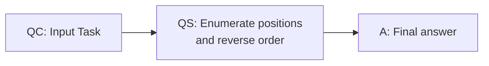
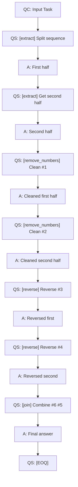
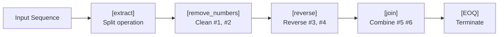
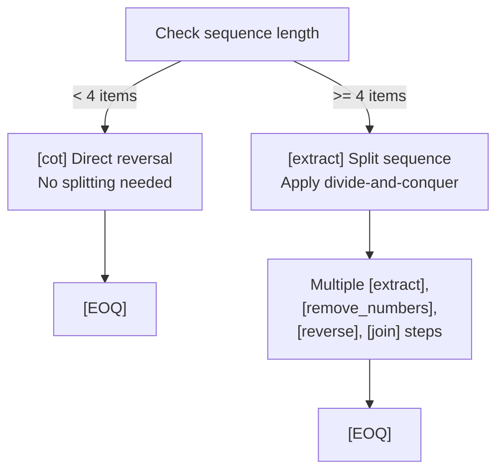
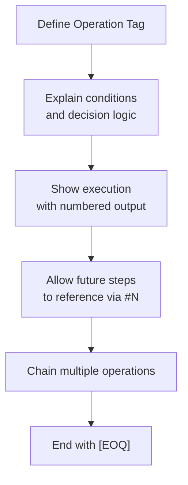
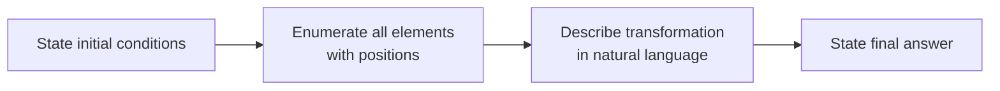
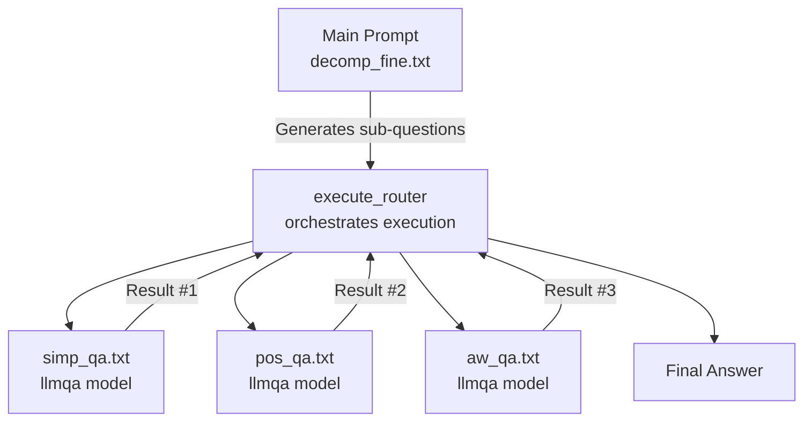
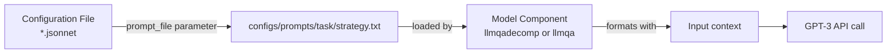
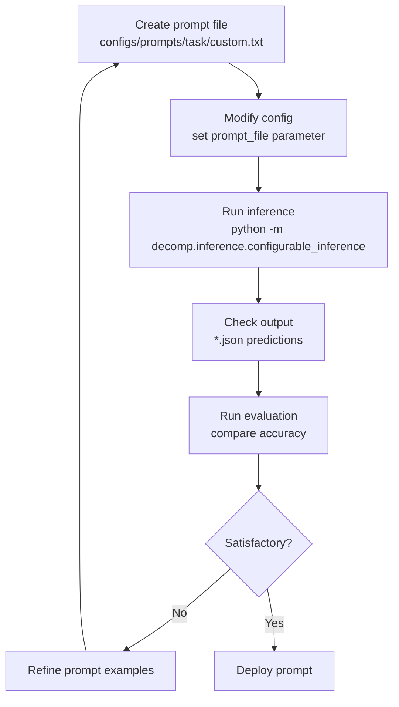

<!-- source: DeepWiki mcp.deepwiki.com · repo allenai/DecomP · page 8.3 Creating Custom Prompts · fetched 2026-10-26 -->

# Creating Custom Prompts

<details>
<summary>Relevant source files</summary>

The following files were used as context for generating this wiki page:

- [configs/prompts/reverse/cot.txt](configs/prompts/reverse/cot.txt)
- [configs/prompts/reverse/decomp.txt](configs/prompts/reverse/decomp.txt)

</details>


## Purpose and Scope

This document provides technical guidance for designing and implementing custom prompt templates in the DecomP framework. It covers the prompt file format, special operation tags, few-shot example structure, and integration points with the inference pipeline.

For information about the overall prompting strategies (decomposed, CoT, unrolled), see [Core Concepts](#3). For details on how prompts are loaded and used during inference, see [Inference Pipeline](#5.1). For existing prompt templates, see [Prompt Templates](#7).

---

## Prompt File Structure

Prompt files in DecomP are plain text files that contain few-shot examples demonstrating the desired behavior. Each example follows a consistent format that the language model uses to learn the task pattern.

### Basic Structure

```
QC: [Question Context - the input task]
QS: [Question/Step - reasoning or operation]
A: [Answer - the output]

[Additional QS/A pairs for multi-step reasoning]

QC: [Next example...]
QS: ...
A: ...
```

The structure consists of:
- **QC (Question Context)**: The initial task description or input
- **QS (Question/Step)**: A reasoning step or operation tag
- **A (Answer)**: The result of the step
- Blank lines separate different examples

**Prompt File Location Pattern:**
```
configs/prompts/<task>/<strategy>.txt
```

Sources: [configs/prompts/reverse/cot.txt:1-12](), [configs/prompts/reverse/decomp.txt:1-41]()

---

## Prompt Format Components

### Chain of Thought Format

The CoT strategy uses natural language reasoning without special operation tags:

| Component | Description | Example |
|-----------|-------------|---------|
| QC | Task statement | `Reverse the sequence "laptop, photo, clip"` |
| QS | Natural language reasoning | `First is laptop. Second is photo. Third is clip...` |
| A | Final answer | `"clip, photo, laptop"` |

Each example is self-contained with a single QS→A pair demonstrating the complete reasoning process.

**Example from cot.txt:**



Sources: [configs/prompts/reverse/cot.txt:5-7]()

### Decomposed Format

The decomposed strategy uses operation tags enclosed in square brackets `[operation]` to explicitly specify sub-tasks:

| Component | Description | Example |
|-----------|-------------|---------|
| QC | Task statement | `Reverse the sequence "driving license, button..."` |
| QS | Operation tag + reasoning | `[extract] The sequence is "1. driving license..."` |
| A | Intermediate result | `"1. driving license, 2. button"` |
| Special | End-of-question marker | `[EOQ]` |

Multiple QS→A pairs form a chain of operations, with each step potentially referencing previous results using `#N` notation.

**Multi-Step Flow:**



Sources: [configs/prompts/reverse/decomp.txt:1-16]()

---

## Special Operation Tags

Operation tags are domain-specific markers that instruct the model to perform specific sub-operations. The system does not enforce these tags programmatically; they exist purely as prompting conventions.

### List Reversal Operation Tags

| Tag | Purpose | Example Usage |
|-----|---------|---------------|
| `[extract]` | Extract a portion of the sequence | `[extract] The first half (2 items) is "1. newspaper, 2. glasses"` |
| `[remove_numbers]` | Strip numbering prefixes | `[remove_numbers] Remove the numbers from #1` |
| `[reverse]` | Reverse a sequence | `[reverse] Reverse the sequence #3` |
| `[join]` | Concatenate sequences | `[join] #6 #5` |
| `[cot]` | Apply chain-of-thought reasoning | `[cot] Reverse the sequence #1` |
| `[EOQ]` | End-of-question marker | `[EOQ]` (terminates the example) |

### Reference Notation

Results from previous steps are referenced using `#N` where N is the step number:

```
QS: [extract] The first half is "1. newspaper, 2. glasses".
A: "1. newspaper, 2. glasses"    # This is step #1

QS: [remove_numbers] Remove the numbers from #1.
A: "newspaper, glasses"           # References previous step
```

**Tag Usage Pattern:**



Sources: [configs/prompts/reverse/decomp.txt:6-16](), [configs/prompts/reverse/decomp.txt:21-23]()

---

## Creating Few-Shot Examples

Few-shot examples teach the model the desired behavior through demonstration. The number and complexity of examples should match the task difficulty.

### Example Selection Guidelines

1. **Coverage**: Include examples spanning the range of input lengths and edge cases
2. **Consistency**: Maintain identical formatting across all examples
3. **Progression**: Order examples from simple to complex
4. **Diversity**: Vary the content while keeping structure consistent

### Example: List Reversal with Length Variation

The decomp.txt prompt includes three examples with different sequence lengths:

| Example | Length | Split Strategy | Line Reference |
|---------|--------|----------------|----------------|
| Example 1 | 5 items | Split into 2+3 | [1-16]() |
| Example 2 | 3 items | No split (< min length) | [18-23]() |
| Example 3 | 4 items | Split into 2+2 | [25-40]() |

**Length-based Branching Logic:**



Sources: [configs/prompts/reverse/decomp.txt:18-23](), [configs/prompts/reverse/decomp.txt:25-40]()

### Short Example (No Splitting)

When the sequence is below the minimum length threshold, the decomposed strategy uses a simplified flow:

```
QC: Reverse the sequence "laptop, photo, clip".
QS: [extract] The sequence is "1. laptop, 2. photo, 3. clip". 
    The sequence is 3 items long, which is less than the minimum 
    length of 4, so we don't need to split it. 
    All we need to do is reverse "laptop, photo, clip".
A: "laptop, photo, clip"
QS: [cot] Reverse the sequence #1.
A: "clip, photo, laptop"
QS: [EOQ]
```

Sources: [configs/prompts/reverse/decomp.txt:18-23]()

---

## Strategy-Specific Prompt Guidelines

### Decomposed Strategy Prompts

**Key Characteristics:**
- Explicit operation tags for each sub-task
- Numbered step references (`#1`, `#2`, etc.)
- Conditional logic expressed in natural language
- End with `[EOQ]` marker

**Template Structure:**
```
QC: [Primary task description]
QS: [operation_tag] [Reasoning that explains what to do]
A: [Result of this operation]
QS: [next_operation] [May reference previous steps using #N]
A: [Next result]
...
QS: [EOQ]
```

**Operation Definition Pattern:**



Sources: [configs/prompts/reverse/decomp.txt:1-41]()

### Chain of Thought Strategy Prompts

**Key Characteristics:**
- Natural language reasoning without operation tags
- Explicit enumeration of positions or states
- Single QS→A pair per example
- No step references or EOQ markers

**Template Structure:**
```
QC: [Task description]
QS: [Natural language reasoning that shows work]
A: [Final answer]
```

**Reasoning Pattern:**



Sources: [configs/prompts/reverse/cot.txt:1-12]()

---

## Sub-Question Prompts for Multi-Stage Tasks

Complex tasks like CommAQA use specialized prompts for different question types. Each sub-question type has its own prompt file.

### Sub-Question Prompt Types

Based on the CommAQA pipeline described in the high-level architecture:

| Prompt Type | File Pattern | Purpose |
|-------------|--------------|---------|
| Decomposition | `decomp_fine.txt` | Generate sub-question sequence |
| Simple QA | `simp_qa.txt` | Answer factual lookup questions |
| Position QA | `pos_qa.txt` | Answer position-based queries |
| Award QA | `aw_qa.txt` | Answer award-related questions |

### Multi-Stage Prompt Integration



### Configuration Linkage

Prompt files are specified in configuration files through the `prompt_file` parameter:

```jsonnet
{
  "model_name": "llmqadecomp",
  "prompt_file": "configs/prompts/commaqae/decomp_fine.txt",
  // ... other parameters
}
```

Sources: Based on Diagram 5 from high-level architecture

---

## Prompt File Placement and Naming Conventions

### Directory Structure

```
configs/
└── prompts/
    ├── reverse/              # List reversal prompts
    │   ├── decomp.txt
    │   ├── cot.txt
    │   └── unrolled.txt
    ├── letter_cat/           # Letter concatenation prompts
    │   └── [strategy].txt
    └── commaqae/             # CommAQA prompts
        ├── decomp_fine.txt
        ├── decomp_coarse.txt
        ├── aw_qa.txt
        ├── pos_qa.txt
        └── simp_qa.txt
```

### Naming Convention

| Pattern | Example | Purpose |
|---------|---------|---------|
| `<strategy>.txt` | `cot.txt` | Main strategy prompt |
| `decomp_<variant>.txt` | `decomp_fine.txt` | Decomposition variant |
| `<subtype>_qa.txt` | `aw_qa.txt` | Sub-question type prompt |

**File System Mapping to Configuration:**



Sources: [configs/prompts/reverse/cot.txt:1](), [configs/prompts/reverse/decomp.txt:1]()

---

## Testing Custom Prompts

### Integration Steps

1. **Create the prompt file** in the appropriate directory under `configs/prompts/`
2. **Create or modify a configuration file** to reference the new prompt
3. **Run inference** with the configuration to test behavior
4. **Evaluate results** using the evaluation scripts

### Configuration Example

To use a custom prompt `my_custom_decomp.txt`:

```jsonnet
{
  "model_name": "llmqadecomp",
  "prompt_file": "configs/prompts/reverse/my_custom_decomp.txt",
  "max_generation_tokens": 512,
  "max_steps": 20,
  // ... other parameters
}
```

### Testing Workflow



Sources: Based on inference pipeline from Diagram 3

---

## Best Practices

### Format Consistency

**Rule**: Maintain identical formatting across all examples in a prompt file.

- Use the same quotation marks (double quotes)
- Consistent spacing around commas
- Identical capitalization patterns
- Uniform numbering format (e.g., "1. item" not "1) item")

### Operation Tag Design

**Rule**: Operation tags should be:
- **Short**: Single word or two-word phrases
- **Descriptive**: Clear purpose from the tag name
- **Consistent**: Used the same way across all examples
- **Documented**: Explain the tag's purpose in reasoning text

Example of good tag usage:
```
QS: [extract] The sequence is "1. newspaper, 2. glasses". 
    The sequence is 4 items long, which is equal to the 
    minimum length of 4, so we split it.
```

### Example Complexity Progression

**Rule**: Order examples from simple to complex:

1. Start with minimal edge cases (e.g., shortest valid input)
2. Progress to standard cases (e.g., typical input length)
3. End with complex cases (e.g., longest input or multiple operations)

### Reference Clarity

**Rule**: When using `#N` references:
- Clearly establish what each numbered result represents
- Reference numbers sequentially in order
- Avoid skipping numbers in the sequence
- Make it clear what operation produced each numbered result

### Answer Format Consistency

**Rule**: All answers should follow the same format:
- Quoted strings: `"item1, item2, item3"`
- Consistent delimiter (comma-space)
- No trailing punctuation outside quotes
- Exact format matching expected output

### Documentation in Prompts

**Rule**: Include reasoning that explains decisions:
```
QS: [extract] The sequence is 3 items long, which is less than 
    the minimum length of 4, so we don't need to split it.
```

This helps the model learn not just what to do, but why to do it.

### End Markers

**Rule**: For decomposed strategies:
- Always end with `[EOQ]` marker
- Do not include EOQ for single-step examples (like CoT)
- Place EOQ on its own line: `QS: [EOQ]`

Sources: [configs/prompts/reverse/decomp.txt:16](), [configs/prompts/reverse/decomp.txt:23](), [configs/prompts/reverse/decomp.txt:40]()

---

## Summary Table: Strategy Comparison

| Aspect | Decomposed | Chain of Thought | Unrolled |
|--------|-----------|------------------|----------|
| **Operation Tags** | Yes (`[extract]`, `[reverse]`, etc.) | No | Yes (conditional logic) |
| **Step References** | Yes (`#1`, `#2`) | No | Yes |
| **QS/A Pairs** | Multiple per example | Single per example | Multiple per example |
| **End Marker** | `[EOQ]` required | Not used | `[EOQ]` required |
| **Reasoning Style** | Explicit sub-operations | Natural language | Recursive decomposition |
| **Complexity** | High (many steps) | Low (direct reasoning) | Medium (conditional) |

Sources: [configs/prompts/reverse/cot.txt:1-12](), [configs/prompts/reverse/decomp.txt:1-41]()