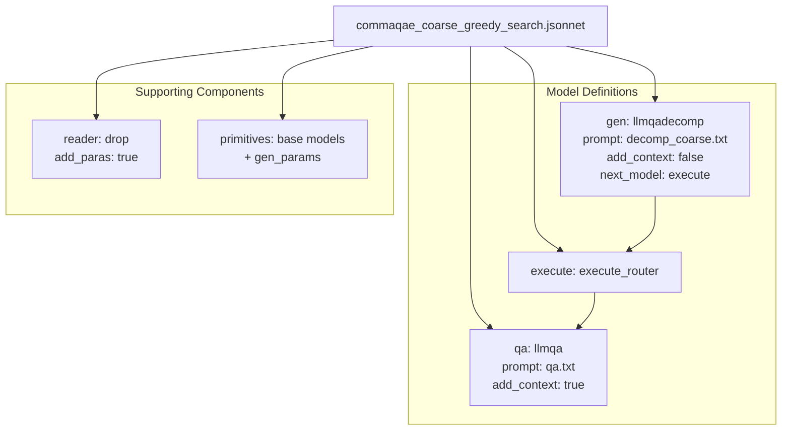
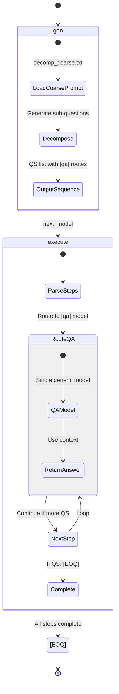
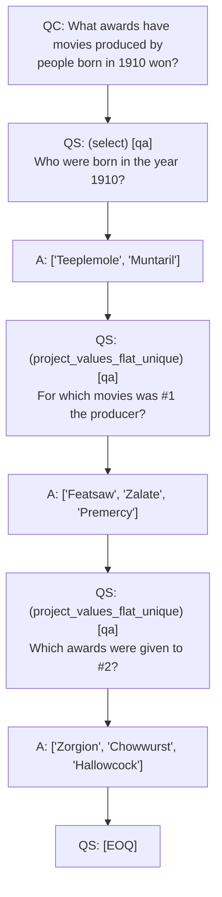
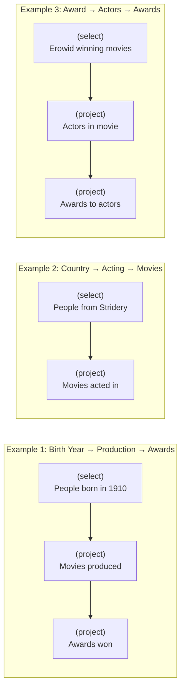
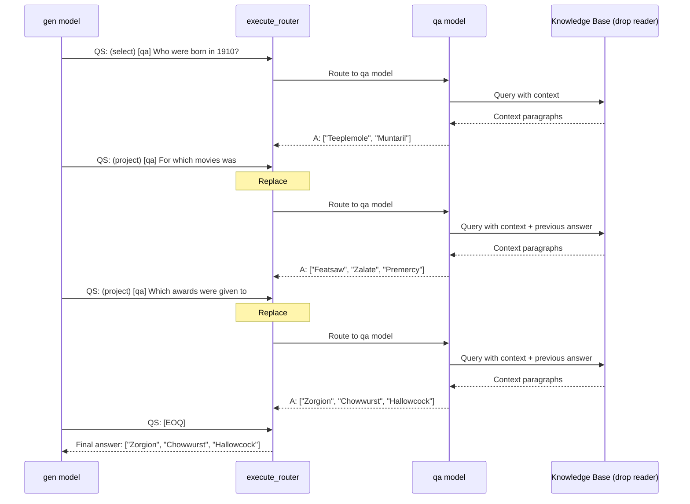
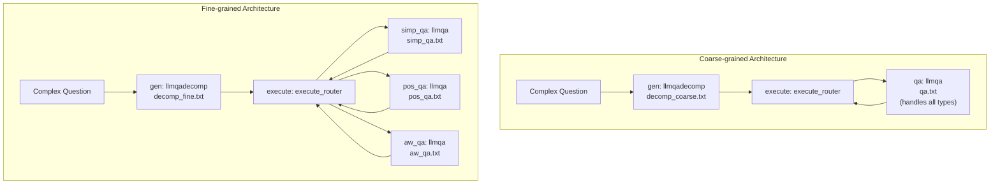

<!-- source: DeepWiki mcp.deepwiki.com · repo allenai/DecomP · extra page Coarse-grained Decomposition · fetched 2026-10-26 -->

# Coarse-grained Decomposition

<details>
<summary>Relevant source files</summary>

The following files were used as context for generating this wiki page:

- [configs/inference/commaqa_e/commaqae_coarse_greedy_search.jsonnet](configs/inference/commaqa_e/commaqae_coarse_greedy_search.jsonnet)
- [configs/prompts/commaqa_e/commaqa_e_p1/decomp_coarse.txt](configs/prompts/commaqa_e/commaqa_e_p1/decomp_coarse.txt)

</details>


## Purpose and Scope

This page documents the coarse-grained decomposition strategy for the CommAQA multi-hop question answering experiment. This strategy breaks complex compositional questions into a sequence of high-level sub-queries that are all answered by a single general-purpose QA model.

For information about the alternative fine-grained decomposition approach that uses specialized QA models for different question types, see [Fine-grained Decomposition](#4.3.1). For general information about the CommAQA experiment, see [CommAQA Multi-hop Question Answering](#4.3).

## Overview

The coarse-grained decomposition strategy simplifies the multi-hop reasoning pipeline by using a uniform QA model to answer all sub-questions, regardless of their semantic type. This approach trades specialization for simplicity, making it easier to apply to diverse question types without requiring separate model configurations for each question category.

**Sources:** [configs/inference/commaqa_e/commaqae_coarse_greedy_search.jsonnet:1-28]()

## Configuration Structure

The coarse-grained configuration is defined in `commaqae_coarse_greedy_search.jsonnet` and consists of three primary model components:

| Model Key | Model Type | Purpose | Context Access |
|-----------|------------|---------|----------------|
| `gen` | `llmqadecomp` | Decomposes complex questions into sub-questions | No (`add_context: false`) |
| `qa` | `llmqa` | Answers individual sub-questions | Yes (`add_context: true`) |
| `execute` | `execute_router` | Orchestrates execution of decomposed steps | N/A |

The configuration uses a state machine with `start_state: "gen"` and `end_state: "[EOQ]"`, following the standard DecomP inference pipeline pattern described in [Inference Pipeline](#5.1).

### Configuration Code Structure



**Diagram:** Configuration structure showing model relationships and data flow

**Sources:** [configs/inference/commaqa_e/commaqae_coarse_greedy_search.jsonnet:1-28]()

## Decomposition Pipeline

The coarse-grained pipeline follows a two-stage execution pattern:

### Execution Flow



**Diagram:** State machine showing the coarse-grained decomposition execution flow

The key difference from fine-grained decomposition is that all sub-questions route to the same `qa` model, which is configured with `add_context: true` to access the knowledge base through the `drop` reader.

**Sources:** [configs/inference/commaqa_e/commaqae_coarse_greedy_search.jsonnet:5-22]()

## Prompt Template Format

The coarse-grained prompt template (`decomp_coarse.txt`) demonstrates the decomposition pattern through few-shot examples. Each example follows a consistent structure:

### Template Structure Components

| Component | Syntax | Purpose |
|-----------|--------|---------|
| Complex Query | `QC: <question>` | The original multi-hop question |
| Sub-question | `QS: (<operation>) [qa] <question>` | Individual decomposed step |
| Answer | `A: [<list of values>]` | Answer to the sub-question |
| Reference | `#1`, `#2`, etc. | Reference to previous answer |
| Terminator | `QS: [EOQ]` | End of question sequence |

### Example Decomposition Pattern



**Diagram:** Example decomposition showing sequential sub-question answering with intermediate results

**Sources:** [configs/prompts/commaqa_e/commaqa_e_p1/decomp_coarse.txt:1-8]()

## Query Types and Operations

The coarse-grained decomposition uses operation annotations to indicate the semantic type of each sub-question. These operations guide the reasoning process but all questions are still routed to the same `qa` model.

### Supported Operations

| Operation | Description | Example Usage |
|-----------|-------------|---------------|
| `(select)` | Filter entities based on criteria | "Who were born in the year 1910?" |
| `(project_values_flat_unique)` | Extract attribute values and flatten | "For which movies was #1 the producer?" |

### Multi-hop Reasoning Pattern

The prompt template includes six complete examples covering common multi-hop patterns:



**Diagram:** Multi-hop reasoning patterns demonstrated in the prompt template

**Sources:** [configs/prompts/commaqa_e/commaqa_e_p1/decomp_coarse.txt:1-49]()

## Answer Reference Mechanism

The coarse-grained strategy uses numerical references (`#1`, `#2`, etc.) to chain sub-questions together. These references allow later questions to depend on earlier answers without repeating the actual values.

### Reference Flow Example



**Diagram:** Sequence diagram showing answer reference resolution during execution

**Sources:** [configs/prompts/commaqa_e/commaqa_e_p1/decomp_coarse.txt:1-8]()

## Code Entity Mapping

The following table maps natural language concepts to specific code entities in the DecomP codebase:

| Natural Language | Code Entity | Location |
|------------------|-------------|----------|
| Coarse-grained config | `commaqae_coarse_greedy_search.jsonnet` | [configs/inference/commaqa_e/commaqae_coarse_greedy_search.jsonnet]() |
| Decomposition prompt | `decomp_coarse.txt` | Loaded by `gen` model's `prompt_file` parameter |
| Generic QA prompt | `qa.txt` | Loaded by `qa` model's `prompt_file` parameter |
| Decomposition model | `llmqadecomp` | `gen` model's `name` parameter |
| QA model | `llmqa` | `qa` model's `name` parameter |
| Execution orchestrator | `execute_router` | `execute` model's `name` parameter |
| Knowledge base reader | `drop` | `reader.name` parameter |
| Context access | `add_context: true` | Enables knowledge base access for `qa` model |
| Prompt variable | `std.extVar("promptid")` | Allows switching between prompt versions (e.g., p1) |

**Sources:** [configs/inference/commaqa_e/commaqae_coarse_greedy_search.jsonnet:1-28](), [configs/prompts/commaqa_e/commaqa_e_p1/decomp_coarse.txt:1-49]()

## Comparison with Fine-grained Decomposition

The following table summarizes key differences between coarse-grained and fine-grained decomposition strategies:

| Aspect | Coarse-grained | Fine-grained |
|--------|----------------|--------------|
| **QA Models** | Single `qa` model for all sub-questions | Specialized models: `simp_qa`, `pos_qa`, `aw_qa` |
| **Prompt Files** | `decomp_coarse.txt`, `qa.txt` | `decomp_fine.txt`, `aw_qa.txt`, `pos_qa.txt`, `simp_qa.txt` |
| **Specialization** | Generic approach for all question types | Type-specific models for different semantic categories |
| **Configuration Complexity** | Simpler (2 main models) | More complex (4+ models) |
| **Model Routing** | All routes to `[qa]` | Routes to `[simp_qa]`, `[pos_qa]`, `[aw_qa]` based on question type |
| **Context Access** | `qa` model has `add_context: true` | All specialized models have `add_context: true` |

### Architectural Comparison



**Diagram:** Architectural comparison showing model structure differences

For detailed information about fine-grained decomposition, see [Fine-grained Decomposition](#4.3.1).

**Sources:** [configs/inference/commaqa_e/commaqae_coarse_greedy_search.jsonnet:1-28]()

## Usage

To run inference with the coarse-grained decomposition strategy:

```bash
python decomp/inference/configurable_inference.py \
  --input_path datasets/commaqa_e/dev_iid.json \
  --config_path configs/inference/commaqa_e/commaqae_coarse_greedy_search.jsonnet \
  --promptid p1 \
  --output_path output/commaqae_coarse_predictions.json
```

The `promptid` variable selects the prompt directory (e.g., `commaqa_e_p1`) that contains both `decomp_coarse.txt` and `qa.txt` files.

**Sources:** [configs/inference/commaqa_e/commaqae_coarse_greedy_search.jsonnet:10,17]()

---

