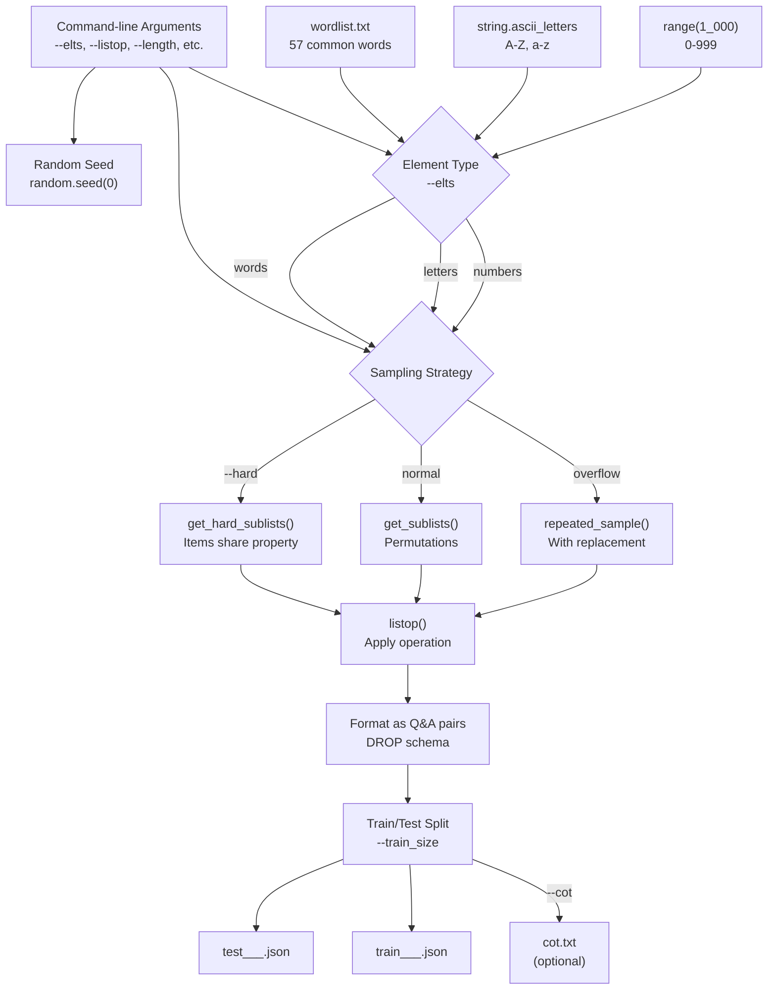
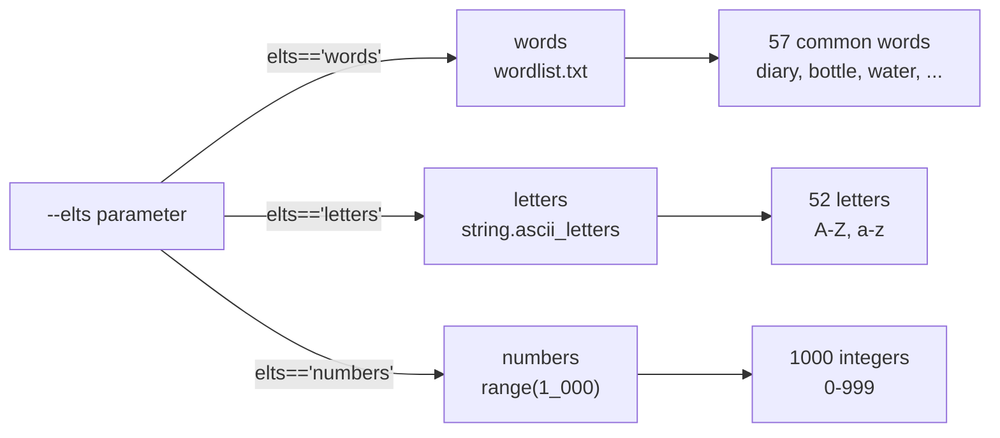
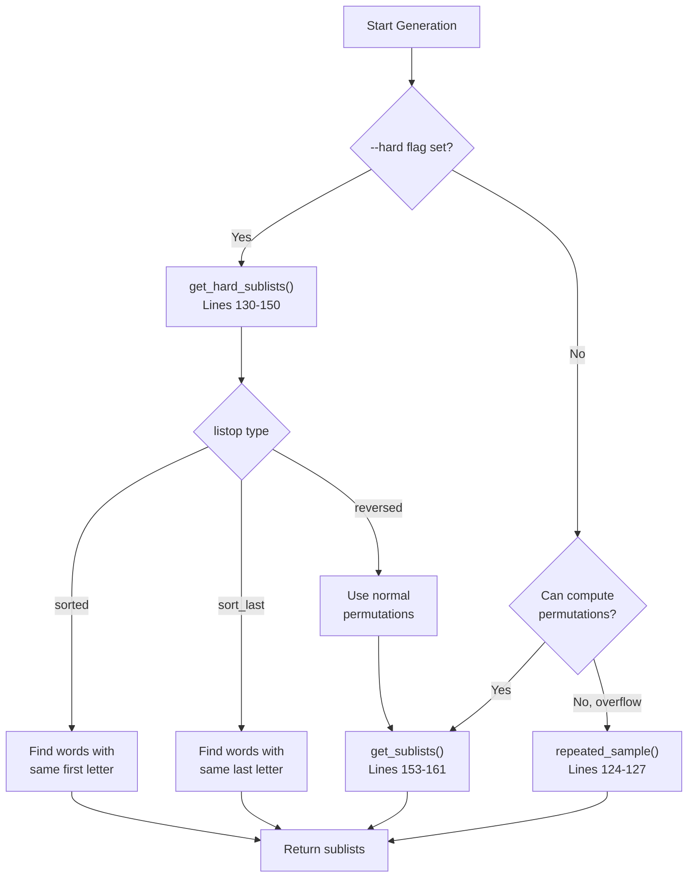

<!-- source: DeepWiki mcp.deepwiki.com · repo allenai/DecomP · extra page Dataset Generation · fetched 2026-10-26 -->

# Dataset Generation

<details>
<summary>Relevant source files</summary>

The following files were used as context for generating this wiki page:

- [configs/data/wordlist.txt](configs/data/wordlist.txt)
- [src/decomp/datasets_utils/build_reverse_dataset.py](src/decomp/datasets_utils/build_reverse_dataset.py)

</details>


## Purpose and Scope

This page documents the dataset generation system for the List Reversal experiment. The `build_reverse_dataset.py` script creates synthetic datasets for evaluating list manipulation operations, including sequence reversal, alphabetical sorting, and last-element sorting. The script generates both test and training sets in DROP-compatible JSON format with configurable parameters for element types, list lengths, and difficulty levels.

For information about running inference on these generated datasets, see [Inference Configurations](#4.2.2). For evaluation of results, see [Evaluation and Results](#4.2.3).

**Sources:** [src/decomp/datasets_utils/build_reverse_dataset.py:1-180]()

---

## Generation Script Overview

The dataset generation system is implemented in `build_reverse_dataset.py` and produces question-answer pairs for three types of list operations on three types of elements.

### Diagram: Dataset Generation Pipeline



**Sources:** [src/decomp/datasets_utils/build_reverse_dataset.py:25-103]()

---

## Command-line Parameters

The generation script accepts the following parameters:

| Parameter | Type | Choices/Default | Description |
|-----------|------|-----------------|-------------|
| `--elts` | Required | `words`, `letters`, `numbers` | Type of elements in the sequences |
| `--listop` | Required | `reversed`, `sorted`, `sort_last` | List operation to perform |
| `--num_examples` | Integer | `100` | Total number of examples to generate |
| `--train_size` | Integer | `10` | Number of examples reserved for training set |
| `--out_dir` | String | `.` | Output directory for generated files |
| `--word_list` | String | `configs/data/wordlist.txt` | Path to vocabulary file for word-based sequences |
| `--hard` | Flag | `False` | Generate harder examples where items share a property |
| `--length` | Integer(s) | `[4]` | List length(s) to generate; supports multiple values |
| `--cot` | Flag | `False` | Generate Chain-of-Thought examples from training set |
| `--delim` | String | `", "` | Delimiter for joining list elements in questions/answers |

**Sources:** [src/decomp/datasets_utils/build_reverse_dataset.py:28-39]()

---

## Element Types and Operations

The script supports three element types, each with a corresponding vocabulary:

### Diagram: Element Type Selection



**Sources:** [src/decomp/datasets_utils/build_reverse_dataset.py:42-51](), [configs/data/wordlist.txt:1-56]()

### Question Templates

The script uses predefined question templates for each operation-element combination:

| Operation | Element Type | Question Template |
|-----------|--------------|-------------------|
| `reversed` | `words` | `Reverse the sequence "{}".` |
| `reversed` | `letters` | `Reverse the sequence "{}".` |
| `reversed` | `numbers` | `Reverse the sequence "{}".` |
| `sorted` | `words` | `Sort alphabetically the sequence "{}".` |
| `sorted` | `letters` | `Sort alphabetically the sequence "{}".` |
| `sorted` | `numbers` | `Sort the sequence "{}".` |
| `sort_last` | `words` | `Sort alphabetically by last letter the sequence "{}".` |
| `sort_last` | `numbers` | `Sort by last digit the sequence "{}".` |

**Sources:** [src/decomp/datasets_utils/build_reverse_dataset.py:13-22]()

---

## Sampling Strategies

The script implements three sampling strategies for generating sublists:

### Diagram: Sampling Strategy Decision Flow



**Sources:** [src/decomp/datasets_utils/build_reverse_dataset.py:54-61](), [src/decomp/datasets_utils/build_reverse_dataset.py:130-150]()

### 1. Normal Permutation Sampling (`get_sublists`)

This strategy generates unique permutations without replacement using combinatorial indexing:

```
Function: get_sublists(lst, lengths, num_examples)
Algorithm:
  1. Calculate total permutations: math.perm(len(lst), length)
  2. Sample random permutation indices
  3. Convert each index to actual permutation via get_permutation()
  4. Return list of sublists
```

The `get_permutation()` function [src/decomp/datasets_utils/build_reverse_dataset.py:164-171]() converts a permutation index to an actual sequence by iteratively extracting elements using divmod operations.

**Sources:** [src/decomp/datasets_utils/build_reverse_dataset.py:153-171]()

### 2. Repeated Sampling (`repeated_sample`)

When the number of possible permutations cannot be computed (causing `OverflowError`), the script falls back to sampling with replacement. This simply calls `random.sample(lst, length)` for each required example.

**Sources:** [src/decomp/datasets_utils/build_reverse_dataset.py:124-127]()

### 3. Hard Example Generation (`get_hard_sublists`)

For word-based sequences with `--hard` flag, the script generates more challenging examples where all words share a common property:

- **For `sorted` operation**: All words start with the same letter
- **For `sort_last` operation**: All words end with the same letter  
- **For `reversed` operation**: Falls back to normal permutation sampling

The algorithm [src/decomp/datasets_utils/build_reverse_dataset.py:130-150]() repeatedly:
1. Selects a random seed word
2. Filters words sharing the same first/last letter
3. Samples a sublist from the filtered set
4. Removes exhausted letters from the pool

**Sources:** [src/decomp/datasets_utils/build_reverse_dataset.py:130-150]()

---

## Output Format

The script generates JSON files in DROP dataset format with the following structure:

### Dataset Schema

```json
{
  "alg_qa": {
    "passage": "",
    "qa_pairs": [
      {
        "question": "Reverse the sequence \"card, stamp, book, water\".",
        "answer": {
          "number": "",
          "date": {"day": "", "month": "", "year": ""},
          "spans": ["water, book, stamp, card"]
        },
        "query_id": "0",
        "validated_answers": []
      }
    ]
  }
}
```

**Key Fields:**
- `passage`: Empty string (context not needed for algorithmic tasks)
- `qa_pairs`: Array of question-answer pairs
  - `question`: Formatted question string with sequence
  - `answer.spans`: Array containing the correct answer string
  - `query_id`: String identifier for the example
  - `validated_answers`: Empty array (no human validation)

**Sources:** [src/decomp/datasets_utils/build_reverse_dataset.py:64-89]()

### File Naming Convention

Generated files follow this naming pattern:

```
{length}_{difficulty}_{element_type}.json
```

Examples:
- `test_4_normal_words.json` - Test set with 4-word sequences, normal difficulty
- `train_6_hard_words.json` - Training set with 6-word sequences, hard difficulty  
- `test_4_6_8_normal_letters.json` - Test set with multiple lengths (4, 6, 8)

**Sources:** [src/decomp/datasets_utils/build_reverse_dataset.py:90-103]()

---

## Chain-of-Thought Generation

When the `--cot` flag is provided, the script generates a `cot.txt` file containing 5 randomly sampled examples from the training set formatted for Chain-of-Thought prompting:

### CoT Format

```
QC: Reverse the sequence "card, stamp, book, water".
QS: The answer is "water, book, stamp, card".
A: water, book, stamp, card
QS: [EOQ]
```

**Format Fields:**
- `QC`: Question Context (the original question)
- `QS`: Question Step (reasoning or final answer)
- `A`: Answer (the final result)
- `[EOQ]`: End-of-question marker

This format is used by the Chain-of-Thought prompting strategy documented in [Chain of Thought Strategy](#3.2).

**Sources:** [src/decomp/datasets_utils/build_reverse_dataset.py:96-114]()

---

## Vocabulary: wordlist.txt

The word vocabulary file contains 57 common everyday objects used for word-based sequences. The list includes items like "diary", "bottle", "water", "glasses", "mobile phone", etc.

### Word Statistics

- **Total words**: 56 (line 56 is empty)
- **Length range**: 3-16 characters
- **Common categories**: Personal items, stationery, electronics
- **Purpose**: Provides familiar, unambiguous words for list manipulation tasks

The vocabulary is designed to avoid:
- Similar-sounding words that could cause confusion
- Words with multiple meanings
- Technical jargon

**Sources:** [configs/data/wordlist.txt:1-56]()

---

## Example Usage

### Basic Reversal Dataset

Generate a basic 4-element word reversal dataset with 100 test examples and 10 training examples:

```bash
python src/decomp/datasets_utils/build_reverse_dataset.py \
  --elts words \
  --listop reversed \
  --length 4 \
  --num_examples 110 \
  --train_size 10 \
  --out_dir configs/data/
```

**Output:**
- `configs/data/test_4_normal_words.json` (100 examples)
- `configs/data/train_4_normal_words.json` (10 examples)

### Multi-length Dataset

Generate datasets with multiple sequence lengths:

```bash
python src/decomp/datasets_utils/build_reverse_dataset.py \
  --elts words \
  --listop reversed \
  --length 4 6 8 10 \
  --num_examples 400 \
  --train_size 40
```

This creates datasets with 100 examples at each length (4, 6, 8, 10), totaling 400 examples split into test and train sets.

### Hard Examples with CoT

Generate hard sorting examples with Chain-of-Thought demonstrations:

```bash
python src/decomp/datasets_utils/build_reverse_dataset.py \
  --elts words \
  --listop sorted \
  --length 6 \
  --num_examples 100 \
  --hard \
  --cot \
  --out_dir configs/data/
```

**Output:**
- `configs/data/test_6_hard_words.json` (90 examples with same-first-letter words)
- `configs/data/train_6_hard_words.json` (10 examples)
- `cot.txt` (5 CoT examples)

### Letter and Number Datasets

Generate datasets with non-word elements:

```bash
# Letter sequences
python src/decomp/datasets_utils/build_reverse_dataset.py \
  --elts letters \
  --listop reversed \
  --length 8

# Number sequences  
python src/decomp/datasets_utils/build_reverse_dataset.py \
  --elts numbers \
  --listop sort_last \
  --length 5
```

**Sources:** [src/decomp/datasets_utils/build_reverse_dataset.py:25-103]()

---

## Implementation Details

### Random Seed Determinism

The script sets a fixed random seed (`random.seed(0)`) at the start of `main()` to ensure reproducible dataset generation. This means running the script with identical parameters will always produce the same dataset.

**Sources:** [src/decomp/datasets_utils/build_reverse_dataset.py:26]()

### List Operation Functions

The actual list operations are implemented using Python built-in functions:

| Operation | Implementation |
|-----------|----------------|
| `reversed` | Python's `reversed()` built-in |
| `sorted` | Python's `sorted()` built-in |
| `sort_last` | Custom function using `sorted()` with `key=lambda x: str(list(reversed(x)))` |

The `sort_last()` function [src/decomp/datasets_utils/build_reverse_dataset.py:174-175]() reverses each element's string representation and sorts based on that, effectively sorting by the last character.

**Sources:** [src/decomp/datasets_utils/build_reverse_dataset.py:62](), [src/decomp/datasets_utils/build_reverse_dataset.py:174-175]()

### Data Shuffling

After generating all Q&A pairs, the script shuffles them randomly before splitting into train/test sets to ensure random distribution across both sets.

**Sources:** [src/decomp/datasets_utils/build_reverse_dataset.py:77]()

---

