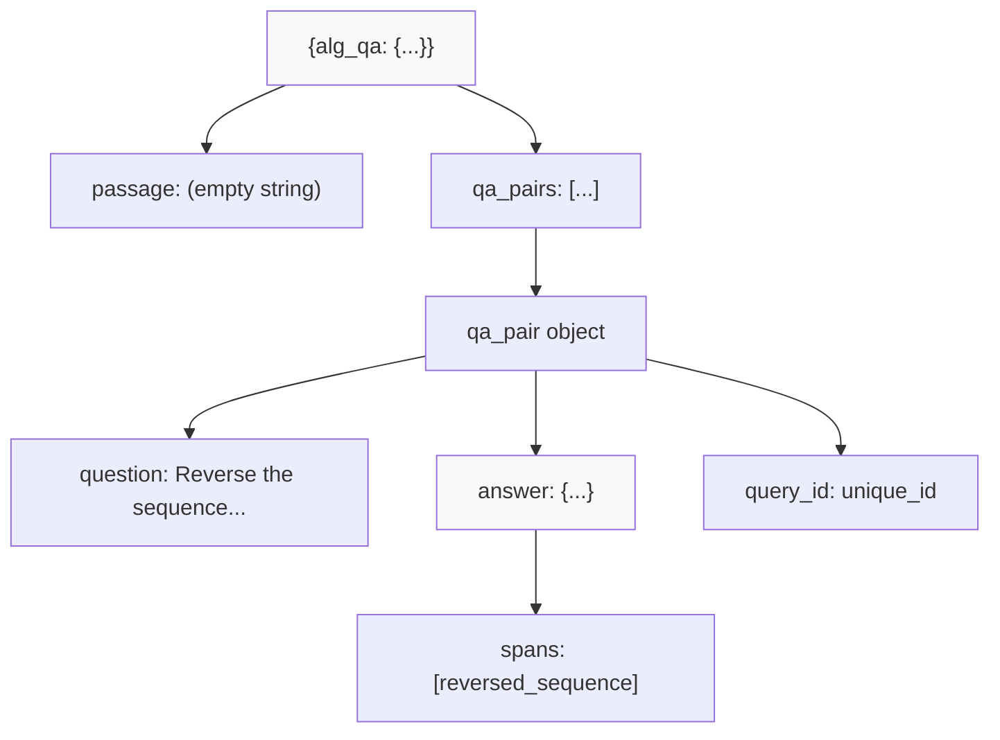
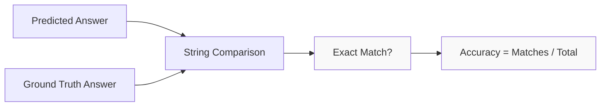
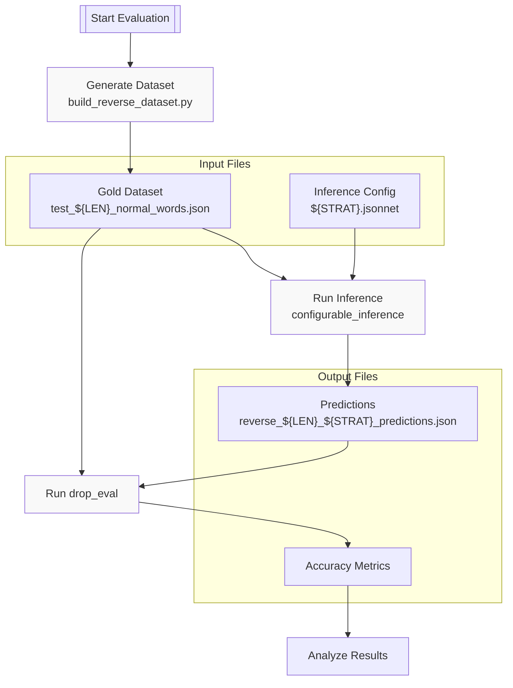
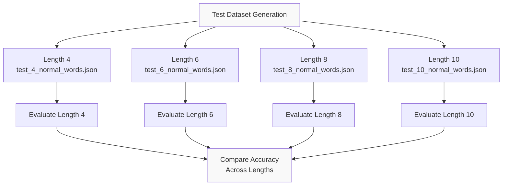
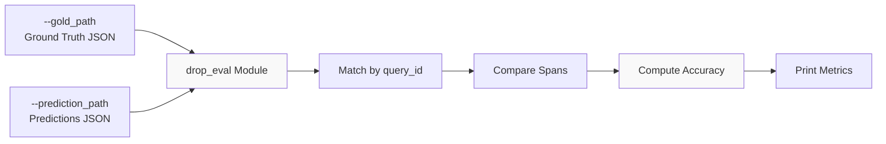

<!-- source: DeepWiki mcp.deepwiki.com · repo allenai/DecomP · extra page Evaluation and Results · fetched 2026-10-26 -->

# Evaluation and Results

<details>
<summary>Relevant source files</summary>

The following files were used as context for generating this wiki page:

- [LICENSE](LICENSE)
- [README.md](README.md)
- [datasets/reverse/test_10_normal_words.json](datasets/reverse/test_10_normal_words.json)

</details>


This page explains how to evaluate list reversal predictions and interpret the results produced by the DecomP system. After running inference with one of the prompting strategies (decomp, cot, or unrolled), you can measure accuracy by comparing predicted outputs against ground truth datasets.

For information about generating list reversal datasets, see [Dataset Generation](#4.2.1). For details on the available inference configurations, see [Inference Configurations](#4.2.2).

---

## Overview

The evaluation process for list reversal experiments consists of three main steps:

1. Running inference with a selected strategy to generate predictions
2. Comparing predictions against ground truth using the `drop_eval` module
3. Interpreting accuracy metrics across different sequence lengths and strategies

The evaluation uses exact string matching to determine whether a predicted reversed sequence matches the ground truth answer.

**Sources:** [README.md:37-60]()

---

## Running Evaluation

### Basic Evaluation Command

After generating predictions using the inference pipeline, evaluate them using the `drop_eval` module:

```bash
python -m decomp.datasets_utils.drop_eval \
  --gold_path datasets/reverse/test_${LEN}_normal_words.json \
  --prediction_path output/predictions/reverse_${LEN}_${STRAT}_predictions.json
```

### Evaluation Parameters

| Parameter | Description | Example Value |
|-----------|-------------|---------------|
| `--gold_path` | Path to the ground truth dataset file | `datasets/reverse/test_10_normal_words.json` |
| `--prediction_path` | Path to the inference output predictions file | `output/predictions/reverse_10_decomp_predictions.json` |

The `drop_eval` module compares the predicted answers in the prediction file against the ground truth answers in the gold dataset.

**Sources:** [README.md:57-59]()

---

## Dataset and Prediction Format

### Ground Truth Format

Ground truth datasets follow the DROP dataset format structure with list reversal tasks:



#### Example Ground Truth Entry

From [datasets/reverse/test_10_normal_words.json:1-19](), a typical entry contains:

- `question`: The reversal task (e.g., "Reverse the sequence \"banknote, sweet, phone card, identity card, credit card, case, passport, newspaper, painkiller, pen\".")
- `answer.spans`: Array containing the correct reversed sequence (e.g., ["pen, painkiller, newspaper, passport, case, credit card, identity card, phone card, sweet, banknote"])
- `query_id`: Unique identifier for the question

### Prediction Format

The prediction file generated by the inference pipeline has a parallel structure where each `query_id` is matched with its predicted answer. The `drop_eval` module performs this matching and computes accuracy by checking if the predicted span exactly matches any of the ground truth spans.

**Sources:** [datasets/reverse/test_10_normal_words.json:1-100]()

---

## Evaluation Metrics

### Exact Match Accuracy

The primary evaluation metric is **exact match accuracy**, which measures the percentage of predictions that exactly match the ground truth reversed sequence.



The evaluation considers a prediction correct if and only if:
- The predicted reversed sequence string exactly matches the ground truth
- Word order is correct
- Punctuation and spacing match exactly

**Sources:** [README.md:57-59]()

---

## Evaluation Workflow

The complete evaluation workflow for list reversal experiments follows this sequence:



### Step-by-Step Process

1. **Dataset Generation**: Use `build_reverse_dataset.py` to create test datasets at desired sequence lengths
2. **Inference Execution**: Run `configurable_inference` with selected strategy (decomp/cot/unrolled)
3. **Evaluation**: Execute `drop_eval` to compute accuracy metrics
4. **Analysis**: Compare results across strategies and sequence lengths

**Sources:** [README.md:37-60]()

---

## Comparing Strategies

### Strategy Configuration Mapping

Different prompting strategies use different configuration files and produce different prediction outputs:

| Strategy | Config File | Prediction Output |
|----------|-------------|-------------------|
| Decomposed | `configs/inference/reverse/decomp.jsonnet` | `output/predictions/reverse_${LEN}_decomp_predictions.json` |
| Chain of Thought | `configs/inference/reverse/cot.jsonnet` | `output/predictions/reverse_${LEN}_cot_predictions.json` |
| Unrolled | `configs/inference/reverse/unrolled.jsonnet` | `output/predictions/reverse_${LEN}_unrolled_predictions.json` |

### Evaluation Across Strategies

To compare strategy effectiveness, run evaluation for each strategy on the same test dataset:

```bash
# Evaluate decomposed strategy
LEN=10
python -m decomp.datasets_utils.drop_eval \
  --gold_path datasets/reverse/test_${LEN}_normal_words.json \
  --prediction_path output/predictions/reverse_${LEN}_decomp_predictions.json

# Evaluate CoT strategy
python -m decomp.datasets_utils.drop_eval \
  --gold_path datasets/reverse/test_${LEN}_normal_words.json \
  --prediction_path output/predictions/reverse_${LEN}_cot_predictions.json

# Evaluate unrolled strategy
python -m decomp.datasets_utils.drop_eval \
  --gold_path datasets/reverse/test_${LEN}_normal_words.json \
  --prediction_path output/predictions/reverse_${LEN}_unrolled_predictions.json
```

**Sources:** [README.md:37-60]()

---

## Evaluation Across Sequence Lengths

### Testing Multiple Lengths

The list reversal experiment supports evaluation across multiple sequence lengths (typically 4, 6, 8, and 10):



### Length Scaling Analysis

Generate and evaluate datasets of varying lengths to understand how each strategy scales:

```bash
for LEN in 4 6 8 10; do
  # Generate dataset
  python src/decomp/datasets_utils/build_reverse_dataset.py \
    --listop=reversed \
    --elts=words \
    --out_dir=datasets/reverse \
    --length=$LEN \
    --num_examples=1000
  
  # Run inference (example with decomp strategy)
  python -m decomp.inference.configurable_inference \
    --input datasets/reverse/test_${LEN}_normal_words.json \
    --config configs/inference/reverse/decomp.jsonnet \
    --output output/predictions/reverse_${LEN}_decomp_predictions.json
  
  # Evaluate
  python -m decomp.datasets_utils.drop_eval \
    --gold_path datasets/reverse/test_${LEN}_normal_words.json \
    --prediction_path output/predictions/reverse_${LEN}_decomp_predictions.json
done
```

**Sources:** [README.md:37-60]()

---

## Result Interpretation

### Key Questions to Answer

When analyzing evaluation results, consider:

1. **Overall Accuracy**: What percentage of sequences were correctly reversed?
2. **Strategy Comparison**: Which prompting strategy (decomp/cot/unrolled) performs best?
3. **Length Scaling**: How does accuracy change as sequence length increases?
4. **Error Patterns**: What types of errors occur (e.g., partial reversal, ordering mistakes)?

### Accuracy Patterns

Expected patterns based on the DecomP methodology:

| Sequence Length | Expected Behavior |
|----------------|-------------------|
| 4 | Higher accuracy across all strategies; simpler task |
| 6 | Moderate accuracy; strategies begin to diverge |
| 8 | Lower accuracy; decomposition benefits become apparent |
| 10 | Lowest accuracy; explicit decomposition may outperform other strategies |

The decomposed prompting strategy is designed to maintain better accuracy at longer sequence lengths by breaking the reversal task into explicit sub-operations.

**Sources:** [README.md:37-60]()

---

## Ground Truth Data Structure

### Sample Dataset Entry

The test dataset at [datasets/reverse/test_10_normal_words.json:1-19]() shows the structure:

```json
{
  "alg_qa": {
    "passage": "",
    "qa_pairs": [
      {
        "question": "Reverse the sequence \"banknote, sweet, phone card, identity card, credit card, case, passport, newspaper, painkiller, pen\".",
        "answer": {
          "number": "",
          "date": {"day": "", "month": "", "year": ""},
          "spans": ["pen, painkiller, newspaper, passport, case, credit card, identity card, phone card, sweet, banknote"]
        },
        "query_id": "28",
        "validated_answers": []
      }
    ]
  }
}
```

### Key Fields

- **`passage`**: Empty for list reversal (no context needed)
- **`question`**: Contains the sequence to reverse in quotes
- **`answer.spans`**: Array with the correct reversed sequence as a single comma-separated string
- **`query_id`**: Unique identifier used to match predictions to ground truth

**Sources:** [datasets/reverse/test_10_normal_words.json:1-20]()

---

## Complete Evaluation Example

### Full Command Sequence

Here is a complete example evaluating the decomposed strategy on sequences of length 10:

```bash
# Step 1: Generate test dataset
mkdir -p datasets/reverse
python src/decomp/datasets_utils/build_reverse_dataset.py \
  --listop=reversed \
  --elts=words \
  --out_dir=datasets/reverse \
  --length=10 \
  --num_examples=1000

# Step 2: Run inference with decomposed strategy
mkdir -p output/predictions
python -m decomp.inference.configurable_inference \
  --input datasets/reverse/test_10_normal_words.json \
  --config configs/inference/reverse/decomp.jsonnet \
  --output output/predictions/reverse_10_decomp_predictions.json

# Step 3: Evaluate predictions
python -m decomp.datasets_utils.drop_eval \
  --gold_path datasets/reverse/test_10_normal_words.json \
  --prediction_path output/predictions/reverse_10_decomp_predictions.json
```

The final command outputs accuracy metrics indicating the percentage of correctly reversed sequences.

**Sources:** [README.md:37-60]()

---

## Module Reference

### drop_eval Module

The evaluation module is located at `decomp.datasets_utils.drop_eval` and provides the following functionality:



The module:
1. Loads both gold and prediction JSON files
2. Matches predictions to ground truth by `query_id`
3. Compares predicted spans to ground truth spans
4. Computes and reports accuracy metrics

**Sources:** [README.md:28-30](), [README.md:57-59]()

---

