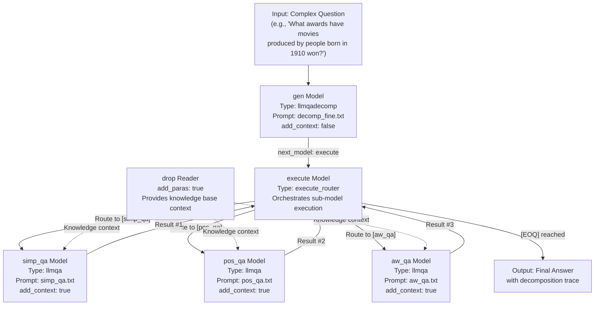
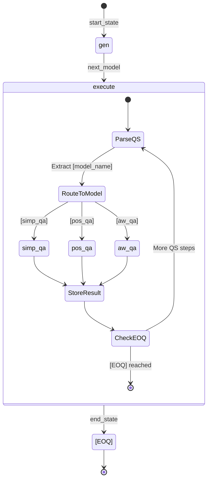
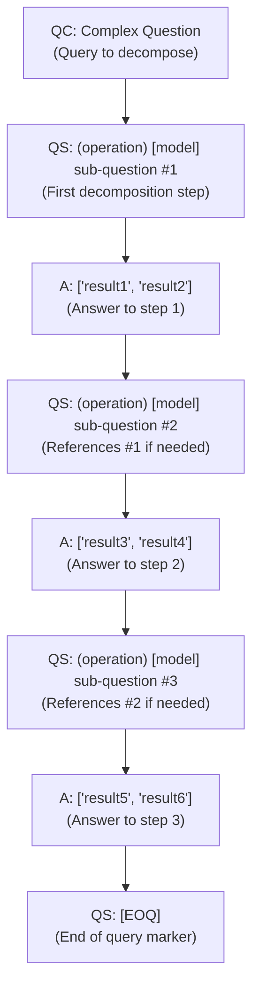
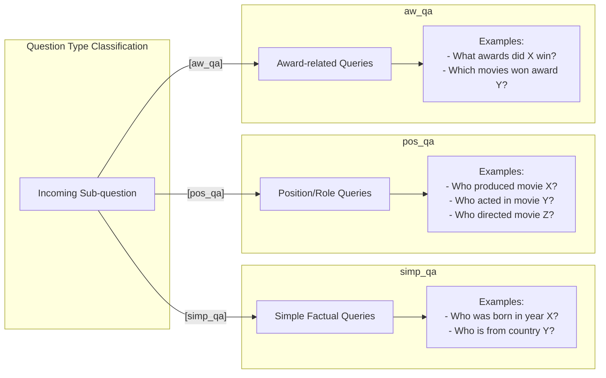
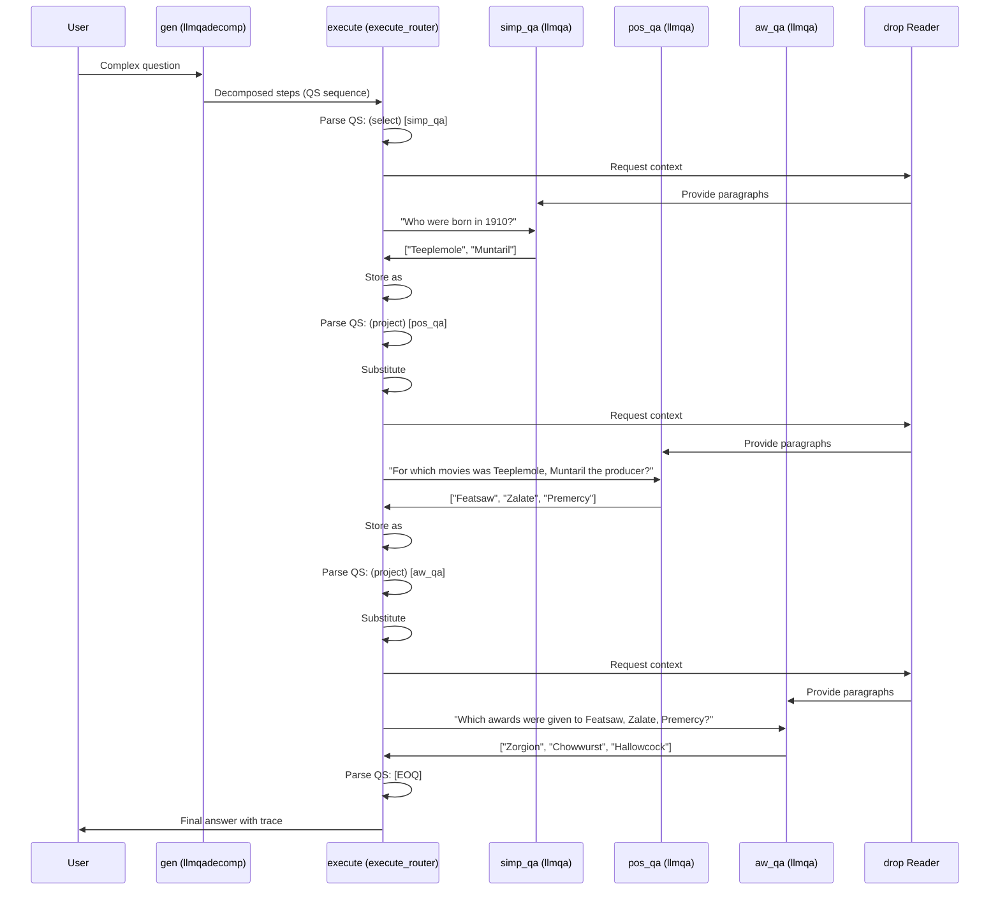

<!-- source: DeepWiki mcp.deepwiki.com · repo allenai/DecomP · extra page Fine-grained Decomposition · fetched 2026-10-26 -->

# Fine-grained Decomposition

<details>
<summary>Relevant source files</summary>

The following files were used as context for generating this wiki page:

- [configs/inference/commaqa_e/commaqae_fine_greedy_search.jsonnet](configs/inference/commaqa_e/commaqae_fine_greedy_search.jsonnet)
- [configs/prompts/commaqa_e/commaqa_e_p1/decomp_fine.txt](configs/prompts/commaqa_e/commaqa_e_p1/decomp_fine.txt)

</details>


## Purpose and Scope

This document describes the fine-grained decomposition strategy for CommAQA multi-hop question answering. Fine-grained decomposition breaks complex questions into a sequence of typed sub-questions, each routed to specialized QA models. For the alternative coarse-grained approach, see [Coarse-grained Decomposition](#4.3.2). For general CommAQA background, see [CommAQA Multi-hop Question Answering](#4.3).

## Overview

Fine-grained decomposition decomposes complex multi-hop questions into explicit sub-operations with typed routing. Unlike coarse-grained decomposition which uses general-purpose reasoning, fine-grained decomposition:

1. **Explicitly types each sub-question** (simple fact lookup, position-based query, award-based query)
2. **Routes to specialized models** based on question type
3. **Specifies operations** (select, project_values_flat_unique) for each step
4. **Maintains references** between steps using numbered placeholders (#1, #2, #3)

This approach provides maximum control over the reasoning process by explicitly encoding the query structure and data flow.

## Pipeline Architecture

### System Architecture Diagram



**Sources:** [configs/inference/commaqa_e/commaqae_fine_greedy_search.jsonnet:1-38]()

### State Transition Flow



**Sources:** [configs/inference/commaqa_e/commaqae_fine_greedy_search.jsonnet:5-12]()

## Configuration Structure

The fine-grained decomposition configuration is defined in [commaqae_fine_greedy_search.jsonnet](configs/inference/commaqa_e/commaqae_fine_greedy_search.jsonnet).

### Model Definitions

| Model Key | Type | Prompt Template | Add Context | Purpose |
|-----------|------|-----------------|-------------|---------|
| `gen` | `llmqadecomp` | `decomp_fine.txt` | `false` | Decomposes complex question into typed sub-questions |
| `execute` | `execute_router` | N/A | N/A | Routes sub-questions to appropriate specialized models |
| `simp_qa` | `llmqa` | `simp_qa.txt` | `true` | Answers simple factual questions (e.g., "Who was born in 1910?") |
| `pos_qa` | `llmqa` | `pos_qa.txt` | `true` | Answers position-based questions (e.g., "Who produced movie X?") |
| `aw_qa` | `llmqa` | `aw_qa.txt` | `true` | Answers award-based questions (e.g., "What awards did X win?") |

**Sources:** [configs/inference/commaqa_e/commaqae_fine_greedy_search.jsonnet:7-33]()

### Configuration Parameters

```jsonnet
{
  "start_state": "gen",
  "end_state": "[EOQ]",
  "models": {
    "gen": {
      "name": "llmqadecomp",
      "prompt_file": "configs/prompts/commaqa_e/commaqa_e_" + std.extVar("promptid") + "/decomp_fine.txt",
      "next_model": "execute",
      "end_state": "[EOQ]",
      "add_context": false
    },
    "execute": {
      "name": "execute_router"
    }
  },
  "reader": {
    "name": "drop",
    "add_paras": true
  }
}
```

Key configuration aspects:
- **`start_state: "gen"`** - Inference begins at the `gen` model
- **`next_model: "execute"`** - After decomposition, control passes to the router
- **`add_context: false`** for `gen` - Decomposition doesn't need knowledge base
- **`add_context: true`** for QA models - Sub-questions require factual grounding
- **`reader: "drop"`** with `add_paras: true` - Provides paragraph-level context

**Sources:** [configs/inference/commaqa_e/commaqae_fine_greedy_search.jsonnet:4-37]()

## Prompt Template Format

The decomposition prompt follows a structured few-shot format defined in [decomp_fine.txt](configs/prompts/commaqa_e/commaqa_e_p1/decomp_fine.txt).

### Structure Components



**Sources:** [configs/prompts/commaqa_e/commaqa_e_p1/decomp_fine.txt:1-49]()

### Format Syntax

Each decomposition example consists of:

1. **`QC:`** - Original complex question
2. **`QS:`** - Question step with three components:
   - **(operation)** - Data operation type: `select`, `project_values_flat_unique`
   - **[model]** - Target model: `[simp_qa]`, `[pos_qa]`, `[aw_qa]`
   - **sub-question text** - Simplified question, may reference previous results with `#1`, `#2`, etc.
3. **`A:`** - Answer in JSON list format
4. **`QS: [EOQ]`** - End marker

### Example Decomposition

From [decomp_fine.txt:1-8]():

```
QC: What awards have movies produced by people born in 1910 won?
QS: (select) [simp_qa] Who were born in the year 1910?
A: ["Teeplemole", "Muntaril"]
QS: (project_values_flat_unique) [pos_qa] For which movies was #1 the producer?
A: ["Featsaw", "Zalate", "Premercy"]
QS: (project_values_flat_unique) [aw_qa] Which awards were given to #2?
A: ["Zorgion", "Chowwurst", "Hallowcock"]
QS: [EOQ]
```

**Decomposition logic:**
1. **Step 1** - Use `simp_qa` to find people born in 1910 → Result stored as `#1`
2. **Step 2** - Use `pos_qa` to find movies produced by `#1` → Result stored as `#2`
3. **Step 3** - Use `aw_qa` to find awards given to `#2` → Final answer

**Sources:** [configs/prompts/commaqa_e/commaqa_e_p1/decomp_fine.txt:1-8]()

### Operation Types

| Operation | Purpose | Typical Usage |
|-----------|---------|---------------|
| `select` | Initial filtering/selection from knowledge base | First step to identify entities matching criteria |
| `project_values_flat_unique` | Extract and flatten related values | Later steps to traverse relationships and aggregate results |

**Sources:** [configs/prompts/commaqa_e/commaqa_e_p1/decomp_fine.txt:2-48]()

## Specialized Sub-models

The fine-grained strategy employs three specialized QA models, each optimized for different question types.

### Sub-model Comparison



**Sources:** [configs/inference/commaqa_e/commaqae_fine_greedy_search.jsonnet:15-29]()

### Model Specifications

#### simp_qa

- **Type:** `llmqa`
- **Prompt:** `simp_qa.txt`
- **Context:** Knowledge base enabled (`add_context: true`)
- **Purpose:** Answers straightforward factual questions requiring simple lookup

**Configuration:** [configs/inference/commaqa_e/commaqae_fine_greedy_search.jsonnet:25-29]()

#### pos_qa

- **Type:** `llmqa`
- **Prompt:** `pos_qa.txt`
- **Context:** Knowledge base enabled (`add_context: true`)
- **Purpose:** Answers questions about roles and positions (producer, actor, director, writer)

**Configuration:** [configs/inference/commaqa_e/commaqae_fine_greedy_search.jsonnet:20-24]()

#### aw_qa

- **Type:** `llmqa`
- **Prompt:** `aw_qa.txt`
- **Context:** Knowledge base enabled (`add_context: true`)
- **Purpose:** Answers questions about awards given to entities

**Configuration:** [configs/inference/commaqa_e/commaqae_fine_greedy_search.jsonnet:15-19]()

## Execution Flow

### Step-by-Step Execution



**Sources:** [configs/inference/commaqa_e/commaqae_fine_greedy_search.jsonnet:1-38](), [configs/prompts/commaqa_e/commaqa_e_p1/decomp_fine.txt:1-8]()

### Reference Resolution

When the `execute_router` encounters references like `#1` or `#2` in sub-questions:

1. **Parse the QS line** to identify the model and question text
2. **Identify reference placeholders** (`#1`, `#2`, etc.)
3. **Substitute references** with actual results from previous steps
4. **Route to specified model** with the resolved question
5. **Store the result** for potential use in subsequent steps

Example transformation:
```
Original QS: "For which movies was #1 the producer?"
After #1 = ["Teeplemole", "Muntaril"]
Resolved:    "For which movies was Teeplemole, Muntaril the producer?"
```

**Sources:** [configs/prompts/commaqa_e/commaqa_e_p1/decomp_fine.txt:1-49]()

## Usage Example

### Running Fine-grained Decomposition

```bash
# Run fine-grained decomposition with prompt ID p1
allennlp predict \
  configs/inference/commaqa_e/commaqae_fine_greedy_search.jsonnet \
  data/commaqa_e/test.json \
  --output-file predictions/commaqae_fine_p1.json \
  --include-package decomp \
  --predictor configurable_inference \
  --use-dataset-reader \
  --cuda-device 0 \
  --overrides '{"environ": {"promptid": "p1"}}'
```

The `promptid` environment variable controls which prompt variant to use, corresponding to directories under [configs/prompts/commaqa_e/]().

**Sources:** [configs/inference/commaqa_e/commaqae_fine_greedy_search.jsonnet:10](), [configs/inference/commaqa_e/commaqae_fine_greedy_search.jsonnet:17](), [configs/inference/commaqa_e/commaqae_fine_greedy_search.jsonnet:22](), [configs/inference/commaqa_e/commaqae_fine_greedy_search.jsonnet:27]()

## Complete Example Traces

### Example 1: Multi-hop Award Query

**Input Question:**
```
What awards have movies produced by people born in 1910 won?
```

**Decomposition Trace:**
```
QS: (select) [simp_qa] Who were born in the year 1910?
A: ["Teeplemole", "Muntaril"]

QS: (project_values_flat_unique) [pos_qa] For which movies was #1 the producer?
A: ["Featsaw", "Zalate", "Premercy"]

QS: (project_values_flat_unique) [aw_qa] Which awards were given to #2?
A: ["Zorgion", "Chowwurst", "Hallowcock"]

QS: [EOQ]
```

**Final Answer:** `["Zorgion", "Chowwurst", "Hallowcock"]`

**Sources:** [configs/prompts/commaqa_e/commaqa_e_p1/decomp_fine.txt:1-8]()

### Example 2: Country-based Actor Query

**Input Question:**
```
What movies have people from the country Stridery acted in?
```

**Decomposition Trace:**
```
QS: (select) [simp_qa] Who is from the country Stridery?
A: ["Gastrat"]

QS: (project_values_flat_unique) [pos_qa] Which movies has #1 been an actor in?
A: ["Partnershipmaker", "Nilitude", "Warpstone"]

QS: [EOQ]
```

**Final Answer:** `["Partnershipmaker", "Nilitude", "Warpstone"]`

**Sources:** [configs/prompts/commaqa_e/commaqa_e_p1/decomp_fine.txt:10-15]()

### Example 3: Three-hop Award Chain

**Input Question:**
```
What awards have the actors of the Erowid winning movies received?
```

**Decomposition Trace:**
```
QS: (select) [aw_qa] Which movies were given the Erowid award?
A: ["Dewbar", "Caudacite"]

QS: (project_values_flat_unique) [pos_qa] Who are the actors in the movie #1?
A: ["Wetherality", "Lougerière", "Gigabut"]

QS: (project_values_flat_unique) [aw_qa] Which awards were given to #2?
A: ["Aniconder", "Trifogation"]

QS: [EOQ]
```

**Final Answer:** `["Aniconder", "Trifogation"]`

**Sources:** [configs/prompts/commaqa_e/commaqa_e_p1/decomp_fine.txt:17-24]()

## Key Design Principles

The fine-grained decomposition strategy embodies several important principles:

1. **Explicit Type Routing** - Each sub-question explicitly declares its target model, providing clear execution paths
2. **Operation Annotations** - Data operations (`select`, `project_values_flat_unique`) make the reasoning structure explicit
3. **Compositional References** - The `#1`, `#2` notation enables information flow between steps
4. **Specialized Knowledge Access** - Only QA models receive knowledge base context, while decomposition remains abstract
5. **Deterministic Execution** - The `execute_router` follows explicit routing instructions without additional LLM calls

These principles enable precise control over the reasoning process while maintaining interpretability of the decomposition steps.

**Sources:** [configs/inference/commaqa_e/commaqae_fine_greedy_search.jsonnet:1-38](), [configs/prompts/commaqa_e/commaqa_e_p1/decomp_fine.txt:1-49]()

---

