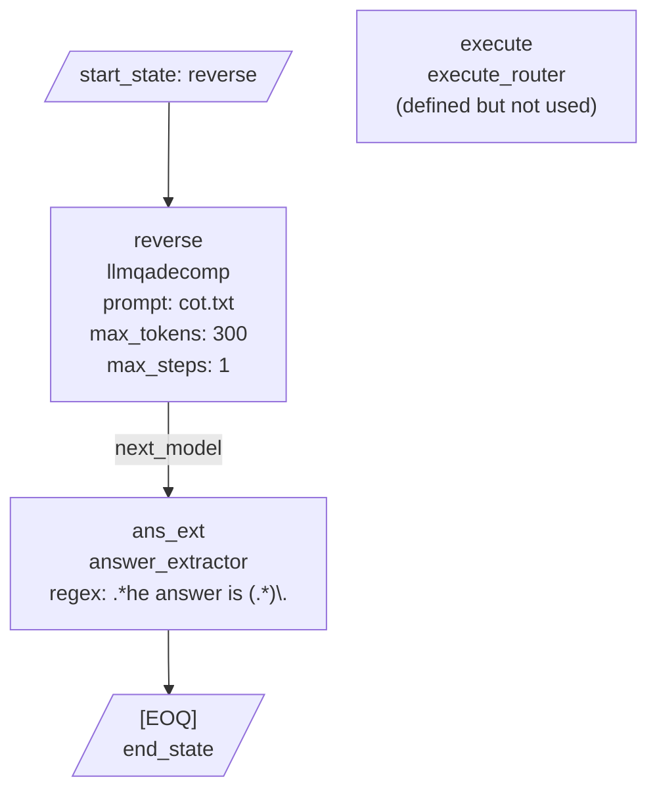
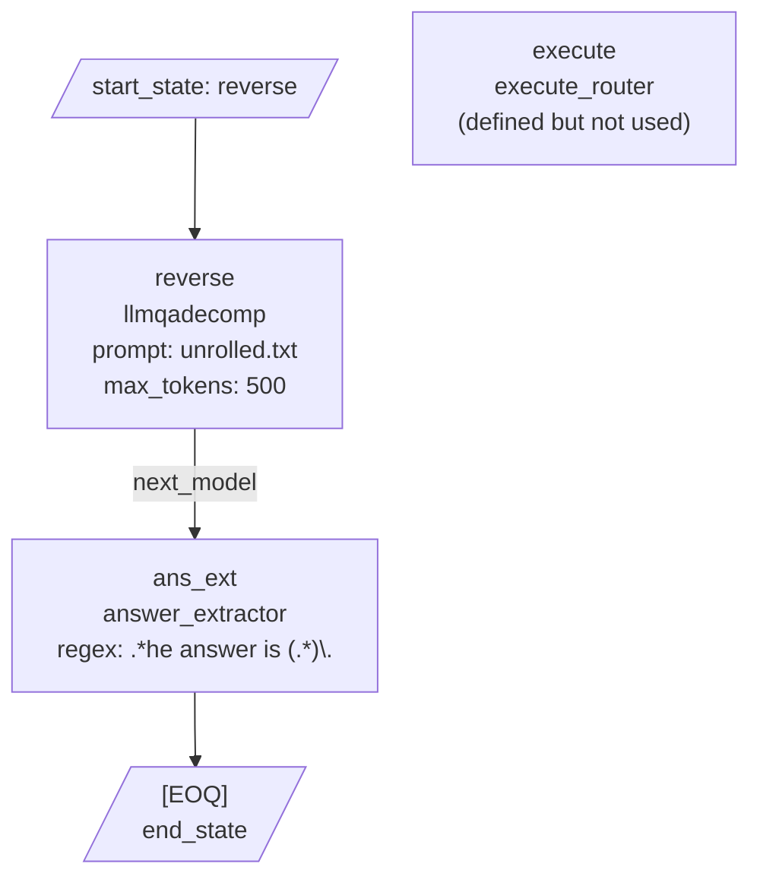
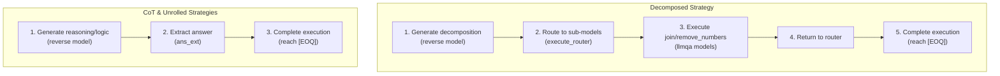
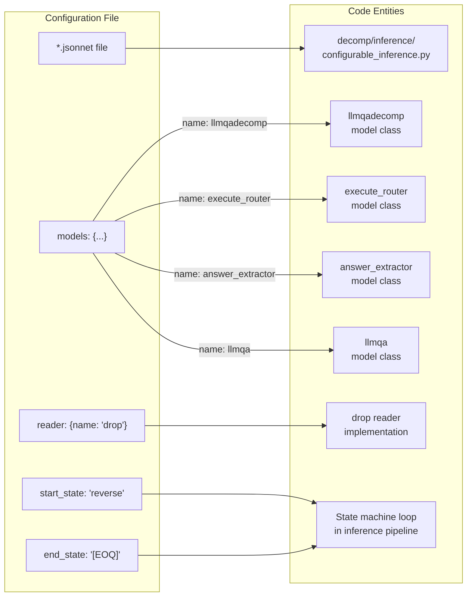

<!-- source: DeepWiki mcp.deepwiki.com · repo allenai/DecomP · extra page Inference Configurations · fetched 2026-10-26 -->

# Inference Configurations

<details>
<summary>Relevant source files</summary>

The following files were used as context for generating this wiki page:

- [configs/inference/reverse/cot.jsonnet](configs/inference/reverse/cot.jsonnet)
- [configs/inference/reverse/decomp.jsonnet](configs/inference/reverse/decomp.jsonnet)
- [configs/inference/reverse/unrolled.jsonnet](configs/inference/reverse/unrolled.jsonnet)

</details>


## Purpose and Scope

This page documents the three inference configuration files available for running the list reversal experiment. Each configuration implements a different prompting strategy (decomposed, chain of thought, or unrolled) and defines the models, prompts, and execution flow required for that strategy.

For information about generating list reversal datasets, see [Dataset Generation](#4.2.1). For information about evaluating results, see [Evaluation and Results](#4.2.3). For general information about the prompting strategies themselves, see [Core Concepts](#3).

## Configuration Overview

The list reversal experiment provides three Jsonnet configuration files located in `configs/inference/reverse/`:

| Configuration File | Strategy | Complexity | Key Characteristic |
|-------------------|----------|------------|-------------------|
| `decomp.jsonnet` | Decomposed | High | Multi-stage pipeline with specialized sub-models |
| `cot.jsonnet` | Chain of Thought | Low | Single-stage reasoning with direct answer extraction |
| `unrolled.jsonnet` | Unrolled | Low | Conditional logic with recursive decomposition |

All three configurations share common infrastructure components but differ significantly in their model orchestration and execution flow.

**Sources:** [configs/inference/reverse/decomp.jsonnet](), [configs/inference/reverse/cot.jsonnet](), [configs/inference/reverse/unrolled.jsonnet]()

## Common Configuration Parameters

All three configurations share the following base parameters:

| Parameter | Value | Description |
|-----------|-------|-------------|
| `start_state` | `"reverse"` | Initial model to execute |
| `end_state` | `"[EOQ]"` | Terminal state marker |
| `gen_model` | `"gpt3"` | Language model backend |
| `engine` | `"text-davinci-001"` | GPT-3 engine version |
| `reader.name` | `"drop"` | Dataset reader type |
| `reader.add_paras` | `true` | Include paragraph context |

The `gen_params` local variable defined at the top of each configuration file provides the GPT-3 engine settings that are merged into model definitions using the `+ gen_params` syntax.

**Sources:** [configs/inference/reverse/decomp.jsonnet:1-1](), [configs/inference/reverse/cot.jsonnet:1-1](), [configs/inference/reverse/unrolled.jsonnet:1-1]()

## Decomposed Configuration

### Model Pipeline

The decomposed configuration (`decomp.jsonnet`) implements the most complex execution pipeline with six distinct models:

```mermaid
graph TB
    START[/"start_state: reverse"/]
    
    REVERSE["reverse<br/>llmqadecomp<br/>prompt: decomp.txt<br/>max_tokens: 400"]
    
    EXECUTE["execute<br/>execute_router<br/>orchestrates sub-models"]
    
    JOIN["join<br/>llmqa<br/>prompt: join.txt"]
    
    REMOVE["remove_numbers<br/>llmqa<br/>prompt: rm_num.txt"]
    
    COT["cot<br/>llmqadecomp<br/>prompt: cot.txt<br/>max_tokens: 400<br/>max_steps: 1"]
    
    EXTRACT["extract<br/>answer_extractor<br/>regex: .* (?:is|reverse) \"(.*)\"\."]
    
    END[/"[EOQ]<br/>end_state"/]
    
    START --> REVERSE
    REVERSE -->|"next_model"| EXECUTE
    EXECUTE -.->|"routes to"| JOIN
    EXECUTE -.->|"routes to"| REMOVE
    COT -->|"next_model"| EXTRACT
    EXTRACT --> END
    JOIN --> END
    REMOVE --> END
```

### Model Definitions

**Primary Decomposition Model (`reverse`)**
- **Type:** `llmqadecomp`
- **Prompt:** [configs/prompts/reverse/decomp.txt]()
- **Max Tokens:** 400
- **Next Model:** `execute` (execute_router)
- **Function:** Generates decomposed sub-operations for the reversal task

**Execution Router (`execute`)**
- **Type:** `execute_router`
- **Function:** Orchestrates execution of sub-models based on the decomposed operations
- **Routes To:** `join`, `remove_numbers`, and potentially other models

**Sub-operation Models:**
- **`join`** - Combines reversed sub-sequences using [configs/prompts/reverse/join.txt]()
- **`remove_numbers`** - Strips numbering from sequences using [configs/prompts/reverse/rm_num.txt]()

**Alternative Path:**
- **`cot`** - Chain of thought model with `max_steps: 1` (single-shot execution)
- **`extract`** - Extracts final answer using regex pattern

**Sources:** [configs/inference/reverse/decomp.jsonnet:5-41]()

## Chain of Thought Configuration

### Model Pipeline

The chain of thought configuration (`cot.jsonnet`) uses a simple two-stage pipeline:



### Model Definitions

**Primary Reasoning Model (`reverse`)**
- **Type:** `llmqadecomp`
- **Prompt:** [configs/prompts/reverse/cot.txt]()
- **Max Tokens:** 300 (lower than decomposed strategy)
- **Max Steps:** 1 (enforces single-shot generation)
- **Next Model:** `ans_ext`
- **Function:** Generates natural language reasoning steps leading to the reversed sequence

**Answer Extractor (`ans_ext`)**
- **Type:** `answer_extractor`
- **Regex:** `.*he answer is (.*)\\.`
- **Function:** Extracts the final answer from the reasoning trace

The `execute` router model is defined but not used in this configuration, as the CoT strategy does not require sub-model orchestration.

**Sources:** [configs/inference/reverse/cot.jsonnet:5-26]()

## Unrolled Configuration

### Model Pipeline

The unrolled configuration (`unrolled.jsonnet`) has the same two-stage structure as CoT but with different prompt and token settings:



### Model Definitions

**Primary Unrolled Model (`reverse`)**
- **Type:** `llmqadecomp`
- **Prompt:** [configs/prompts/reverse/unrolled.txt]()
- **Max Tokens:** 500 (highest of all three strategies)
- **Next Model:** `ans_ext`
- **Function:** Applies conditional logic with recursive decomposition pattern

**Answer Extractor (`ans_ext`)**
- **Type:** `answer_extractor`
- **Regex:** `.*he answer is (.*)\\.`
- **Function:** Extracts the final answer from the execution trace

The unrolled strategy requires more tokens (500) than CoT (300) because it generates explicit conditional branches and recursive calls, resulting in longer output text.

**Sources:** [configs/inference/reverse/unrolled.jsonnet:5-25]()

## Configuration Comparison

### Execution Flow Differences



### Parameter Comparison Table

| Aspect | Decomposed | Chain of Thought | Unrolled |
|--------|-----------|------------------|----------|
| **Model Count** | 6 models | 3 models (1 unused) | 3 models (1 unused) |
| **Max Tokens** | 400 | 300 | 500 |
| **Max Steps** | Unlimited | 1 | Unlimited |
| **Answer Extraction** | Regex: `.* (?:is\|reverse) "(.*)"\\.` | Regex: `.*he answer is (.*)\\.` | Regex: `.*he answer is (.*)\\.` |
| **Pipeline Stages** | Multi-stage (decompose → execute → sub-models) | Two-stage (reason → extract) | Two-stage (unroll → extract) |
| **Prompt File** | decomp.txt | cot.txt | unrolled.txt |
| **Uses execute_router** | Yes (actively) | No (defined only) | No (defined only) |

**Sources:** [configs/inference/reverse/decomp.jsonnet](), [configs/inference/reverse/cot.jsonnet](), [configs/inference/reverse/unrolled.jsonnet]()

## Configuration to Code Entity Mapping

The following diagram maps configuration parameters to their corresponding code entities in the inference system:



### Model Name to Class Mapping

| Configuration Value | Code Entity | File Location |
|---------------------|-------------|---------------|
| `"llmqadecomp"` | Model class for decomposed QA | `decomp/inference/` |
| `"llmqa"` | Model class for QA sub-operations | `decomp/inference/` |
| `"execute_router"` | Router for orchestrating sub-models | `decomp/inference/` |
| `"answer_extractor"` | Regex-based answer extraction | `decomp/inference/` |
| `"drop"` | Dataset reader implementation | `decomp/inference/` |
| `"gpt3"` | GPT-3 API interface | `decomp/inference/` |

**Sources:** [configs/inference/reverse/decomp.jsonnet](), [configs/inference/reverse/cot.jsonnet](), [configs/inference/reverse/unrolled.jsonnet]()

## Usage

### Running Inference with a Configuration

To run inference using one of these configurations, use the `configurable_inference` command with the desired configuration file:

```bash
# Decomposed strategy
python -m decomp.inference.configurable_inference \
    --inference_config configs/inference/reverse/decomp.jsonnet \
    --input_file data/reverse/reverse_len4.json \
    --output_file output/reverse_len4_decomp.json

# Chain of Thought strategy
python -m decomp.inference.configurable_inference \
    --inference_config configs/inference/reverse/cot.jsonnet \
    --input_file data/reverse/reverse_len4.json \
    --output_file output/reverse_len4_cot.json

# Unrolled strategy
python -m decomp.inference.configurable_inference \
    --inference_config configs/inference/reverse/unrolled.jsonnet \
    --input_file data/reverse/reverse_len4.json \
    --output_file output/reverse_len4_unrolled.json
```

### Configuration Selection Guidelines

**Use `decomp.jsonnet` when:**
- You want to evaluate explicit multi-step decomposition
- You need detailed sub-operation tracing
- The task benefits from modular problem-solving

**Use `cot.jsonnet` when:**
- You want natural language reasoning chains
- You prefer single-shot generation with constrained steps
- Token efficiency is important (300 tokens)

**Use `unrolled.jsonnet` when:**
- You want to evaluate recursive decomposition patterns
- Conditional logic is important for the task
- You need more token budget for complex reasoning (500 tokens)

**Sources:** [configs/inference/reverse/decomp.jsonnet](), [configs/inference/reverse/cot.jsonnet](), [configs/inference/reverse/unrolled.jsonnet]()

## Configuration Structure Reference

Each configuration file follows this Jsonnet structure:

```
{
  "start_state": "<initial_model_name>",
  "end_state": "[EOQ]",
  "models": {
    "<model_name>": {
      "name": "<model_type>",
      "prompt_file": "<path_to_prompt>",
      "next_model": "<next_model_name>",
      "max_tokens": <integer>,
      "max_steps": <integer>,  // optional
      "regex": "<pattern>",     // for answer_extractor only
      "gen_model": "gpt3",
      "engine": "text-davinci-001"
    },
    // ... more models
  },
  "reader": {
    "name": "drop",
    "add_paras": true
  }
}
```

### Required Fields by Model Type

| Model Type | Required Fields | Optional Fields |
|------------|----------------|-----------------|
| `llmqadecomp` | `name`, `prompt_file`, `next_model`, `gen_model`, `engine` | `max_tokens`, `max_steps`, `end_state` |
| `llmqa` | `name`, `prompt_file`, `gen_model`, `engine` | `max_tokens`, `next_model` |
| `execute_router` | `name` | - |
| `answer_extractor` | `name`, `regex` | - |

**Sources:** [configs/inference/reverse/decomp.jsonnet](), [configs/inference/reverse/cot.jsonnet](), [configs/inference/reverse/unrolled.jsonnet]()

---

