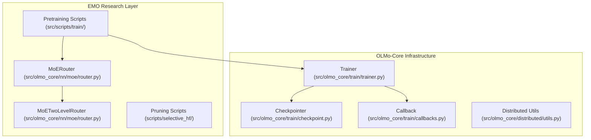
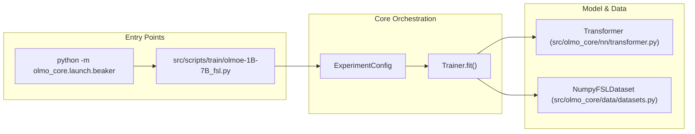

<!-- source: DeepWiki mcp.deepwiki.com · repo allenai/EMO · page 1 EMO / OLMo-Core Overview · fetched 2026-10-26 -->

# EMO / OLMo-Core Overview

Relevant source files

The following files were used as context for generating this wiki page:

- [CHANGELOG.md](CHANGELOG.md)
- [README.md](README.md)
- [docs/source/index.rst](docs/source/index.rst)
- [docs/source/overview/installation.rst](docs/source/overview/installation.rst)
- [docs/source/overview/introduction.rst](docs/source/overview/introduction.rst)
- [scripts/RUN_TEMPLATES.md](scripts/RUN_TEMPLATES.md)
- [scripts/selective_hf/hf_finetune_with_selective_easy_ep.sh](scripts/selective_hf/hf_finetune_with_selective_easy_ep.sh)
- [scripts/selective_hf/hf_finetune_with_selective_layerwise.sh](scripts/selective_hf/hf_finetune_with_selective_layerwise.sh)
- [src/olmo_core/train/trainer.py](src/olmo_core/train/trainer.py)
- [src/olmo_core/version.py](src/olmo_core/version.py)
- [src/scripts/official/README.md](src/scripts/official/README.md)
- [src/scripts/train/README.md](src/scripts/train/README.md)
- [src/test/conftest.py](src/test/conftest.py)

EMO (Emergent Modularity) is a research project and codebase developed at the Allen Institute for AI (AI2) focusing on **modular Mixture-of-Experts (MoE) pretraining**. The core innovation of EMO is enabling modular structure to emerge during pretraining without human-defined priors, allowing for **selective expert usage** (down to 12.5% of total experts) with minimal performance degradation [README.md:22-23]().

The project is built upon **OLMo-Core**, a high-performance rewrite of the original OLMo training and modeling code designed for stability, efficiency, and scale [docs/source/overview/introduction.rst:4-7]().

## Research Goals: Modular MoE

The primary research objective of EMO is to induce expert specialization at the level of high-level topics and capabilities rather than low-level lexical patterns [README.md:22-23](). By using document-level routing constraints, EMO forces experts to group into modules that can be selectively activated or pruned for specific tasks or domains [README.md:36-38]().

### Key Architectural Concepts
*   **Emergent Modularity:** Inducing structure during pretraining via specialized routing mechanisms.
*   **Two-Level Routing:** Constraining expert selection at the document or batch level to encourage module formation.
*   **Expert Pruning:** One-shot or iterative methods to identify and keep only the most relevant experts for a given task (e.g., EASY-EP) [scripts/selective_hf/hf_finetune_with_selective_easy_ep.sh:7-14]().
*   **Config-Driven Design:** Every component (model, data, trainer) is defined via a `Config` class and instantiated via a `.build()` method [docs/source/overview/introduction.rst:16-34]().

## System Relationship: EMO and OLMo-Core

EMO serves as the research implementation layer, while OLMo-Core provides the robust distributed training infrastructure.

### System Entity Mapping
The following diagram maps high-level system concepts to their specific implementations within the codebase.

**Concept to Code Entity Map**

**Sources:** [src/olmo_core/train/trainer.py:99-156](), [docs/source/overview/introduction.rst:9-13](), [scripts/selective_hf/hf_finetune_with_selective_layerwise.sh:9-13]().

## Repository Organization

The repository is structured to separate core library logic from research scripts and evaluation pipelines.

| Directory | Purpose |
| :--- | :--- |
| `src/olmo_core/` | The core library: NN layers, distributed training logic, data loaders, and trainer. |
| `src/scripts/train/` | Primary entry points for pretraining (e.g., `olmoe-1B-7B_fsl.py`). |
| `src/hf_training/` | Logic for fine-tuning and interacting with HuggingFace models. |
| `src/offline_evals/` | The standalone evaluation engine for task-based benchmarking. |
| `scripts/models/` | Shell scripts containing specific hyperparameters for released EMO/MoE models. |
| `scripts/selective_hf/` | Pipelines for expert pruning and selective fine-tuning. |

**Code Entity Interaction Diagram**

**Sources:** [src/scripts/official/README.md:7-11](), [docs/source/overview/introduction.rst:16-34](), [README.md:34-38]().

## Major Child Sections

For detailed technical documentation, refer to the following sub-pages:

*   **[Getting Started: Installation and Environment Setup](#1.1)**
    Covers `uv` and `conda` setup, and installing optional extras like `flash-attn` or `grouped_gemm`. For details, see [Getting Started: Installation and Environment Setup](#1.1).
*   **[Repository Structure and Key Concepts](#1.2)**
    A deep dive into the `src/` layout, the Config/Build pattern, and a glossary of terms like FSL/VSL and EP (Expert Parallelism). For details, see [Repository Structure and Key Concepts](#1.2).

**Sources:** [README.md:42-50](), [docs/source/overview/installation.rst:11-17](), [docs/source/overview/introduction.rst:9-13]().

---

