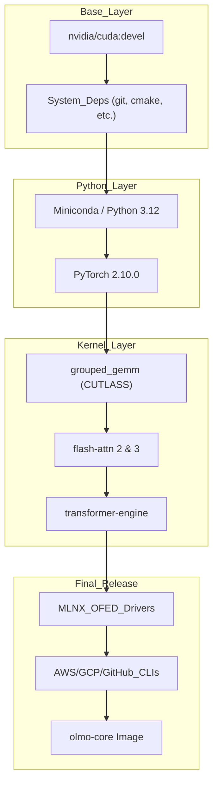
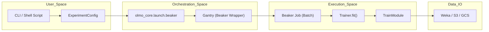

<!-- source: DeepWiki mcp.deepwiki.com · repo allenai/EMO · page 1.1 Getting Started: Installation and Environment Setup · fetched 2026-10-26 -->

# Getting Started: Installation and Environment Setup

<details>
<summary>Relevant source files</summary>

The following files were used as context for generating this wiki page:

- [.github/workflows/docker.yml](.github/workflows/docker.yml)
- [.github/workflows/main.yml](.github/workflows/main.yml)
- [.github/workflows/pr_checks.yml](.github/workflows/pr_checks.yml)
- [Makefile](Makefile)
- [README.md](README.md)
- [docs/source/index.rst](docs/source/index.rst)
- [docs/source/overview/installation.rst](docs/source/overview/installation.rst)
- [docs/source/overview/introduction.rst](docs/source/overview/introduction.rst)
- [pyproject.toml](pyproject.toml)
- [scripts/RUN_TEMPLATES.md](scripts/RUN_TEMPLATES.md)
- [scripts/selective_hf/hf_finetune_with_selective_easy_ep.sh](scripts/selective_hf/hf_finetune_with_selective_easy_ep.sh)
- [scripts/selective_hf/hf_finetune_with_selective_layerwise.sh](scripts/selective_hf/hf_finetune_with_selective_layerwise.sh)
- [src/Dockerfile](src/Dockerfile)
- [src/olmo_core/launch/beaker.py](src/olmo_core/launch/beaker.py)
- [src/scripts/official/README.md](src/scripts/official/README.md)
- [src/scripts/train/README.md](src/scripts/train/README.md)

</details>


This page provides a comprehensive guide to setting up the development environment for EMO (and its underlying framework, `olmo-core`). It covers local installation, optional dependency management, Docker-based workflows, and launching your first training run.

## Purpose and Scope
The EMO repository is built upon `ai2-olmo-core`, a high-performance training library designed for large-scale distributed language modeling [docs/source/overview/introduction.rst:4-9](). This setup guide ensures you have the correct Python environment, CUDA drivers, and specialized kernels (like FlashAttention and GroupedGEMM) required for efficient MoE training and expert pruning research.

---

## Local Environment Setup

The recommended way to manage dependencies is using `conda` for the Python runtime and `uv` for fast, reproducible package installation.

### 1. Clone and Create Environment
```bash
git clone https://github.com/allenai/EMO.git
cd EMO
conda create -n emo python==3.12
conda activate emo
```
Sources: [README.md:44-47]()

### 2. Install Dependencies
EMO uses a tiered dependency system defined in `pyproject.toml`. You can install the base requirements or include optional "extras" for specific features like Beaker launching, Weights & Biases logging, or evaluation suites.

**Standard Installation (All features):**
```bash
uv pip install -e .[all]
uv pip install --upgrade 'chardet>=7'
```
Sources: [README.md:48-49](), [pyproject.toml:85-85]()

### 3. Understanding Optional Extras
The `pyproject.toml` file defines several dependency groups:

| Extra | Purpose | Key Packages |
| :--- | :--- | :--- |
| `dev` | Development and linting | `black`, `mypy`, `pytest`, `ruff` |
| `beaker` | AI2 Beaker cluster integration | `beaker-py`, `GitPython` |
| `wandb` | Experiment tracking | `wandb` |
| `eval` | In-loop and offline evaluation | `ai2-olmes`, `ai2-olmo-eval` |
| `flash-attn` | High-speed attention kernels | `flash-attn` (prebuilt wheels) |
| `transformers`| HuggingFace interoperability | `transformers==4.57.1` |

Sources: [pyproject.toml:35-85]()

---

## System Dependencies and Specialized Kernels

For high-performance training, especially with Mixture-of-Experts (MoE), several C++/CUDA extensions are required. These are often easier to manage via Docker (see below), but can be installed manually:

*   **PyTorch**: Version `2.8.0` is the primary target [pyproject.toml:17-17]().
*   **FlashAttention**: Required for optimized transformer blocks [pyproject.toml:77-80]().
*   **Grouped GEMM**: Essential for "dropless" MoE implementations, allowing experts to process varying batch sizes efficiently [docs/source/overview/installation.rst:16-16]().
*   **TransformerEngine**: Used for FP8 training and optimized Hopper-generation kernels [src/Dockerfile:85-87]().

---

## Docker and Beaker Infrastructure

For distributed training on clusters, EMO provides a multi-stage `Dockerfile` and integration with the Beaker platform.

### Docker Image Architecture
The Dockerfile builds a comprehensive environment including AWS/GCP CLIs, InfiniBand drivers (MLNX OFED), and all necessary CUDA kernels.

Title: EMO Docker Build Pipeline

Sources: [src/Dockerfile:1-170](), [Makefile:76-94]()

### Beaker Integration
The `olmo_core.launch.beaker` module allows for seamless transition from local testing to cluster execution.

*   **Images**: Official images are tracked in `OLMoCoreBeakerImage` [src/olmo_core/launch/beaker.py:130-188]().
*   **Weka Support**: Configurable via `BeakerWekaBucket` for high-speed data access [src/olmo_core/launch/beaker.py:204-208]().

---

## Running Your First Command

The EMO repository uses a "Config/Build" pattern. You define an `ExperimentConfig`, and the framework handles the orchestration.

### 1. Local Training (Dry Run)
You can verify your installation by running a training script in local mode using `torchrun`.

```bash
# Example: Dense 1B baseline
torchrun --nproc-per-node=1 src/scripts/train/olmo2-1B.py test-run \
    --save-folder="./checkpoints/test-run" \
    --dataset.mix=OLMoE-mix-0824 \
    --trainer.max_duration='{value: 100, unit: steps}'
```
Sources: [scripts/RUN_TEMPLATES.md:32-54](), [docs/source/overview/introduction.rst:47-49]()

### 2. Launching on Beaker
Using the `launch_common.sh` utility, you can submit the same job to a cluster by setting `MODE=beaker`.

```bash
MODE=beaker bash scripts/models/dense_1b_130b.sh
```
Sources: [scripts/RUN_TEMPLATES.md:21-24]()

### Execution Data Flow
The following diagram illustrates how a training command moves from a script to a distributed environment.

Title: Training Launch Lifecycle

Sources: [src/olmo_core/launch/beaker.py:211-225](), [docs/source/overview/introduction.rst:14-50](), [scripts/RUN_TEMPLATES.md:1-20]()

---

## Development and Quality Control

To maintain code quality, use the provided `Makefile` targets:

*   **Style Checks**: `make style-check` (runs `black` and `isort`) [Makefile:4-9]().
*   **Linting**: `make lint-check` (runs `ruff`) [Makefile:11-14]().
*   **Type Checking**: `make type-check` (runs `mypy`) [Makefile:17-19]().
*   **Testing**: `pytest src/test/` (runs the test suite) [.github/workflows/main.yml:39-45]().

Sources: [Makefile:1-26](), [.github/workflows/main.yml:27-55]()

---

