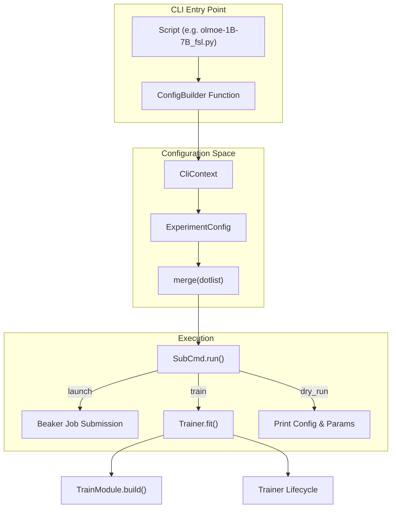
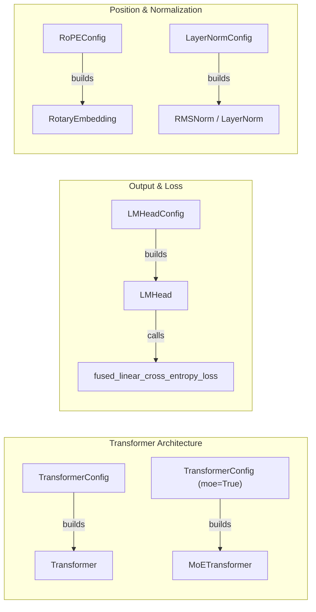

<!-- source: DeepWiki mcp.deepwiki.com · repo allenai/EMO · page 1.2 Repository Structure and Key Concepts · fetched 2026-10-26 -->

# Repository Structure and Key Concepts

Relevant source files

The following files were used as context for generating this wiki page:

- [README.md](README.md)
- [scripts/RUN_TEMPLATES.md](scripts/RUN_TEMPLATES.md)
- [scripts/selective_hf/hf_finetune_with_selective_easy_ep.sh](scripts/selective_hf/hf_finetune_with_selective_easy_ep.sh)
- [scripts/selective_hf/hf_finetune_with_selective_layerwise.sh](scripts/selective_hf/hf_finetune_with_selective_layerwise.sh)
- [src/olmo_core/config.py](src/olmo_core/config.py)
- [src/olmo_core/internal/common.py](src/olmo_core/internal/common.py)
- [src/olmo_core/internal/experiment.py](src/olmo_core/internal/experiment.py)
- [src/olmo_core/nn/layer_norm.py](src/olmo_core/nn/layer_norm.py)
- [src/olmo_core/nn/lm_head.py](src/olmo_core/nn/lm_head.py)
- [src/olmo_core/nn/rope.py](src/olmo_core/nn/rope.py)
- [src/olmo_core/train/callbacks/__init__.py](src/olmo_core/train/callbacks/__init__.py)
- [src/olmo_core/train/callbacks/callback.py](src/olmo_core/train/callbacks/callback.py)
- [src/scripts/official/README.md](src/scripts/official/README.md)
- [src/scripts/train/README.md](src/scripts/train/README.md)
- [src/test/config_test.py](src/test/config_test.py)
- [src/test/nn/layer_norm_test.py](src/test/nn/layer_norm_test.py)
- [src/test/nn/lm_head_test.py](src/test/nn/lm_head_test.py)
- [src/test/nn/rope_test.py](src/test/nn/rope_test.py)

This page provides a technical map of the EMO repository, detailing the organization of source code, the configuration-driven execution model, and a glossary of the core architectural concepts that enable modular Mixture-of-Experts (MoE) training.

## Repository Layout

The EMO repository is organized into several distinct subsystems, separating core library logic from research scripts and deployment infrastructure.

### Source Code (`src/`)

*   **`src/olmo_core/`**: The foundational library. It contains the modular building blocks for neural networks, data loading, distributed training, and the orchestration engine (Trainer).
    *   `nn/`: Implementation of Transformer layers, Attention, MoE, and LayerNorm [src/olmo_core/nn/layer_norm.py:1-21](), [src/olmo_core/nn/lm_head.py:31-38]().
    *   `train/`: The `Trainer` class and its lifecycle management, including `Callback` definitions [src/olmo_core/train/callbacks/__init__.py:1-33]().
    *   `data/`: Datasets and data loading logic for FSL (Fixed Sequence Length) and VSL (Variable Sequence Length).
    *   `launch/`: Infrastructure for executing jobs on Beaker [src/olmo_core/internal/experiment.py:28-28]().
*   **`src/scripts/`**: Primary entry points for training and research experiments.
    *   `train/`: Standardized scripts for training models like `olmo2-1B.py` (dense) and `olmoe-1B-7B_fsl.py` (MoE) [scripts/RUN_TEMPLATES.md:34-40](), [scripts/RUN_TEMPLATES.md:58-65]().
    *   `clustering/`: Utilities for extracting router embeddings and analyzing expert specialization [README.md:37-37]().
*   **`src/hf_training/`**: Logic for fine-tuning EMO models using the Hugging Face ecosystem, specifically for selective expert usage [README.md:88-91]().
*   **`src/vllm_plugin/`**: A standalone plugin to register `EmoForCausalLM` within the vLLM inference engine [README.md:115-119]().

### Shell Scripts (`scripts/`)

*   **`scripts/models/`**: Bash wrappers that define specific hyperparameters for model releases (e.g., `emo_1b14b_1t.sh`) [README.md:60-60]().
*   **`scripts/launch_common.sh`**: Shared preamble for all run scripts, handling path exports (`PREFIX`, `MODELS_DIR`) and the `launch()` function wrapper for `torchrun` or Beaker [scripts/RUN_TEMPLATES.md:5-19]().

## The Config/Build Pattern

EMO utilizes a strict "Config/Build" pattern. Almost every functional component (Layers, Optimizers, Data Loaders) has a corresponding `Config` class that inherits from `olmo_core.config.Config` [src/olmo_core/config.py:55-71]().

1.  **Serialization**: Configs are pure dataclasses that can be serialized to JSON/YAML [src/olmo_core/config.py:153-165]().
2.  **Validation**: Configs often include a `validate()` method to ensure hyperparameter consistency [src/olmo_core/config.py:191-195]().
3.  **Lazy Construction**: Functional objects are instantiated via a `.build()` method on the config. For example, `LMHeadConfig.build()` returns an `LMHead` or `NormalizedLMHead` instance [src/olmo_head.py:114-141]().

### Experiment Execution Flow

The training lifecycle is managed by `ExperimentConfig` and `SubCmd` [src/olmo_core/internal/experiment.py:96-114]().

Title: Experiment Execution Data Flow

Sources: [src/olmo_core/internal/experiment.py:108-169](), [src/olmo_core/internal/experiment.py:171-174](), [src/olmo_core/config.py:197-206]()

## Beaker Execution Model

For large-scale training, EMO integrates with the AI2 Beaker platform. 

*   **`BeakerLaunchConfig`**: Defines the hardware (e.g., `NVIDIA H100 80GB`), Weka bucket mounts, and environment secrets required for a job [src/olmo_core/internal/common.py:56-163]().
*   **Weka Storage**: The root directory for checkpoints and data is dynamically determined based on the cluster tags (e.g., `/weka/oe-training-default/ai2-llm` for Weka-enabled clusters) [src/olmo_core/internal/common.py:34-45]().
*   **Automatic Resumption**: The `BeakerCallback` monitors job status and handles stepping detection to resume training from the latest checkpoint if a node fails [src/olmo_core/train/callbacks/beaker.py:1-6]().

## Glossary of Key Concepts

| Concept | Definition | Code Entity |
| :--- | :--- | :--- |
| **FSL / VSL** | Fixed Sequence Length vs. Variable Sequence Length data loading. | `NumpyFSLDataset`, `NumpyVSLDataset` |
| **MoE** | Mixture-of-Experts; conditional computation where only a subset of parameters is active per token. | `MoETransformerBlock`, `MoEBase` |
| **EMO Routing** | Document-aware routing that encourages modularity and expert specialization. | `MoETwoLevelRouter` |
| **Expert Pool** | A constrained subset of experts available to a specific document or sequence. | `document_expert_pool` parameter in scripts |
| **Shared Experts** | Experts that are always active, regardless of the router's top-k selection. | `num_shared_experts` |
| **Dot-notation Override** | The ability to modify any nested config field via the CLI (e.g., `--model.d_model=1024`). | `Config.merge()` |

### Architectural Entity Mapping

Title: Code Entity Mapping for Model Components

Sources: [src/olmo_core/nn/lm_head.py:114-141](), [src/olmo_core/nn/layer_norm.py:88-117](), [src/olmo_core/nn/rope.py:29-45]()

Sources: [src/olmo_core/config.py:55-106](), [src/olmo_core/internal/experiment.py:55-107](), [src/olmo_core/internal/common.py:56-163](), [scripts/RUN_TEMPLATES.md:5-30](), [README.md:22-38]()

---

