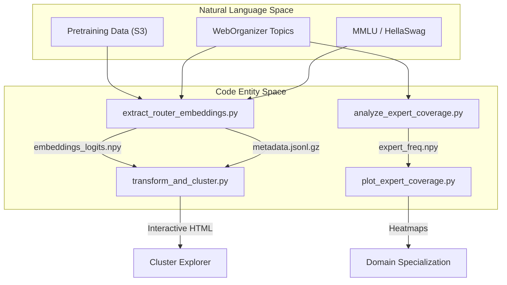
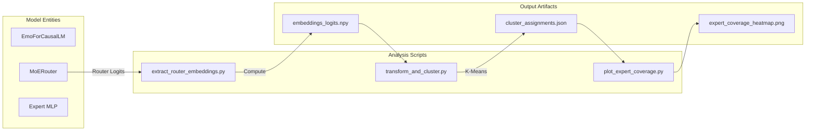

<!-- source: DeepWiki mcp.deepwiki.com · repo allenai/EMO · page 10 Modularity Analysis and Clustering · fetched 2026-10-26 -->

# Modularity Analysis and Clustering

Relevant source files

The following files were used as context for generating this wiki page:

- [README.md](README.md)
- [scripts/RUN_TEMPLATES.md](scripts/RUN_TEMPLATES.md)
- [scripts/selective_hf/hf_finetune_with_selective_easy_ep.sh](scripts/selective_hf/hf_finetune_with_selective_easy_ep.sh)
- [scripts/selective_hf/hf_finetune_with_selective_layerwise.sh](scripts/selective_hf/hf_finetune_with_selective_layerwise.sh)
- [src/scripts/analysis/analyze_expert_coverage.py](src/scripts/analysis/analyze_expert_coverage.py)
- [src/scripts/analysis/analyze_weborganizer.py](src/scripts/analysis/analyze_weborganizer.py)
- [src/scripts/analysis/extract_router_embeddings.py](src/scripts/analysis/extract_router_embeddings.py)
- [src/scripts/analysis/plot_expert_coverage.py](src/scripts/analysis/plot_expert_coverage.py)
- [src/scripts/analysis/transform_and_cluster.py](src/scripts/analysis/transform_and_cluster.py)
- [src/scripts/analysis/utils.py](src/scripts/analysis/utils.py)
- [src/scripts/official/README.md](src/scripts/official/README.md)
- [src/scripts/train/README.md](src/scripts/train/README.md)

The EMO repository provides a comprehensive suite of tools for analyzing the emergence of modularity in Mixture-of-Experts (MoE) models. These tools enable researchers to extract router activations, cluster them to identify specialized expert groups, and visualize how these groups align with semantic domains or task-specific capabilities.

A key finding supported by this pipeline is that EMO expert groups specialize in higher-level topics and capabilities rather than low-level lexical patterns [README.md:22-22]().

## Pipeline Overview

The analysis pipeline typically follows a three-stage process:
1.  **Extraction**: Collecting router logits or probabilities from the model as it processes a diverse corpus (e.g., pretraining data or WebOrganizer topics).
2.  **Clustering**: Transforming these high-dimensional activations into embeddings and grouping them using algorithms like Spherical K-Means.
3.  **Visualization**: Generating interactive HTML reports or heatmaps to interpret the semantic meaning of each cluster.

### System Flow: Activation to Analysis

The following diagram illustrates how raw model outputs are transformed into interpretable modularity metrics.

Sources: [src/scripts/analysis/extract_router_embeddings.py:1-38](), [src/scripts/analysis/transform_and_cluster.py:1-13](), [src/scripts/analysis/analyze_expert_coverage.py:1-27]()

## Core Components

### Router Embedding Extraction
The extraction phase captures how the model's router selects experts for different inputs. The primary tool, `extract_router_embeddings.py`, supports both **document-level** aggregation (averaging activations across a text) and **token-level** storage [src/scripts/analysis/extract_router_embeddings.py:4-8]().

Commonly extracted metrics include:
*   `logits`: Average pre-softmax router logits [src/scripts/analysis/extract_router_embeddings.py:15-15]().
*   `probs`: Per-token softmax probabilities averaged per document [src/scripts/analysis/extract_router_embeddings.py:16-16]().
*   `topk_freq`: Frequency of expert selection within a document [src/scripts/analysis/extract_router_embeddings.py:17-17]().

For details, see [Router Embedding Extraction](#10.1).

### Clustering and Domain Analysis
Once embeddings are extracted, `transform_and_cluster.py` is used to reduce dimensionality (via PCA) and group documents into semantic clusters [src/scripts/analysis/transform_and_cluster.py:131-148](). This reveals whether specific experts are consistently co-activated for specific topics.

For domain-specific analysis, the pipeline integrates with **WebOrganizer** (cc_all_dressed). The `analyze_weborganizer.py` script prepares uniform data mixes across topics, while `analyze_expert_coverage.py` measures how experts cover these domains [src/scripts/analysis/analyze_weborganizer.py:1-21](), [src/scripts/analysis/analyze_expert_coverage.py:1-18]().

For details, see [Clustering, Visualization, and Analysis](#10.2).

### Paper Figures and Result Summarization
The repository includes utilities for reproducing the quantitative results and figures presented in the EMO paper. This includes plotting expert selection entropy, topic-topic similarity matrices, and performance bars across different expert pruning methods [src/scripts/analysis/plot_expert_coverage.py:1-13]().

For details, see [Paper Figures and Result Tables](#10.3).

## Data and Code Relationships

The modularity analysis bridges the gap between raw model weights and high-level behavioral patterns.

Sources: [src/scripts/analysis/extract_router_embeddings.py:85-106](), [src/scripts/analysis/transform_and_cluster.py:35-45](), [src/scripts/analysis/plot_expert_coverage.py:79-101]()

## Child Pages
- [Router Embedding Extraction](#10.1) — Technical details on `extract_router_embeddings.py`, granularity levels, and data streaming from S3.
- [Clustering, Visualization, and Analysis](#10.2) — Deep dive into PCA/K-Means transforms, WebOrganizer domain heatmaps, and interactive visualization tools.
- [Paper Figures and Result Tables](#10.3) — Guide to the plotting scripts used for main result bars and expert selection method comparisons.

---

