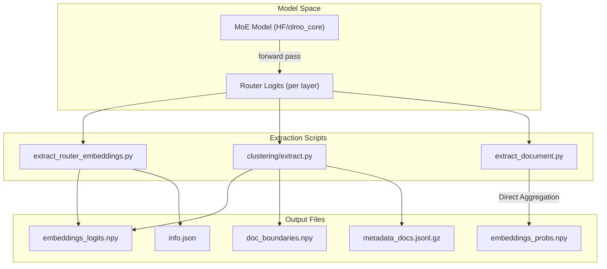
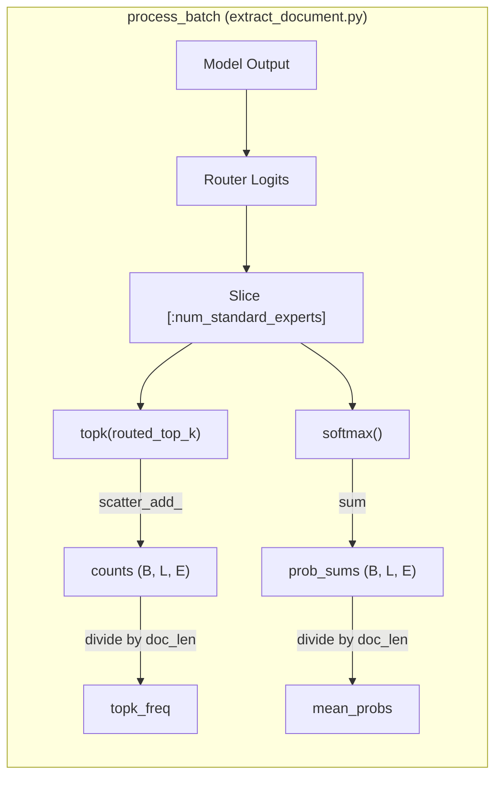

<!-- source: DeepWiki mcp.deepwiki.com · repo allenai/EMO · page 10.1 Router Embedding Extraction · fetched 2026-10-26 -->

# Router Embedding Extraction

Relevant source files

The following files were used as context for generating this wiki page:

- [src/hf_training/analyze_nprune_keep_sets.py](src/hf_training/analyze_nprune_keep_sets.py)
- [src/hf_training/analyze_nprune_keep_sets_0shot.py](src/hf_training/analyze_nprune_keep_sets_0shot.py)
- [src/hf_training/summarize_nprune_keep_sets.py](src/hf_training/summarize_nprune_keep_sets.py)
- [src/scripts/analysis/analyze_expert_coverage.py](src/scripts/analysis/analyze_expert_coverage.py)
- [src/scripts/analysis/analyze_weborganizer.py](src/scripts/analysis/analyze_weborganizer.py)
- [src/scripts/analysis/extract_router_embeddings.py](src/scripts/analysis/extract_router_embeddings.py)
- [src/scripts/analysis/plot_expert_coverage.py](src/scripts/analysis/plot_expert_coverage.py)
- [src/scripts/analysis/transform_and_cluster.py](src/scripts/analysis/transform_and_cluster.py)
- [src/scripts/analysis/utils.py](src/scripts/analysis/utils.py)
- [src/scripts/clustering/cluster.py](src/scripts/clustering/cluster.py)
- [src/scripts/clustering/extract.py](src/scripts/clustering/extract.py)
- [src/scripts/clustering/extract_document.py](src/scripts/clustering/extract_document.py)
- [src/scripts/clustering/plot_doc_expert_coverage.py](src/scripts/clustering/plot_doc_expert_coverage.py)
- [src/scripts/clustering/transform.py](src/scripts/clustering/transform.py)

Router embedding extraction is the process of capturing the internal decision-making state of Mixture-of-Experts (MoE) models. By recording the logits produced by router modules across different data sources (pretraining, MMLU, HellaSwag), researchers can analyze expert specialization, perform document-level clustering, and inform pruning strategies.

## Extraction Pipeline Overview

The extraction infrastructure supports multiple levels of granularity and diverse data sources. It is designed to bridge the gap between raw model activations and structured analysis files used for clustering and visualization.

### System Architecture: Logit Extraction to Analysis

The following diagram illustrates the flow from a trained model to the various output formats used in modularity analysis.

Sources: `src/scripts/analysis/extract_router_embeddings.py:4-38`(), `src/scripts/clustering/extract.py:1-44`(), `src/scripts/clustering/extract_document.py:1-34`()

## Key Extraction Modules

### 1. `extract_router_embeddings.py`
This script focuses on extracting activations from a trained MoE model with two primary granularity levels:
*   **Document Level**: Aggregates per-token activations into a single vector per document. Shape: `(num_docs, num_layers * num_standard_experts)` [src/scripts/analysis/extract_router_embeddings.py:5-6]().
*   **Token Level**: Stores raw activations for every token. Shape: `(num_tokens, num_layers * num_standard_experts)` [src/scripts/analysis/extract_router_embeddings.py:7-8]().

It defines an `EmbeddingType` dataclass to register various compute functions like `compute_logits_embedding`, `compute_probs_embedding`, and `compute_topk_freq_embedding` [src/scripts/analysis/extract_router_embeddings.py:74-132]().

### 2. `src/scripts/clustering/extract.py`
The primary extraction utility for clustering workflows. It is optimized for multi-source extraction, supporting:
*   **Pretraining**: Shuffled sampling from S3-based datasets [src/scripts/clustering/extract.py:9]().
*   **MMLU**: Processes 57 subjects with 5-shot demonstrations [src/scripts/clustering/extract.py:10-14]().
*   **HellaSwag**: Subsampled validation split [src/scripts/clustering/extract.py:15-16]().

The core function `extract_logits` runs a batch through the model and returns a concatenated `float16` array of router logits for all valid (non-padding) tokens [src/scripts/clustering/extract.py:75-122]().

### 3. `extract_document.py`
A standalone pipeline specifically for the WebOrganizer (`cc_all_dressed`) topic mix. Unlike the other scripts, it does not persist per-token data; it performs a single pass and aggregates results into document-level expert vectors (`doc_topk_freq` and `doc_probs`) [src/scripts/clustering/extract_document.py:5-23]().

## Data Formats and Structures

The extraction process generates a standardized set of files in the `--output-dir`.

| File Name | Format | Description |
| :--- | :--- | :--- |
| `embeddings_logits.npy` | `float16` | Raw router logits. Shape: `(T, L * E)` [src/scripts/clustering/extract.py:19](). |
| `doc_boundaries.npy` | `int64` | Cumulative offsets for tokens in `embeddings_logits.npy` to reconstruct documents [src/scripts/clustering/extract.py:21](). |
| `metadata_docs.jsonl.gz`| `jsonl.gz` | Per-document metadata (source, tokens, index) [src/scripts/clustering/extract.py:23](). |
| `info.json` | `json` | Metadata about the extraction (model path, `num_layers`, `num_experts`, `routed_top_k`) [src/scripts/clustering/extract.py:24](). |

### Router Logit Processing Logic
The extraction logic involves slicing the router output to exclude shared experts and handling padding masks.

Sources: `src/scripts/clustering/extract_document.py:128-191`(), `src/scripts/analysis/analyze_expert_coverage.py:123-187`()

## Post-Extraction Derivation

Once raw logits are extracted, `src/scripts/clustering/transform.py` is used to derive secondary representations without re-running model inference.

*   **`probs`**: Applies softmax per layer to the raw logits [src/scripts/clustering/transform.py:61-79]().
*   **`topk_binary`**: Creates a binary mask where 1 indicates an expert was in the top-k selection for that token [src/scripts/clustering/transform.py:82-102]().
*   **`doc_topk_freq`**: Aggregates the `topk_binary` mask across document boundaries to find the frequency of expert usage per document [src/scripts/clustering/transform.py:213-221]().

Sources: `src/scripts/clustering/transform.py:44-221`()

## Calibration-Size Sensitivity Analysis

For expert pruning (EMO), it is critical to know how many calibration examples ($N$) are required to stabilize the "kept-expert set". `src/hf_training/analyze_nprune_keep_sets.py` performs a sweep over $N$ (e.g., 128, 512, 2048, "all") and records the Jaccard overlap of experts selected for pruning compared to a reference set [src/hf_training/analyze_nprune_keep_sets.py:2-16]().

The results are summarized into a `summary.md` table by `src/hf_training/summarize_nprune_keep_sets.py`, which calculates the mean per-layer Jaccard overlap [src/hf_training/summarize_nprune_keep_sets.py:2-9]().

Sources: `src/hf_training/analyze_nprune_keep_sets.py:2-16`(), `src/hf_training/summarize_nprune_keep_sets.py:48-91`()

---

