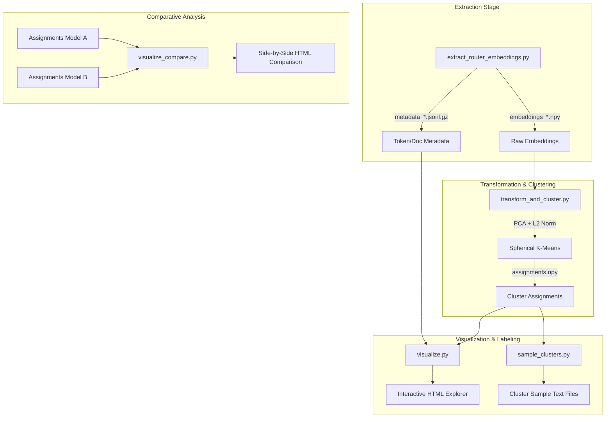
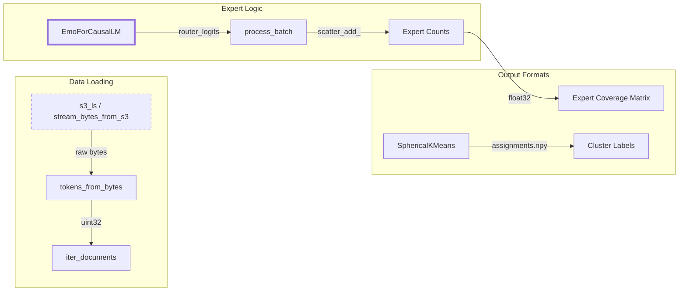

<!-- source: DeepWiki mcp.deepwiki.com · repo allenai/EMO · page 10.2 Clustering, Visualization, and Analysis · fetched 2026-10-26 -->

# Clustering, Visualization, and Analysis

Relevant source files

The following files were used as context for generating this wiki page:

- [CLAUDE.md](CLAUDE.md)
- [scripts/clustering/README.md](scripts/clustering/README.md)
- [scripts/clustering/pretraining/extract.sh](scripts/clustering/pretraining/extract.sh)
- [scripts/clustering/pretraining/generate_mix.sh](scripts/clustering/pretraining/generate_mix.sh)
- [scripts/clustering/run_pretraining_compare.sh](scripts/clustering/run_pretraining_compare.sh)
- [scripts/clustering/run_weborganizer_compare.sh](scripts/clustering/run_weborganizer_compare.sh)
- [scripts/clustering/weborganizer/extract.sh](scripts/clustering/weborganizer/extract.sh)
- [src/olmo_core/train/callbacks/post_train_eval.py](src/olmo_core/train/callbacks/post_train_eval.py)
- [src/scripts/analysis/analyze_expert_coverage.py](src/scripts/analysis/analyze_expert_coverage.py)
- [src/scripts/analysis/analyze_weborganizer.py](src/scripts/analysis/analyze_weborganizer.py)
- [src/scripts/analysis/extract_router_embeddings.py](src/scripts/analysis/extract_router_embeddings.py)
- [src/scripts/analysis/generate_cluster_viz.py](src/scripts/analysis/generate_cluster_viz.py)
- [src/scripts/analysis/generate_token_cluster_viz.py](src/scripts/analysis/generate_token_cluster_viz.py)
- [src/scripts/analysis/plot_expert_coverage.py](src/scripts/analysis/plot_expert_coverage.py)
- [src/scripts/analysis/transform_and_cluster.py](src/scripts/analysis/transform_and_cluster.py)
- [src/scripts/analysis/utils.py](src/scripts/analysis/utils.py)
- [src/scripts/clustering/sample_clusters.py](src/scripts/clustering/sample_clusters.py)
- [src/scripts/clustering/utils.py](src/scripts/clustering/utils.py)
- [src/scripts/clustering/visualize.py](src/scripts/clustering/visualize.py)
- [src/scripts/clustering/visualize_compare.py](src/scripts/clustering/visualize_compare.py)

This page documents the modularity analysis pipeline used to study expert specialization in EMO models. The pipeline spans from raw router activation extraction to unsupervised clustering, interactive visualization, and domain-specific coverage analysis.

## Overview of the Analysis Pipeline

The modularity analysis pipeline is designed to map the "Internal Routing Space" (how the model chooses experts) to the "Semantic/Syntactic Space" (what the content actually is). 

### Data Flow: Activation to Visualization

The following diagram illustrates how token-level activations are transformed into interactive insights.

**Modularity Analysis Data Flow**

**Sources:** [src/scripts/analysis/extract_router_embeddings.py:1-38](), [src/scripts/analysis/transform_and_cluster.py:1-13](), [src/scripts/clustering/visualize.py:1-16]()

---

## 1. Embedding Extraction and Transformation

The analysis begins by running a trained model over a dataset and capturing the router's internal state.

### Router Embedding Extraction
The script `extract_router_embeddings.py` supports two granularities:
*   **Document Level:** Aggregates per-token activations into a single vector per document. Useful for high-level semantic clustering.
*   **Token Level:** Stores raw activations for every token. Essential for studying fine-grained syntactic patterns (e.g., punctuation, code keywords).

**Supported Embedding Types:**
| Type | Granularity | Description |
| :--- | :--- | :--- |
| `logits` | Doc/Token | Average or raw pre-softmax router logits. |
| `probs` | Doc/Token | Softmax probabilities (sums to 1 per layer). |
| `topk_freq` | Doc | Frequency of expert selection within a document. |
| `topk_binary`| Token | Binary mask of which experts were selected for a token. |

**Key Functions:**
*   `compute_logits_embedding`: Averages raw logits across non-padding tokens [src/scripts/analysis/extract_router_embeddings.py:85-106]().
*   `compute_probs_embedding`: Computes per-token softmax then averages [src/scripts/analysis/extract_router_embeddings.py:109-132]().

### Transformation and Clustering
The `transform_and_cluster.py` script processes these raw embeddings to prepare them for K-Means. Because router activations often exist in high-dimensional, non-Euclidean spaces, specific transforms are applied via a `TRANSFORM_REGISTRY`.

**Common Pipeline:** `mean_pca_l2`
1.  **Mean-centering**: Centers the distribution.
2.  **PCA**: Reduces dimensionality to 95% variance (often ~50-200 components) [src/scripts/analysis/transform_and_cluster.py:131-149]().
3.  **L2 Normalization**: Projects vectors onto a hypersphere.

**Clustering Algorithm:**
The pipeline primarily uses **Spherical K-Means** (K-Means on L2-normalized vectors) to group documents or tokens based on their routing patterns rather than their activation magnitude [src/scripts/analysis/transform_and_cluster.py:228-243]().

**Sources:** [src/scripts/analysis/extract_router_embeddings.py:74-132](), [src/scripts/analysis/transform_and_cluster.py:105-171]()

---

## 2. Interactive Visualization and Comparison

To interpret the clusters, the repository provides HTML-based explorers that combine UMAP projections with raw text inspection.

### Cluster Explorer (`visualize.py`)
This tool generates a standalone HTML page with:
*   **UMAP Plot**: A 2D scatter plot of documents/tokens, colored by cluster or source.
*   **Cluster Summary**: Statistics on source distribution (e.g., % code vs % web) and representative samples.
*   **Token Context**: For token-level data, it decodes the surrounding ±N tokens to show the target token in context [src/scripts/clustering/visualize.py:122-144]().

### Comparative Visualization (`visualize_compare.py`)
This script is used to compare how two different models (e.g., EMO vs. Standard MoE) cluster the same set of documents.
*   **Documents Tab**: Shows a document side-by-side where tokens are colored by their cluster assignment in Model A vs. Model B [src/scripts/clustering/visualize_compare.py:178-195]().
*   **Clusters Tab**: Lists clusters from both models to identify which model exhibits higher specialization [src/scripts/clustering/visualize_compare.py:87-100]().

**Sources:** [src/scripts/clustering/visualize.py:89-144](), [src/scripts/clustering/visualize_compare.py:1-20]()

---

## 3. Domain and Expert Coverage Analysis

Beyond unsupervised clustering, the pipeline includes tools for analyzing how experts cover known domains.

### WebOrganizer Analysis
`analyze_weborganizer.py` and `analyze_expert_coverage.py` use the **WebOrganizer** dataset (categorized web crawls) to measure expert specialization.

**Implementation Details:**
*   **Uniform Sampling**: Samples tokens uniformly across topics like `code`, `science`, `news`, and `health` [src/scripts/analysis/analyze_expert_coverage.py:59-116]().
*   **Expert Frequency**: `process_batch` runs documents through the model and counts how many tokens in a specific topic selected each expert [src/scripts/analysis/analyze_expert_coverage.py:122-187]().
*   **Coverage Heatmaps**: The output is typically visualized as a heatmap showing which experts are "owned" by specific topics.

### Implementation Mapping: Code to Logic
The following diagram maps the high-level analysis concepts to the specific code entities responsible for them.

**Modularity Analysis System Mapping**

**Sources:** [src/scripts/analysis/utils.py:34-108](), [src/scripts/analysis/analyze_expert_coverage.py:163-187](), [src/scripts/analysis/transform_and_cluster.py:228-243]()

---

## 4. Summary of Analysis Utilities

| Script | Purpose |
| :--- | :--- |
| `sample_clusters.py` | Generates `.txt` files with sampled contexts and "enriched" tokens (tokens that appear more frequently in a cluster than in the background) to aid manual labeling [src/scripts/clustering/sample_clusters.py:1-13](). |
| `analyze_weborganizer.py` | Specifically handles the cc_all_dressed / WebOrganizer topic hierarchy for domain-aware analysis. |
| `plot_expert_coverage.py` | Generates the heatmap figures used in research papers to show expert specialization across domains. |
| `utils.py` | Contains shared logic for S3 range-GETs and parsing raw token binaries [src/scripts/analysis/utils.py:1-29](). |

**Sources:** [src/scripts/clustering/sample_clusters.py:138-169](), [src/scripts/analysis/utils.py:22-28]()

---

