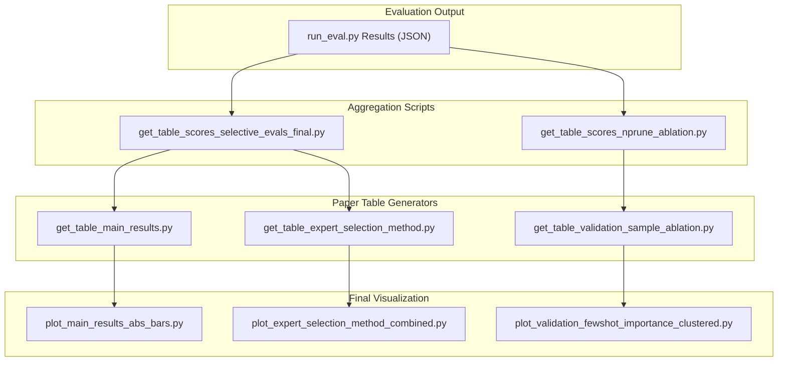
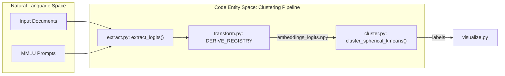

<!-- source: DeepWiki mcp.deepwiki.com · repo allenai/EMO · page 10.3 Paper Figures and Result Tables · fetched 2026-10-26 -->

# Paper Figures and Result Tables

Relevant source files

The following files were used as context for generating this wiki page:

- [scripts/convert_olmo_to_hf.sh](scripts/convert_olmo_to_hf.sh)
- [scripts/other_figures/crop_html_to_pdf.py](scripts/other_figures/crop_html_to_pdf.py)
- [scripts/other_figures/figure_token_cluster_comparison.py](scripts/other_figures/figure_token_cluster_comparison.py)
- [scripts/other_figures/plot_doc_probs_similarity_compare.py](scripts/other_figures/plot_doc_probs_similarity_compare.py)
- [scripts/other_figures/plot_modmoe_global_vs_local_lb.py](scripts/other_figures/plot_modmoe_global_vs_local_lb.py)
- [scripts/other_figures/plot_modmoe_vs_stdmoe_doc_clusters.py](scripts/other_figures/plot_modmoe_vs_stdmoe_doc_clusters.py)
- [scripts/other_figures/plot_moe_hyperparameter_ablations.py](scripts/other_figures/plot_moe_hyperparameter_ablations.py)
- [scripts/other_figures/plot_prenorm_noqknorm_ablations.py](scripts/other_figures/plot_prenorm_noqknorm_ablations.py)
- [scripts/other_figures/plot_twolevel_hyperparameter_ablations.py](scripts/other_figures/plot_twolevel_hyperparameter_ablations.py)
- [scripts/plotting/get_table_scores_nselective_ablation.py](scripts/plotting/get_table_scores_nselective_ablation.py)
- [scripts/plotting/get_table_scores_selective_evals_final.py](scripts/plotting/get_table_scores_selective_evals_final.py)
- [scripts/plotting/paper_figure_codes/plot_expert_selection_method_combined.py](scripts/plotting/paper_figure_codes/plot_expert_selection_method_combined.py)
- [scripts/plotting/paper_figure_codes/plot_general_tasks_orig.py](scripts/plotting/paper_figure_codes/plot_general_tasks_orig.py)
- [scripts/plotting/paper_figure_codes/plot_main_results_abs_bars.py](scripts/plotting/paper_figure_codes/plot_main_results_abs_bars.py)
- [scripts/plotting/paper_figure_codes/plot_mmlu_other_abs_bars.py](scripts/plotting/paper_figure_codes/plot_mmlu_other_abs_bars.py)
- [scripts/plotting/paper_figure_codes/plot_validation_fewshot_importance_clustered.py](scripts/plotting/paper_figure_codes/plot_validation_fewshot_importance_clustered.py)
- [scripts/plotting/paper_table_numbers/get_table_expert_selection_method.py](scripts/plotting/paper_table_numbers/get_table_expert_selection_method.py)
- [scripts/plotting/paper_table_numbers/get_table_general_tasks_orig.py](scripts/plotting/paper_table_numbers/get_table_general_tasks_orig.py)
- [scripts/plotting/paper_table_numbers/get_table_main_results.py](scripts/plotting/paper_table_numbers/get_table_main_results.py)
- [scripts/plotting/paper_table_numbers/get_table_modmoe_anneal_vs_modmoe.py](scripts/plotting/paper_table_numbers/get_table_modmoe_anneal_vs_modmoe.py)
- [scripts/plotting/paper_table_numbers/get_table_validation_sample_ablation.py](scripts/plotting/paper_table_numbers/get_table_validation_sample_ablation.py)
- [src/hf_training/analyze_nprune_keep_sets.py](src/hf_training/analyze_nprune_keep_sets.py)
- [src/hf_training/analyze_nprune_keep_sets_0shot.py](src/hf_training/analyze_nprune_keep_sets_0shot.py)
- [src/hf_training/summarize_nprune_keep_sets.py](src/hf_training/summarize_nprune_keep_sets.py)
- [src/scripts/clustering/cluster.py](src/scripts/clustering/cluster.py)
- [src/scripts/clustering/extract.py](src/scripts/clustering/extract.py)
- [src/scripts/clustering/transform.py](src/scripts/clustering/transform.py)

This page documents the utilities and scripts used to reproduce the figures and tables presented in the EMO paper. These tools bridge the gap between raw evaluation metrics (stored in JSON/CSV formats) and the final visualizations, including main result bar charts, expert selection method comparisons, and modularity analysis plots.

## Overview of Plotting Infrastructure

The plotting infrastructure is divided into two main directories:
1.  `scripts/plotting/`: Contains logic for aggregating raw evaluation scores into intermediate tables and generating primary paper figures (e.g., bar charts, few-shot importance).
2.  `scripts/other_figures/`: Contains specialized analysis scripts for document clustering, hyperparameter ablations (Batch-LB variants), and architectural comparisons (e.g., Norm variants).

### Data Flow for Figure Generation

The typical data flow involves three stages:
1.  **Summarization**: Raw JSON results from `run_eval.py` are aggregated into CSVs using scripts like `get_table_scores_selective_evals_final.py`.
2.  **Table Formatting**: These CSVs are transformed into final paper-ready CSVs or LaTeX tables (e.g., `get_table_main_results.py`).
3.  **Visualization**: The final CSVs are consumed by plotting scripts (e.g., `plot_main_results_abs_bars.py`) to generate PDFs.

**Sources:** [scripts/plotting/paper_table_numbers/get_table_main_results.py:1-36](), [scripts/plotting/paper_table_numbers/get_table_expert_selection_method.py:1-27](), [scripts/plotting/paper_table_numbers/get_table_validation_sample_ablation.py:1-22]()

---

## Main Results and Expert Selection

### Main Results Table
The script `get_table_main_results.py` generates the primary comparison table between Dense, Regular MoE, and EMO (FlexMoE) across 130B and 1T scales [scripts/plotting/paper_table_numbers/get_table_main_results.py:1-19](). It includes a "Win-rate" calculation, which counts how many MMLU/MMLU-Pro sub-tasks EMO wins against all relevant baselines at a matching expert count [scripts/plotting/paper_table_numbers/get_table_main_results.py:20-36]().

### Expert Selection Methods
The paper compares three methods for selecting experts during pruning: **Random**, **Router** (activations), and **Easy-EP**.
*   **Data Collection**: `get_table_expert_selection_method.py` reads metrics for both fine-tuned and pre-finetune (ckpt0) models [scripts/plotting/paper_table_numbers/get_table_expert_selection_method.py:2-13]().
*   **Visualization**: `plot_expert_selection_method_combined.py` generates a 1x3 grid (MMLU, MMLU Pro, GSM8K) showing performance curves for each method [scripts/plotting/paper_figure_codes/plot_expert_selection_method_combined.py:2-11](). It uses a consistent color palette (Green for Reg. MoE, Magenta/Pink for EMO) [scripts/plotting/paper_figure_codes/plot_expert_selection_method_combined.py:34-37]().

**Sources:** [scripts/plotting/paper_table_numbers/get_table_main_results.py:40-106](), [scripts/plotting/paper_figure_codes/plot_expert_selection_method_combined.py:40-44]()

---

## Pruning Sensitivity Analysis

The repository includes tools to analyze how the choice of calibration data affects pruning performance.

### Calibration Sample Ablation
The script `analyze_nprune_keep_sets.py` sweeps over calibration sizes ($N$) and records the set of experts kept at each layer [src/hf_training/analyze_nprune_keep_sets.py:1-6](). 
*   **Nested Subsampling**: To ensure consistency, it uses a fixed seed (`torch.manual_seed(0)`) to generate subsets of validation prompts [src/hf_training/analyze_nprune_keep_sets.py:8-12]().
*   **Zero-Shot Variant**: `analyze_nprune_keep_sets_0shot.py` replicates this sweep but forces `num_shots=0` for the calibration prompts to test sensitivity to few-shot demonstrations [src/hf_training/analyze_nprune_keep_sets_0shot.py:1-9]().

### Visualizing Few-Shot Importance
`plot_validation_fewshot_importance_clustered.py` visualizes these ablations as a clustered scatter plot [scripts/plotting/paper_figure_codes/plot_validation_fewshot_importance_clustered.py:2-11](). It maps:
*   **X-axis**: Binned by `keep_k` experts [scripts/plotting/paper_figure_codes/plot_validation_fewshot_importance_clustered.py:47]().
*   **Color**: Few-shot configuration (e.g., 0-shot vs few-shot selection) [scripts/plotting/paper_figure_codes/plot_validation_fewshot_importance_clustered.py:53-57]().
*   **Marker Shape**: Number of calibration samples ($N$) [scripts/plotting/paper_figure_codes/plot_validation_fewshot_importance_clustered.py:61-67]().

**Sources:** [src/hf_training/analyze_nprune_keep_sets.py:28-33](), [scripts/plotting/paper_table_numbers/get_table_validation_sample_ablation.py:53-58](), [scripts/plotting/paper_figure_codes/plot_validation_fewshot_importance_clustered.py:76-78]()

---

## Modularity and Clustering Analysis

These scripts support the modularity analysis by visualizing how experts specialize in different domains or document clusters.

### Document Cluster Comparisons
`plot_modmoe_vs_stdmoe_doc_clusters.py` generates plots comparing document-level clustering in EMO versus standard MoE models. It relies on embeddings derived via `transform.py` [src/scripts/clustering/transform.py:1-11]().

### Implementation of Clustering Utilities
The `src/scripts/clustering/` module provides the backend for these figures:
*   **`extract.py`**: Extracts raw router logits from models across different sources (pretraining, MMLU, HellaSwag) [src/scripts/clustering/extract.py:1-24]().
*   **`transform.py`**: Derives token-level or document-level representations (e.g., `probs`, `topk_binary`, `doc_probs`) [src/scripts/clustering/transform.py:44-138]().
*   **`cluster.py`**: Implements clustering algorithms like **Spherical K-Means** (which normalizes centroids at each iteration) to handle the high-dimensional router embedding space [src/scripts/clustering/cluster.py:132-164]().

**Sources:** [src/scripts/clustering/extract.py:76-89](), [src/scripts/clustering/transform.py:61-82](), [src/scripts/clustering/cluster.py:105-113]()

---

## Miscellaneous Analysis Figures

Specialized scripts in `scripts/other_figures/` document specific ablations mentioned in the paper:
*   **Batch-LB Ablations**: `plot_modmoe_global_vs_local_lb.py` compares global versus local load balancing [scripts/other_figures/plot_modmoe_global_vs_local_lb.py]().
*   **Normalization Ablations**: `plot_prenorm_noqknorm_ablations.py` compares different Transformer normalization strategies (e.g., QK-Norm) [scripts/other_figures/plot_prenorm_noqknorm_ablations.py]().
*   **Hyperparameter Sweeps**: `plot_twolevel_hyperparameter_ablations.py` visualizes the impact of two-level routing parameters [scripts/other_figures/plot_twolevel_hyperparameter_ablations.py]().

**Sources:** [scripts/other_figures/figure_token_cluster_comparison.py](), [scripts/other_figures/plot_moe_hyperparameter_ablations.py]()

---

