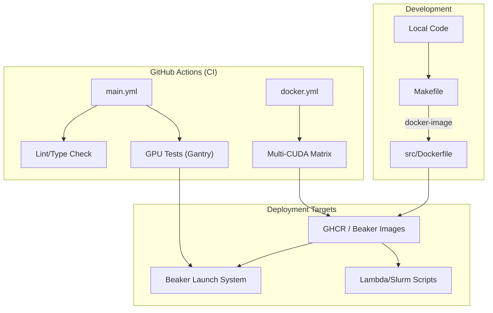
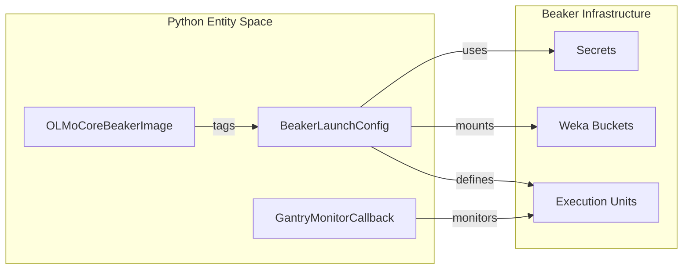

<!-- source: DeepWiki mcp.deepwiki.com · repo allenai/EMO · page 11 Infrastructure, CI/CD, and Deployment · fetched 2026-10-26 -->

# Infrastructure, CI/CD, and Deployment

Relevant source files

The following files were used as context for generating this wiki page:

- [.github/RELEASE_PROCESS.md](.github/RELEASE_PROCESS.md)
- [.github/workflows/docker.yml](.github/workflows/docker.yml)
- [.github/workflows/main.yml](.github/workflows/main.yml)
- [.github/workflows/pr_checks.yml](.github/workflows/pr_checks.yml)
- [Makefile](Makefile)
- [pyproject.toml](pyproject.toml)
- [src/Dockerfile](src/Dockerfile)
- [src/olmo_core/launch/beaker.py](src/olmo_core/launch/beaker.py)
- [src/scripts/release/add_pr_comments_on_release.sh](src/scripts/release/add_pr_comments_on_release.sh)
- [src/scripts/release/prepare_changelog.py](src/scripts/release/prepare_changelog.py)
- [src/scripts/release/release.sh](src/scripts/release/release.sh)
- [src/scripts/release/release_notes.py](src/scripts/release/release_notes.py)

This page provides a high-level overview of the infrastructure powering the EMO and OLMo-Core projects. It covers the containerization strategy, automated testing pipelines, and the systems used to launch large-scale experiments on Beaker and Lambda Labs clusters.

## Infrastructure Overview

The project relies on a multi-stage Docker environment to provide consistent builds across different hardware targets (H100, A100). Orchestration is handled via GitHub Actions for CI, while execution is distributed across Beaker (for research experiments and GPU testing) and Lambda/Slurm clusters (for large-scale pretraining).

### System Relationship Diagram

The following diagram illustrates how code changes flow through the CI/CD pipeline into deployment on various compute targets.

**CI/CD and Deployment Flow**

**Sources:** [.github/workflows/main.yml:1-103](), [Makefile:76-94](), [src/Dockerfile:1-112]()

---

## Docker and Build System

The project uses a sophisticated multi-stage `src/Dockerfile` designed to support high-performance ML kernels.

*   **Build Stage:** Compiles heavy dependencies including `flash-attn` (v2 and v3), `transformer-engine`, `grouped_gemm`, and optionally `quack-kernels` [src/Dockerfile:13-101]().
*   **Release Stage:** A leaner image based on Ubuntu 22.04 that includes production utilities like `aws-cli`, `google-cloud-sdk`, and `MLNX OFED` drivers for InfiniBand support [src/Dockerfile:114-159]().
*   **Automation:** The `Makefile` provides targets for building (`docker-image`), pushing to GitHub Container Registry (`ghcr-image`), and creating Beaker-ready images (`beaker-image`) [Makefile:76-118]().

For details on build arguments and kernel versions, see [Docker, CI/CD, and Build System](#11.1).

**Sources:** [src/Dockerfile:1-171](), [Makefile:38-126]()

---

## CI/CD Workflows

Continuous Integration is managed through GitHub Actions to ensure code quality and functional correctness on both CPU and GPU environments.

*   **Static Analysis:** `main.yml` runs `lint-check`, `type-check` (via `mypy`), and style checks on every PR [ .github/workflows/main.yml:27-55]().
*   **GPU Integration:** The `gpu_checks` job uses `beaker-gantry` to spin up remote GPU nodes (H100/A100) to run specialized test suites for `attention`, `moe`, and `distributed` checkpointing [ .github/workflows/main.yml:103-165]().
*   **Release Automation:** The `release.sh` script automates version bumping in `src/olmo_core/version.py`, updates the `CHANGELOG.md`, and tags the repository to trigger deployment workflows [src/scripts/release/release.sh:1-34]().

For details on workflow triggers and environment variables, see [Docker, CI/CD, and Build System](#11.1).

**Sources:** [.github/workflows/main.yml:1-219](), [src/scripts/release/release.sh:1-34](), [pyproject.toml:35-85]()

---

## Beaker Launch System

Beaker is the primary platform for AI2 research experiments. The `olmo_core.launch.beaker` module provides a programmatic interface to define and submit jobs.

**Code Entity to Infrastructure Mapping**

**Sources:** [src/olmo_core/launch/beaker.py:211-230](), [src/olmo_core/launch/beaker.py:130-151]()

*   **Configuration:** `BeakerLaunchConfig` handles hardware requirements (GPUs, priority), environment secrets, and Weka bucket mounts [src/olmo_core/launch/beaker.py:211-280]().
*   **Image Management:** The `OLMoCoreBeakerImage` enum maintains stable pointers to validated images with specific PyTorch/CUDA combinations [src/olmo_core/launch/beaker.py:130-189]().
*   **Monitoring:** Integration with `Gantry` allows for Slack notifications and automatic cleanup of stalled jobs.

For details on launching experiments, see [Beaker Launch System](#11.2).

**Sources:** [src/olmo_core/launch/beaker.py:1-280]()

---

## Lambda Cluster and Slurm Support

For non-Beaker environments, specifically Lambda Labs GPU clusters, the repository provides a suite of shell scripts to manage distributed training.

*   **Orchestration:** `launch.sh` and `launch_with_retries.sh` manage the lifecycle of multi-node jobs [11.3]().
*   **Health Checks:** `healthchecks.sh` and `distributed_test.py` verify interconnectivity and GPU health before starting heavy training runs [11.3]().
*   **Slurm:** Sample `.sbatch` files are provided for running 1B+ parameter model tests on standard Slurm-managed clusters [11.3]().

For details on cluster-specific setup, see [Lambda Cluster and Slurm Support](#11.3).

**Sources:** [pyproject.toml:15-28](), [Makefile:1-36]()

---

## Child Pages
- [Docker, CI/CD, and Build System](#11.1)
- [Beaker Launch System](#11.2)
- [Lambda Cluster and Slurm Support](#11.3)

---

