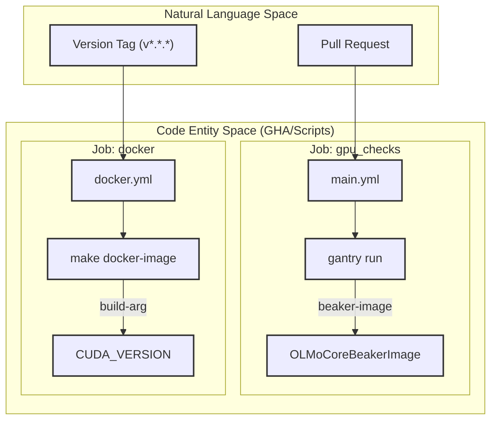
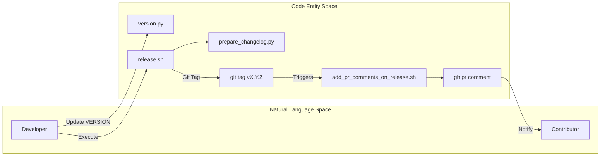

<!-- source: DeepWiki mcp.deepwiki.com · repo allenai/EMO · page 11.1 Docker, CI/CD, and Build System · fetched 2026-10-26 -->

# Docker, CI/CD, and Build System

Relevant source files

The following files were used as context for generating this wiki page:

- [.github/RELEASE_PROCESS.md](.github/RELEASE_PROCESS.md)
- [.github/workflows/docker.yml](.github/workflows/docker.yml)
- [.github/workflows/main.yml](.github/workflows/main.yml)
- [.github/workflows/pr_checks.yml](.github/workflows/pr_checks.yml)
- [Makefile](Makefile)
- [pyproject.toml](pyproject.toml)
- [src/Dockerfile](src/Dockerfile)
- [src/olmo_core/launch/beaker.py](src/olmo_core/launch/beaker.py)
- [src/scripts/release/add_pr_comments_on_release.sh](src/scripts/release/add_pr_comments_on_release.sh)
- [src/scripts/release/prepare_changelog.py](src/scripts/release/prepare_changelog.py)
- [src/scripts/release/release.sh](src/scripts/release/release.sh)
- [src/scripts/release/release_notes.py](src/scripts/release/release_notes.py)

This section documents the infrastructure supporting the EMO and OLMo-Core projects, including the multi-stage Docker build process, the GitHub Actions automation for quality assurance and image distribution, and the standardized release workflow.

## Build System Overview

The project uses a standard Python `setuptools` build backend defined in `pyproject.toml` [pyproject.toml:1-3](). Dependencies are managed through optional extras, allowing for modular installations of developer tools, Beaker integration, evaluation suites, and hardware-specific kernels like `flash-attn` [pyproject.toml:35-85]().

The `Makefile` serves as the primary entry point for local development tasks and CI automation, providing targets for style checking, linting, type checking, and image generation [Makefile:1-37]().

### Build Tools and Logic
- **Linting/Formatting**: Uses `ruff`, `black`, and `isort` [Makefile:4-15]().
- **Type Checking**: Uses `mypy` on the `src/` directory [Makefile:16-20]().
- **Packaging**: Uses the `build` module to generate distribution files [Makefile:33-37]().

Sources: [pyproject.toml:1-85](), [Makefile:1-37]()

---

## Multi-Stage Docker Architecture

The Dockerfile is designed as a multi-stage build to produce a lean "release" image while handling complex CUDA-accelerated dependency compilation in a "build" stage [src/Dockerfile:13-114]().

### 1. Build Stage
The build stage [src/Dockerfile:13-109]() utilizes the `nvidia/cuda:devel` image to compile several high-performance kernels:
- **PyTorch Core**: Installed via the official wheel index for specific CUDA versions [src/Dockerfile:45-49]().
- **Flash Attention**: Installs both `flash-attn` (v2) [src/Dockerfile:58-59]() and `flash-attn-3` (Hopper-optimized) [src/Dockerfile:61-72]().
- **Transformer Engine**: Installed to support FP8 and optimized Transformer primitives [src/Dockerfile:86-87]().
- **Specialized Kernels**: Includes `grouped_gemm` (built with CUTLASS for MoE) [src/Dockerfile:51-55](), `ring-flash-attn` [src/Dockerfile:89-91](), `liger-kernel` [src/Dockerfile:93-95](), and optionally `quack-kernels` [src/Dockerfile:97-100]().

### 2. Release Stage
The release stage [src/Dockerfile:114-171]() starts from a clean Ubuntu base and copies the prepared Conda environment from the build stage [src/Dockerfile:162](). It adds essential cloud and networking tools:
- **Cloud SDKs**: `aws-cli` and `google-cloud-sdk` [src/Dockerfile:132-144]().
- **Networking**: MLNX OFED user-space drivers for RDMA/Infiniband support [src/Dockerfile:150-159]().
- **Package Managers**: `uv` and `gh` (GitHub CLI) [src/Dockerfile:145-148]().

### Docker Build Flow

| Step | Code Entity | Description |
| :--- | :--- | :--- |
| Define Args | `ARG CUDA_VERSION` | Sets the base CUDA toolkit version (e.g., 12.8.1) [src/Dockerfile:3](). |
| Compile | `build` stage | Compiles C++/CUDA extensions into the Conda environment [src/Dockerfile:13](). |
| Structure | `flash_attn_3` fix | Moves FA3 interface to match TransformerEngine expectations [src/Dockerfile:78-83](). |
| Finalize | `release` stage | Strips build-time dependencies, adds cloud CLI tools [src/Dockerfile:114](). |

Sources: [src/Dockerfile:1-171](), [Makefile:38-102]()

---

## CI/CD Workflows

The repository uses GitHub Actions for continuous integration, split into quality checks and automated image building.

### Main Workflow (`main.yml`)
Triggered on every PR and push to `main` [main.yml:7-15](). It consists of two primary job types:
1.  **Standard Checks**: Runs `lint-check`, `type-check`, and `style-check` on standard Ubuntu runners [main.yml:27-55]().
2.  **GPU Tests**: Uses `beaker-gantry` to launch tests on Beaker H100/A100 nodes [main.yml:103-219](). These tests cover:
    - Distributed checkpointing [main.yml:125-130]().
    - Transformer and MoE layer logic [main.yml:132-152]().
    - Integration tests [main.yml:160-165]().

### Docker Workflow (`docker.yml`)
This workflow builds a matrix of images for different CUDA (12.8.1, 12.9.1) and PyTorch (2.7.1, 2.9.0) versions [docker.yml:37-50]().
- **Beaker Push**: If a version tag is pushed, images are automatically uploaded to the Beaker image registry [docker.yml:94-101]().
- **GHCR Push**: Images are also mirrored to GitHub Container Registry [docker.yml:84-92]().

### CI System Logic and Entity Mapping

Title: CI/CD Execution and Environment Mapping

Sources: [.github/workflows/main.yml:1-219](), [.github/workflows/docker.yml:1-102](), [src/olmo_core/launch/beaker.py:130-188]()

---

## Release Process

The project follows a structured release cycle involving version bumping, changelog preparation, and automated PR commenting.

### Release Script (`release.sh`)
The `src/scripts/release/release.sh` script automates the release steps:
1.  Pulls the latest code and tags [release.sh:5-8]().
2.  Invokes `prepare_changelog.py` to move "Unreleased" changes into a new versioned section [release.sh:19](), [prepare_changelog.py:7-35]().
3.  Commits changes and creates a git tag [release.sh:24-28]().
4.  Pushing the tag triggers the `docker.yml` workflow and the PyPI publishing process.

### Post-Release Automation
After a release, `add_pr_comments_on_release.sh` identifies all PRs merged since the last tag [add_pr_comments_on_release.sh:19-22](). It uses the GitHub CLI (`gh`) to comment on each PR, notifying contributors that their changes are now available in the specific release [add_pr_comments_on_release.sh:23-30]().

Title: Release Pipeline and Code Interaction

Sources: [src/scripts/release/release.sh:1-34](), [src/scripts/release/prepare_changelog.py:1-40](), [src/scripts/release/add_pr_comments_on_release.sh:1-31](), [.github/RELEASE_PROCESS.md:1-18]()

---

## Beaker Image Management

The `olmo_core.launch.beaker` module defines a set of stable and versioned images used for large-scale training.

### `OLMoCoreBeakerImage` Enum
This enum maintains pointers to "battle-tested" images [olmo_core/launch/beaker.py:130-137]():
- **`stable`**: The current recommended image for general use [olmo_core/launch/beaker.py:140-143]().
- **`tch270_cu128`**: A version specifically noted as "battle tested" for Olmo3 7B and 32B training [olmo_core/launch/beaker.py:180-184]().
- **`tch291_cu129`**: A newer image containing Flash Attention 4 and Quack kernels [olmo_core/launch/beaker.py:156-161]().

### Image Creation
Images are created and registered in Beaker using `make beaker-image`, which calls the `create_beaker_image.sh` script [Makefile:114-118](). The image name is derived from the Torch version, CUDA version, and a date-based suffix [Makefile:71-74]().

Sources: [src/olmo_core/launch/beaker.py:130-188](), [Makefile:71-126]()

---

