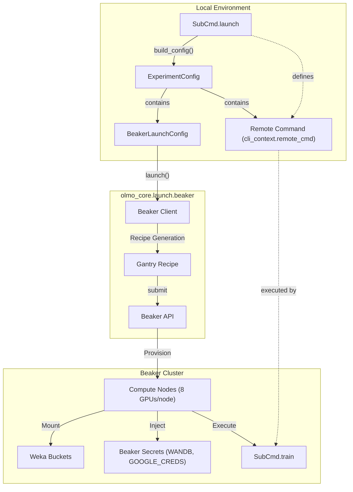
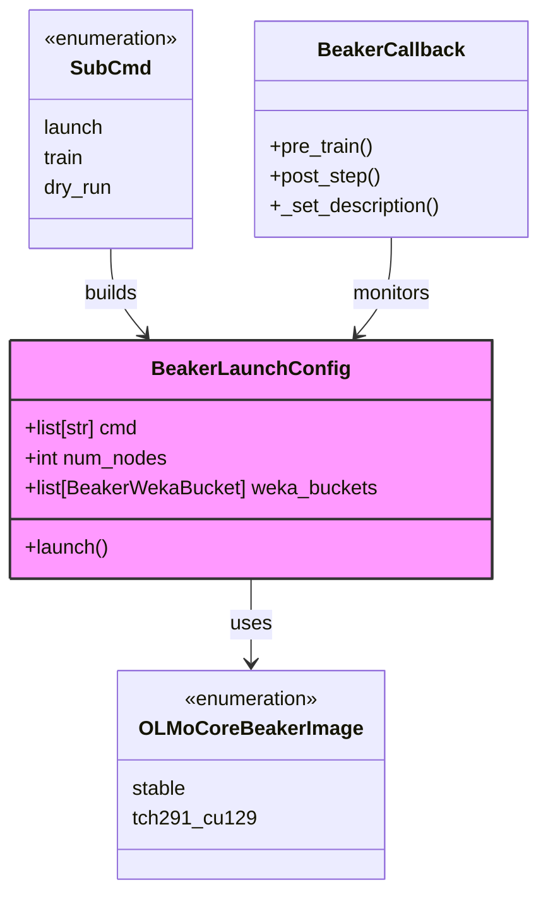

<!-- source: DeepWiki mcp.deepwiki.com · repo allenai/EMO · page 11.2 Beaker Launch System · fetched 2026-10-26 -->

# Beaker Launch System

Relevant source files

The following files were used as context for generating this wiki page:

- [.github/workflows/docker.yml](.github/workflows/docker.yml)
- [.github/workflows/main.yml](.github/workflows/main.yml)
- [.github/workflows/pr_checks.yml](.github/workflows/pr_checks.yml)
- [Makefile](Makefile)
- [pyproject.toml](pyproject.toml)
- [src/Dockerfile](src/Dockerfile)
- [src/olmo_core/exceptions.py](src/olmo_core/exceptions.py)
- [src/olmo_core/internal/common.py](src/olmo_core/internal/common.py)
- [src/olmo_core/internal/experiment.py](src/olmo_core/internal/experiment.py)
- [src/olmo_core/launch/beaker.py](src/olmo_core/launch/beaker.py)
- [src/olmo_core/launch/select_beaker_hosts.py](src/olmo_core/launch/select_beaker_hosts.py)
- [src/olmo_core/launch/utils.py](src/olmo_core/launch/utils.py)
- [src/olmo_core/train/callbacks/__init__.py](src/olmo_core/train/callbacks/__init__.py)
- [src/olmo_core/train/callbacks/beaker.py](src/olmo_core/train/callbacks/beaker.py)
- [src/olmo_core/train/callbacks/callback.py](src/olmo_core/train/callbacks/callback.py)
- [src/olmo_core/train/callbacks/comet.py](src/olmo_core/train/callbacks/comet.py)
- [src/olmo_core/train/callbacks/metric_saver.py](src/olmo_core/train/callbacks/metric_saver.py)
- [src/olmo_core/train/callbacks/wandb.py](src/olmo_core/train/callbacks/wandb.py)
- [src/test/launch/beaker_test.py](src/test/launch/beaker_test.py)
- [src/test/launch/utils_test.py](src/test/launch/utils_test.py)

The Beaker Launch System provides the infrastructure to transition from local experiment configuration to large-scale distributed training on AI2's Beaker platform. It handles hardware provisioning, environment synchronization (secrets, variables), Weka storage orchestration, and real-time job monitoring.

## System Architecture

The launch system bridges the gap between the `ExperimentConfig` (defined in Python) and the Beaker API. It uses `gantry` as the underlying engine to manage job lifecycles and container orchestration.

### Launch Workflow
The following diagram illustrates the data flow from a CLI command to a running Beaker experiment.

**Beaker Launch Data Flow**

Sources: [src/olmo_core/internal/experiment.py:108-142](), [src/olmo_core/launch/beaker.py:211-230](), [src/olmo_core/internal/common.py:56-72]()

## Core Components

### BeakerLaunchConfig
The `BeakerLaunchConfig` class is the primary configuration object for defining job requirements. It includes fields for hardware (GPUs, nodes), timeouts, and environment setup.

| Feature | Field | Description |
| :--- | :--- | :--- |
| **Hardware** | `num_nodes`, `num_gpus` | Defines the scale of the job. Usually 8 GPUs per node [src/olmo_core/internal/common.py:150](). |
| **Image** | `beaker_image` | The tag from `OLMoCoreBeakerImage` to use [src/olmo_core/launch/beaker.py:130-152](). |
| **Storage** | `weka_buckets` | List of `BeakerWekaBucket` objects for high-performance data access [src/olmo_core/launch/beaker.py:205-208](). |
| **Timeouts** | `step_timeout` | Maximum time allowed for a single training step before the job is considered hung [src/olmo_core/launch/beaker.py:313-316](). |
| **Secrets** | `env_secrets` | List of `BeakerEnvSecret` for credentials like `WANDB_API_KEY` [src/olmo_core/launch/beaker.py:198-202](). |

Sources: [src/olmo_core/launch/beaker.py:211-318](), [src/olmo_core/internal/common.py:140-161]()

### OLMoCoreBeakerImage
The `OLMoCoreBeakerImage` enum maintains a list of stable, pre-built Docker images optimized for EMO. These images include complex dependencies like `flash-attn`, `transformer-engine`, and `Quack` kernels.

*   `stable`: The current recommended image with latest stable PyTorch/CUDA [src/olmo_core/launch/beaker.py:140-143]().
*   `tch291_cu129`: Advanced image including `flash-attn 4` and `Quack` kernels [src/olmo_core/launch/beaker.py:156-161]().
*   `tch270_cu128`: Battle-tested image used for OLMo3 7B/32B training [src/olmo_core/launch/beaker.py:180-184]().

Sources: [src/olmo_core/launch/beaker.py:130-189]()

## Execution Logic

### launch() and dry_run()
The `launch()` method converts the `BeakerLaunchConfig` into a Gantry experiment.
1.  **Validation**: Checks if the workspace and clusters exist [src/olmo_core/launch/beaker.py:382-395]().
2.  **Secret Injection**: Automatically pulls user-specific secrets (e.g., `USER_WANDB_API_KEY`) based on the current Beaker username [src/olmo_core/internal/common.py:93-124]().
3.  **Submission**: Uses `gantry.api.create_experiment` to submit the job [src/olmo_core/launch/beaker.py:488-510]().

The `dry_run()` method simulates this process without submitting to Beaker, allowing users to inspect the generated command and environment variables [src/olmo_core/internal/experiment.py:143-144]().

### Weka Bucket Mounts
High-performance training requires Weka. The system automatically detects if a cluster supports Weka (via the `storage:weka` tag) and mounts the default training bucket `/weka/oe-training-default` if the `root_dir` points to a Weka path [src/olmo_core/internal/common.py:34-42](), [src/olmo_core/internal/common.py:83-84]().

## Monitoring and Callbacks

### GantryMonitorCallback
When launching, `gantry` attaches monitors to the job to handle failures and notifications.
*   **Stepping Detection**: Uses `step_timeout` and `step_soft_timeout` to detect if training has stalled [src/olmo_core/internal/common.py:70-72]().
*   **Slack Notifications**: If `SLACK_WEBHOOK_URL` is provided, Gantry sends updates on job start, success, or failure [src/olmo_core/internal/common.py:120-123]().

### BeakerCallback
The `BeakerCallback` runs *inside* the training process (rank 0) to update the Beaker UI with live training progress.
*   **Description Updates**: Periodically updates the Beaker experiment description with the current step, loss, and W&B/Comet URL [src/olmo_core/train/callbacks/beaker.py:152-164]().
*   **Metadata Storage**: Saves `config.json` and `requirements.txt` (via `pip freeze`) into the Beaker results dataset at `/results/olmo-core/` [src/olmo_core/train/callbacks/beaker.py:88-109]().

Sources: [src/olmo_core/train/callbacks/beaker.py:25-165]()

## Utility: select_beaker_hosts
The `select_beaker_hosts` utility (found in `src/olmo_core/launch/select_beaker_hosts.py`) is used to filter and select specific compute nodes within a cluster based on health or availability. It is often used to avoid "bad" nodes that have historically caused NCCL timeouts or hardware failures.

## Implementation Detail: Entity Mapping

The following diagram maps high-level launch concepts to their specific class implementations and file locations.

**Entity Mapping: Launch Infrastructure**

Sources: [src/olmo_core/launch/beaker.py:211](), [src/olmo_core/train/callbacks/beaker.py:25](), [src/olmo_core/internal/experiment.py:108](), [src/olmo_core/launch/beaker.py:130]()

---

