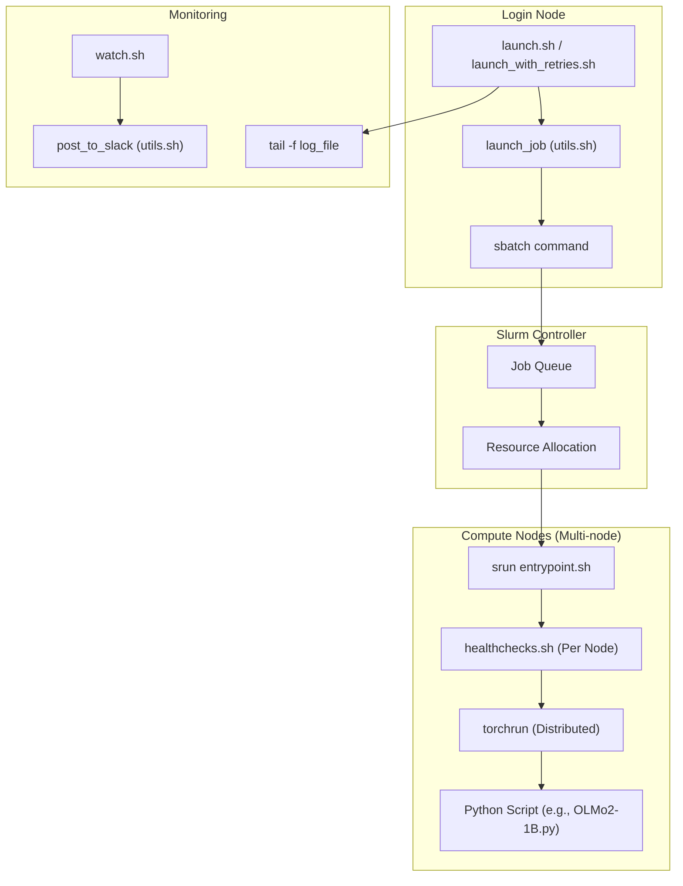

<!-- source: DeepWiki mcp.deepwiki.com · repo allenai/EMO · page 11.3 Lambda Cluster and Slurm Support · fetched 2026-10-26 -->

# Lambda Cluster and Slurm Support

Relevant source files

The following files were used as context for generating this wiki page:

- [src/scripts/lambda/README.md](src/scripts/lambda/README.md)
- [src/scripts/lambda/distributed_test.py](src/scripts/lambda/distributed_test.py)
- [src/scripts/lambda/entrypoint.sh](src/scripts/lambda/entrypoint.sh)
- [src/scripts/lambda/healthchecks.sh](src/scripts/lambda/healthchecks.sh)
- [src/scripts/lambda/launch.sh](src/scripts/lambda/launch.sh)
- [src/scripts/lambda/launch_with_retries.sh](src/scripts/lambda/launch_with_retries.sh)
- [src/scripts/lambda/slurm-1B-test.sbatch](src/scripts/lambda/slurm-1B-test.sbatch)
- [src/scripts/lambda/slurm-test-job.sbatch](src/scripts/lambda/slurm-test-job.sbatch)
- [src/scripts/lambda/utils.sh](src/scripts/lambda/utils.sh)
- [src/scripts/lambda/watch.sh](src/scripts/lambda/watch.sh)

This page documents the infrastructure and scripts located in `src/scripts/lambda/` designed for executing EMO and OLMo-core training workloads on Lambda Labs GPU clusters managed by Slurm. These utilities provide a robust wrapper around Slurm commands, implementing features like real-time log streaming, automated retries, Slack notifications, and comprehensive hardware health checks.

### System Overview and Workflow

The Lambda support system bridges the gap between the high-level Python experiment configurations and the low-level Slurm resource manager. It mimics the execution environment of the Beaker launch system to ensure consistency across different compute providers.

#### Lambda Cluster Execution Flow

The following diagram illustrates the lifecycle of a job from submission to execution across multiple nodes.

**Job Execution Lifecycle**

**Sources:** [src/scripts/lambda/launch.sh:1-81](), [src/scripts/lambda/entrypoint.sh:1-75](), [src/scripts/lambda/utils.sh:126-194]()

---

### Core Launch Scripts

The repository provides several entry points for submitting jobs to the Slurm cluster.

#### 1. `launch.sh`
This is the primary script for interactive job submission. It submits a job using `sbatch`, waits for the job to transition from `PENDING` to `RUNNING`, and then automatically streams the log file from the first task to the user's terminal [src/scripts/lambda/launch.sh:62-80](). It also handles `SIGINT` (Ctrl+C) gracefully by informing the user whether the job is still running or has been canceled [src/scripts/lambda/launch.sh:36-58]().

#### 2. `launch_with_retries.sh`
Designed for long-running pretraining jobs, this script wraps `launch_job` in a loop [src/scripts/lambda/launch_with_retries.sh:28-80](). If a job fails, it automatically resubmits it after a 5-second delay and sends a notification via `post_to_slack` if the `SLACK_WEBHOOK_URL` is configured [src/scripts/lambda/launch_with_retries.sh:74-79]().

#### 3. `watch.sh`
A utility to monitor an existing `JOB_ID`. It polls the job status using `sacct` and `squeue` via helper functions in `utils.sh` and sends a Slack notification upon completion or failure [src/scripts/lambda/watch.sh:27-42]().

**Sources:** [src/scripts/lambda/launch.sh:1-81](), [src/scripts/lambda/launch_with_retries.sh:1-81](), [src/scripts/lambda/watch.sh:1-43]()

---

### Execution Environment: `entrypoint.sh`

The `entrypoint.sh` script is the bridge between the Slurm environment and the Python training process. It is invoked via `srun` inside the `.sbatch` files [src/scripts/lambda/slurm-test-job.sbatch:6]().

**Key Responsibilities:**
*   **Environment Setup**: Sets `OLMO_SHARED_FS=1` and `OLMO_RICH_LOGGING=1` to match the project's standard execution environment [src/scripts/lambda/entrypoint.sh:25-26]().
*   **Distributed Coordination**: Automatically resolves the `MASTER_ADDR` from the Slurm node list and calculates a `MASTER_PORT` based on the `SLURM_JOB_ID` to avoid collisions [src/scripts/lambda/entrypoint.sh:32-37]().
*   **Process Launch**: Executes the target script using `torchrun`, passing through node counts (`--nnodes`) and rank information (`--node_rank`) derived from Slurm environment variables [src/scripts/lambda/entrypoint.sh:68-74]().

**Sources:** [src/scripts/lambda/entrypoint.sh:1-75](), [src/scripts/lambda/slurm-test-job.sbatch:6]()

---

### Node Health and Cordoning

To prevent "black hole" nodes from sinking large distributed jobs, the system includes proactive health checks and a manual cordoning mechanism.

#### Health Checks (`healthchecks.sh`)
Before training starts, `entrypoint.sh` runs `healthchecks.sh` on every allocated node [src/scripts/lambda/entrypoint.sh:56-63]().
*   **GPU Temperature**: Queries `nvidia-smi` for GPU temperatures. It warns if a GPU is $\ge 50^\circ\text{C}$ and fails the node if it is $\ge 55^\circ\text{C}$ while idle, as high idle temperatures often indicate cooling failure or throttled performance [src/scripts/lambda/healthchecks.sh:40-71]().
*   **GPU Idle Check**: Ensures no unexpected compute processes are running and that memory usage is below thresholds (default fail at 500MiB) [src/scripts/lambda/healthchecks.sh:87-136]().

#### Cordoning Mechanism
The `launch_job` function in `utils.sh` reads a list of node hostnames from `/data/ai2/cordoned-nodes.txt` [src/scripts/lambda/utils.sh:3](). Any nodes listed in this file are automatically added to the `--exclude` flag of the `sbatch` command, ensuring Slurm does not schedule jobs on known-bad hardware [src/scripts/lambda/utils.sh:166-175]().

**Sources:** [src/scripts/lambda/healthchecks.sh:1-145](), [src/scripts/lambda/utils.sh:166-175]()

---

### Job Configuration and Testing

#### Slurm Batch Scripts
The repository includes template `.sbatch` files:
*   `slurm-test-job.sbatch`: Runs `distributed_test.py` to verify environment connectivity [src/scripts/lambda/slurm-test-job.sbatch:1-7]().
*   `slurm-1B-test.sbatch`: A full integration test that launches `OLMo2-1B.py` with 100-step hard stop and checkpoints disabled [src/scripts/lambda/slurm-1B-test.sbatch:1-19]().

#### Distributed Connectivity Check
`distributed_test.py` is a minimal script used to validate the Slurm/Lambda setup. It calls `prepare_training_environment()` to initialize the process group and performs a `dist_utils.barrier()` to ensure all nodes can communicate before reporting success [src/scripts/lambda/distributed_test.py:11-18]().

**Entity Mapping: Slurm to Code**

| Slurm Concept | Code Entity / Script | Implementation Detail |
| :--- | :--- | :--- |
| **Submission** | `launch_job` function | Uses `sbatch --parsable` in `utils.sh` [src/scripts/lambda/utils.sh:182]() |
| **Node Setup** | `entrypoint.sh` | Configures `MASTER_ADDR` and `VENV_DIR` [src/scripts/lambda/entrypoint.sh:33-51]() |
| **Health Check** | `healthchecks.sh` | Validates `nvidia-smi` outputs [src/scripts/lambda/healthchecks.sh:50-118]() |
| **Distributed Init** | `prepare_training_environment` | Called in `distributed_test.py` [src/scripts/lambda/distributed_test.py:12]() |
| **Logging** | `LOGS_DIR` | Defaults to `/data/ai2/logs` [src/scripts/lambda/utils.sh:4]() |

**Sources:** [src/scripts/lambda/slurm-test-job.sbatch:1-7](), [src/scripts/lambda/slurm-1B-test.sbatch:1-19](), [src/scripts/lambda/distributed_test.py:1-23](), [src/scripts/lambda/utils.sh:1-194]()

---

