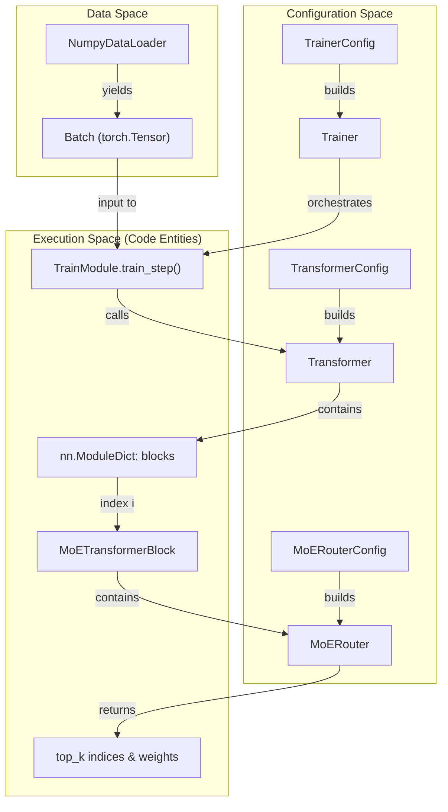
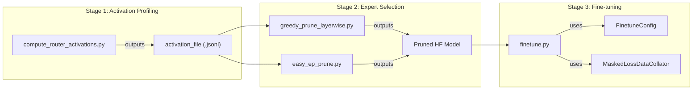

<!-- source: DeepWiki mcp.deepwiki.com · repo allenai/EMO · page 12 Glossary · fetched 2026-10-26 -->

# Glossary

Relevant source files

The following files were used as context for generating this wiki page:

- [CHANGELOG.md](CHANGELOG.md)
- [README.md](README.md)
- [docs/source/guides/data_mixing.rst](docs/source/guides/data_mixing.rst)
- [scripts/RUN_TEMPLATES.md](scripts/RUN_TEMPLATES.md)
- [scripts/selective_hf/hf_finetune_with_selective_easy_ep.sh](scripts/selective_hf/hf_finetune_with_selective_easy_ep.sh)
- [scripts/selective_hf/hf_finetune_with_selective_layerwise.sh](scripts/selective_hf/hf_finetune_with_selective_layerwise.sh)
- [src/hf_training/compute_router_activations.py](src/hf_training/compute_router_activations.py)
- [src/hf_training/data_utils.py](src/hf_training/data_utils.py)
- [src/hf_training/easy_ep_prune.py](src/hf_training/easy_ep_prune.py)
- [src/hf_training/finetune.py](src/hf_training/finetune.py)
- [src/hf_training/greedy_prune_layerwise.py](src/hf_training/greedy_prune_layerwise.py)
- [src/hf_training/greedy_prune_layerwise_variable.py](src/hf_training/greedy_prune_layerwise_variable.py)
- [src/offline_evals/__init__.py](src/offline_evals/__init__.py)
- [src/offline_evals/run_eval.py](src/offline_evals/run_eval.py)
- [src/offline_evals/tasks/splits_gsm8k.py](src/offline_evals/tasks/splits_gsm8k.py)
- [src/offline_evals/tasks/splits_mmlu.py](src/offline_evals/tasks/splits_mmlu.py)
- [src/offline_evals/tasks/splits_mmlu_pro.py](src/offline_evals/tasks/splits_mmlu_pro.py)
- [src/olmo_core/data/__init__.py](src/olmo_core/data/__init__.py)
- [src/olmo_core/data/data_loader.py](src/olmo_core/data/data_loader.py)
- [src/olmo_core/data/numpy_dataset.py](src/olmo_core/data/numpy_dataset.py)
- [src/olmo_core/data/source_mixture.py](src/olmo_core/data/source_mixture.py)
- [src/olmo_core/data/types.py](src/olmo_core/data/types.py)
- [src/olmo_core/data/utils.py](src/olmo_core/data/utils.py)
- [src/olmo_core/distributed/parallel/__init__.py](src/olmo_core/distributed/parallel/__init__.py)
- [src/olmo_core/distributed/parallel/pipeline_parallel.py](src/olmo_core/distributed/parallel/pipeline_parallel.py)
- [src/olmo_core/nn/feed_forward.py](src/olmo_core/nn/feed_forward.py)
- [src/olmo_core/nn/moe/mutualinfo_router.py](src/olmo_core/nn/moe/mutualinfo_router.py)
- [src/olmo_core/nn/moe/pruning_router.py](src/olmo_core/nn/moe/pruning_router.py)
- [src/olmo_core/nn/moe/router.py](src/olmo_core/nn/moe/router.py)
- [src/olmo_core/nn/moe/twolevel_batchlb_reducedp_sharedexp_router.py](src/olmo_core/nn/moe/twolevel_batchlb_reducedp_sharedexp_router.py)
- [src/olmo_core/nn/moe/twolevel_batchlb_reducedp_sharedexppool_router.py](src/olmo_core/nn/moe/twolevel_batchlb_reducedp_sharedexppool_router.py)
- [src/olmo_core/nn/moe/twolevel_router.py](src/olmo_core/nn/moe/twolevel_router.py)
- [src/olmo_core/nn/moe/twolevel_topp_batchlb_router.py](src/olmo_core/nn/moe/twolevel_topp_batchlb_router.py)
- [src/olmo_core/nn/transformer/__init__.py](src/olmo_core/nn/transformer/__init__.py)
- [src/olmo_core/nn/transformer/block.py](src/olmo_core/nn/transformer/block.py)
- [src/olmo_core/nn/transformer/config.py](src/olmo_core/nn/transformer/config.py)
- [src/olmo_core/nn/transformer/init.py](src/olmo_core/nn/transformer/init.py)
- [src/olmo_core/nn/transformer/model.py](src/olmo_core/nn/transformer/model.py)
- [src/olmo_core/optim/__init__.py](src/olmo_core/optim/__init__.py)
- [src/olmo_core/optim/adamw.py](src/olmo_core/optim/adamw.py)
- [src/olmo_core/optim/config.py](src/olmo_core/optim/config.py)
- [src/olmo_core/optim/lion.py](src/olmo_core/optim/lion.py)
- [src/olmo_core/optim/scheduler.py](src/olmo_core/optim/scheduler.py)
- [src/olmo_core/train/callbacks/list_checkpointer.py](src/olmo_core/train/callbacks/list_checkpointer.py)
- [src/olmo_core/train/trainer.py](src/olmo_core/train/trainer.py)
- [src/olmo_core/version.py](src/olmo_core/version.py)
- [src/scripts/eval/get_mmlu_subjects.py](src/scripts/eval/get_mmlu_subjects.py)
- [src/scripts/eval/launch_eval.py](src/scripts/eval/launch_eval.py)
- [src/scripts/eval/tasks.py](src/scripts/eval/tasks.py)
- [src/scripts/eval/testbed_arc_easy.sh](src/scripts/eval/testbed_arc_easy.sh)
- [src/scripts/official/README.md](src/scripts/official/README.md)
- [src/scripts/train/README.md](src/scripts/train/README.md)
- [src/scripts/train/olmoe-1B-7B_finetune.py](src/scripts/train/olmoe-1B-7B_finetune.py)
- [src/scripts/train/olmoe-1B-7B_fsl.py](src/scripts/train/olmoe-1B-7B_fsl.py)
- [src/test/conftest.py](src/test/conftest.py)
- [src/test/data/data_loader_test.py](src/test/data/data_loader_test.py)
- [src/test/data/fixtures.py](src/test/data/fixtures.py)
- [src/test/data/numpy_dataset_test.py](src/test/data/numpy_dataset_test.py)
- [src/test/data/source_mixture_test.py](src/test/data/source_mixture_test.py)
- [src/test/data/utils_test.py](src/test/data/utils_test.py)
- [src/test/nn/transformer/model_test.py](src/test/nn/transformer/model_test.py)
- [src/test/optim/adamw_test.py](src/test/optim/adamw_test.py)
- [src/test/optim/lion_test.py](src/test/optim/lion_test.py)
- [src/test/optim/scheduler_test.py](src/test/optim/scheduler_test.py)
- [src/test/optim/skip_step_optimizer_test.py](src/test/optim/skip_step_optimizer_test.py)

This glossary defines technical terms, architectural concepts, and abbreviations specific to the **EMO** and **OLMo-Core** codebase. It provides definitions alongside code pointers to the primary implementations and data structures.

---

## 1. Core Architecture Concepts

### Transformer
The base "Llama-style" autoregressive decoder model. In this codebase, it is implemented with modularity in mind, allowing for different block types and attention backends.
*   **Implementation:** `Transformer` class in [src/olmo_core/nn/transformer/model.py:84-187]()
*   **Configuration:** `TransformerConfig` in [src/olmo_core/nn/transformer/config.py]()

### MoE (Mixture-of-Experts)
A sparse architecture where only a subset of parameters (experts) are activated for each token.
*   **Base Class:** `MoEBase` in [src/olmo_core/nn/moe/base.py]()
*   **Transformer Variant:** `MoETransformer` in [src/olmo_core/nn/transformer/model.py:270-320]() (implied by block selection).

### EMO (Emergent Modular MoE)
The research project's primary contribution: a method to induce modularity during pretraining (typically via document-level routing constraints) to enable efficient expert pruning and specialization.
*   **Paper Reference:** Indicated in [README.md:22-22]()
*   **Key Logic:** Often involves the `MoETwoLevelRouter`.

### nGPT (Normalized Transformer)
A variant of the Transformer where all embeddings, weights, and activations are L2-normalized to improve training stability and scaling.
*   **Implementation:** `NormalizedTransformer` in [src/olmo_core/nn/transformer/model.py:221-268]()
*   **Block:** `NormalizedTransformerBlock` in [src/olmo_core/nn/transformer/block.py:315-350]()

---

## 2. Routing & Modularity Terms

### Router
The module responsible for selecting which experts process a given input token.
*   **Base Class:** `MoERouter` in [src/olmo_core/nn/moe/router.py:171-213]()

### Two-Level Router
A specific router implementation that enforces document-level constraints. It restricts the experts available to tokens within a single document to a "document expert pool."
*   **Implementation:** `MoETwoLevelRouter` in [src/olmo_core/nn/moe/twolevel_router.py]()
*   **Configuration:** `MoETwoLevelRouterConfig` in [src/scripts/train/olmoe-1B-7B_fsl.py:53-53]()

### Expert Pruning
The process of removing experts from a pretrained MoE model to reduce memory or compute, while maintaining performance.
*   **Greedy Layerwise Pruning:** `greedy_prune_layerwise.py` in [src/hf_training/greedy_prune_layerwise.py]()
*   **EASY-EP:** An output-aware scoring method for pruning found in [src/hf_training/easy_ep_prune.py]()

### Shared Expert
An expert MLP that is always active for every token, regardless of the router's top-k selection. Used to capture general knowledge.
*   **Logic:** `MoELinearLBReduceDPSharedExpRouterConfig` in [src/scripts/train/olmoe-1B-7B_fsl.py:30-32]()

---

## 3. Training & Infrastructure

### Trainer
The central orchestration class that manages the training loop, metrics collection, and callback execution.
*   **Implementation:** `Trainer` in [src/olmo_core/train/trainer.py:100-242]()

### TrainModule
An abstraction that wraps a model and an optimizer, defining how a training step is performed (e.g., FSDP wrapping, loss calculation).
*   **Implementation:** `TrainModule` in [src/olmo_core/train/train_module.py]()
*   **Transformer Variant:** `TransformerTrainModule` in [src/olmo_core/train/train_module.py]()

### FSL vs. VSL
*   **FSL (Fixed Sequence Length):** Training where every example is padded or truncated to a specific length.
*   **VSL (Variable Sequence Length):** Training where sequences can have different lengths, often used with document packing or curriculum learning.
*   **Datasets:** `NumpyFSLDataset` vs `NumpyVSLDataset` in [src/olmo_core/data/numpy_dataset.py]()

### Checkpointer
Handles saving and loading model/optimizer states, supporting asynchronous I/O to minimize training stalls.
*   **Implementation:** `Checkpointer` in [src/olmo_core/train/checkpoint.py]()
*   **Call Site:** Used within `Trainer` at [src/olmo_core/train/trainer.py:145-151]()

---

## 4. Code Entity Space Mapping

The following diagrams bridge high-level concepts to their specific code identifiers.

### Diagram: Model Hierarchy and Data Flow
This diagram shows how `TransformerConfig` builds the actual `Transformer` module and how it interacts with the `Trainer`.

**Sources:** [src/olmo_core/train/trainer.py:119-127](), [src/olmo_core/nn/transformer/model.py:143-160](), [src/olmo_core/nn/moe/router.py:127-137]()

### Diagram: Pruning and Fine-tuning Pipeline
This diagram maps the "Selective Expert Usage" research workflow to the specific scripts and classes.

**Sources:** [src/hf_training/finetune.py:49-80](), [src/hf_training/greedy_prune_layerwise.py](), [src/hf_training/easy_ep_prune.py](), [src/hf_training/data_utils.py:195-205]()

---

## 5. Abbreviations Table

| Abbreviation | Full Term | Context / Code Pointer |
| :--- | :--- | :--- |
| **LB** | Load Balancing | `load_balancing_loss` in [src/olmo_core/nn/moe/loss.py]() |
| **EP** | Expert Parallelism | `DataParallelType.expert` in [src/olmo_core/distributed/parallel/__init__.py]() |
| **TP** | Tensor Parallelism | `tp_enabled` in [src/olmo_core/nn/transformer/model.py:209-211]() |
| **CP** | Context Parallelism | `RingContextParallelStyle` in [src/olmo_core/nn/transformer/model.py:34-37]() |
| **PP** | Pipeline Parallelism | `pp_enabled` in [src/olmo_core/nn/transformer/model.py:201-203]() |
| **GQA** | Grouped Query Attention | `AttentionConfig` in [src/olmo_core/nn/attention/config.py]() |
| **RoPE** | Rotary Positional Embeddings | `RoPEBuffers` in [src/olmo_core/nn/rope.py]() |
| **MFU** | Model Flops Utilization | Logged by `SpeedMonitorCallback` in [src/olmo_core/train/callbacks/speed_monitor.py]() |
| **WSDS** | Warmup-Stable-Decay-Squeeze | A learning rate scheduler in [src/olmo_core/optim/scheduler.py]() |

---

## 6. Evaluation Concepts

### Offline Evals
Benchmarking performed outside the training loop using the `run_eval.py` engine. It supports multiple backends like HuggingFace and vLLM.
*   **Entrypoint:** [src/offline_evals/run_eval.py]()
*   **Task Registry:** `TASK_REGISTRY` in [src/offline_evals/__init__.py:5-42]()

### In-Loop Evaluators
Evaluations (usually perplexity or small zero-shot tasks) that run during the training process via callbacks.
*   **Implementation:** `EvaluatorCallback` in [src/olmo_core/train/callbacks/evaluator.py]()
*   **Configuration:** `DownstreamEvaluatorCallbackConfig` in [src/scripts/train/olmoe-1B-7B_fsl.py:76-76]()

### Masked Loss
In fine-tuning, the practice of setting labels to `-100` for the prompt tokens so the model is only penalized for its generated answer.
*   **Implementation:** `MaskedLossDataCollator` in [src/hf_training/finetune.py:83-116]()
*   **Logic:** `create_masked_labels` in [src/hf_training/data_utils.py:195-205]()

**Sources:** [src/olmo_core/train/trainer.py](), [src/olmo_core/nn/transformer/model.py](), [src/hf_training/finetune.py](), [src/offline_evals/run_eval.py](), [src/olmo_core/nn/moe/router.py]()