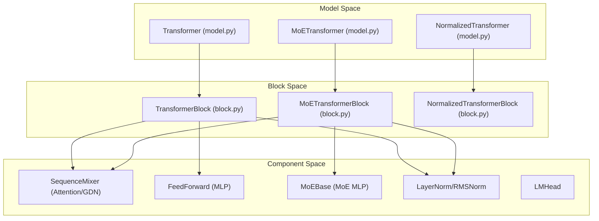
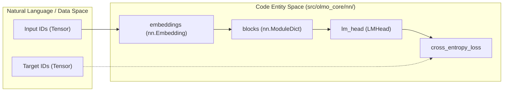

<!-- source: DeepWiki mcp.deepwiki.com · repo allenai/EMO · page 2 Core Neural Network Architecture · fetched 2026-10-26 -->

# Core Neural Network Architecture

Relevant source files

The following files were used as context for generating this wiki page:

- [src/olmo_core/config.py](src/olmo_core/config.py)
- [src/olmo_core/nn/feed_forward.py](src/olmo_core/nn/feed_forward.py)
- [src/olmo_core/nn/layer_norm.py](src/olmo_core/nn/layer_norm.py)
- [src/olmo_core/nn/lm_head.py](src/olmo_core/nn/lm_head.py)
- [src/olmo_core/nn/rope.py](src/olmo_core/nn/rope.py)
- [src/olmo_core/nn/transformer/__init__.py](src/olmo_core/nn/transformer/__init__.py)
- [src/olmo_core/nn/transformer/block.py](src/olmo_core/nn/transformer/block.py)
- [src/olmo_core/nn/transformer/config.py](src/olmo_core/nn/transformer/config.py)
- [src/olmo_core/nn/transformer/init.py](src/olmo_core/nn/transformer/init.py)
- [src/olmo_core/nn/transformer/model.py](src/olmo_core/nn/transformer/model.py)
- [src/test/config_test.py](src/test/config_test.py)
- [src/test/nn/layer_norm_test.py](src/test/nn/layer_norm_test.py)
- [src/test/nn/lm_head_test.py](src/test/nn/lm_head_test.py)
- [src/test/nn/rope_test.py](src/test/nn/rope_test.py)
- [src/test/nn/transformer/model_test.py](src/test/nn/transformer/model_test.py)

The core neural network architecture in EMO is built around a modular and highly configurable Transformer implementation. Located primarily in `src/olmo_core/nn/`, the architecture supports a variety of modern techniques including Mixture-of-Experts (MoE), normalized architectures (nGPT), and diverse attention mechanisms. The system follows a "Config/Build" pattern where dataclass-based configurations define the model structure before instantiation.

## Architectural Overview

The architecture is hierarchical, moving from the top-level model container down to specialized layers and kernels.

### High-Level Hierarchy

Sources: [src/olmo_core/nn/transformer/model.py:84-122](), [src/olmo_core/nn/transformer/block.py:96-143](), [src/olmo_core/nn/transformer/config.py:79-149]()

## Core Components

### Transformer Models and Blocks
The base `Transformer` class [src/olmo_core/nn/transformer/model.py:84]() provides a standard decoder-only architecture. It is extended by `MoETransformer` [src/olmo_core/nn/transformer/model.py:75]() for expert-parallel models and `NormalizedTransformer` [src/olmo_core/nn/transformer/model.py:74]() for nGPT-style experiments where weights are constrained to a hypersphere.

The `TransformerBlock` [src/olmo_core/nn/transformer/block.py:96]() manages the residual stream and coordinates the interaction between the `SequenceMixer` (typically attention) and the `FeedForward` network.

For details, see [Transformer Model and Block Architecture](#2.1).

### Sequence Mixers and Attention
The `SequenceMixer` abstraction [src/olmo_core/nn/attention/base.py]() allows the model to swap between standard `Attention`, `FusedAttention` (using FlashAttention), and recurrent layers like `GatedDeltaNet`.
*   **RoPE:** Rotary Positional Embeddings are managed via `RoPEConfig` [src/olmo_core/nn/rope.py:16](), supporting multiple scaling strategies like Linear, YaRN, and Stepwise (Llama-3.1 style) [src/olmo_core/nn/rope.py:133]().
*   **Backends:** The system supports various backends including `torch`, `flash_attn`, and `flex` [src/olmo_core/nn/attention/config.py]().

For details, see [Attention Mechanisms](#2.2).

### Mixture-of-Experts (MoE)
MoE is a first-class citizen in the architecture. `MoETransformerBlock` [src/olmo_core/nn/transformer/block.py:224]() replaces the standard MLP with a `MoEBase` layer.
*   **MLP Variants:** Supports `MoEMLP` and `DroplessMoEMLP` [src/olmo_core/nn/moe/parallel_mlp.py]().
*   **Parallelism:** Built-in support for Expert Parallelism (EP) and shared experts.

For details, see [Mixture-of-Experts (MoE) Layer Architecture](#2.3).

### Routing and EMO Variants
The router is the critical component for EMO's modularity research. Routers decide token-to-expert assignments and are defined under the `MoERouter` hierarchy.
*   **Baseline:** `MoELinearRouter` [src/olmo_core/nn/moe/router.py]().
*   **Advanced:** Document-aware routing via `MoETwoLevelRouter` [src/olmo_core/nn/moe/twolevel_router.py:19]().

For details, see [EMO Router Variants](#2.4).

## Supporting Infrastructure

### Normalization and Heads
*   **LayerNorm:** Implements standard `LayerNorm`, `RMSNorm`, and specialized versions like `CuTeRMSNorm` and `L2Norm` [src/olmo_core/nn/layer_norm.py:24-49]().
*   **LM Head:** The `LMHead` [src/olmo_core/nn/lm_head.py:154]() handles the final projection to vocabulary. It supports `LMLossImplementation.fused_linear` [src/olmo_core/nn/lm_head.py:70]() for memory-efficient training by fusing the linear projection with cross-entropy loss.

### Initialization Methods
The `InitMethod` enum [src/olmo_core/nn/transformer/init.py:46]() defines several initialization schemes:
*   `normal`: Truncated normal with $\sigma=0.02$.
*   `llama`: Depth-scaled initialization for output layers.
*   `fan_in`: Variance-preserving initialization based on layer dimensions.
*   `normalized`: Specifically for nGPT architectures.

### Data and Model Space Mapping

Sources: [src/olmo_core/nn/transformer/model.py:133-163](), [src/olmo_core/nn/lm_head.py:201-212]()

### Distributed Integration
The architecture is designed for `torch.distributed`. Modules implement `apply_tp()` for Tensor Parallelism, `apply_fsdp()` for Fully Sharded Data Parallelism, and `apply_cp()` for Context Parallelism [src/olmo_core/nn/transformer/block.py:63-89]().

Sources: [src/olmo_core/nn/transformer/model.py:84-182](), [src/olmo_core/nn/transformer/block.py:32-94](), [src/olmo_core/nn/lm_head.py:77-114](), [src/olmo_core/nn/rope.py:29-46](), [src/olmo_core/nn/transformer/init.py:46-77]()

---

