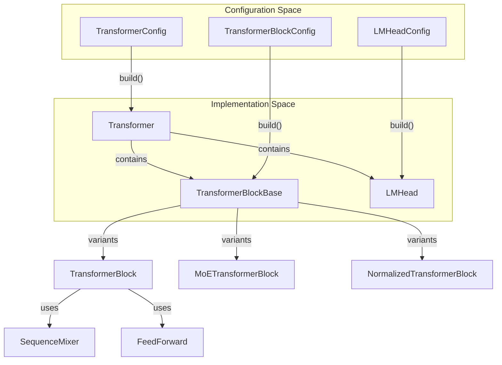
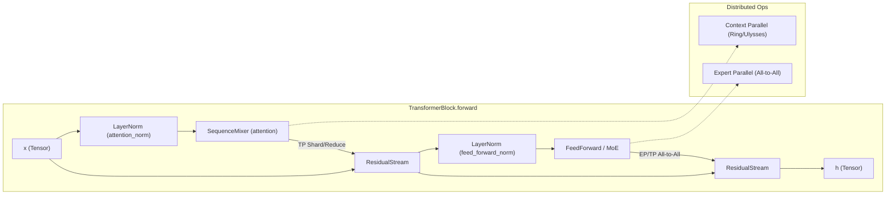

<!-- source: DeepWiki mcp.deepwiki.com · repo allenai/EMO · page 2.1 Transformer Model and Block Architecture · fetched 2026-10-26 -->

# Transformer Model and Block Architecture

Relevant source files

The following files were used as context for generating this wiki page:

- [src/olmo_core/config.py](src/olmo_core/config.py)
- [src/olmo_core/nn/feed_forward.py](src/olmo_core/nn/feed_forward.py)
- [src/olmo_core/nn/layer_norm.py](src/olmo_core/nn/layer_norm.py)
- [src/olmo_core/nn/lm_head.py](src/olmo_core/nn/lm_head.py)
- [src/olmo_core/nn/rope.py](src/olmo_core/nn/rope.py)
- [src/olmo_core/nn/transformer/__init__.py](src/olmo_core/nn/transformer/__init__.py)
- [src/olmo_core/nn/transformer/block.py](src/olmo_core/nn/transformer/block.py)
- [src/olmo_core/nn/transformer/config.py](src/olmo_core/nn/transformer/config.py)
- [src/olmo_core/nn/transformer/init.py](src/olmo_core/nn/transformer/init.py)
- [src/olmo_core/nn/transformer/model.py](src/olmo_core/nn/transformer/model.py)
- [src/test/config_test.py](src/test/config_test.py)
- [src/test/nn/layer_norm_test.py](src/test/nn/layer_norm_test.py)
- [src/test/nn/lm_head_test.py](src/test/nn/lm_head_test.py)
- [src/test/nn/rope_test.py](src/test/nn/rope_test.py)
- [src/test/nn/transformer/model_test.py](src/test/nn/transformer/model_test.py)

This page details the implementation of the Transformer architecture in `olmo_core`. The system is designed for modularity, supporting multiple block variants (standard, MoE, normalized), diverse initialization schemes, and a strict forward pass lifecycle integrated with distributed training strategies.

## Architecture Overview

The core architecture follows a "Llama-style" design but is generalized to support research variants like Mixture-of-Experts (MoE) and nGPT (Normalized Transformers). The model is composed of three primary segments:
1.  **Embeddings**: Token embeddings with optional scaling and normalization [src/olmo_core/nn/transformer/model.py:133-142]().
2.  **Transformer Blocks**: A stack of $N$ blocks, which can be homogeneous or heterogeneous via configuration overrides [src/olmo_core/nn/transformer/model.py:150-160]().
3.  **LM Head**: The final projection to vocabulary space, supporting fused loss implementations for memory efficiency [src/olmo_core/nn/lm_head.py:78-114]().

### Code Entity Mapping: Model Structure
The following diagram bridges the high-level transformer concepts to the specific classes and configurations in the codebase.

Sources: [src/olmo_core/nn/transformer/model.py:84-164](), [src/olmo_core/nn/transformer/config.py:152-240](), [src/olmo_core/nn/transformer/block.py:32-143]()

---

## Transformer Model Variants

The codebase provides three primary model implementations via `TransformerType` [src/olmo_core/nn/transformer/config.py:79-98]():

| Class | Type Enum | Description |
| :--- | :--- | :--- |
| `Transformer` | `default` | Standard decoder-only architecture (Llama-style) [src/olmo_core/nn/transformer/model.py:84](). |
| `MoETransformer` | `moe` | Extends the base transformer to support Mixture-of-Experts blocks and auxiliary loss tracking [src/olmo_core/nn/transformer/model.py:313](). |
| `NormalizedTransformer` | `normalized` | Implements the **nGPT** architecture, where weights and activations are L2-normalized [src/olmo_core/nn/transformer/model.py:270](). |

### Normalized Transformers (nGPT)
The `NormalizedTransformer` requires specific handling during the training loop. Since weights are constrained to a hypersphere, the model includes a `normalize_matrices()` method called after optimizer steps to project weights back to unit norm [src/olmo_core/nn/transformer/model.py:303-311]().

Sources: [src/olmo_core/nn/transformer/model.py:84-350](), [src/olmo_core/nn/transformer/config.py:79-98]()

---

## Block Variants and Logic

Blocks are the fundamental unit of the model. All blocks inherit from `TransformerBlockBase` [src/olmo_core/nn/transformer/block.py:32]().

### Standard Block (`TransformerBlock`)
Follows the pre-norm architecture:
1.  `Attention(LayerNorm(x)) + x`
2.  `FeedForward(LayerNorm(h)) + h`
The `SequenceMixer` (Attention) and `FeedForward` components are modular [src/olmo_core/nn/transformer/block.py:152-153]().

### MoE Block (`MoETransformerBlock`)
Replaces the standard `FeedForward` with a `MoEBase` module. It supports Expert Parallelism (EP) and tracks auxiliary routing losses [src/olmo_core/nn/transformer/block.py:537-565]().

### Specialized Variants
*   **`LayerNormScaledTransformerBlock`**: Applies scaling to LayerNorm outputs [src/olmo_core/nn/transformer/config.py:110]().
*   **`ReorderedNormTransformerBlock`**: Changes the placement of normalization relative to residuals [src/olmo_core/nn/transformer/config.py:115]().
*   **`PeriNormTransformerBlock`**: Implements Peri-norm architecture [src/olmo_core/nn/transformer/config.py:120]().

Sources: [src/olmo_core/nn/transformer/block.py:96-153](), [src/olmo_core/nn/transformer/config.py:100-150]()

---

## Initialization Methods

The `InitMethod` enum defines how weights are populated across the model [src/olmo_core/nn/transformer/init.py:46]().

| Method | Logic |
| :--- | :--- |
| `normal` | Truncated normal (std=0.02) for all linear and embedding layers [src/olmo_core/nn/transformer/init.py:47-51](). |
| `llama` | Output layers use `std = 0.02 / sqrt(2 * n_layers)` [src/olmo_core/nn/transformer/init.py:58-62](). |
| `llama_depth` | Depth-scaled init using `std = 0.02 / sqrt(2 * (block_idx + 1))` [src/olmo_core/nn/transformer/init.py:64-68](). |
| `fan_in` | Uses `1 / sqrt(d_in)` where `d_in` is the input dimension of the specific layer [src/olmo_core/nn/transformer/init.py:70-77](). |
| `normalized` | nGPT scheme; embeddings use `std = d_model**-0.5` [src/olmo_core/nn/transformer/init.py:90-91](). |

Sources: [src/olmo_core/nn/transformer/init.py:46-105](), [src/olmo_core/nn/transformer/init.py:143-181]()

---

## Forward Pass Lifecycle and Parallelism

The model's lifecycle involves several transformation stages to support distributed training. The application order is critical for compatibility.

### Application Order
1.  **Pipeline Parallelism (PP)**: The model is partitioned into stages [src/olmo_core/nn/transformer/model.py:440]().
2.  **Tensor Parallelism (TP)**: Linear layers are sharded (Columnwise/Rowwise) [src/olmo_core/nn/transformer/model.py:507]().
3.  **Context Parallelism (CP)**: Attention is sharded across the sequence dimension [src/olmo_core/nn/transformer/model.py:560]().
4.  **FSDP**: Sharding of parameters and gradients across the data-parallel mesh [src/olmo_core/nn/transformer/model.py:615]().
5.  **FP8**: Modules are wrapped for 8-bit floating point execution [src/olmo_core/nn/transformer/model.py:408]().

### Data Flow Diagram
This diagram shows the execution flow of a single `TransformerBlock` within the distributed environment.

Sources: [src/olmo_core/nn/transformer/block.py:144-153](), [src/olmo_core/nn/transformer/block.py:155-200](), [src/olmo_core/nn/transformer/model.py:507-650]()

### Auxiliary Metrics
For `MoETransformer`, the forward pass also aggregates auxiliary metrics such as load-balancing loss and router z-loss, which are retrieved via `compute_auxiliary_metrics()` [src/olmo_core/nn/transformer/model.py:335-350]().

Sources: [src/olmo_core/nn/transformer/model.py:313-350](), [src/olmo_core/nn/transformer/block.py:537-565]()

---

