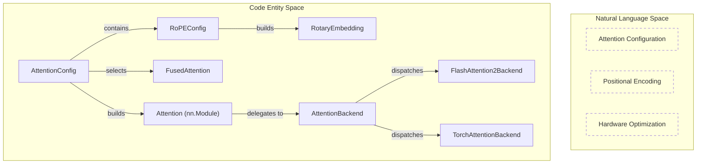
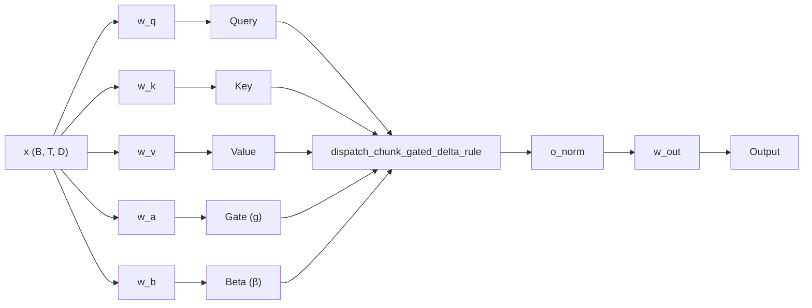

<!-- source: DeepWiki mcp.deepwiki.com · repo allenai/EMO · page 2.2 Attention Mechanisms · fetched 2026-10-26 -->

# Attention Mechanisms

Relevant source files

The following files were used as context for generating this wiki page:

- [src/olmo_core/config.py](src/olmo_core/config.py)
- [src/olmo_core/nn/attention/__init__.py](src/olmo_core/nn/attention/__init__.py)
- [src/olmo_core/nn/attention/backend.py](src/olmo_core/nn/attention/backend.py)
- [src/olmo_core/nn/attention/flash_attn_api.py](src/olmo_core/nn/attention/flash_attn_api.py)
- [src/olmo_core/nn/attention/kv_cache.py](src/olmo_core/nn/attention/kv_cache.py)
- [src/olmo_core/nn/attention/recurrent.py](src/olmo_core/nn/attention/recurrent.py)
- [src/olmo_core/nn/layer_norm.py](src/olmo_core/nn/layer_norm.py)
- [src/olmo_core/nn/lm_head.py](src/olmo_core/nn/lm_head.py)
- [src/olmo_core/nn/rope.py](src/olmo_core/nn/rope.py)
- [src/olmo_core/script_utils.py](src/olmo_core/script_utils.py)
- [src/olmo_core/testing/__init__.py](src/olmo_core/testing/__init__.py)
- [src/olmo_core/testing/utils.py](src/olmo_core/testing/utils.py)
- [src/olmo_core/train/callbacks/stability_monitor.py](src/olmo_core/train/callbacks/stability_monitor.py)
- [src/test/config_test.py](src/test/config_test.py)
- [src/test/nn/attention/recurrent_test.py](src/test/nn/attention/recurrent_test.py)
- [src/test/nn/layer_norm_test.py](src/test/nn/layer_norm_test.py)
- [src/test/nn/lm_head_test.py](src/test/nn/lm_head_test.py)
- [src/test/nn/rope_test.py](src/test/nn/rope_test.py)

The EMO codebase provides a modular and high-performance suite of attention mechanisms designed for scalable Transformer pretraining. It abstracts hardware-specific optimizations through an `AttentionBackend` system, supporting standard multi-head attention (MHA), group-query attention (GQA), sliding window attention (SWA), and recurrent linear attention via Gated Delta Networks.

## Attention Architecture Overview

The primary entry point for attention is the `Attention` class and its corresponding `AttentionConfig`. The system supports multiple implementation variants including standard, fused, and normalized attention [src/olmo_core/nn/attention/__init__.py:158-175]().

### Data Flow and Code Entity Mapping

The following diagram illustrates the relationship between the configuration entities and the functional modules that implement the attention forward pass.

**Attention System Architecture**

Sources: [src/olmo_core/nn/attention/__init__.py:178-204](), [src/olmo_core/nn/attention/backend.py:43-75](), [src/olmo_core/nn/rope.py:29-46]()

## Attention Backends

The `AttentionBackend` abstraction allows EMO to utilize the most efficient kernels available for the underlying hardware while maintaining a unified interface for the Transformer block.

| Backend Name | Class | Target Hardware / Features |
| :--- | :--- | :--- |
| `torch` | `TorchAttentionBackend` | PyTorch SDPA; fallback for all devices [src/olmo_core/nn/attention/backend.py:48-51](). |
| `flash_2` | `FlashAttention2Backend` | Ampere+ GPUs; supports `flash-attn` v2 and Ring CP [src/olmo_core/nn/attention/backend.py:52-58](). |
| `flash_3` | `FlashAttention3Backend` | Hopper GPUs (H100/H800); utilizes FP8 and newer kernels [src/olmo_core/nn/attention/backend.py:59-64](). |
| `flash_4` | `FlashAttention4Backend` | Blackwell GPUs; CUTE implementation [src/olmo_core/nn/attention/backend.py:65-70](). |
| `te` | `TEAttentionBackend` | NVIDIA Transformer Engine; SM 9.0+ [src/olmo_core/nn/attention/backend.py:71-75](). |

The backend is selected via `AttentionConfig.backend` and instantiated using the `AttentionBackendName.build()` method [src/olmo_core/nn/attention/backend.py:91-111]().

## Positional Embeddings (RoPE)

EMO primarily uses Rotary Positional Embeddings (RoPE). The implementation supports various scaling strategies to extend context lengths beyond training limits.

*   **Implementations**: `RotaryEmbedding` (default), `FusedRotaryEmbedding` (Triton/CUDA optimized), and `ComplexRotaryEmbedding` [src/olmo_core/nn/rope.py:29-46]().
*   **Scaling Strategies**:
    *   **PI (Position-Interpolation)**: Linearly compresses position indices [src/olmo_core/nn/rope.py:97-113]().
    *   **Stepwise (Llama-3.1)**: Interpolates between high and low frequency bands to preserve short-range ordering while extending context [src/olmo_core/nn/rope.py:133-170]().
    *   **ABF (Absolute Base Frequency)**: Modifies the `theta` base parameter [src/olmo_core/nn/rope.py:73-83]().

Sources: [src/olmo_core/nn/rope.py:48-51](), [src/olmo_core/nn/rope.py:177-194]()

## Sliding Window Attention (OLMo3)

Sliding Window Attention (SWA) is configured via `SlidingWindowAttentionConfig`. It allows specific layers to attend only to a local window of tokens, reducing the quadratic complexity of the attention operation [src/olmo_core/nn/attention/__init__.py:101-119]().

*   **Pattern-based**: A pattern like `[4096, 4096, 4096, -1]` applies a 4096 window to three layers followed by one full-attention layer [src/olmo_core/nn/attention/__init__.py:105-108]().
*   **Layer Constraints**: Typically, the first and last layers are forced to use full attention to ensure global information flow [src/olmo_core/nn/attention/__init__.py:124-127]().

Sources: [src/olmo_core/nn/attention/__init__.py:120-156]()

## Gated Delta Networks (Recurrent Attention)

For efficient $O(N)$ sequence modeling, EMO includes `GatedDeltaNet`, a linear attention variant based on the gated delta rule [src/olmo_core/nn/attention/recurrent.py:34-41]().

**GatedDeltaNet Data Flow**

Sources: [src/olmo_core/nn/attention/recurrent.py:152-163](), [src/olmo_core/nn/attention/recurrent.py:18-21]()

## KV Cache and Generation

The `KVCacheManager` handles the state required for incremental decoding during inference.
*   **Backend Support**: Backends must explicitly support KV caching (verified via `assert_supports_kv_cache`) [src/olmo_core/nn/attention/backend.py:207-214]().
*   **Flash Attention Integration**: EMO dispatches to specific "with_kvcache" variants of Flash Attention kernels (e.g., `dispatch_flash_attn_3_with_kvcache`) when a cache is provided during the forward pass [src/olmo_core/nn/attention/backend.py:24-27]().

Sources: [src/olmo_core/nn/attention/kv_cache.py](), [src/olmo_core/nn/attention/backend.py:17-34]()

---

