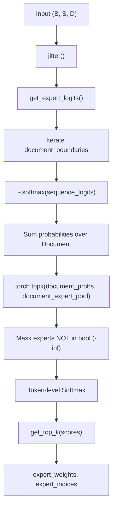
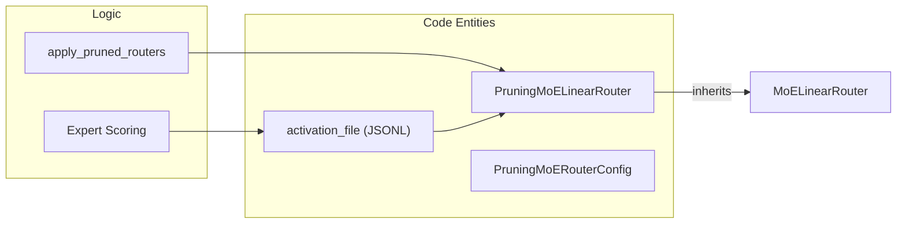

<!-- source: DeepWiki mcp.deepwiki.com · repo allenai/EMO · page 2.4 EMO Router Variants · fetched 2026-10-26 -->

# EMO Router Variants

Relevant source files

The following files were used as context for generating this wiki page:

- [src/olmo_core/nn/moe/masked_finetune_router.py](src/olmo_core/nn/moe/masked_finetune_router.py)
- [src/olmo_core/nn/moe/mutualinfo_router.py](src/olmo_core/nn/moe/mutualinfo_router.py)
- [src/olmo_core/nn/moe/pruning_router.py](src/olmo_core/nn/moe/pruning_router.py)
- [src/olmo_core/nn/moe/router.py](src/olmo_core/nn/moe/router.py)
- [src/olmo_core/nn/moe/router_finetune_old.py](src/olmo_core/nn/moe/router_finetune_old.py)
- [src/olmo_core/nn/moe/router_lbreducedp.py](src/olmo_core/nn/moe/router_lbreducedp.py)
- [src/olmo_core/nn/moe/router_lbreducedp_sharedexp.py](src/olmo_core/nn/moe/router_lbreducedp_sharedexp.py)
- [src/olmo_core/nn/moe/twolevel_batchlb_fullzloss_router.py](src/olmo_core/nn/moe/twolevel_batchlb_fullzloss_router.py)
- [src/olmo_core/nn/moe/twolevel_batchlb_nomaskaux_router.py](src/olmo_core/nn/moe/twolevel_batchlb_nomaskaux_router.py)
- [src/olmo_core/nn/moe/twolevel_batchlb_reducedp_router.py](src/olmo_core/nn/moe/twolevel_batchlb_reducedp_router.py)
- [src/olmo_core/nn/moe/twolevel_batchlb_reducedp_sharedexp_router.py](src/olmo_core/nn/moe/twolevel_batchlb_reducedp_sharedexp_router.py)
- [src/olmo_core/nn/moe/twolevel_batchlb_reducedp_sharedexppool_router.py](src/olmo_core/nn/moe/twolevel_batchlb_reducedp_sharedexppool_router.py)
- [src/olmo_core/nn/moe/twolevel_batchlb_router.py](src/olmo_core/nn/moe/twolevel_batchlb_router.py)
- [src/olmo_core/nn/moe/twolevel_pbatchlb_router.py](src/olmo_core/nn/moe/twolevel_pbatchlb_router.py)
- [src/olmo_core/nn/moe/twolevel_router.py](src/olmo_core/nn/moe/twolevel_router.py)
- [src/olmo_core/nn/moe/twolevel_sampling_nolb_router.py](src/olmo_core/nn/moe/twolevel_sampling_nolb_router.py)
- [src/olmo_core/nn/moe/twolevel_topp_batchlb_router.py](src/olmo_core/nn/moe/twolevel_topp_batchlb_router.py)
- [src/scripts/train/olmo2-1B.py](src/scripts/train/olmo2-1B.py)
- [src/scripts/train/olmo2-1B_finetune.py](src/scripts/train/olmo2-1B_finetune.py)
- [src/scripts/train/olmoe-1B-7B_finetune.py](src/scripts/train/olmoe-1B-7B_finetune.py)
- [src/scripts/train/olmoe-1B-7B_fsl.py](src/scripts/train/olmoe-1B-7B_fsl.py)

This page provides a comprehensive technical reference for the Mixture-of-Experts (MoE) router implementations within the EMO framework. Routers are responsible for mapping input tokens to a subset of experts ($top\_k$) and calculating auxiliary losses to ensure balanced expert utilization.

## Router Class Hierarchy

The routing infrastructure is built on a modular hierarchy starting from the `MoERouter` base class. Most specialized routers extend `MoELinearRouter`, which implements the standard linear projection gating mechanism.

### Base Abstractions
*   **`MoERouter`**: The abstract base class defining the interface for all routers, including parameter initialization and the core routing lifecycle [src/olmo_core/nn/moe/router.py:171-213]().
*   **`MoELinearRouter`**: The standard implementation using a learnable weight matrix to project input embeddings into expert logit space [src/olmo_core/nn/moe/router.py:410-435]().
*   **`MoERouterConfig`**: A unified configuration factory for instantiating router variants [src/olmo_core/nn/moe/router.py:90-111]().

### Router Selection via CLI
Routers are typically selected in training scripts by modifying the `TransformerConfig`. In `olmoe-1B-7B_fsl.py`, the router type is determined by the configuration object passed to the model builder [src/scripts/train/olmoe-1B-7B_fsl.py:117-127]().

**Sources:**
- [src/olmo_core/nn/moe/router.py:171-435]()
- [src/scripts/train/olmoe-1B-7B_fsl.py:117-127]()

---

## Document-Aware Routing (EMO)

The `MoETwoLevelRouter` is the primary implementation of the EMO (Expert MOdular) paper's document-aware routing strategy. It enforces a two-stage selection process:
1.  **Document-Level**: A subset of experts (`document_expert_pool`) is selected for the entire document based on aggregated token probabilities [src/olmo_core/nn/moe/twolevel_router.py:82-94]().
2.  **Token-Level**: Standard $top\_k$ routing is performed, but restricted only to the experts selected in the first stage [src/olmo_core/nn/moe/twolevel_router.py:107-107]().

### Data Flow: Two-Level Routing
The following diagram illustrates how `MoETwoLevelRouter` processes a batch with `document_boundaries`.

Title: MoETwoLevelRouter Forward Pass

**Sources:**
- [src/olmo_core/nn/moe/twolevel_router.py:18-107]()

---

## Batch Load-Balancing and Distributed Variants

To improve stability in distributed settings, several variants modify how load-balancing losses are calculated and how experts are shared.

| Variant | Class Name | Key Feature |
| :--- | :--- | :--- |
| **BatchLB** | `MoETwoLevelBatchLBRouter` | Implements load balancing over the entire batch [src/olmo_core/nn/moe/twolevel_batchlb_router.py:14-18](). |
| **ReduceDP** | `MoETwoLevelBatchLBReduceDPRouter` | Optimizes metric reduction across Data Parallel ranks [src/olmo_core/nn/moe/twolevel_batchlb_reducedp_router.py:16-20](). |
| **SharedExp** | `MoETwoLevelBatchLBReduceDPSharedExpRouter` | Reserves a fixed set of experts that are *always* active for every token [src/olmo_core/nn/moe/twolevel_batchlb_reducedp_sharedexp_router.py:17-54](). |
| **SharedExpPool** | `MoETwoLevelBatchLBReduceDPSharedExpPoolRouter` | Selects a subset of shared experts from a dedicated pool [src/olmo_core/nn/moe/twolevel_batchlb_reducedp_sharedexppool_router.py:17-80](). |

### Shared Expert Implementation
In `MoETwoLevelBatchLBReduceDPSharedExpRouter`, the `top_k` logic is split: `num_shared_experts` are always selected, and the router dynamically chooses the remaining `top_k - num_shared_experts` [src/olmo_core/nn/moe/twolevel_batchlb_reducedp_sharedexp_router.py:54-78]().

**Sources:**
- [src/olmo_core/nn/moe/twolevel_batchlb_reducedp_router.py:16-20]()
- [src/olmo_core/nn/moe/twolevel_batchlb_reducedp_sharedexp_router.py:17-78]()
- [src/olmo_core/nn/moe/twolevel_batchlb_reducedp_sharedexppool_router.py:17-80]()

---

## Pruning and Fine-Tuning Routers

For research into modularity and efficiency, EMO supports routers that can be "pruned" after pretraining.

### `PruningMoELinearRouter`
Used to load activation statistics from a file and permanently disable the least-used experts for specific layers.
*   **Activation Loading**: Reads `avg_router_probabilities` from a JSONL file [src/olmo_core/nn/moe/pruning_router.py:41-48]().
*   **Masking**: Creates an `expert_mask` that forces the logits of pruned experts to `-inf` [src/olmo_core/nn/moe/pruning_router.py:119-119]().

### `MoEMaskedFinetuneRouter`
Used during selective fine-tuning where only specific expert paths are updated. It uses a mask to prevent gradient flow to "frozen" experts during the backward pass.

Title: Code Entity Mapping for Pruning

**Sources:**
- [src/olmo_core/nn/moe/pruning_router.py:18-120]()
- [src/scripts/train/olmoe-1B-7B_finetune.py:151-195]()

---

## Specialized Research Routers

*   **`MoEMutualInfoRouter`**: Implements a router that maximizes the mutual information between inputs and expert assignments to encourage specialization [src/olmo_core/nn/moe/mutualinfo_router.py]().
*   **`MoETwoLevelSamplingNoLBRouter`**: A variant of the EMO router that uses multinomial sampling instead of top-k to select the document-level expert pool [src/olmo_core/nn/moe/twolevel_sampling_nolb_router.py:15-95]().
*   **`MoETwoLevelTopPBatchLBRouter`**: Uses Nucleus (Top-P) sampling at the document level to dynamically size the expert pool based on the probability mass [src/olmo_core/nn/moe/twolevel_topp_batchlb_router.py]().

**Sources:**
- [src/olmo_core/nn/moe/twolevel_sampling_nolb_router.py:15-95]()
- [src/olmo_core/nn/moe/mutualinfo_router.py]()

---

