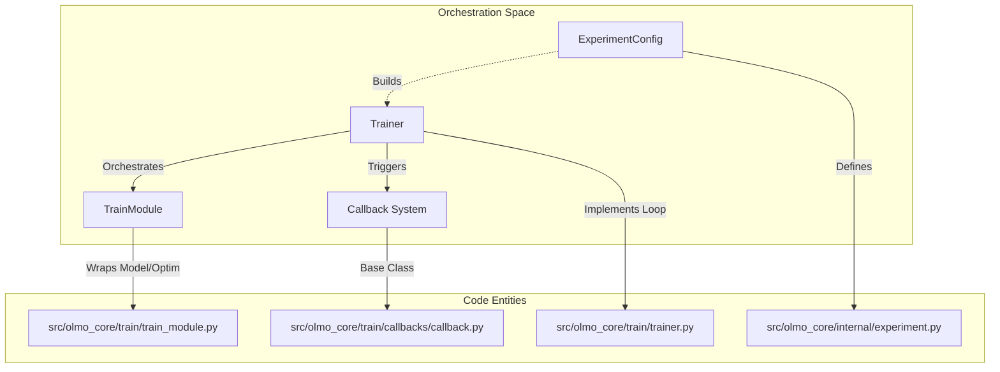
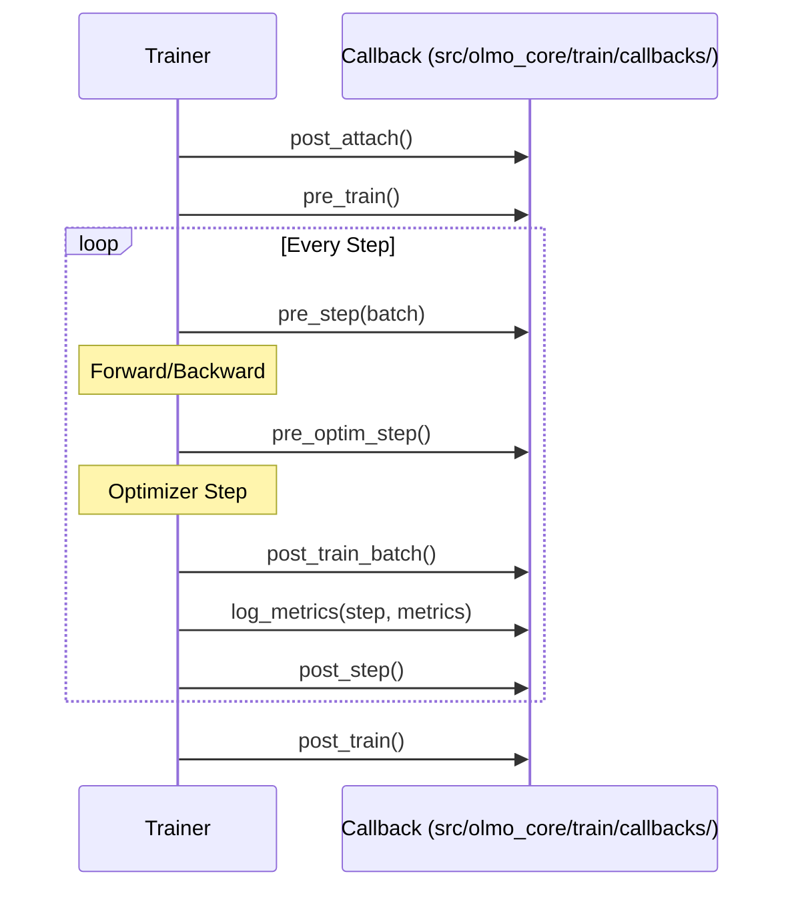

<!-- source: DeepWiki mcp.deepwiki.com · repo allenai/EMO · page 3 Training Infrastructure · fetched 2026-10-26 -->

# Training Infrastructure

Relevant source files

The following files were used as context for generating this wiki page:

- [CHANGELOG.md](CHANGELOG.md)
- [src/olmo_core/internal/common.py](src/olmo_core/internal/common.py)
- [src/olmo_core/internal/experiment.py](src/olmo_core/internal/experiment.py)
- [src/olmo_core/train/callbacks/__init__.py](src/olmo_core/train/callbacks/__init__.py)
- [src/olmo_core/train/callbacks/callback.py](src/olmo_core/train/callbacks/callback.py)
- [src/olmo_core/train/trainer.py](src/olmo_core/train/trainer.py)
- [src/olmo_core/version.py](src/olmo_core/version.py)
- [src/test/conftest.py](src/test/conftest.py)

The EMO training infrastructure is designed for large-scale modular Mixture-of-Experts (MoE) pretraining. It provides a robust, configuration-driven system that orchestrates complex training loops, distributed checkpointing, and extensive monitoring through a flexible callback system.

## System Architecture Overview

The training system is built around three core pillars: the `Trainer`, which manages the execution loop; the `TrainModule`, which abstracts the model and optimization logic; and the `ExperimentConfig`, which provides a unified interface for defining and launching experiments.

### Training Execution Flow
The following diagram illustrates the relationship between the high-level orchestration components and the underlying code entities.

**Training System Orchestration**

Sources: [src/olmo_core/train/trainer.py:99-158](), [src/olmo_core/internal/experiment.py:96-107](), [src/olmo_core/train/train_module.py:1-50](), [src/olmo_core/train/callbacks/callback.py:14-22]()

---

## [Trainer and Training Loop](#3.1)

The `Trainer` class is the central orchestrator of the training process. It manages the `fit()` lifecycle, handling everything from data loading to distributed synchronization and metric reduction.

*   **Lifecycle Management**: The `fit()` method executes the training loop across epochs and steps [src/olmo_core/train/trainer.py:410-450]().
*   **Step Execution**: Each step follows a strict sequence: `pre_step` → `train_batch` → `optim_step` → `post_step`.
*   **Async Bookkeeping**: Uses a `ThreadPoolExecutor` to handle non-blocking IO and metric logging, ensuring that the GPU remains saturated [src/olmo_core/train/trainer.py:9-10]().
*   **Cancellation**: Robustly handles `SIGTERM` and `SIGINT` to ensure checkpoints are saved before exiting.

For details, see [Trainer and Training Loop](#3.1).

---

## [Experiment Configuration and Launch](#3.2)

EMO uses a hierarchical configuration system built on Python dataclasses, allowing for type-safe experiment definitions that can be easily overridden via CLI.

*   **ExperimentConfig**: A top-level container for `ModelConfig`, `DatasetConfig`, and `TrainerConfig` [src/olmo_core/internal/experiment.py:96-107]().
*   **SubCmd**: The system supports various execution modes including `launch` (to Beaker/Slurm), `train` (local execution), `prep` (data preparation), and `dry_run` [src/olmo_core/internal/experiment.py:108-114]().
*   **Cluster Awareness**: Automatically detects environment settings for Weka vs GCS storage and configures GPU types (e.g., H100, B200) [src/olmo_core/internal/common.py:34-45](), [src/olmo_core/internal/common.py:166-170]().

For details, see [Experiment Configuration and Launch](#3.2).

---

## [Checkpointing and IO](#3.3)

The `Checkpointer` provides a high-level interface for saving and loading distributed model states, leveraging PyTorch's distributed checkpointing capabilities.

*   **Atomicity**: Implements a temporary-directory pattern to ensure that checkpoints are only marked as complete once all shards are successfully written.
*   **Distributed Coordination**: Uses barriers and local-rank coordination to manage IO across nodes [src/olmo_core/train/trainer.py:35-46]().
*   **Unified IO**: A single API (`olmo_core.io`) handles local files, S3, GCS, and Weka transparently [src/olmo_core/internal/common.py:10-18]().
*   **Duration System**: Checkpoints can be scheduled based on steps, epochs, or total tokens seen [src/olmo_core/train/trainer.py:158-168]().

For details, see [Checkpointing and IO](#3.3).

---

## [Callbacks System](#3.4)

The callback system allows for modular extension of the trainer without modifying the core loop. Callbacks are prioritized and can be stateful, allowing them to participate in checkpointing.

**Callback Lifecycle and Code Mapping**

Sources: [src/olmo_core/train/callbacks/callback.py:71-160]()

Key built-in callbacks include:
*   `SpeedMonitorCallback`: Tracks MFU and TFLOPS [src/olmo_core/train/callbacks/__init__.py:31]().
*   `WandBCallback` / `CometCallback`: Handles experiment tracking [src/olmo_core/train/callbacks/__init__.py:9-33]().
*   `EvaluatorCallback`: Manages in-loop validation and downstream tasks [src/olmo_core/train/callbacks/__init__.py:12-16]().
*   `HFConverterCallback`: Automatically exports checkpoints to HuggingFace format [src/olmo_core/train/callbacks/__init__.py:22]().

For details, see [Callbacks System](#3.4).

---

## [Optimizers and Learning Rate Schedulers](#3.5)

EMO supports a wide range of modern optimizers and flexible scheduling logic required for stable MoE training.

*   **Optimizers**: Includes `AdamW`, `Lion`, and experimental optimizers like `Muon` and `Dion` [CHANGELOG.md:47]().
*   **Schedulers**: Supports `CosineWithWarmup`, `WSD` (Warmup-Stable-Decay), and `SequentialScheduler` for complex training regimes [src/olmo_core/train/trainer.py:35]().
*   **Matrix-Aware Optimization**: Specialized configurations for handling MoE expert weights differently from dense weights.

For details, see [Optimizers and Learning Rate Schedulers](#3.5).

---

