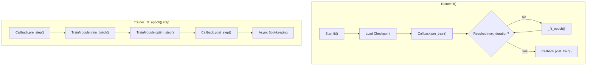
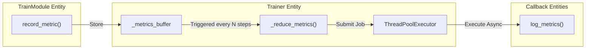

<!-- source: DeepWiki mcp.deepwiki.com · repo allenai/EMO · page 3.1 Trainer and Training Loop · fetched 2026-10-26 -->

# Trainer and Training Loop

Relevant source files

The following files were used as context for generating this wiki page:

- [CHANGELOG.md](CHANGELOG.md)
- [src/olmo_core/train/train_module/__init__.py](src/olmo_core/train/train_module/__init__.py)
- [src/olmo_core/train/train_module/config.py](src/olmo_core/train/train_module/config.py)
- [src/olmo_core/train/train_module/train_module.py](src/olmo_core/train/train_module/train_module.py)
- [src/olmo_core/train/train_module/transformer/common.py](src/olmo_core/train/train_module/transformer/common.py)
- [src/olmo_core/train/train_module/transformer/config.py](src/olmo_core/train/train_module/transformer/config.py)
- [src/olmo_core/train/train_module/transformer/pipeline_train_module.py](src/olmo_core/train/train_module/transformer/pipeline_train_module.py)
- [src/olmo_core/train/train_module/transformer/train_module.py](src/olmo_core/train/train_module/transformer/train_module.py)
- [src/olmo_core/train/trainer.py](src/olmo_core/train/trainer.py)
- [src/olmo_core/version.py](src/olmo_core/version.py)
- [src/test/conftest.py](src/test/conftest.py)

The training infrastructure in EMO is centered around the `Trainer` class, which manages the execution of the training loop, metric collection, and distributed coordination. It interacts with a `TrainModule`, an abstraction that encapsulates the model architecture and optimization logic.

## The Trainer Class

The `Trainer` is the primary orchestrator for the training lifecycle. It handles the transition between epochs, steps, and the asynchronous processing of bookkeeping tasks.

### Lifecycle: fit()

The `fit()` method is the entry point for training. It executes the following high-level flow:
1.  **Signal Handling**: Sets up `SIGTERM` and `SIGINT` handlers for graceful cancellation [src/olmo_core/train/trainer.py:465-470]().
2.  **Checkpoint Loading**: Attempts to load the latest checkpoint from `save_folder` or a specified `load_path` based on the `load_strategy` [src/olmo_core/train/trainer.py:480-503]().
3.  **Callback Initialization**: Calls `pre_train()` on all registered callbacks [src/olmo_core/train/trainer.py:516-518]().
4.  **Epoch Loop**: Iterates through epochs until `max_duration` is reached [src/olmo_core/train/trainer.py:534-565]().
5.  **Cleanup**: Shuts down the asynchronous bookkeeping thread pool and executes `post_train()` callbacks [src/olmo_core/train/trainer.py:567-575]().

### Step Execution: _fit_epoch

Within an epoch, `_fit_epoch` iterates over the `data_loader`. Each step follows a strict sequence:
1.  **pre_step**: Callbacks are notified of the impending step [src/olmo_core/train/trainer.py:651-653]().
2.  **train_batch**: The `TrainModule` executes the forward and backward passes [src/olmo_core/train/trainer.py:656]().
3.  **optim_step**: The `TrainModule` updates model parameters [src/olmo_core/train/trainer.py:663]().
4.  **post_step**: Callbacks are notified, and metrics are recorded [src/olmo_core/train/trainer.py:673-676]().

### Trainer Execution Flow

Sources: [src/olmo_core/train/trainer.py:99-168](), [src/olmo_core/train/trainer.py:441-575](), [src/olmo_core/train/trainer.py:577-704]().

---

## TrainModule Interface

`TrainModule` is an abstract base class (inheriting from `torch.distributed.checkpoint.stateful.Stateful`) that decouples the `Trainer` from specific model implementations.

### Key Methods
*   `train_batch(batch, dry_run)`: Performs the forward pass, calculates loss, and executes `loss.backward()` [src/olmo_core/train/train_module/train_module.py:169-173]().
*   `optim_step()`: Executes the optimizer update and potentially clips gradients [src/olmo_core/train/train_module/train_module.py:183-187]().
*   `zero_grads()`: Resets gradients [src/olmo_core/train/train_module/train_module.py:190-194]().
*   `record_metric(name, value, ...)`: Buffers metrics to be reduced and logged by the trainer [src/olmo_core/train/train_module/train_module.py:213-228]().

### TransformerTrainModule
The standard implementation for EMO models is `TransformerTrainModule`. It handles complex sharding and parallelism strategies:
*   **Parallelization**: Applies FSDP, TP, CP, or EP via `parallelize_model` [src/olmo_core/train/train_module/transformer/train_module.py:162-185]().
*   **Microbatching**: Manages gradient accumulation if the `rank_microbatch_size` is smaller than the global batch size [src/olmo_core/train/train_module/transformer/train_module.py:75-81]().

Sources: [src/olmo_core/train/train_module/train_module.py:73-228](), [src/olmo_core/train/train_module/transformer/train_module.py:65-124]().

---

## Metric Reduction and Bookkeeping

To maximize throughput, the `Trainer` uses an asynchronous thread pool for bookkeeping and metric processing.

### Metric Pipeline
1.  **Collection**: `TrainModule` calls `record_metric` during the step.
2.  **Buffering**: Metrics are stored in a local buffer [src/olmo_core/train/train_module/train_module.py:228]().
3.  **Reduction**: Every `metrics_collect_interval` steps, the trainer reduces metrics across the `dp_process_group` using the specified `ReduceType` (e.g., `mean`, `sum`, `max`) [src/olmo_core/train/trainer.py:200-217](), [src/olmo_core/train/trainer.py:808-835]().
4.  **Async Logging**: The reduced metrics are passed to a `ThreadPoolExecutor` to be logged by callbacks (like WandB or CSV loggers) without blocking the next training step [src/olmo_core/train/trainer.py:716-735]().

### Code Entity Association: Metric Flow

Sources: [src/olmo_core/train/trainer.py:716-750](), [src/olmo_core/train/train_module/train_module.py:213-228](), [src/olmo_core/train/trainer.py:808-835]().

---

## Cancellation and Dry-Run

### Cancellation Handling
The trainer monitors a `cancel_check_interval`. If a `SIGTERM` or `SIGINT` is received, it sets a `canceled` flag. The trainer then attempts to save an ephemeral checkpoint before exiting to allow for seamless resumption [src/olmo_core/train/trainer.py:465-478](), [src/olmo_core/train/trainer.py:706-714]().

### Dry-Run Batch
Before starting the actual training loop, the trainer can execute a "dry-run" batch. This pass initializes lazy modules (like those in `torch.compile` or specific FSDP configurations) and verifies that the model and data loader are compatible without updating weights [src/olmo_core/train/train_module/train_module.py:169-173]().

### Code Entity Association: Trainer Components
| Component | Code Entity | Responsibility |
| :--- | :--- | :--- |
| **Orchestrator** | `Trainer` | Main loop, epoch/step management [src/olmo_core/train/trainer.py:100]() |
| **Logic Wrapper** | `TrainModule` | Forward/Backward/Optimizer logic [src/olmo_core/train/train_module/train_module.py:73]() |
| **State Tracker** | `TrainingProgress` | Tracks steps, tokens, and petaflops [src/olmo_core/train/common.py:76]() |
| **Parallelism** | `DeviceMesh` | Distributed topology for sharding [src/olmo_core/train/train_module/transformer/train_module.py:136]() |
| **Scheduler** | `Scheduler` | Learning rate adjustments [src/olmo_core/train/train_module/transformer/train_module.py:118]() |

Sources: [src/olmo_core/train/trainer.py:100-246](), [src/olmo_core/train/train_module/train_module.py:73-85](), [src/olmo_core/train/train_module/transformer/train_module.py:65-124]().

---

