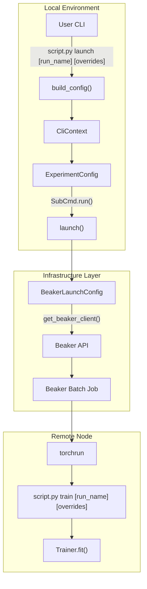
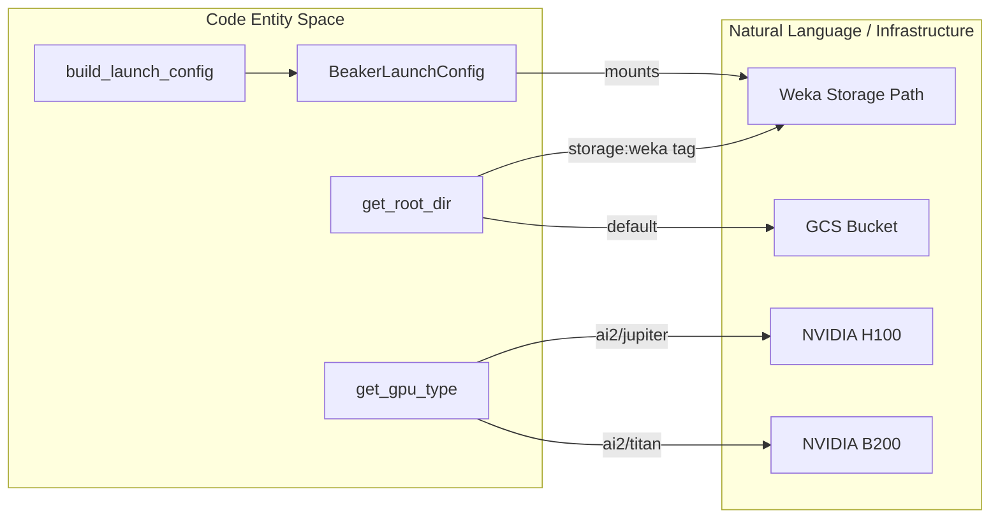

<!-- source: DeepWiki mcp.deepwiki.com · repo allenai/EMO · page 3.2 Experiment Configuration and Launch · fetched 2026-10-26 -->

# Experiment Configuration and Launch

Relevant source files

The following files were used as context for generating this wiki page:

- [.github/workflows/docker.yml](.github/workflows/docker.yml)
- [.github/workflows/main.yml](.github/workflows/main.yml)
- [.github/workflows/pr_checks.yml](.github/workflows/pr_checks.yml)
- [Makefile](Makefile)
- [pyproject.toml](pyproject.toml)
- [src/Dockerfile](src/Dockerfile)
- [src/examples/llama_lns/train.py](src/examples/llama_lns/train.py)
- [src/examples/moe/train.py](src/examples/moe/train.py)
- [src/examples/ngpt/__init__.py](src/examples/ngpt/__init__.py)
- [src/examples/ngpt/train.py](src/examples/ngpt/train.py)
- [src/olmo_core/internal/common.py](src/olmo_core/internal/common.py)
- [src/olmo_core/internal/experiment.py](src/olmo_core/internal/experiment.py)
- [src/olmo_core/launch/beaker.py](src/olmo_core/launch/beaker.py)
- [src/olmo_core/train/callbacks/__init__.py](src/olmo_core/train/callbacks/__init__.py)
- [src/olmo_core/train/callbacks/callback.py](src/olmo_core/train/callbacks/callback.py)
- [src/scripts/train/Llama3-8B.py](src/scripts/train/Llama3-8B.py)
- [src/scripts/train/OLMoE-1B-7B.py](src/scripts/train/OLMoE-1B-7B.py)
- [src/scripts/train/nGPT-1B.py](src/scripts/train/nGPT-1B.py)
- [src/scripts/train/template.py](src/scripts/train/template.py)

This section covers the end-to-end process of defining an experiment in Python, configuring its execution environment (local or Beaker), and launching it. The system relies on a unified `ExperimentConfig` structure and a subcommand-based CLI to manage the transition from local development to large-scale cluster training.

## Experiment Configuration System

The configuration system is built around the `ExperimentConfig` dataclass, which serves as the root container for all components required to run a training job.

### ExperimentConfig Structure
The `ExperimentConfig` encapsulates the model architecture, data pipeline, training logic, and infrastructure requirements.

| Component | Class / Type | Responsibility |
| :--- | :--- | :--- |
| `model` | `TransformerConfig` | Defines NN architecture (layers, heads, MoE, etc.) |
| `dataset` | `NumpyDatasetConfig` | Paths to tokenized data and sequence length settings |
| `data_loader` | `DataLoaderConfig` | Batch size, worker counts, and shuffling seeds |
| `train_module` | `TrainModuleConfig` | Optimizer, scheduler, and parallelism (FSDP/TP) settings |
| `trainer` | `TrainerConfig` | Checkpointing, callbacks, and logging intervals |
| `launch` | `BeakerLaunchConfig` | Cluster-specific hardware and environment settings |

Sources: `[src/olmo_core/internal/experiment.py:96-106]()`, `[src/scripts/train/template.py:87-94]()`.

### The build_config Pattern
Most training scripts implement a `build_config` factory function. This function takes a `run_name` and a list of CLI `overrides`, constructs the base configuration, and applies the overrides using the `merge()` system.

Sources: `[src/scripts/train/template.py:97-194]()`, `[src/examples/ngpt/train.py:70-153]()`.

## CLI and Execution Lifecycle

Experiments are typically managed via a script entry point that utilizes `SubCmd` to determine the execution mode.

### Subcommands (SubCmd)
The `SubCmd` enum defines the primary entry points for an experiment script:
*   `launch`: Submits the experiment to Beaker as a batch job.
*   `train`: Starts the actual training loop (typically called by `torchrun` or inside a Beaker job).
*   `prep`: Runs data preprocessing or cache warming.
*   `dry_run`: Validates the configuration and prints parameter counts without executing training.

Sources: `[src/olmo_core/internal/experiment.py:108-114]()`.

### CliContext and Remote Command Generation
When a job is launched remotely, the `CliContext` tracks the original script and overrides to reconstruct the command for the remote node. The `remote_cmd` property ensures that if a user runs `python script.py launch ...`, the remote node executes `python script.py train ...`.

Sources: `[src/olmo_core/internal/experiment.py:56-71]()`.

### Configuration to Execution Flow

The following diagram illustrates the transition from a Python script to a running Beaker job.

**Experiment Launch Data Flow**

Sources: `[src/olmo_core/internal/experiment.py:116-169]()`, `[src/olmo_core/launch/beaker.py:211-230]()`.

## Cluster-Specific Logic

The system automatically detects and configures environment-specific paths and hardware settings based on the target cluster.

### Root Directory and Storage
The `get_root_dir` function determines where checkpoints and data should reside.
*   **Weka**: If a Beaker cluster has the `storage:weka` tag, it defaults to `/weka/oe-training-default/ai2-llm`.
*   **GCS**: Otherwise, it defaults to Google Cloud Storage (`gs://ai2-llm`).

Sources: `[src/olmo_core/internal/common.py:34-45]()`.

### GPU Type Detection
Hardware constraints are mapped via `CLUSTER_TO_GPU_TYPE`. If a cluster is not explicitly mapped, the system queries the Beaker API to inspect node resources and determine the GPU type (e.g., "NVIDIA H100 80GB HBM3").

Sources: `[src/olmo_core/internal/common.py:166-188]()`.

## Beaker Launch Integration

`BeakerLaunchConfig` defines the requirements for running on AI2's Beaker platform.

### Key Configuration Parameters
*   **Images**: The `OLMoCoreBeakerImage` enum provides stable, versioned Docker images containing pre-built dependencies like `flash-attn`, `transformer-engine`, and `quack-kernels`.
*   **Secrets**: Automatically mounts environment secrets like `BEAKER_TOKEN`, `WANDB_API_KEY`, and cloud credentials (AWS/GCP).
*   **Weka Mounts**: If the `root_dir` starts with `/weka/`, the corresponding bucket is automatically added to `weka_buckets`.

Sources: `[src/olmo_core/launch/beaker.py:130-188]()`, `[src/olmo_core/internal/common.py:56-163]()`.

### Execution Environment Setup
Before execution, `prepare_cli_environment()` or `prepare_training_environment()` is called. This handles:
1.  Setting up `NCCL` environment variables.
2.  Initializing the distributed backend (typically `nccl` for CUDA).
3.  Setting global seeds for reproducibility.

Sources: `[src/olmo_core/internal/experiment.py:122-130]()`, `[src/olmo_core/train/env.py:1-40]()`.

**Infrastructure Configuration Mapping**

Sources: `[src/olmo_core/internal/common.py:34-45]()`, `[src/olmo_core/internal/common.py:166-188]()`, `[src/olmo_core/internal/common.py:56-163]()`.

## Config Merge and Override System

The system allows for flexible experimentation without modifying Python files by using a string-based override system.

1.  **Base Config**: Defined in the script's `build_config`.
2.  **CLI Overrides**: Passed as `key=value` strings (e.g., `model.n_layers=24`).
3.  **Merge Logic**: `ExperimentConfig.merge(overrides)` uses `omegaconf` or similar logic to traverse the dataclass hierarchy and update values.

Sources: `[src/scripts/train/template.py:194]()`, `[src/olmo_core/config.py:1-50]()`.

---

