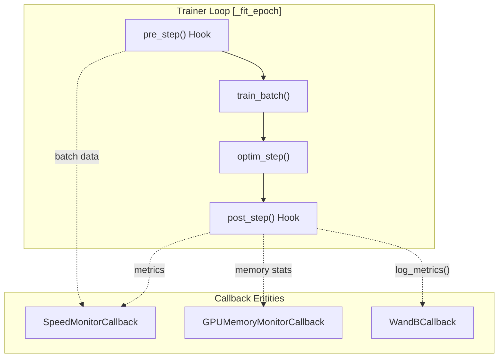
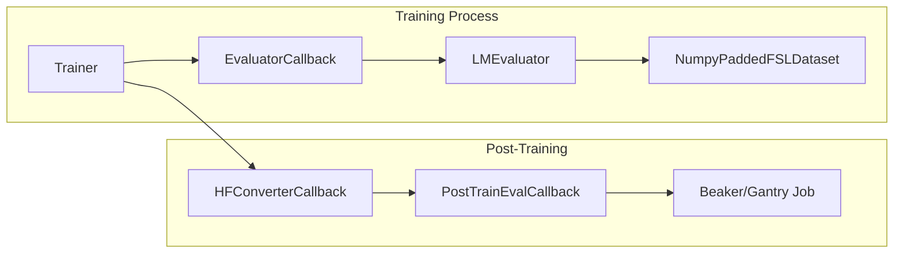

<!-- source: DeepWiki mcp.deepwiki.com · repo allenai/EMO · page 3.4 Callbacks System · fetched 2026-10-26 -->

# Callbacks System

Relevant source files

The following files were used as context for generating this wiki page:

- [CLAUDE.md](CLAUDE.md)
- [docs/source/conf.py](docs/source/conf.py)
- [docs/source/distributed/checkpoint.rst](docs/source/distributed/checkpoint.rst)
- [docs/source/exceptions.rst](docs/source/exceptions.rst)
- [docs/source/io.rst](docs/source/io.rst)
- [docs/source/utils.rst](docs/source/utils.rst)
- [src/examples/llama_lns/__init__.py](src/examples/llama_lns/__init__.py)
- [src/examples/llm/train.py](src/examples/llm/train.py)
- [src/olmo_core/eval/evaluator.py](src/olmo_core/eval/evaluator.py)
- [src/olmo_core/eval/lm_evaluator.py](src/olmo_core/eval/lm_evaluator.py)
- [src/olmo_core/exceptions.py](src/olmo_core/exceptions.py)
- [src/olmo_core/launch/select_beaker_hosts.py](src/olmo_core/launch/select_beaker_hosts.py)
- [src/olmo_core/train/callbacks/batch_size_scheduler.py](src/olmo_core/train/callbacks/batch_size_scheduler.py)
- [src/olmo_core/train/callbacks/beaker.py](src/olmo_core/train/callbacks/beaker.py)
- [src/olmo_core/train/callbacks/comet.py](src/olmo_core/train/callbacks/comet.py)
- [src/olmo_core/train/callbacks/console_logger.py](src/olmo_core/train/callbacks/console_logger.py)
- [src/olmo_core/train/callbacks/evaluator_callback.py](src/olmo_core/train/callbacks/evaluator_callback.py)
- [src/olmo_core/train/callbacks/expert_pool_scheduler.py](src/olmo_core/train/callbacks/expert_pool_scheduler.py)
- [src/olmo_core/train/callbacks/frozen_expert_gradient_mask.py](src/olmo_core/train/callbacks/frozen_expert_gradient_mask.py)
- [src/olmo_core/train/callbacks/frozen_weight_restorer.py](src/olmo_core/train/callbacks/frozen_weight_restorer.py)
- [src/olmo_core/train/callbacks/gap_monitor.py](src/olmo_core/train/callbacks/gap_monitor.py)
- [src/olmo_core/train/callbacks/gpu_memory_monitor.py](src/olmo_core/train/callbacks/gpu_memory_monitor.py)
- [src/olmo_core/train/callbacks/gradient_monitor.py](src/olmo_core/train/callbacks/gradient_monitor.py)
- [src/olmo_core/train/callbacks/metric_saver.py](src/olmo_core/train/callbacks/metric_saver.py)
- [src/olmo_core/train/callbacks/post_train_eval.py](src/olmo_core/train/callbacks/post_train_eval.py)
- [src/olmo_core/train/callbacks/slack_notifier.py](src/olmo_core/train/callbacks/slack_notifier.py)
- [src/olmo_core/train/callbacks/speed_monitor.py](src/olmo_core/train/callbacks/speed_monitor.py)
- [src/olmo_core/train/callbacks/wandb.py](src/olmo_core/train/callbacks/wandb.py)
- [src/olmo_core/train/utils.py](src/olmo_core/train/utils.py)
- [src/scripts/analysis/generate_cluster_viz.py](src/scripts/analysis/generate_cluster_viz.py)
- [src/scripts/analysis/generate_token_cluster_viz.py](src/scripts/analysis/generate_token_cluster_viz.py)
- [src/scripts/clustering/visualize.py](src/scripts/clustering/visualize.py)
- [src/scripts/inspect_tensor.py](src/scripts/inspect_tensor.py)
- [src/test/launch/beaker_test.py](src/test/launch/beaker_test.py)
- [src/test/train/utils_test.py](src/test/train/utils_test.py)

The EMO training infrastructure utilizes a flexible callback system to decouple core training logic from auxiliary tasks such as logging, checkpointing, evaluation, and hardware monitoring. Callbacks are executed at specific hooks within the `Trainer` lifecycle.

## Callback Base Class

All callbacks inherit from the `Callback` base class. This abstraction allows for stateful components that can participate in the training loop and handle distributed coordination.

### Lifecycle Hooks
Callbacks can implement several methods that the `Trainer` calls at specific points:
- `pre_train()`: Executed once before the training loop starts.
- `post_train()`: Executed once after the training loop finishes successfully.
- `pre_step()`: Executed before each training step.
- `post_step()`: Executed after each training step.
- `on_error()`: Executed if an exception occurs during training.

### Key Properties
- **Priority**: Callbacks have a `priority` attribute (integer) that determines the execution order. Lower values run first for "pre" hooks and later for "post" hooks [src/olmo_core/train/callbacks/speed_monitor.py:28-28]().
- **Statefulness**: Callbacks can implement `state_dict()` and `load_state_dict()` to persist their internal state across checkpoints [src/olmo_core/train/callbacks/comet.py:136-141]().
- **Cancellations**: Callbacks can trigger run cancellations via `self.trainer.cancel_run()` [src/olmo_core/train/callbacks/wandb.py:174-174]().

### Data Flow: Trainer to Callback
The following diagram illustrates how the `Trainer` interacts with the `Callback` system during a single training step.

**Trainer-Callback Interaction Loop**

Sources: [src/olmo_core/train/callbacks/speed_monitor.py:121-122](), [src/olmo_core/train/callbacks/gpu_memory_monitor.py:47-47](), [src/olmo_core/train/callbacks/wandb.py:144-144]().

---

## Logging and Monitoring Callbacks

### SpeedMonitorCallback
Calculates throughput metrics including Tokens Per Second (TPS), Model Flops Utilization (MFU), and data loading overhead [src/olmo_core/train/callbacks/speed_monitor.py:19-21]().
- **MFU Calculation**: Estimates peak FLOPS based on device name (e.g., H100, B200, A100) and compares against actual training throughput [src/olmo_core/train/callbacks/speed_monitor.py:92-113]().
- **Automatic Insertion**: This callback is added automatically by the trainer if not explicitly configured [src/olmo_core/train/callbacks/speed_monitor.py:23-26]().

### GPUMemoryMonitorCallback
Tracks GPU memory utilization (active vs. reserved) and monitors for CUDA OOM errors or allocation retries [src/olmo_core/train/callbacks/gpu_memory_monitor.py:13-16]().
- **Metrics**: Records `gpu_memory/GPU active mem (GiB)` and `gpu_memory/GPU active mem (%)` [src/olmo_core/train/callbacks/gpu_memory_monitor.py:53-54]().

### WandBCallback & CometCallback
Integrations for Weights & Biases and Comet.ml.
- **Rank 0 Only**: Logging and API communication are restricted to the global rank 0 process [src/olmo_core/train/callbacks/wandb.py:141-142]().
- **Remote Cancellation**: Monitors for specific tags (e.g., "cancel") on the web UI to stop the training job remotely [src/olmo_core/train/callbacks/wandb.py:162-175](), [src/olmo_core/train/callbacks/comet.py:200-208]().

Sources: [src/olmo_core/train/callbacks/speed_monitor.py:19-116](), [src/olmo_core/train/callbacks/gpu_memory_monitor.py:13-81](), [src/olmo_core/train/callbacks/wandb.py:21-178](), [src/olmo_core/train/callbacks/comet.py:48-229]().

---

## Evaluation Callbacks

### EvaluatorCallback
Runs in-loop evaluations periodically. It supports `LMEvaluator` for perplexity and cross-entropy loss tracking [src/olmo_core/train/callbacks/evaluator_callback.py:45-49]().
- **Determinism**: Logs the `first_batch_hash` and global instance indices to verify that evaluation data is consistent across different training runs [src/olmo_core/train/callbacks/evaluator_callback.py:148-165]().
- **Execution**: Can be configured to run on startup, on finish, or at fixed step intervals [src/olmo_core/train/callbacks/evaluator_callback.py:56-74]().

### PostTrainEvalCallback
Launches downstream evaluation jobs (e.g., ARC, MMLU, GSM8K) on Beaker after training completes [src/olmo_core/train/callbacks/post_train_eval.py:71-74]().
- **HF Dependency**: Expects an HF-format checkpoint to exist, typically created by `HFConverterCallback` [src/olmo_core/train/callbacks/post_train_eval.py:75-76]().
- **Priority**: Set to `-2` to ensure it runs after the converter (priority `-1`) [src/olmo_core/train/callbacks/post_train_eval.py:86-86]().

**Evaluation Data Flow**

Sources: [src/olmo_core/train/callbacks/evaluator_callback.py:45-165](), [src/olmo_core/train/callbacks/post_train_eval.py:71-150](), [src/olmo_core/eval/lm_evaluator.py:14-40]().

---

## Infrastructure and Specialized Callbacks

### BeakerCallback
Synchronizes training progress and metadata with the Beaker experiment description [src/olmo_core/train/callbacks/beaker.py:25-28]().
- **Metadata Integration**: Adds Beaker experiment URLs to WandB/Comet configurations [src/olmo_core/train/callbacks/beaker.py:69-85]().
- **Requirements Logging**: Saves `requirements.txt` and `config.json` to the Beaker results dataset [src/olmo_core/train/callbacks/beaker.py:91-112]().

### ExpertPoolSchedulerCallback
Used in EMO research to dynamically adjust the number of active experts in a Mixture-of-Experts model during training.
- **Functionality**: Updates the `active_experts` count in the `MoELayer` based on a predefined schedule or training progress.

### FrozenExpertGradientMaskCallback
Supports selective fine-tuning by masking gradients for specific experts.
- **Implementation**: Applies a binary mask to the `.grad` attribute of expert parameters during the `post_step` or `pre_step` hooks to prevent updates to "frozen" experts.

### GAPMonitorCallback
Monitors the "Generalization Gap" by comparing training loss against validation loss in real-time.

Sources: [src/olmo_core/train/callbacks/beaker.py:25-165](), [src/olmo_core/launch/select_beaker_hosts.py:132-160]().

---

